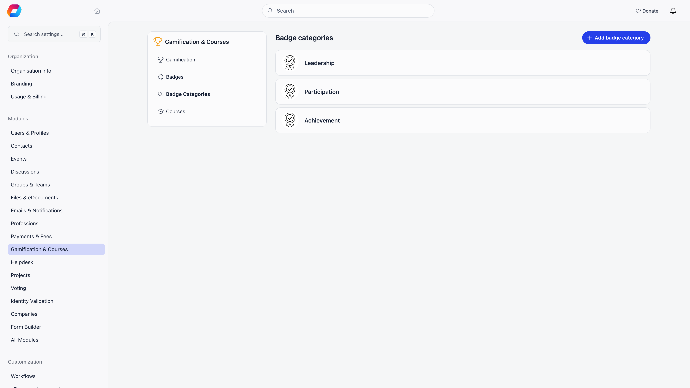
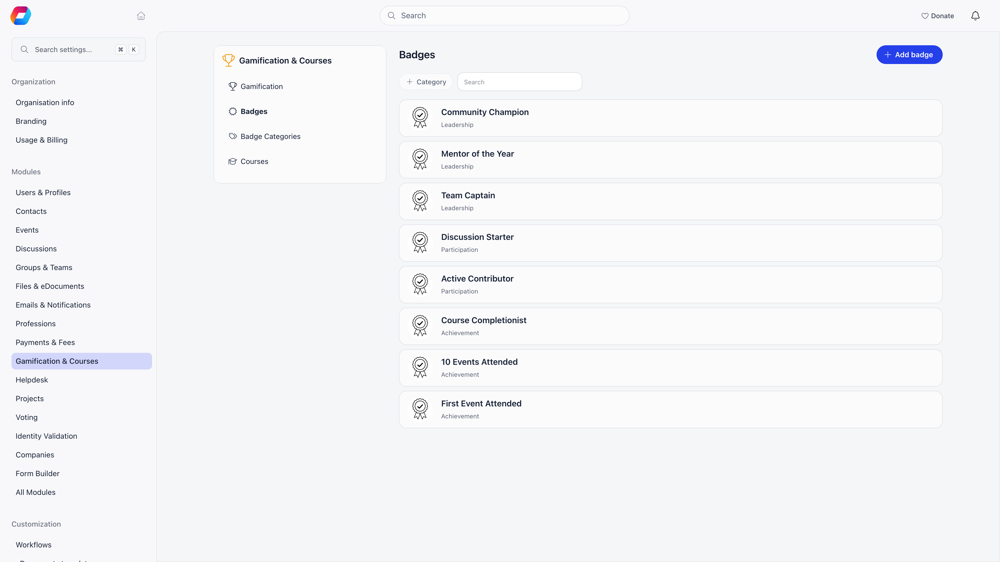
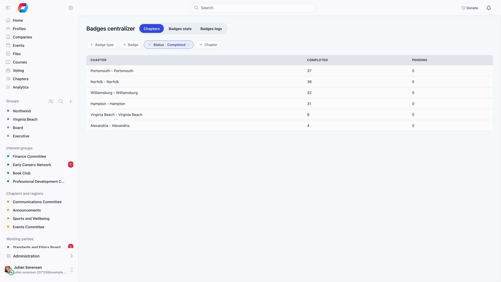

A badge is a named, illustrated award attached to a member's profile. You define the catalogue once, then badges reach members either because someone gives them out or because Orgo awards them from something the member did: an event attended, a course finished, or every step of a checklist completed.

**Built for** organizations that already recognise members informally (training passed, levels reached, skills signed off) and want that recognition on the member record instead of in a spreadsheet.

**Replaces** the certificates spreadsheet and the "who is first aid certified?" email thread. It is not a qualifications register: a badge has no expiry date and no renewal.

Badges need the Gamification module. Turn it on at **Settings** → **Modules** → **Gamification & Courses** → **Gamification** with **Enable Gamification Module**. That settings area needs `ADMIN_TENANT`. The other switches on that screen (categories, checklists, awards, member levels) are listed in [Gamification](/platform/gamification#turning-it-on).

<Note>
Volunteering-hours tracking no longer exists. The **Enable hours tracking** switch, the **Hours number** badge field, **Add volunteering hours** and the automatic award from an hours total were removed, and the volunteering hour logs that members had were deleted with them. A badge that used to have an hours threshold is now an ordinary badge: it stays on every profile that already holds it, but nothing awards it automatically any more. Badge points and point rules are not affected.
</Note>

---

## Categories and badges

Badges can be grouped into categories, which is optional and controlled by the **Enable badge categories** switch. A category has only an image and a title. Its job is to keep the award picker usable once you have more badges than fit on a screen.

**Settings** → **Modules** → **Gamification & Courses** → **Badge Categories**

Badges themselves live one level down, at **Settings** → **Modules** → **Gamification & Courses** → **Badges**. Each row shows the artwork and name, the category when categories are on, and a points pill on badges that have a points threshold.

| Field | What it does |
|---|---|
| Image | Circular badge artwork, cropped on upload |
| **Title** | The badge name. Required, saving without one is blocked |
| **Badge type** | The category. Shown only when **Enable badge categories** is on |
| **Points required** | Makes the badge a membership tier, see [Gamification](/platform/gamification#tiers). Shown only for organisations that have tiers |
| **Kind** | **Badge** or **Award**. Shown only when **Awards** is on, see [Awards](#awards-and-member-levels) |
| **Member level** | Which member level (user type) the badge belongs to, or **Any level**. Shown only when **Badges by user type** is on |
| **Default note explanation** | Pre-fills the note when someone awards this badge, so the same wording is used every time |
| **Complete the badge automatically when every required step is completed** | Shown only when checklists are on, see [Checklists of steps](#checklists-of-steps) |
| **Checklist** | The steps editor with its **Add step** button. Shown only when checklists are on, and only once the badge is saved |

Creating, editing, and deleting badges and categories all need `ADMIN_TENANT`.

<Warning>
Deleting a badge also deletes every award of it from every member. Deleting a category deletes the badges filed under it, and their awards with them. Courses and events that pointed at a deleted badge simply lose the link.
</Warning>

---

## Awarding a badge

### By hand

Open the member. There are two places to start:

- On the **Achievements** card of the profile, click the **+** button (**Add badge**).
- In the profile's edit panel, open the **Badges** tab and click **Add badge**.

The **Add badge** window opens, headed with the member's name. It has two halves.

**Left half, the list.** A **Search badges** box, category chips with counts when categories are on (**All**, each category, **No category**), and every badge in the catalogue sorted into three groups by what this member already has:

| Group | What it means | Can you pick it? |
|---|---|---|
| **In progress** | The member holds it as **Pending**. A progress bar shows steps done when the badge has a checklist | No |
| **Available** | The member does not hold it | Yes |
| **Already earned** | The member holds it as **Completed**, with the date | No |

**Right half, the award.** It reads **Choose a badge from the list** until you pick one, then shows:

| Field | Notes |
|---|---|
| Checklist | Only when checklists are on and the badge has steps, see [Checklists of steps](#checklists-of-steps) |
| **Status** | **Completed** or **Pending**, defaulting to Completed |
| **Date completed** | Pre-filled with today, and editable by hand. Back-dating is allowed. Leaving it empty is fine: a new award is stamped with the moment you save it |
| **Notes** | Pre-filled from the badge's default note when it has one. The placeholder reads "e.g. completed at the summer camp" |

Click **Save**. A save that fails leaves the window open and reports the error, so an award that does not appear in the table was not quietly dropped. Pending is for work in progress: the member holds the record, and it is counted and filtered separately from completed awards everywhere it appears.

Because only **Available** badges can be picked, this window cannot give a member a second copy of a badge they already hold. To finish a pending award, open it (see [Changing or removing an award](#changing-or-removing-an-award)).

Who can award: the **Achievements** card button and the window itself need `HR_LOCAL` or `HR_ASSISTANT_LOCAL` on the member's local center; the **Badges** tab button shows for `HR_TENANT` and for `HR_LOCAL` on the member's local center. Awarding is checked again by the server when you save: it needs `HR_ASSISTANT_LOCAL` over that member's local center, which `HR_LOCAL`, `FINANCIAL_LOCAL` and `ADMIN_LOCAL` all satisfy, or one of the tenant-wide equivalents. Every award stores who gave it, shown as **Offered by** in the award's details and **Given by** in the centralizer.

Nobody is notified when a badge is awarded or removed, so announce the ones that matter yourself.

### From an event

An event can award a badge to everyone marked as attending. This needs **Enable badge per event** on, and the event form's **Gamification** section, which is visible to `EVENT_TENANT` and appears only for organisations that have [tiers](/platform/gamification#tiers) enabled. In that section, **Award badge on event attendance** takes the badge. Participants receive it, as Completed, when their attendance is set to Attended. If the attendance is deleted or moved away from attending, the badge is removed again.

### From a course

With the Gamification module on, a saved course gains **Award badge on completion**. Students receive it when their enrollment is marked complete, and the course page then shows the badge as earned. Deleting a completed enrollment removes the badge.

### From a checklist

A badge with a checklist can complete itself: when every required step is marked completed, the award becomes Completed. See below.

<Note>
A member can hold a given badge only once. Every automatic path checks first and skips if the badge is already on the profile, so re-marking attendance will not create duplicates.
</Note>

---

## Checklists of steps

A checklist turns a badge into a short programme: a list of steps the member works through, with progress recorded step by step. A first aid badge might have "Attend the course", "Pass the written test", "Complete the practical", with the last one optional.

Checklists are off by default. Turn them on with **Badges with a checklist of steps** in **Settings** → **Modules** → **Gamification & Courses** → **Gamification**. Badges that have no steps keep working exactly as before.

### Defining the steps

Open a badge (**Settings** → **Modules** → **Gamification & Courses** → **Badges**, then edit) and use the **Checklist** editor at the bottom. Save the badge first, because a new badge has nothing to attach steps to. Defining steps needs `ADMIN_TENANT`.

| Control | What it does |
|---|---|
| **Add step** | Opens a window with **Title**, **Description**, and a switch **Optional**, which stops the step blocking the badge from completing |
| Drag a row | Reorders the steps. Steps are numbered by position |
| Pencil / bin icons | Edit a step, or remove it |
| **Complete the badge automatically when every required step is completed** | On: the award's status follows the steps. Off: steps are only a record, and someone sets the status by hand |

Removing a step deletes it, unless members have already recorded progress on it. In that case it is archived instead: their history stays readable, and the step no longer counts towards anyone's progress.

### Recording progress

Each step has three states: **Not started**, **Began**, **Completed**. Every change stamps the date, the time and who made it, shown under the step. Open an award (click it in the table, or on the profile) to see its checklist.

| Who | Can record steps |
|---|---|
| `HR_ASSISTANT_LOCAL` over the member, or `HR_ASSISTANT_TENANT` | Always |
| The member themselves | Only while **Members may record their own progress** is on (it appears under the checklist switch and is on by default) |

When the switch is off, the member sees the checklist read-only with the message "Only a leader can record progress on this badge".

With **Complete the badge automatically** on, progress moves the award in both directions: marking the last required step Completed turns the award to Completed, and re-opening a required step puts it back to Pending. While the badge is automatic, the **Status** buttons in the Add badge window are locked and show "All steps are marked done" or "n / m required steps" instead. Optional steps never block completion. A badge with only optional steps has no required steps, so it is never completed automatically.

### Where progress shows

- In the badges table, a badge with a checklist shows one numbered dot per step beside its status: green for completed, amber for began, empty for not started (with a dashed outline when the step is optional).
- On the **Achievements** card, **Achievements in progress** lists each pending badge with a progress bar, and **Recent activity** lists badges earned, awards received, badges started, and steps began or completed. Both appear only when checklists are on.

---

## Awards and member levels

Two optional switches change how earned badges are counted and grouped on a profile.

| Switch | Effect |
|---|---|
| **Awards** | Each badge gets a **Kind**: **Badge** or **Award**. The **Achievements** card then counts them separately ("badges" and "awards"). With the switch off, **Kind** is ignored and the card shows one list |
| **Badges by user type** | Each badge gets a **Member level** (a user type, or **Any level**). The **Achievements** card gains a tab per member level in which the member has earned a badge, plus **All**. With only one level there are no tabs |

---

## Changing or removing an award

Click an award to open its details: the badge, its **Status**, **Offered by**, **Date completed**, **Required Points** when it is a tier badge, and the checklist when there is one. The **Notes** field is visible only to people who manage badges.

| Action | How | Needs |
|---|---|---|
| Switch Completed or Pending | The **Status** buttons, which save at once | `HR_LOCAL` on the member's local center |
| Change date or notes | **Edit**, then **Save** | `HR_LOCAL` on the member's local center |
| Remove the award | **Delete**, then confirm | `HR_LOCAL` on the member's local center |

The server itself accepts these changes from `HR_ASSISTANT_LOCAL` over the member, or from the person who gave the badge. A member can open their own awards to read them and, when allowed, tick checklist steps, but cannot change the award.

---

## Where badges show up

On a member profile with Gamification on, the **Achievements** card shows earned badges as pictures, with the name on hover. Click one for its details. People who manage badges also get **Manage**, which turns the pictures into a table with the badge (and its category), the status, and the date. Badges that have a points threshold are tiers: they appear in the **Membership level** card instead, see [Gamification](/platform/gamification#tiers).

The profile's edit panel has a **Badges** tab (for `HR_ASSISTANT_LOCAL` over the member) with the same table and the **Add badge** button.

**Badges** in the sidebar (`/badge-users`) is the tenant-wide view, shown to `HR_ASSISTANT_LOCAL` and above once the module is on. Filter by category, badge, Completed or Pending, and local center, then read across three tabs.

| Tab | What it shows |
|---|---|
| **Local centers** | Completed and pending counts per local center. The tab is labelled with whatever your organisation calls its local centers, so it reads **Chapters** where that is the word in use. Only when the Local Centers module is on |
| **Badges stats** | Completed and pending counts per badge, sortable, 30 rows a page |
| **Badges** | Individual awards: badge, member, who gave it, and when. 100 rows a page |

Someone whose HR permission is local-only sees just the awards for members of their own local center.

---

## Common questions

<AccordionGroup>
  <Accordion title="How do I give a member a badge?">
    Open the member, click the **+** on the **Achievements** card (or **Add badge** on the **Badges** tab of the edit panel), pick a badge from the list, set the status, date and notes, and click **Save**. You need `HR_LOCAL` or `HR_ASSISTANT_LOCAL` over the member's local center.
  </Accordion>

  <Accordion title="Can I track or award badges for volunteering hours?">
    No. Hours tracking was removed from Orgo: there is no hours field on a badge, no way to log hours on a member, and no badge is awarded from an hours total. To recognise participation, award a badge by hand, from event attendance, from a course completion, or from a checklist.
  </Accordion>

  <Accordion title="Why can't I pick a badge in the Add badge window?">
    The member already holds it. Badges they have as Pending sit under **In progress**, and those they have as Completed under **Already earned**, and neither can be picked again. To finish a pending award, open it and set **Status** to Completed (or complete its checklist).
  </Accordion>

  <Accordion title="Can members request a badge or give one to themselves?">
    There is no request flow and no self-service button. Badges come from an admin with HR permission, or from one of the automatic paths above. The one thing a member can do themselves is tick off the steps of a checklist badge they hold, and only while **Members may record their own progress** is on.
  </Accordion>

  <Accordion title="Can I revoke a badge?">
    Yes. Click the award, then **Delete**. Nobody is notified, so explain it directly if the reason matters.
  </Accordion>

  <Accordion title="What is the difference between a badge and an award?">
    Only a label. With the **Awards** switch on, you mark each badge as a **Badge** or an **Award**, and the profile counts the two separately. Both are given and removed in the same way.
  </Accordion>

  <Accordion title="How do I add a checklist to a badge?">
    Turn on **Badges with a checklist of steps** in the Gamification settings, edit the badge, and use **Add step** in the **Checklist** editor. Save the badge first if it is new.
  </Accordion>

  <Accordion title="Why does a badge go back to Pending after I re-open a step?">
    The badge is set to complete automatically when every required step is completed, so the status follows the steps in both directions. Complete the step again and it returns to Completed. Turn the automatic switch off on the badge if status should be set by hand.
  </Accordion>

  <Accordion title="Can I load our existing badge history?">
    Yes. The import tool has three badge entities: Badge Types, Badges, and Badge Assignments, each with a downloadable example file. Import categories and badges first, then the assignments.
  </Accordion>

  <Accordion title="Why is there no Badges tab or Achievements card on the member profile?">
    The Gamification module is off, or you lack permission. Turn the module on under Settings, Modules, Gamification &amp; Courses. The **Badges** tab also needs `HR_ASSISTANT_LOCAL` over the member.
  </Accordion>

  <Accordion title="Why can a colleague see fewer awards than I do in the centralizer?">
    They hold a local-level HR permission, so the list and the local center filter are limited to their own local center. Tenant-level HR sees everything.
  </Accordion>
</AccordionGroup>

---

## Related

- [Gamification](/platform/gamification) - Points, tiers, and the leaderboard
- [Courses](/platform/courses) - Award a badge when a course is completed
- [Event attendance](/platform/events/attendance) - Award a badge to everyone marked as attended
- [Members](/platform/users) - The profile where badges appear
- [Permissions](/platform/permissions) - What HR_LOCAL and HR_ASSISTANT_LOCAL cover
