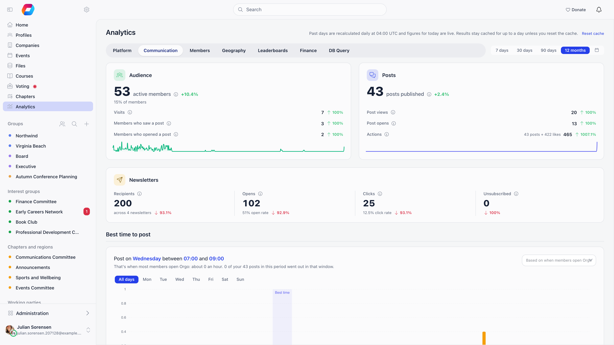
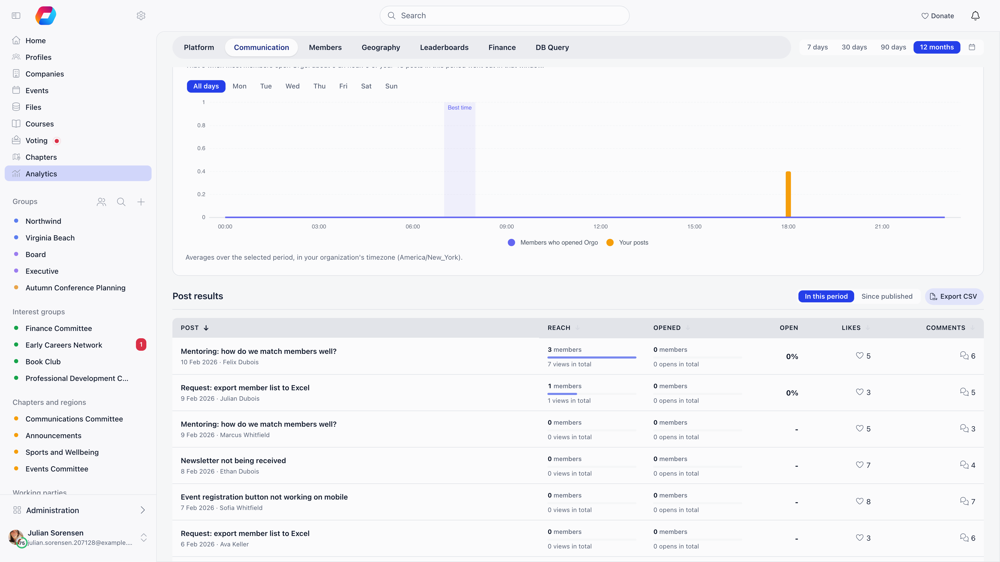

The **Communication** tab of **Analytics** answers the questions an organization
asks about its own channels. How many members actually open Orgo? Are the posts
we publish being seen, opened and liked? When is the best moment to post? How did
the newsletters do over the same period?

**Built for** the people who run an organization's communication and want to
judge what works without exporting data into a spreadsheet.

**Replaces** guessing at a posting schedule, and adding up newsletter reports by
hand.

---

## Where to find it

Open **Analytics** in the sidebar and choose the **Communication** tab. It sits
next to **Platform** and **Members**.

The tab is hidden unless all of these are true:

- the analytics module is switched on;
- you clear the analytics **Minimum access level**;
- you hold the role set for the **Communication** tab. By default that is
  organization admins.

The role is one of the analytics settings on **Settings** → **Modules** → **Users
& Profiles** → **Security & Permissions**, next to the ones for the other tabs.
These are configuration screens, so changing them needs the **Orgo administrator**
flag on your account. See [Permissions](/platform/permissions) and
[Insights & Ask Orgo](/platform/insights) for how the other tabs are gated.

<Note>
The figures on this tab cover the whole organization, not one chapter. Giving the
role to someone below organization admin shows them the totals, the best-time
chart and the newsletter numbers, but never the list of individual posts. The
post list names every post in the feed, private groups included, so it is for
organization admins only.
</Note>

---

## Choosing the period

The pills at the top pick **7 days**, **30 days**, **90 days**, **12 months** or a
custom range (the calendar icon). A custom range can cover at most two years.

Every figure on the tab is compared with the period of the same length just
before it. A small arrow and a percentage show the change: an arrow up is growth
and an arrow down is a fall. When the earlier period had nothing in it,
any growth reads as 100%.

Figures are read live and kept for five minutes. **Reset cache** next to the page
title re-reads them straight away.

---

## The three summary cards

### Audience

| Figure | What it counts |
|---|---|
| **Active members** | Members who opened Orgo at least once in the period, each counted once. Beside it, the share of all your members that this represents |
| **Visits** | Every time a member opened Orgo after at least 30 minutes away, so one member can make several visits in a day |
| **Members who saw a post** | Members who had at least one post on screen in the feed, each counted once |
| **Members who opened a post** | Members who opened at least one post, each counted once |

A small chart under the card shows active members for each day of the period.

### Posts

| Figure | What it counts |
|---|---|
| **Posts published** | Posts published in the period, as the dashboard feed lists them. Help desk tickets, issues, archived posts and posts held or hidden by moderation are not counted |
| **Post views** | Times a post was on screen in the feed for at least a second, repeats and older posts included |
| **Post opens** | Times a post was opened, repeats and older posts included |
| **Actions** | Posts published plus likes given in the period |

A view is counted when at least half of a post card stays on screen for a full
second, once each time the card appears. Two things are never counted: a member
looking at their own post, and an administrator who is browsing as another member.
A post the member could not see in their own feed is never counted either.

Likes are every reaction on a post, whichever of the five reactions was used.

### Newsletters

| Figure | What it counts |
|---|---|
| **Recipients** | Everyone the newsletters sent in the period went to, added up across newsletters, with the number of newsletters beside it |
| **Opens** | Recipients who opened each newsletter, added up, with the average open rate |
| **Clicks** | Recipients who clicked a link in each newsletter, added up, with the average click rate |
| **Unsubscribed** | Recipients who unsubscribed through one of these newsletters |

These are the same figures as the tiles above the campaign list in
[Newsletter](/platform/newsletter), added up for the period and compared with the
period before. They include every campaign of the organization, chapter campaigns
too.

---

## Best time to post

A chart of the average week shows when your members are active, by day and by
hour, in your organization's timezone. Above it, a sentence names the busiest day
and the busiest two hours, for example "Post on Tuesday between 18:00 and 20:00",
with the reason ("that's when most members open Orgo: about 40 an hour") and how
many of your own posts in the period went out in that window.

The selector beside it chooses what the chart is based on:

- **when members open Orgo**, the default;
- **when posts are seen**;
- **when posts are opened**;
- **when posts are liked**.

Use the day pills to look at **All days** together or at one weekday on its own.
The chart marks the hours in which you actually published, under **Your posts**,
so you can compare when you post with when members are around. The values are
averages over the period: each hour's total divided by how many times that
weekday and hour came round.

A longer period smooths out one-off events, so a single busy day does not decide
the recommendation.

---

## Post results

Organization admins also see a table of every post in the period, one row per
post.

| Column | What it shows |
|---|---|
| **Post** | Title, publication date and author. A post published before the period started carries an **older** tag, because its views and opens in the period still count |
| **Reach** | Members who saw the post, each counted once, with a bar against the busiest post and the total number of views beside it |
| **Opened** | Members who opened the post, with the total number of opens |
| **Open rate** | Members who opened it as a share of members who saw it. A dash means nobody saw it |
| **Likes** | Reactions on the post |
| **Comments** | Comments and replies, not counting the post itself |

Select a column heading to sort, and select a row to open the post. The table
shows 10 posts a page. The two pills above it switch the figures between **In
this period** and **Since published**, which counts everything the post has
collected since it went up.

**Export CSV** downloads every post of the period in one file, with both sets of
figures side by side: the period figures and the since-published figures, each
with reach, times shown, opened by, times opened, likes and comments. The
publication time is in your organization's timezone. Each export is recorded in
the activity log.

---

## When the numbers start

Views, visits and repeat opens are counted only from the day Orgo released this
tab to your organization. A period that starts earlier shows nothing for those
figures before that day, and the chart says so when there is nothing to show yet.
Active members, posts published, likes, comments and the newsletter figures come
from records that already existed, so they cover the whole period.

---

## Common questions

<AccordionGroup>
  <Accordion title="The Communication tab is missing">
    Check the three conditions under [Where to find it](#where-to-find-it). The
    usual cause is the role: it defaults to organization admins, and chapter
    admins or communication managers do not see the tab unless an Orgo
    administrator has lowered it.
  </Accordion>

  <Accordion title="Active members is much bigger than members who saw a post">
    That is normal. Active members counts anyone who opened Orgo at all. Many
    members come for an event or their profile and never reach the feed. The gap
    is a measure of how much of your audience the feed actually reaches.
  </Accordion>

  <Accordion title="A post has opens but no views">
    A post can be opened from a notification, a link or the group page without
    ever appearing as a card in the feed. Views come only from the feed, so such a
    post shows opens with a low or empty reach.
  </Accordion>

  <Accordion title="Post views look lower than I expected">
    A post counts as seen only when half of it stays on screen for a second, so
    scrolling past quickly does not count. Your own posts and views by an
    administrator browsing as someone else are left out as well.
  </Accordion>

  <Accordion title="Why is the post list missing for a colleague who has the tab?">
    The list shows the title of every post in the organization, including private
    groups, so it is limited to organization admins even where the tab itself has
    been opened to a wider role.
  </Accordion>
</AccordionGroup>

---

## Related

- [Insights & Ask Orgo](/platform/insights) for the other Analytics tabs and for asking questions in plain language
- [Newsletter](/platform/newsletter) for the campaign reports behind the newsletter card
- [Discussions](/platform/discussion) for the posts, comments and reactions this tab measures
- [Permissions](/platform/permissions) for the Orgo administrator flag and the roles used above
