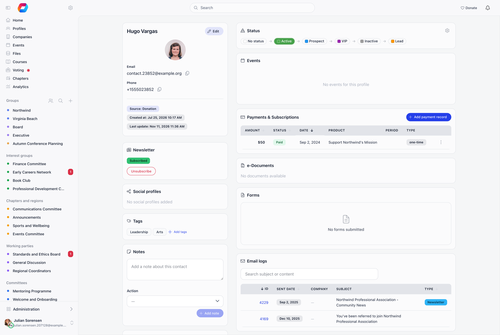

**Built for** organisations who take money from people outside their membership.

A contact has no login, no password and no member profile, and can still pay you
for almost everything you sell. Donations, event tickets, invoices and recurring
subscriptions all work with a contact as the payer. There is exactly one thing a
contact can never hold, and it is the thing people most often assume they can.

---

## A contact can never hold a membership fee

<Warning>
Membership fees belong to members and to companies. A contact record has no fee
validity date and no membership status, so no payment made by a contact can ever
put them in good standing. A fee payment records a member as its payer.
</Warning>

The practical consequence is simple. If you need any of the following for a
person, that person has to be a member, not a contact:

- a membership validity date and an active or lapsed status
- the renewal ladder and its reminder emails
- membership inherited from a company
- inclusion in the paying-members figures on Insights

Turning a contact into a member is a separate job with its own rules about what
moves across. See
[Becoming a member](/platform/contacts/becoming-a-member).

<Note>
Do not sell a membership fee product to an address that is not a member. A fee
purchase made from an email Orgo cannot match to a member does not become a fee
record. Take fee money through the member's own account, or use **Mark as paid**
on their **Fee** tab. See [Recording a payment made outside Orgo](/platform/fees/record-payment).
</Note>

---

## Money follows the email

Every checkout in Orgo resolves its payer the same way, whether it is a donation
page, an event ticket, an invoice or a Stripe charge.

<Steps>
  <Step title="Look for a member">
    The payer's email is matched against members in your organisation. A match
    books the payment to that member.
  </Step>
  <Step title="Otherwise look for a contact">
    No member match, so Orgo looks for a contact with that email in your
    organisation.
  </Step>
  <Step title="Otherwise create one">
    No contact either, so a contact is created there and then, stamped with the
    source that produced it (Donation, Event or Stripe), and the money is booked
    against it.
  </Step>
</Steps>

A payment from a complete stranger is therefore never orphaned. It arrives with a
contact record attached to it. This is why your contacts list grows every time
you run a public campaign.

One safeguard is worth knowing. When the email does match an existing member, an
anonymous public checkout is not allowed to rewrite that member's name or their
stored identity details. Only that member, signed in, can change them.

---

## What a contact can pay for

| Type | How it happens | Notes |
|---|---|---|
| **Donations** | Public donation page, one-off or recurring | The donor is created as a contact at the point the payload is built, before the card is charged |
| **Event tickets** | Card checkout, free registration, or pay by invoice | A contact can be the buyer, the attendee, or both, and can buy tickets for other people |
| **Invoices** | An invoice raised with a contact as the payer, including event registration invoices settled by bank transfer | An invoice has one payer: a member, a contact, or a company |
| **Subscriptions** | A recurring product bought without an account | Each period's charge creates a payment against the contact |
| **Payments you record by hand** | **Add payment record** on the contact record | Needs an organisation-wide financial manager. Choose a **Payment type** when you enter a custom item |
| **Membership fees** | Not possible | See the boundary above |

---

## Where a contact's money shows up

**On the contact record.** The **Payments & Subscriptions** card holds a
subscriptions table and the same payments table used on member profiles, plus an
**Add payment record** button for money taken offline. The button only shows for
organisation-wide financial managers. Choose what it was for with **Payment type**
(see [Recording a payment](/platform/fees/record-payment#payment-type)).

**In your organisation-wide lists.** A contact payer appears in the payments list
and in the invoice list exactly like a member, shown as a link back to the
contact record rather than to a member profile.

Permissions differ by action, and the server enforces them regardless of what a
screen shows you.

| Action | Permission |
|---|---|
| See a contact's payment history | Organisation-wide financial or HR managers |
| Record a payment against a contact | Organisation-wide financial managers |
| Refund a contact's payment | Chapter financial managers for the payment's chapter, or organisation-wide financial managers |
| Generate an invoice from a payment | Organisation admins |

A chapter-level financial or HR permission on its own is not enough to open a
contact's payment history. That list is an organisation-level view.

To see only one kind of money across everyone, including contacts, use the
**Payment type** filter on the organisation-wide **Payments** list: **Fee**,
**Donation**, **Event ticket**, **Shop** or **Admin**. The contact's own card has
no such filter.

<Note>
A contact with any payment, invoice or signed document attached cannot be
deleted. Deleting one directly is refused, and a bulk delete skips it and reports how
many it skipped. The money records would be left without a payer.
</Note>

---

## Recurring payments by a contact

Recurring works. A contact can hold a subscription, the card is charged every
period, and each charge is written as a payment against the contact and shows on
their record.

<Warning>
Renewal notice emails are sent for subscriptions owned by members. A contact on a
recurring donation or subscription is charged every period without receiving one.
</Warning>

Plan for that. Say on the donation page how often the card will be charged and
how to stop it, and check the subscriptions on the contact record when someone
queries a charge they did not expect.

---

## Donations that count towards membership

A contact still never holds a fee. But if your organisation has **Donations count towards
membership** switched on, a donation a contact made is judged like any other when it is
paid. When that contact is later merged into a member, the member's membership is worked
out again with those donations included. See [Donations](/platform/fees/donations).

---

## Company membership

A contact can be added to a company and given any of the company roles, including
**Primary Contact**, and can carry a joined date. They appear in the company's
**Team Members** panel and link back to the contact record.

**A contact consumes one of the company's seats.** The seat allowance comes from
the plan the company bought, and a contact row counts against it in the same way
a member row does.

What a contact does not get from the company:

- **Membership validity.** When the company pays, its valid-until date is copied
  to members who have an account. A contact has no fee date to receive, so it is
  skipped. A contact inside a fully paid-up company is still a non-member.
- **Any company power.** Roles held by a contact are stored and displayed but
  grant nothing, because company permissions are exercised by signing in and a
  contact cannot sign in. A contact who is the Primary Contact cannot administer
  the company, edit it, or manage its payments.

Note the current behaviour of the company screen: **Remove** and the role
controls on the **Team Members** panel act on member rows. A contact attached to
a company cannot be removed from the company or given a different role from
there, while still counting toward the seat allowance.

Company mechanics in full: [Companies](/platform/users/companies).

---

## Refunds

Refunding a contact's payment is the same job as refunding a member's, with the
same button, the same permission and the same result. The money goes back through
Stripe, the payment is marked refunded, and any event tickets bought with it are
cancelled so the places return to sale.

The only difference is what a refund unwinds afterwards. A member refund rolls
their membership validity date back. A contact has no validity date, so there is
nothing to roll back and nothing happens. A refund on a contact-payer invoice
marks the payment refunded and stops there.

---

## Reporting: the figure that misleads

This one costs people a board meeting.

- **Revenue totals include money paid by contacts.** Every successful payment
  counts, whoever paid it.
- **The paying-members count does not.** It counts members with a membership fee
  period covering the date being reported. Contacts are excluded, and so is every
  purchase that is not a membership fee.

So dividing revenue by paying members does not give you average revenue per
paying member. In an organisation with a busy donation page or public ticket
sales, the two numbers describe different populations and the result can be wildly
overstated.

Use revenue by product type, or the **Finance** tab, when you want to understand
where money comes from. See [Insights](/platform/insights).

---

## Troubleshooting

<AccordionGroup>
  <Accordion title="A payment shows against a contact instead of the member">
    The payer used an email address that does not match their member record, so
    the member lookup missed and a contact was found or created instead. The
    payment stays where it was booked. Merging that contact into the member moves
    their payments, subscriptions, invoices and identity records across.
    **Create user account** does the same thing, but only when your
    organisation creates admin-made accounts as Active, which is the default. On
    that setting the matching contact is folded into the new member and removed.
    On any other setting the contact is left behind with the money still on it.
    A person who later registers with the contact's own email is folded in
    automatically once they confirm it. Merge Records is the reliable route,
    because it shows you what will move before you commit and can be undone. See
    [Becoming a member](/platform/contacts/becoming-a-member).
  </Accordion>

  <Accordion title="Someone paid but still has no membership">
    Check whether the payer is a member or a contact. A payment booked to a
    contact never produces membership validity, whatever was bought. If they
    should be a member, make them one and record the fee on their **Fee** tab.
  </Accordion>

  <Accordion title="A company seat is taken by someone who cannot be removed">
    Contact rows in a company count toward the seat allowance, and the **Remove**
    and role controls on the **Team Members** panel act on member rows. If the
    company needs more room, the seat count comes from the plan it bought, so a
    plan with more slots raises the allowance.
  </Accordion>

  <Accordion title="I recorded a contact's payment as a Fee and their membership did not change">
    Expected. **Payment type** is a label for filtering. A contact can never hold
    a membership fee, and even for members only a real fee period recorded from
    the **Fee** tab moves a validity date. See
    [Recording a payment](/platform/fees/record-payment#payment-type).
  </Accordion>

  <Accordion title="A contact's subscription renewed and nobody was told">
    Expected behaviour. Renewal notices are sent for member-owned subscriptions.
    The charge itself is recorded normally and appears on the contact record.
  </Accordion>

  <Accordion title="Every anonymous payment creates a new blank contact">
    A payer who completes checkout without giving an email cannot be matched to
    anything, so a fresh contact with no name and no email is created for each
    payment. Ask for an email on the checkout if you want payers to accumulate on
    one record.
  </Accordion>
</AccordionGroup>

---

## Related

- [Contacts](/platform/contacts) what a contact is and how the module is switched on
- [Becoming a member](/platform/contacts/becoming-a-member) merging a contact into a member and what moves
- [Contacts and events](/platform/contacts/events) tickets, attendance and the event app
- [Donations](/platform/fees/donations) donation pages, one-off and recurring giving
- [Stripe integration](/platform/fees/stripe-integration) taking card payments online
- [Invoices](/platform/fees/invoices) raising and settling invoices
- [Recording a payment made outside Orgo](/platform/fees/record-payment) bank transfer, cash and cheque
- [Membership fees](/platform/fees/fees) how fee periods and validity dates work
- [Companies](/platform/users/companies) corporate membership, seats and inherited validity
