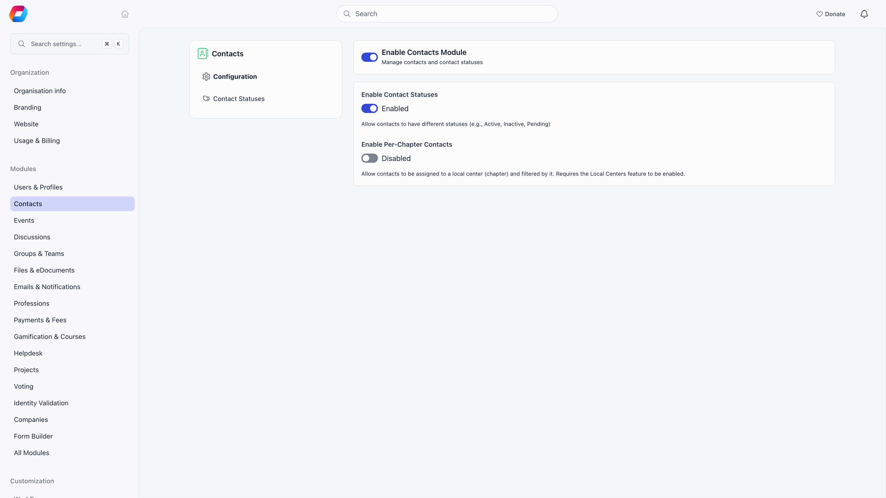

Contacts hold personal data about people who never signed up for an account: donors,
ticket buyers, newsletter subscribers, form respondents. This page answers two questions.
Who on your team can reach that data, and what can you actually do when one of those
people asks you about it.

**Built for** the administrator who decides who is trusted with the contact list, and the
person who has to answer a data-protection request with the tools the product really has.

This page assumes the permission model on [Permissions](/platform/permissions): every
permission is a domain (HR, Financial, Admin) paired with a scope (organisation, regional,
chapter). Only the contact-specific parts are covered here.

---

## What each action needs

| Action | Permission required |
|---|---|
| View the contact list | HR or Financial, at any scope (see the nine below) |
| Open one contact record | The same, and the contact must be in a chapter you cover |
| Create a contact | HR or Financial, at any scope |
| Edit a contact | The same, on that contact |
| Delete one contact | The same, on that contact |
| Bulk delete from the list | HR or Financial, at any scope |
| Export the contact list to CSV | Organisation-wide HR managers, or organisation admins |
| Manage tags on a contact | Organisation-wide HR managers, or organisation admins |
| Subscribe or unsubscribe a contact from the newsletter | Organisation-wide HR managers, or organisation admins |
| Send one email to one contact (**Send an email** on the record) | Communication permission over the contact's chapter. Organisation-wide Communication managers and organisation admins qualify for every contact |
| Email many contacts | Communication Manager, through a campaign |
| Write a note on a contact | HR or Financial, on that contact, with **Enable Profile Notes & Activity** switched on |
| Edit or delete a note | The note's author, or an organisation admin |
| Reveal a stored personal identification number | Organisation-wide HR managers, organisation-wide financial managers or organisation admins |
| See the **Email logs** card on a record | Organisation-wide Communication managers, or organisation admins |

Emailing many contacts is not a contact permission at all. Contacts are reached in bulk
through [newsletter campaigns](/platform/newsletter), which are governed by the
Communication Manager domain. Someone can hold Communication Manager and send to your
whole contact audience without ever being able to open a single contact record, and the
reverse is equally true.

The one-to-one **Send an email** button is the exception. It sits on the contact record, it needs an email address on the contact, and it checks Communication
permission over the contact's chapter rather than HR or Financial. A message sent this
way carries your organisation's branding and an unsubscribe link, is refused for a
contact who has unsubscribed, and is limited to 30 sends an hour per administrator. Each
send is recorded, and shows on the contact's Activity feed when **Enable Profile Notes &
Activity** is on.

---

## The permission line is wider than it looks

Every contact screen asks for the same thing: HR or Financial permission on the chapter.
Written out, that sounds like two narrow chapter-level grants. It is not. Because a
permission held higher up satisfies a check lower down, and because Admin satisfies
chapter-level checks, **nine different permissions open the contact list**:

| Permission | Why it satisfies the check |
|---|---|
| Organisation admin | Passes every permission check in the product |
| Organisation-wide HR manager | Organisation scope satisfies the same domain at chapter scope |
| Organisation-wide financial manager | The same, on the Financial side |
| Regional admin | Admin covers every regional and chapter permission in its branch |
| Chapter admin | Admin covers the chapter-level checks in its own chapter |
| Regional HR manager | Regional HR includes chapter HR |
| Chapter HR manager | Named directly by the check |
| Regional financial manager | Regional Financial includes chapter Financial |
| Chapter financial manager | Named directly by the check |

<Warning>
Granting a permission that sounds unrelated to contacts still grants the contact list.
Chapter admin for a chapter secretary, regional financial manager for a regional
treasurer, organisation-wide HR manager for a membership officer: all three open
contacts. If the contact directory holds donor or subscriber data you would not hand to
those people, decide that before you tick the box, not afterwards.
</Warning>

**HR Assistant does not reach contacts.** It is the one HR-family permission that does not,
and holding it changes nothing about the contact module. Event Manager and Communication
Manager do not reach contacts either.

---

## Ordinary members cannot reach contacts

A member with no administrative permission has no route to the contact directory: not the
list, not a record, not search, not export. There is no minimum access level setting that
opens contacts to regular users, and nothing in the member-facing product links to them.
Contacts are an administrative surface only.

---

## Chapter scoping

A contact can be filed under a chapter, and chapter administrators can then be limited to
their own. This needs **two** settings switched on together:

| Setting | Where |
|---|---|
| **Local Centers** module | **Settings** → **Modules** |
| **Enable Per-Chapter Contacts** | **Settings** → **Modules** → **Contacts** |

Both on, and scoping applies:

- Organisation-scope managers (organisation-wide HR and financial managers, and
  organisation admins) see every contact, including contacts with no chapter.
- Everyone else sees only contacts in the chapters they cover. Someone who covers no
  chapter sees an empty list rather than an error.
- Creating a contact files it under the creator's own chapter by default, and a
  chapter-scoped admin cannot file one outside the chapters they cover.
- Editing is re-checked after the change, so a chapter admin cannot move a contact out of
  their scope or leave it unfiled.

<Warning>
**With Per-Chapter Contacts off, chapter-scoped administrators get no contacts at all**,
rather than a scoped view. Chapter HR and chapter financial managers are refused the list,
the record and every write. Only organisation-scope managers keep access. Turning the
setting off to "simplify things" therefore removes contacts from your chapter teams
entirely.
</Warning>

**A contact with no chapter is invisible to chapter administrators**, even with the setting
on. Contacts created by donations, ticket sales and newsletter signups usually arrive
unfiled, so on a scoped organisation most incoming contacts are visible only to
organisation-scope managers until someone files them.

---

## CSV export, and what is recorded

Export is the one contact action that does not follow the nine-permission rule. **It
requires an organisation-wide HR manager or an organisation admin.** The **Download CSV**
button is hidden from everyone else. A chapter or regional administrator who can read
every contact on screen still cannot export them, and adding a chapter filter to the
request does not change that.

Every export writes a row to the [Activity Log](/platform/logs) recording who exported,
when, and the exact request that was made, including any filters. That is your record of
who took a copy of the directory.

<Note>
The same data pulled another way is not recorded the same way. Reading contacts through the
[API](/platform/api) or through an assistant on the [Orgo MCP connection](/platform/mcp) is
an ordinary read of the contact list: it leaves no export entry, because no export
happened. If your controls depend on knowing when the directory left the product, treat API
tokens and connected apps as their own control point, and scope them narrowly.
</Note>

The report builder is a second export route. It is for organisation admins only, it can include
contacts and their payments, tags and custom fields, and its exports are recorded too. See
[Reports](/platform/reports).

---

## Data protection

Below is what the product does and does not do with contact personal data. Read it as a
description of the mechanics, not as advice about your obligations.

### What is stored

A contact record holds name and middle name, email, phone, address, town and country, date
of birth, gender, a personal identification number, a bio, employer and role, social
profiles, company details, tags, status, source, staff notes, custom field answers, and links to
payments, invoices, form submissions and event registrations.

**Of everything on a contact, only the personal identification number is encrypted at
rest.** Email, phone, address, date of birth and gender are stored as ordinary text.
Individual custom fields can be marked as encrypted, one field at a time, but that is
opt-in and off unless someone set it.

The personal identification number is never returned by the normal record; the record only
says whether one exists. Reading the value has a single door, restricted to
organisation-wide HR managers, organisation-wide financial managers and organisation
admins, and every reveal is recorded with who did it, when,
and from where. If that record cannot be written, the reveal is refused.

### Identity documents

An identity record can be attached to a contact, carrying an identification number, the
document type, serial, number and dates, an address, a date of birth, and scanned images of
the document itself. These usually arrive through the flows described in
[Identity Validation](/platform/identity-validation). Treat any contact with an attached
identity as holding considerably more sensitive data than the record on screen suggests.

### What you can do for a data-protection request

- **Produce a copy of what you hold: ask the Orgo team.** There is a complete export for
  one person, but it is a command that an Orgo operator runs on the server, not a button
  an administrator can click. See [Subject access export](#subject-access-export) below.
  Inside the product, the contact record shows notes, activity, payments, invoices, event
  registrations and custom field answers on one screen, and the CSV export covers the
  directory fields but not notes, payments or emails. Assembling a full answer yourself
  means reading the record and copying from it.
- **Correct data.** Edit the record, in the normal way.
- **Stop email.** Unsubscribe the contact, or let them use the unsubscribe link in any
  campaign. This does not remove the record.
- **Clear the personal identification number.** The edit form cannot do it: leaving the
  field empty keeps the stored value. Overwrite it with a different value, or ask a
  developer to clear it through the [API](/platform/api).
- **Delete the contact**, subject to the limit below.

### Subject access export

When a person asks for everything you hold about them, Orgo can produce it. This is **not
a screen in the product and no organisation administrator can run it.** It is a console
command, `app:gdpr:export-person`, which only an Orgo operator with server access can
run. Forward the request to the Orgo team through [Orgo support](/platform/orgo-support)
and say which contact (or member) it is about.

What the command does:

- **One person per run.** The operator names either a contact or a member, plus the
  organisation the person belongs to. If the two do not match, nothing is exported, which
  guards against pulling the wrong person from a mistyped number.
- **It follows a linked member account.** If a member account was created from the
  contact and is still linked to it, both are exported. A contact that was merged into a
  member no longer exists as a separate record: its history is part of the member's file.
- **What the data file holds for a contact:** profile (name, email, phone, birth date,
  gender, personal identification number in readable form, address, town, country,
  chapter, status, source, organisation, role, company details, bio, social profiles,
  newsletter state, created date), identity documents, custom field answers, event
  registrations, contracts, form submissions, invoices, payments, subscriptions, and
  whether the person took part in votes. A member's file adds roles, membership
  applications, course enrolments and membership fee payments.
- **Files:** the profile photo, identity scans and signature, signed contracts, files
  uploaded as custom field or form answers, invoice PDFs, and for a member the
  application attachments and personal drive. The operator can leave files out.
- **What it leaves out:** other people's personal data (staff who handled the record, or
  whoever booked or paid for the person), the content of ballots, and security and
  technical records such as login history, access tokens, device identifiers and
  payment-provider references.
- **Staff notes are left out by default.** They are added only if the operator is told to,
  and that is your decision as the data controller, not Orgo's.
- **The result is one encrypted ZIP.** It is protected with a random password that is
  shown once and not stored. Send the file and the password to the person through
  different channels.
- **Each run is recorded** against the person. If the file carries a personal
  identification number, a personal-identification-number export is recorded as well.

The file opens with a statement that your organisation is the controller of the data and
gives the contact address your organisation set in its settings, so the person knows whom
to write to about correction or erasure. It also states the number of months your
organisation keeps inactive member accounts, if it has set one.

### What the product does not do

- **There is no anonymisation for contacts.** Nothing replaces a contact's details with
  placeholders while keeping the record. Deletion is a real deletion of the row, not a
  flag, and it cannot be undone. (Member accounts are different: see the next point.)
- **Deletion is refused while the contact has any payment, invoice or contract.** There is
  no option to erase the person and keep the financial record. For most organisations this
  means a contact who has ever paid you anything, a donor, a ticket buyer, an invoiced
  partner, **cannot be deleted at all**, and those are exactly the people most likely to
  ask. The only contacts you can delete are ones with no money and no signed document
  attached.
- **Deleting a contact destroys their activity history with them**, including the records of
  who exported the contact list containing them and who revealed their personal
  identification number. Export anything you need to keep before deleting.
- **Deletion does not reach data already sent elsewhere**, such as email logs, records
  synced to a connected CRM, or payloads already delivered to your webhooks.
- **Contacts never expire on their own.** Contacts, notes and log entries stay until
  somebody removes them. The automatic erasure that exists is for member accounts only:
  **Erase Inactive or Deleted Accounts After** under **Settings** → **Modules** →
  **Users & Profiles**, off until an Orgo administrator picks a period. It never touches a
  contact.
- **Consent is a single switch.** Newsletter subscription is subscribed, unsubscribed, or
  never asked. There is no consent timestamp, no record of where consent came from, and no
  per-purpose consent on a contact.

<Note>
Your organisation is the data controller for everything in your contact directory. Orgo
gives you the mechanics described above and nothing more; deciding what you may collect,
how long you may keep it, and how you answer a request from a data subject is yours to
determine, with your own legal advice. Nothing on this page is legal advice and no feature
described here makes an organisation compliant with any law.
</Note>

---

## What is recorded about a contact

Some, but not all, of what happens to a contact is written to the audit log.

| Recorded | Not recorded |
|---|---|
| Changes to name, email, phone, town, date of birth, gender, chapter, photo and the social profile fields | Changes to address, company fields, bio, status, source, custom field answers and the newsletter flag |
| CSV exports of the directory, with the exporter and the full request | Reads: opening a record leaves no trace |
| Personal identification number revealed, changed or exported | Creating a contact |
| Newsletter subscribe and unsubscribe | Deleting a contact |
| Tags added and removed, and notes deleted | |

Two more limits are worth knowing. Nothing is logged for changes made by an import, by an
automation, or by any unauthenticated flow such as a public form or a donation checkout, so
a field that changed by itself changed through one of those. The one exception is the
unsubscribe link in an email, which writes its own entry. And demo organisations write
no log entries at all.

<Warning>
**The field-change history is written, but no screen presents it.** The Activity card on a
contact record deliberately leaves field edits out; it shows notes, tags, donations, form
submissions, emails sent from the record and personal identification number changes. The
[Activity Log](/platform/logs) screen, which does show before and after values, exists for
members and not for contacts. So "who changed this contact's email address" is recorded but
not answerable from the product interface.
</Warning>

---

## Troubleshooting

<AccordionGroup>
  <Accordion title="A chapter administrator cannot see any contacts">
    Check the two settings first. Chapter scoping needs the **Local Centers** module and
    **Enable Per-Chapter Contacts** switched on together. With Per-Chapter Contacts off,
    chapter-scoped administrators are refused contacts outright rather than given a scoped
    view, which looks identical to a permission problem.

    With both on, check what they hold. HR Assistant does not reach contacts, and neither
    does Event Manager or Communication Manager. They need HR, Financial or Admin at
    chapter, regional or organisation scope.

    If they hold the right permission and the list is still empty, the contacts probably
    have no chapter. Unfiled contacts are invisible to chapter-scoped administrators, and
    contacts created by donations, ticket sales and signups arrive unfiled. An
    organisation-scope manager can open those and file them.
  </Accordion>

  <Accordion title="A contact cannot be deleted">
    Deletion is refused while the contact has any payment, invoice or contract attached,
    and there is no way to override it or to erase the person while keeping the financial
    record. This is the expected behaviour, not a fault, and it applies to every donor and
    ticket buyer.

    If the request came from the person themselves, what you can do instead is unsubscribe
    them from email, clear the personal identification number, and remove notes and any
    detail you do not need to keep. The record and its financial history stay.

    A bulk delete from the list applies the same rule to each contact separately. Contacts
    with a payment, invoice or contract are skipped and the rest are deleted; the
    confirmation message reads **Deleted** with a count, and **Skipped** with a count when
    any were left behind. Read the skipped number: those records are still there.
  </Accordion>

  <Accordion title="Who exported the contact list?">
    Every CSV export writes an entry to the [Activity Log](/platform/logs) naming the
    person, the time, and the exact request including any filters. Reading that log needs
    an organisation admin. Report builder exports are recorded too.

    Two gaps to keep in mind. Contacts pulled through the API, a connected app or an
    assistant over MCP are ordinary reads and produce no export entry, so the log answers
    "who used the export button", not "who has a copy". And deleting a contact deletes the
    export entries that mention them, so a log reviewed after a clean-up may be missing
    rows.
  </Accordion>

  <Accordion title="A member says they can see a contact's details">
    Ordinary members have no access to the contact directory, so check what the member
    actually holds on their **Permissions** tab. Chapter admin and chapter financial
    manager both open contacts even though neither is labelled HR, and a permission attached to their
    role counts the same as one ticked on their profile. See
    [Assigning Permissions](/platform/permissions-assigning).

    If they hold nothing, they are almost certainly seeing a contact through another
    feature rather than through the directory: as an attendee on an event they can see, as
    a name on an invoice, or mentioned in a discussion. Those surfaces have their own
    visibility rules and show far less than a contact record does.
  </Accordion>
</AccordionGroup>

---

## Related

- [Contacts](/platform/contacts) - what a contact is and how the module is switched on
- [Permissions](/platform/permissions) - the domains and scopes this page builds on
- [Assigning Permissions](/platform/permissions-assigning) - granting and checking what someone holds
- [Local Groups](/platform/groups/local-groups) - chapters, regions, and what a scoped grant reaches
- [Profile Activity & Notes](/platform/users/profile-activity) - the Activity card on a contact record
- [Activity Log](/platform/logs) - where export and audit entries are read
- [Identity Validation](/platform/identity-validation) - identity documents attached to a contact
- [Reports](/platform/reports) - the second export route, and who can use it
- [Orgo Support](/platform/orgo-support) - where to send a subject access request for the export
