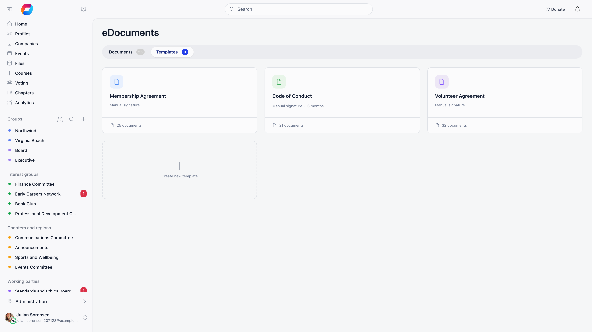
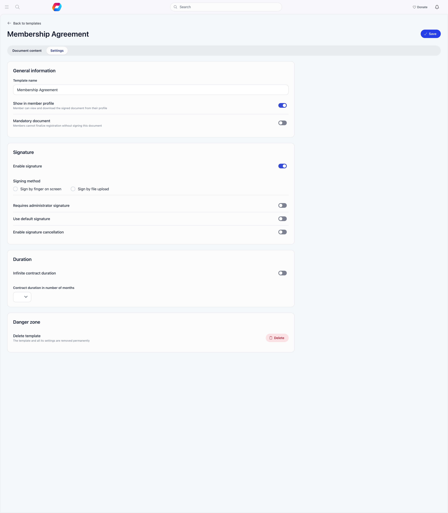
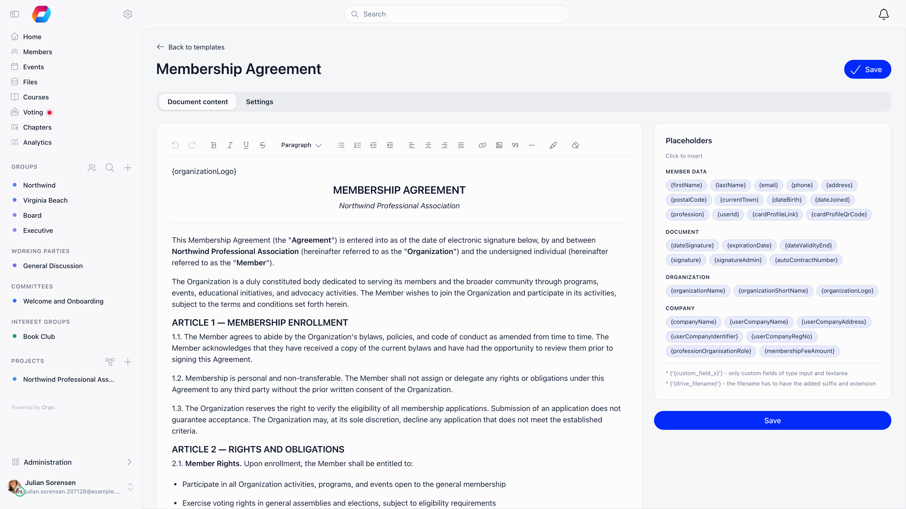
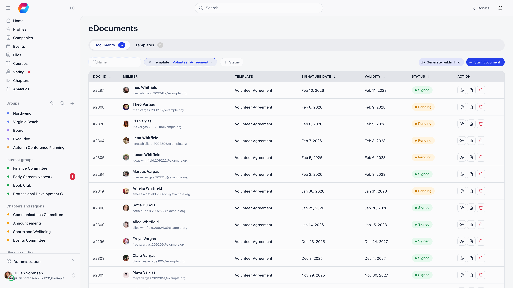
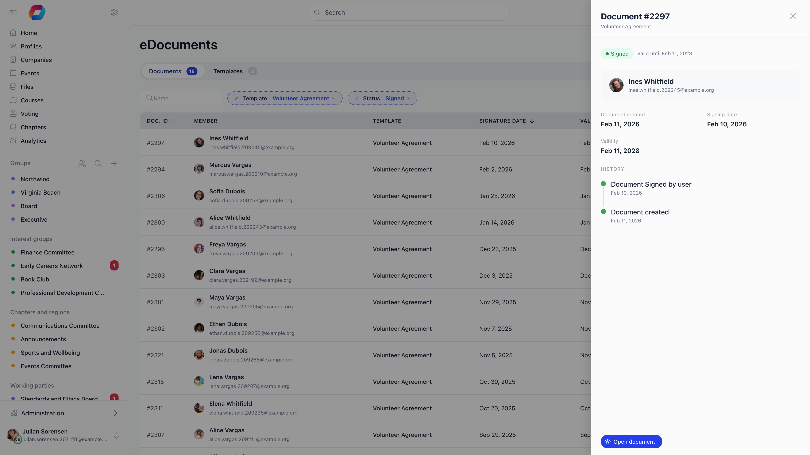

E-Documents lets you write a document once as a template, fill it with member data automatically, send it to a member or a contact, and have them sign it on screen. Orgo renders the signed result as a PDF and keeps it against the member's profile.

**Built for** membership organizations that need the same agreement from every member: membership contracts, volunteer agreements, codes of conduct, photo and media releases, parental consents.

**Replaces** printing, scanning, and chasing paper forms, and replaces a general e-signature tool for the routine documents your own members sign.

---

## Turning it on

**Settings → Modules → Files & eDocuments → eDocuments**, then **Enable eDocuments Module**. Module settings are for the Orgo administrator.

| Setting | What it does |
|---|---|
| **Enable eDocuments Module** | Shows the eDocuments screens and the e-documents on the **Documents** tab of member profiles |
| **Enable Groups** | Ties each template to one group, which changes who sees it and who may assign it |
| **Membership Card Contract** | Marks one template as the membership card document, adding a **Print status** column and a **Mark as printed** action on that template's list |

Day-to-day work lives at **eDocuments** in the admin menu, open to organization HR managers, with **Documents** and **Templates** tabs. Organization admins satisfy every HR check.

---

## Templates

Each card shows the name, group, signing method (on screen or file upload), duration in months and document count; selecting one opens the editor. The same cards under **Settings → Files & eDocuments → eDocuments Templates** also get **Clone**, which copies the template with the name prefixed `Copy `.

Creating a template is for the Orgo administrator; editing, cloning and deleting need organization HR.

### Settings tab

| Setting | What it does |
|---|---|
| **Template name** | Internal name, shown in lists and filters |
| **Associated group** | Ties the template to one group (needs **Enable Groups**) |
| **Show in member profile** | Members see the template on the **Documents** tab of their own profile before it is assigned to them. With **Enable Groups** on, only members of the associated group see it |
| **Mandatory document** | The member is pushed through onboarding until it is signed (see below) |
| **Enable signature** | Off makes it a read-and-download document with no signing step |
| **Signing method** | **Sign by finger on screen** or **Sign by file upload** |
| **Requires administrator signature** | Not finished until an admin countersigns |
| **Use default signature** | Stores one reusable admin signature on the template |
| **Pre-sign with default signature** | Stamps the stored admin signature on every new document at assignment, so it completes the moment the member signs |
| **Enable signature cancellation** | A signed document can be revoked afterwards |
| **Infinite contract duration** | The document never expires |
| **Contract duration in number of months** | 1 to 60 months from the signing date |

**Delete template** refuses once any document from it has been signed. **Cancel all signed**, for organization admins, instead cancels every outstanding document from that template and asks everyone to sign again.

### Document content tab

A rich text editor with a **Placeholders** sidebar. Click any tag to insert it at the cursor.

| Group | Placeholders |
|---|---|
| Member data | `{firstName}` `{lastName}` `{email}` `{phone}` `{address}` `{postalCode}` `{currentTown}` `{dateBirth}` `{dateJoined}` `{profession}` `{userId}` `{cardProfileLink}` `{cardProfileQrCode}` |
| Document | `{dateSignature}` `{expirationDate}` `{dateValidityEnd}` `{signature}` `{signatureAdmin}` `{autoContractNumber}` |
| Organization | `{organizationName}` `{organizationShortName}` `{organizationLogo}` |
| Company | `{companyName}` `{userCompanyName}` `{userCompanyAddress}` `{userCompanyIdentifier}` `{userCompanyRegNo}` `{professionOrganisationRole}` `{membershipFeeAmount}` |

Two more forms work but are not listed as tags: `{custom_field_ID}` for a [custom field](/platform/users/custom-fields) (text input and text area insert their value directly; yes/no, dropdown, checkbox and file render their label or a download link), and `{drive|filename.ext}` to link a file from [Drive](/platform/files).

`{signature}` and `{signatureAdmin}` mark where the signature images land; a missing signature prints a blank line instead.

The two end dates are not the same tag. `{dateValidityEnd}` prints the validity end held on that person's own document, the date set when it was sent, and prints nothing when the document has none. `{expirationDate}` is worked out while the document renders, as today plus the template's duration, and prints "undetermined" on a template with no expiry.

<Warning>
`{cardProfileLink}` and `{cardProfileQrCode}` are meant for templates with **Enable signature** off, such as membership cards, which are rendered fresh from live member data every time. They are not filled in on a signed document.
</Warning>

---

## Sending a document

Sending a document from a template is one panel, opened from two places.

| Where you start | How | Who |
|---|---|---|
| The eDocuments list | **eDocuments** → **Documents** tab → **Start document** (top right of the filter row) | `HR_TENANT` |
| A member's own page | The member's **Documents** tab → **New** → **From eDocuments template**. The member is already chosen | `HR_TENANT`. The entry appears only while eDocuments is on and the member has a personal drive |

<Steps>
  <Step title="Open the panel">
    A panel slides in from the right. Its title is the name of the template, or
    **Start document** until one is chosen.
  </Step>
  <Step title="Pick the template">
    **Document template** is shown only when your organisation has more than one
    template. From the list it starts on the template you are filtering by; from
    a member's page it starts on the first template.
  </Step>
  <Step title="Pick who signs">
    Type in **Search member**. It finds members and [contacts](/platform/contacts)
    alike. The person you pick appears as a chip with their initials; select the
    **x** on the chip to choose someone else. Opened from a member's page, the chip
    is already there.
  </Step>
  <Step title="Set the validity (signing templates only)">
    Under **OPTIONS**, **Contract validity date start** defaults to today. A line
    below it reads **Current validity interval** followed by the template's
    duration in months, or **Unlimited**. To override the end, switch on **Custom
    contract validity date end** and pick a **Contract validity date end**;
    otherwise the end is the start plus the template's duration. A template with
    **Enable signature** off (read-and-download) shows no validity fields.
  </Step>
  <Step title="Send">
    **Start document** stays greyed out until a template and a person are chosen.
    Selecting it creates the document, shows "Created successfully" and closes
    the panel. The document appears in the **Documents** list, and on the member's
    **Documents** tab without reloading the page.
  </Step>
</Steps>

Assigning to someone else needs organization HR, or chapter HR when the template's associated group belongs to a chapter. Members can always start their own document from their profile.

The list page also opens the panel from a link: `/e-documents?send=1` opens it empty, and `/e-documents?send=1&user=<member id>` opens it with that member already chosen.

### Public links

Two buttons produce a link that works without an Orgo login: **Generate public link** on a template creates a blank invitation (the visitor gives a name and email, which creates a contact, then signs), and **Share** on a pending row links to that one document. Both live at `/public/document/<hash>` and **expire 72 hours** after creation. Creating one needs organization HR unless it is for yourself. Every link for a document is deleted as soon as that document is signed.

---

## Statuses

| Status | Shown as | Meaning |
|---|---|---|
| `unsigned` | **Pending** | Assigned, waiting for the signer |
| `signed-user` | **Pending** (filter: **Signed by user**) | The member has signed, an administrator signature is still required |
| `complete` | **Signed** | Fully signed |
| `expired` | **Expired** | The validity end date has passed |

A nightly job moves signed documents to **Expired** the day after their validity ends.

---

## Tracking

Filter by member name, template, group and status. The table shows document ID, member, template, group, signature date, validity and status. Every row carries **View** and **Open document**; **Share** appears on pending rows, **Download PDF** once a signed PDF exists, and **Delete** for organization HR managers.

**View** opens a side panel with the member, the dates, the validity and a **History** timeline. **Revoke** appears there for signed documents when the template has **Enable signature cancellation** on, and **Download PDF** once the signed PDF has been generated.

Three more admin actions on a single document, all for organization HR managers: **Modify document text** (edits this copy before it is completed), **Mark as signed** (records an offline signature with your own start and end dates), and countersigning, by drawing a signature or with **Sign with default signature**.

---

## What the member sees

Members find their documents on the **Documents** tab of their own profile (the tab reads **Files** when eDocuments is off). The e-documents sit above the member's files: a card per template with **Sign**, **Upload file** or **Download PDF**, a **Needs signature** tag on those still waiting, and previous versions with their validity ranges. When there are no e-documents, that part of the tab is simply not shown. The card at the top that counted required documents signed (**Required documents**, "2 / 3 signed") has been removed; use **Needs signature** on each card to see what is outstanding.

Opening a document from there and selecting **Back** returns to the member's own **Documents** tab, rather than to the admin list.

On a signing template, the screen shows the document beside a short form for whatever placeholders it uses (first name, phone, town, company details, custom fields), then the member draws a signature. What they enter is written back to their profile where that field was empty.

---

## Mandatory documents

**Mandatory document** shows the member an onboarding step listing everything they still have to sign, and holds them there until they do. A document is outstanding when it has never been signed, is waiting for the administrator signature, or its validity has ended. Tenant HR admins are exempt.

Separately, **Settings → Modules → Payments & Fees → Membership Fees → Require Contract for Membership** blocks paying the membership fee until the template named in **Membership Contract Document ID** has been validly signed. What counts as validly signed, including the countersignature case, is on [E-Documents](/platform/e-documents#when-a-document-counts-as-validly-signed).

---

## Related

- [E-Document Records and Legal Weight](/platform/e-documents) - what a signature captures, storage, validity and renewal
- [Files](/platform/files) - general document storage and sharing
- [Custom Fields](/platform/users/custom-fields) - the fields you can pull into a template
- [Adhesion](/platform/users/adhesion) - the separate membership application document
- [Permissions](/platform/permissions) - what the HR and Admin permissions unlock
