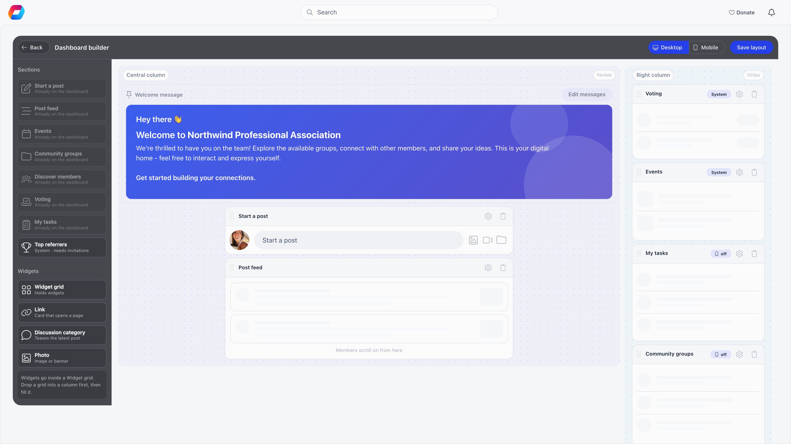

**Built for** organizations that want the dashboard to lead with their own priorities.
**Replaces** a fixed home page everyone scrolls past.

The Dashboard builder arranges the member dashboard from **sections**. Some sections are fixed content Orgo fills for each member (the post feed, upcoming events, community groups, voting, tasks and so on). One, the **Widget grid**, you fill with your own tiles: links, photos and shortcuts into discussion categories. You arrange desktop and mobile separately, over the same set of sections.

**Settings → Customization → Dashboard builder**

<Note>
  Requires the **Orgo administrator** flag. The builder opens as a full page of its own, with a **Back** button to the dashboard. It is available to every organization: there is no switch to turn on first.
</Note>

---

## Building the dashboard

<Steps>
  <Step title="Open the builder">
    The top bar carries **Back**, the title, **Undo** (once you have made an edit), a **Desktop** and **Mobile** switch for the screen you are arranging, and **Save layout**. An **Unsaved changes** tag appears as soon as something differs from the saved layout.
  </Step>
  <Step title="Drag a section in from the left">
    The left panel lists **Sections** and **Widgets**. Drag a section into the **Central column** or the **Right column**. Drop it between existing sections to control where it lands. The central column is flexible; the right column is 300 px wide.
  </Step>
  <Step title="Fill widget grids">
    A **Widget grid** is a section that holds widgets: drag it into a column first, then drag **Link**, **Discussion category** or **Photo** widgets into it. Drag a placed widget to move it, in the same grid or into another.
  </Step>
  <Step title="Open a section or widget to configure it">
    Click it. A settings panel opens on the right with the options described below. Click a section's name bar for its grip handle, **Hide on this screen** (grids only), **Settings** and **Delete** buttons.
  </Step>
  <Step title="Save layout">
    Nothing is applied to members until you press **Save layout**. Both screens are saved in one go, so a failed save never leaves half a layout. You get **Dashboard saved**, or **Could not save the dashboard** if it failed. Closing the page with unsaved edits loses them.
  </Step>
</Steps>

New sections and widgets land on **both** desktop and mobile (a toast says **Added to Desktop and Mobile**). Deleting a section removes it from both screens. To show something on only one screen, use the **Shown on** switches in its settings panel.

**Undo** steps back through the edits you have made since opening the page or since the last save, up to 40 of them. It is the way back from hiding a section, which is a one-click change with a result you cannot see on the other screen.

---

## The sections

| Palette name | What members see | Needs |
|---|---|---|
| **Start a post** | The box for writing a new discussion post | Central column only |
| **Post feed** | The discussion thread | Central column only. Always last in its column: the feed scrolls on, so anything below it could never be reached, and Orgo moves it to the end if you drop something after it |
| **Events** | Upcoming events | The Events module |
| **Community groups** | The groups available to the member | |
| **Discover members** | Suggested members to connect with | **User Recommendations**, under **Settings → Modules → Users & Profiles → Advanced Settings** |
| **Voting** | Votes open to the member | The Voting module |
| **My tasks** | The member's open tasks | The Projects module |
| **Top referrers** | A leaderboard of members who invited the most people | **Enable User Invitations** in Users & Profiles settings |
| **Widget grid** | Your own tiles | Nothing |

A section whose module is off is not offered in the palette, and is not shown to members even if it is already on the layout. Each of the sections above, apart from the Widget grid, can be placed once; once it is on the dashboard its palette entry reads **Already on the dashboard**. Sections Orgo fills are tagged **System** on the canvas, and system sections show their own heading to members, so there is no name to set.

Settings on the sections that have any:

| Section | Setting |
|---|---|
| **Start a post** | **Heading**: a title above the composer. Empty hides it |
| **Post feed** | **Default sort** (Newest, Oldest, Most commented, Least commented) and **Card density** (Comfortable, Compact) |
| **Top referrers** | **Period** (All time, Last 30 days, Last 90 days) and **People shown** (5, 10, 20) |
| **Widget grid** | **Heading** (empty hides it), **Hide heading**, **Tiles per row, desktop** (Auto, or 1 to 6), **On mobile** (**Grid** or **Horizontal scroll**), and for a grid, **Tiles per row, mobile** (Auto, or 1 to 3) |

Every section also has **Shown on**, a switch each for **Desktop** and **Mobile**; a desktop section has **Where on desktop** (**Central column** or **Right column**), and one in the central column has **Full width**, which fills the central column instead of stopping at the 700 px reading width. A section you hide on one screen goes to the **Hidden on this screen** tray under the canvas, with an eye button to show it again.

<Note>
  The **welcome message** is pinned at the top of the central column on the canvas. It is not a section and cannot be moved or removed here. **Edit messages** (or **Set up**, when you have none) takes you to [Dashboard Welcome](/platform/customization/dashboard-welcome).
</Note>

---

## Widgets

Widgets are the tiles inside a Widget grid. A grid with no widget visible on a screen is not shown to members on that screen at all.

| Widget | What it does | Settings |
|---|---|---|
| **Link** | A tile that opens an address | **Title**, **Icon**, **Destination** (a full address or a path inside Orgo such as `/events`), **Open in a new tab**, **Image**, **Background** |
| **Discussion category** | A tile that jumps into discussions and teases the latest post | **Title**, **Icon**, **Category** (a discussion category, or **All discussions**), **Image**, **Background** |
| **Photo** | An image or banner | **Title** (a caption; empty means none), **Default photo**, **User type specific photos**, **Image** (**Cropped to fill the tile** or **Whole image, kept in proportion**), **Alt text** for screen readers, **Background** |

**User type specific photos** appears only when your organization uses user types: it lets different member types see different images in the same tile. **Background** is a swatch of eight colours, a **Custom colour** picker, or **No background**. Every widget also has **Shown on** switches for Desktop and Mobile. Deleting a widget removes the images it held.

<Note>
  The Weather widget and the fixed-size 3, 4, 6, 8 and 16 slot grids of the old dashboard no longer exist. A grid now holds as many tiles as you drop in and you choose how many sit in a row.
</Note>

---

## What members see

Until you save a layout, members get Orgo's default arrangement. On desktop that is the composer and feed in the central column, and Voting, Events, My tasks, Community groups and Discover members in the right column (each only where its module is on). On mobile the order is Voting, Events, Discover members, Start a post, Post feed; My tasks and Community groups are off on mobile.

Once you have saved, members see your layout: the welcome message first, then the sections in the order you set, column by column on desktop and as one list on mobile. A section pointing at a module that is later switched off simply disappears. Sections that can swipe sideways on a phone (Events, Community groups, Discover members, Voting) do so on mobile.

<Tip>
  Three to five sections is usually enough. A long dashboard is scrolled past as fast as an empty one.
</Tip>

---

## Troubleshooting

<AccordionGroup>
  <Accordion title="A section I want is not in the palette">
    Either its module is off (Events, Voting, Projects), the setting it needs is off (User Recommendations for Discover members, user invitations for Top referrers), or it is already on the dashboard. Each section is single-use.
  </Accordion>
  <Accordion title="Nothing I changed shows for members">
    The builder is a staging area. Press **Save layout**. The **Unsaved changes** tag tells you when there is something to save.
  </Accordion>
  <Accordion title="I dropped a section and it moved">
    The Post feed always sits last in its column. Anything dropped after it lands before it.
  </Accordion>
  <Accordion title="A section shows nothing for some members">
    Sections render each member's own data. The feed is empty for someone in no groups, and Events is empty when nothing upcoming is visible to them. A Widget grid with no tile visible on a member's screen is left out. Pair a data section with a Widget grid so the dashboard is never blank.
  </Accordion>
  <Accordion title="I want a different dashboard per role">
    The layout is one for the whole organization. Only the **Photo** widget varies by audience, through its user type specific photos. For role-specific messaging use [Dashboard Welcome](/platform/customization/dashboard-welcome), which does target by user type.
  </Accordion>
  <Accordion title="A tile disappeared after I saved">
    A widget you deleted, or one inside a section you deleted, is removed along with its images. Use **Undo** before saving; after saving, add the tile again.
  </Accordion>
</AccordionGroup>

---

## Related

- [Dashboard Welcome](/platform/customization/dashboard-welcome) - the greeting above the dashboard
- [Menu Organizer](/platform/customization/menu-organizer) - the sidebar equivalent
- [Discussions](/platform/discussion) - what the feed, composer and discussion tiles point at
- [Events](/platform/events) - what the Events section shows
- [Customization](/platform/customization) - everything under Settings → Customization
