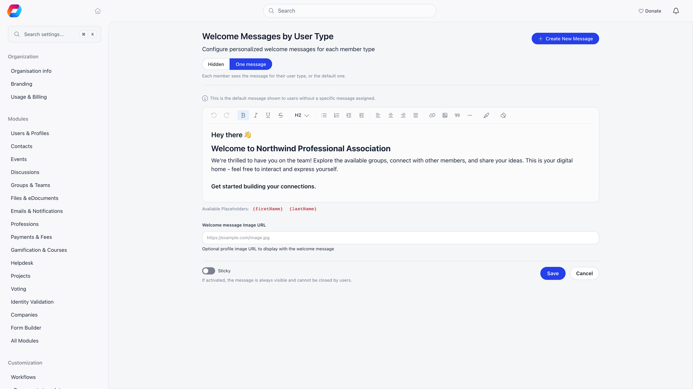
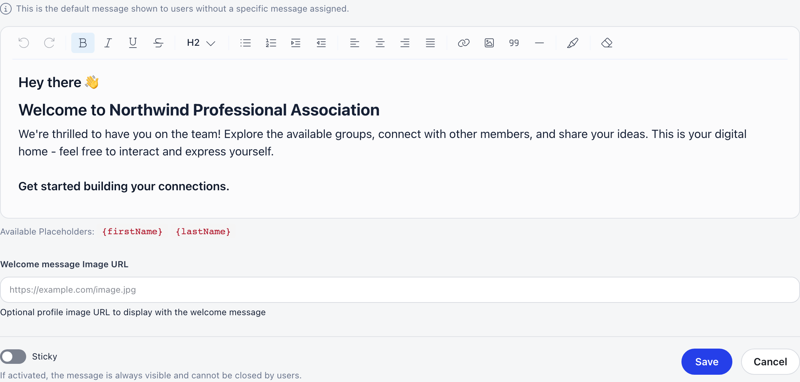

**Built for** the first thing a member reads after logging in.
**Replaces** a launch email nobody reopens.

The welcome message sits at the top of the dashboard. It is rich text with images and personalization placeholders. Every organization has one general message, and organizations that use user types can add more, each aimed at specific types.

**Settings → Customization → Dashboard Welcome**

<Note>
  Requires the **Orgo administrator** flag. The page is headed **Welcome Messages by User Type**. The same screen is one click away from the dashboard itself: an administrator sees a pencil on the welcome card.
</Note>

---

## Writing the message

An organization that has no message yet sees **Your members currently see no welcome message**, with Orgo's standard message shown for reference and two buttons: **Use this message**, which saves the standard text as your general message, and **Write my own**. Once a general message exists, **Restore standard message** on its card puts the standard text back in place (after a confirmation), without ever leaving members with nothing.

<Steps>
  <Step title="Open the message card and click edit">
    An organization with a single message opens it in edit mode automatically.
  </Step>
  <Step title="Write the content">
    The editor supports headings, bold, italic, links, lists and pasted or uploaded images. Images are uploaded when you save, not when you paste them.
  </Step>
  <Step title="Add placeholders">
    Type them inline in curly braces. They resolve per member when the dashboard renders.
  </Step>
  <Step title="Add an image URL (optional)">
    **Welcome message Image URL** takes the address of an image shown alongside the message. It must be a publicly reachable URL.
  </Step>
  <Step title="Assign user types (optional)">
    On a non-default message, add user types from the dropdown. See targeting below.
  </Step>
  <Step title="Save">
    The message is live immediately. **Cancel** closes the editor without saving.
  </Step>
</Steps>

### Placeholders

| Placeholder | Resolves to |
|---|---|
| `{firstName}` | The reader's first name |
| `{lastName}` | The reader's last name |
| `{organizationName}` | Your organization's name |

Write them exactly as shown, with no spaces inside the braces. The editor's own hint lists only the two name placeholders, but `{organizationName}` works as well.

---

## Targeting by user type

**Create New Message** (top right, once at least one message exists) starts an extra message. It only reaches anyone when it is assigned user types, so it is useful on organizations that use user types.

- The **Default** message is tagged as such and labelled **All other users** (or **All members** when you do not use user types). It is the fallback for anyone whose user type has no message of its own. It cannot be deleted.
- Any other message carries a list of user type tags, added from the **Add** dropdown in edit mode. Assignment is exclusive: adding a user type to one message removes it from whichever message held it before, so a member is never matched by two.
- A non-default message with no user types assigned shows **Nobody sees this message**.

### Which message a member sees

The row of buttons at the top of the page chooses what members get:

| Setting | Meaning |
|---|---|
| **Hidden** | No member sees a welcome message |
| **One message** | Each member sees the message for their user type, or the default one |
| **Default + user type** | Members with a user type message see it below the default one. Offered only when user types are in use and at least one message is assigned to a type |

Within **One message**: a member whose user type has its own message sees that one; a member whose type has none, or any member when user types are not in use, sees the general message; and if no message exists at all, nothing renders.

---

## Sticky and dismissible

Each saved message has a **Sticky** toggle, and the help text says it plainly: *if activated, the message is always visible and cannot be closed by users*.

A non-sticky message has a close button. Once a member closes it, it stays hidden for them across sessions, and closing one hides every message that is not sticky, not just that one. That preference is per member and is not reset when you edit the text.

<Warning>
  Editing a non-sticky message does not bring it back for members who already dismissed it. For an announcement that must be read, make it sticky, or use a [notification](/platform/notifications) or the [newsletter](/platform/newsletter).
</Warning>

---

## What to put in it

| Situation | Content |
|---|---|
| Launching Orgo | What the platform is for and the first two or three things to do |
| Onboarding | Complete your profile, join a group, check upcoming events |
| Seasonal | Registration opens, deadline dates, one clear link |
| Nothing in particular | `Welcome back, {firstName}!` and a link. Timeless beats stale |

<Warning>
  A dated message is worse than none. Either keep it current or write something that does not expire.
</Warning>

---

## Troubleshooting

<AccordionGroup>
  <Accordion title="No welcome message appears on the dashboard">
    Check the setting at the top is not **Hidden**, that a message exists, and that its content is not empty (the card preview shows **No content yet** when it is). If you use user types, check the reader's type is either assigned to a message or covered by the default.
  </Accordion>
  <Accordion title="Some members see it and others do not">
    Almost always a dismissal. Non-sticky messages stay closed once a member closes them. Turn on **Sticky** to make it unclosable.
  </Accordion>
  <Accordion title="Placeholders show as literal text">
    Use single braces with no spaces: `{firstName}`, not `{ firstName }`. Names are case-sensitive. Only `{firstName}`, `{lastName}` and `{organizationName}` are substituted; anything else is left as typed.
  </Accordion>
  <Accordion title="I assigned a user type and it disappeared from another message">
    That is intentional. A user type belongs to exactly one message, so adding it here removes it there.
  </Accordion>
  <Accordion title="The image does not display">
    The image URL must be publicly reachable over HTTPS. Test it in a private browser window. Images pasted into the editor itself are uploaded when you save the message, so save before checking those.
  </Accordion>
  <Accordion title="I need a different message per local center">
    Not supported: targeting is by user type only. Either use `{organizationName}` and keep the message generic, or send local announcements through [notifications](/platform/notifications) or a [newsletter](/platform/newsletter) segmented by local center.
  </Accordion>
  <Accordion title="I want to delete the default message">
    You cannot. Replace its text with **Restore standard message**, or choose **Hidden** to suppress all messages at once.
  </Accordion>
</AccordionGroup>

---

## Related

- [Dashboard builder](/platform/customization/dashboard-organizer) - the rest of the dashboard, including where the welcome message sits
- [User Types](/platform/users/user-types) - the types you target messages at
- [Notifications](/platform/notifications) - for time-sensitive messages
- [Newsletter](/platform/newsletter) - for anything that has to reach inboxes
- [Customization](/platform/customization) - everything under Settings → Customization
