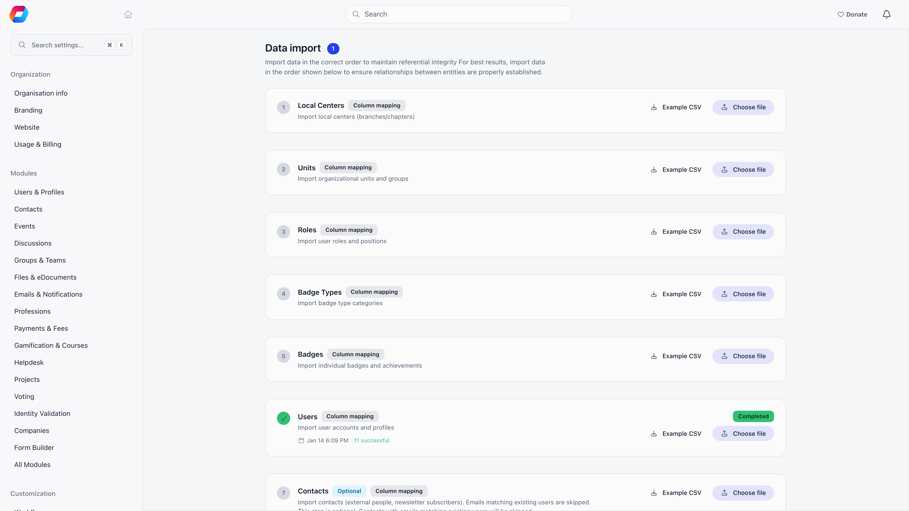
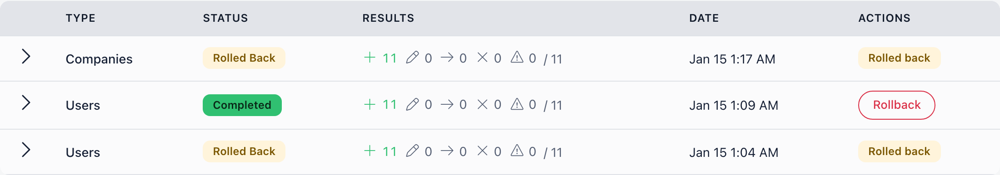

Import turns spreadsheets into Orgo records. It is how you migrate from another system,
load a historical archive, or push a bulk correction across thousands of profiles without
touching them one at a time.

**Built for** organisations arriving with years of data in another tool or in spreadsheets.
**Replaces** the manual re-typing, and the "can you just run this SQL" request.

The page is at **Settings** → **Customization** → **Import** (`/tenants/import`),
titled **Data import**.

<Warning>
**Uploading does not start anything.** Your file is parked as a draft, labelled **Mapping
columns**, while you tell Orgo which column goes where. Nothing is written until you press
**Start import**. If you close the screen, the draft is waiting for you: **Continue mapping**
on the step card picks it up again.
</Warning>

---

## How an import runs

<Steps>
  <Step title="Choose what to import">
    Each card on the page is one import type. They are ordered so that earlier runs create
    the records later ones point at: structure first, then people, then the rows that link
    them. Cards belonging to a module you have switched off do not appear. Each card offers
    an **Example CSV**, which is the quickest way to see what that type can read.
  </Step>
  <Step title="Upload the file">
    Pick a `.csv`, `.txt`, `.xlsx` or `.ods` file and press **Choose file**, then **Map
    columns**. Orgo reads the top of it, works out the delimiter, and opens the mapping
    screen on the draft it just created. A spreadsheet is first converted to CSV, which
    shows as **Reading your spreadsheet...** on the card; the mapping screen opens by
    itself when that finishes. See [Preparing your file](/platform/customization/import/preparing-your-file).
  </Step>
  <Step title="Map the columns">
    A sheet-style view of your file, one settings panel per column. For every column you
    choose where its values go, and Orgo proposes a destination from the header you wrote.
    See [Mapping columns](/platform/customization/import/mapping-columns), and, on member
    and contact files, [Custom fields](/platform/customization/import/custom-fields). Where
    a row has to find a record you already have (a payer, a role, a company), a strip of
    tiles shows what a sample of your rows would match, see
    [Linking to existing records](/platform/customization/import/linking-records).
  </Step>
  <Step title="Read the check">
    A moment after you stop changing the mapping, Orgo runs the whole file through it
    without writing anything and shows what would happen: **Will be created**, **Will be
    updated**, **Will be skipped**, **Will fail** and **With warnings**. Press a tile to see
    the rows behind the number.
  </Step>
  <Step title="Start the import">
    **Start import** becomes available once every required group has a column mapped to it
    and the check has finished for the mapping on screen. If the check says some rows will
    fail, Orgo asks once, **Some rows will fail**, and **Import the rest** carries on without
    them. Pressing start creates any custom fields you declared, then runs the file in the
    background, in batches, so you can close the tab.
  </Step>
  <Step title="Review the result">
    The step card and the **Import History** table show progress while the run is going,
    refreshed every three seconds, with counts of successful, failed, skipped, updated and
    warning rows. Counts move one batch at a time, so a small file sits at 0% and then
    finishes. Expand a history row to read what happened to each row. The history keeps the
    50 most recent imports and shows them 20 to a page.
  </Step>
</Steps>

<Note>
Orgo emails the person who started the import when a run that took a minute or longer
finishes, with the counts and a link back to this page. Shorter runs finish before you
would want an email, so they send none.
</Note>

### One import at a time

An organisation runs one import at a time. If you start another while one is running (or
while a check is running), the new one waits its turn: the card says **Waiting for another
import to finish**, or **Waiting: 2 ahead**, and starts by itself.

---

## What you can import

| Group | Import steps |
|---|---|
| **Structure** | Local Centers, Units, Roles, Companies, Company Members |
| **People** | Users, Contacts, User Roles |
| **Catalogue** | Products, Product Prices |
| **Money** | Product Payments |
| **Events** | Events, Event Attendance |
| **Badges** | Badge Types, Badges, Badge Assignments |
| **Modify existing records** | Modify Users, Modify Contacts |
| **Standalone imports** | Forms |

Which cards you see depends on your modules, not on your permissions: Local Centers needs
the Local Centers module, Units needs **Enable Organizational Units**, the three product
steps need Payments and Fees, Events and Event Attendance need Events, Companies and
Company Members need Companies, the three badge steps need Gamification, and Forms needs
the Form Builder. Users, Contacts, Roles, User Roles and the two modify steps are always
there. **Contacts** carries an **Optional** tag.

The twentieth type, **List members**, is not on this page. To add people to a manual list
from a spreadsheet, open the list itself and use the CSV import inside it. See
[Lists and Segments](/platform/users/lists).

**Forms** is the one import that is not about people or structure: it loads the answers
from a form export (Google Forms, for example) as responses to one of your forms. It does
not depend on the other steps and can run at any time. See [Forms](/platform/customization/import/reference#forms).

What each type reads, which columns are required, and what it treats as the same record on
a second run: [Import reference](/platform/customization/import/reference).

---

## File formats

**CSV, TXT, XLSX and ODS.** A CSV or TXT file can be up to **500 MB**. An Excel (`.xlsx`) or
OpenDocument (`.ods`) spreadsheet can be up to **100 MB**, and only its **first sheet** is
read. The older `.xls` format is not accepted: save it as `.xlsx` or CSV first.

A larger file is refused before the upload starts, with "File is larger than the 100 MB
import limit" (or 500 MB for CSV). Split it and run the parts one after another.

Comma, semicolon and tab are all fine: Orgo works out which one your file uses.
[Preparing your file](/platform/customization/import/preparing-your-file) covers the rest,
including where the header row may sit and how dates and yes/no columns are read.

---

## Who can run an import

Every part of the import page, and every import action behind it, needs the **Orgo
administrator** flag on the account, not merely an admin permission. Chapter admins, HR and
financial admins do not see the Settings area at all, and an admin who holds the
organization-wide admin permission through a role, without the flag, is refused too.
Impersonating a member, or calling the import from an API token, is refused as well.

---

## Creating versus updating

Most steps only create. A row that matches a record you already have counts as
**skipped**, and the existing record is left as it was. A second run of the same file
therefore adds very little, as long as its rows carry something to be recognised by: an
email, a name, a legacy id. What counts as a match is listed per type in the
[reference](/platform/customization/import/reference).

Three things write over what is already there:

- **Modify Users** and **Modify Contacts**, under **Modify existing records**. They match a
  person first, then update only the columns you filled in. An empty cell leaves the stored
  value alone, so a blank cannot be used to clear a field.
- **Users** and **Contacts** when you set **Members that already exist** (at the bottom of
  the mapping screen) to **Update the mapped fields** instead of **Skip them**. Rows that
  match a person already on file are then updated exactly as a modify import would update
  them, and everything else is created as usual. The option is called "Members that already
  exist" on both screens.

Usernames, passwords, permissions and API tokens are never written by any import.

<Warning>
Imported members get no email and no usable password: the import writes a placeholder
nobody knows. Someone imported with their own address signs in with the email one-time code
from the login page, or through a password reset. A row with no email, and a second row
for an address already taken in the same file, gets a generated placeholder address that
cannot receive mail, so those members cannot sign in until you correct the address.
</Warning>

### Moving members between chapters

An import that names a different chapter for a member (the **Chapter** column, or a town
in a state that has its own chapter, on organisations that assign chapters by state)
moves them. Orgo then does what a manual move does: it ends their ordinary memberships at
the old chapter, switches their chapter follow and local fee to the new one, and refreshes
their permissions.

Roles that carry permissions, and unit admin roles, are **not** ended by a move. A chapter
admin moved by an import keeps the role on record at the old chapter, but it gives them no
admin rights over the new chapter. Rights granted to the person directly, rather than
through a role, are not touched and do follow them to the new chapter. Check the Roles tab
of anyone you move who held a position, and end the old one yourself if it should not stay.

### Encrypted fields

An import never writes into an **encrypted** custom field. Such a field is shown with a
lock in the mapping screen and cannot be chosen, because the import stores values without
encrypting them and would leave readable text in a field meant to hide it. See
[Custom fields](/platform/customization/import/custom-fields#encrypted-fields-cannot-receive-imported-values).

---

## Rolling back an import

A completed run has a **Rollback** button in the **Actions** column of Import History. It
asks for confirmation, then undoes what the run did and marks the row **Rolled back**. A
run can be rolled back once, and only after it has completed (not while it is running, and
not if it failed).

What it does:

- **Deletes the records the run created**: members, contacts, chapters, units, roles, role
  assignments, companies and company memberships, products, price tiers, payments, events,
  attendance, list memberships and form responses.
- **Puts back the earlier values** on records a run updated, from a copy taken row by row
  as it ran. This covers Modify Users, Modify Contacts, and Users or Contacts runs set to
  update existing people. The confirmation warns that if other imports or admins changed
  those records since, their changes are reverted to the copy too. Contacts a modify run
  created as a fallback are deleted.
- **Leaves alone** people who were already on file before the run and were only matched,
  and the custom fields and options the run created, which stay until you remove them in
  Custom Fields settings.
- **Recomputes members' fee dates** after a payments run, since the deleted payments no
  longer extend anyone's membership.
- On a **Forms** run, deletes the imported responses, removes the questions the run added
  if nothing else uses them, and deletes a form the run created if no responses remain.

<Warning>
Rollback does not remove badge types, badges or badge awards loaded by the badge imports.
Remove those by hand.
</Warning>

---

## If a run fails partway

A run that stops on an error shows **Failed** on the step card, and in the history row.
Rows from the batches that finished before the error stay in Orgo, the remaining rows are
not imported, and a failed run cannot be rolled back. This is different from rows that
fail one by one, which are listed in the run's results while the rest of the file carries
on.

To recover, fix the cause and upload the file again as a new import. Rows that were already
created are recognised and skipped, for the types that can recognise a repeat (see the
reference for what each one matches on). A type that cannot, such as contacts without an
email, would create them a second time, so for those remove the first batch's records
before re-running.

---

## If you used the old importer

Three habits are worth unlearning.

- **Columns are chosen, not guessed.** The old page matched your headers against a fixed
  list of exact names, so `E-mail address` missed and `email` hit. Now you pick the
  destination for each column yourself, and Orgo only suggests.
- **A legacy id column is no longer required.** Files that carry your old system's
  identifiers still work and still dedupe on them, but a file that has never had them is
  fine too: a member is found by email, a role or a chapter by name.
- **A column you do not map is dropped.** It is not turned into a text custom field the way
  an unrecognised header used to be. If you want a column stored, map it, and declare a new
  custom field for it if there is nowhere obvious to put it.

---

## Related

- [Preparing your file](/platform/customization/import/preparing-your-file) - formats, headers, dates, yes/no columns and example files
- [Mapping columns](/platform/customization/import/mapping-columns) - the mapping screen, suggestions and what has to be filled in before you can start
- [Custom fields](/platform/customization/import/custom-fields) - writing into fields you have, and declaring new ones from a column
- [Linking to existing records](/platform/customization/import/linking-records) - how a payment finds its payer, and what the match strip is telling you
- [Import reference](/platform/customization/import/reference) - every import type, column by column
- [Adding Members](/platform/users/adding-members) - the other ways people get an account
- [Where contacts come from](/platform/contacts/sources) - importing contacts, and how they differ from members
- [Lists and Segments](/platform/users/lists) - importing people straight into a list
- [Custom Fields](/platform/users/custom-fields) - the profile fields an import can fill or create
- [Merging Duplicates](/platform/users/merging-duplicates) - cleaning up records an import doubled
