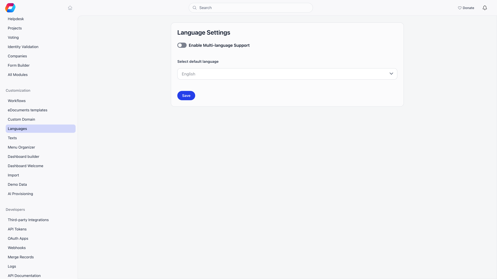

**Built for** organizations that are not generic and should not read as if they were.
**Replaces** custom development to change wording, navigation or a home page.

Orgo runs thousands of very different organizations. The Customization section is where you make it fit yours: which languages members can use, what things are called, what the sidebar contains, what the dashboard shows, and how your existing data gets in.

**Settings → Customization**

<Note>
  Every page in this section needs the **Orgo administrator** flag on your account, not merely an admin permission. Chapter, HR and financial admins, and admins who only hold the organization-wide admin permission, do not see the Settings area. See [Permissions](/platform/permissions).
</Note>

---

## What is in the section

| Page | What it does |
|---|---|
| [Workflows](/platform/workflows) | Automate actions from events and triggers |
| **eDocuments templates** | Document templates. Shown only when the eDocuments module is on. See [E-Document Templates and Signing](/platform/contracts) |
| [Custom Domain](/platform/custom-domain) | Run Orgo on your own address |
| [Languages](/platform/customization/languages) | Choose the interface languages members can use, and the default |
| [Texts](/platform/customization/labels) | Replace Orgo's wording with your own, per language |
| **Terminology** | Rename a whole concept (what Orgo calls a "newsletter", say) across the interface, with a review of every affected text. Shown only when Orgo has switched it on for your organization |
| [Menu Organizer](/platform/customization/menu-organizer) | Reorder, rename, hide and permission-scope the sidebar |
| [Dashboard builder](/platform/customization/dashboard-organizer) | Arrange the dashboard for desktop and for mobile |
| [Dashboard Welcome](/platform/customization/dashboard-welcome) | The greeting at the top of the dashboard |
| [Import](/platform/customization/import) | Bring members and other records in from a file |

Demo organizations get two extra entries, **Demo Data** and **AI Provisioning**, for loading sample content. They disappear once the organization is no longer marked as a demo.

<Note>
  The page called **Labels** in earlier documentation is **Texts** in the app. The doc page kept its address.
</Note>

---

## A sensible order for a new organization

<Steps>
  <Step title="Languages">
    Decide the default and which languages members may pick. Doing this first means every later step, including your wording, is written against the right set.
  </Step>
  <Step title="Texts">
    Replace the handful of phrases that are wrong for your organization: Members to Scouts, Local Center to Troop. You fill in one column per enabled language, which is why languages come first.
  </Step>
  <Step title="Import">
    Bring in your existing records. Import structure before people so references resolve.
  </Step>
  <Step title="Menu Organizer">
    Hide what you do not use, promote what you do, restrict admin sections to the right permissions.
  </Step>
  <Step title="Dashboard Welcome">
    Write the greeting new members land on. This is the highest-read text you will write.
  </Step>
  <Step title="Dashboard builder">
    Arrange the dashboard sections and widget tiles, separately for desktop and mobile.
  </Step>
</Steps>

<Tip>
  All of it can be changed later. The reason to do languages and wording before inviting anyone is that early members otherwise learn the vocabulary you are about to replace.
</Tip>

---

## What Customization does not cover

| You want to change | Go to |
|---|---|
| Logos, login page, colours | [Branding](/platform/organisation/branding) |
| Which features exist at all | [Modules](/platform/organisation/modules) |
| Legal name, VAT, IBANs, timezone | [Organization Info](/platform/organisation/organisation-info) |
| Who can do what | [Permissions](/platform/permissions) |
| The wording of emails members receive | Email templates. Text replacements do not reach emails |
| Registration and profile fields | [Registration form](/platform/users/registration-form), [Profile fields](/platform/users/profile-fields) |

---

## Troubleshooting

<AccordionGroup>
  <Accordion title="I do not see Settings at all">
    The Settings area needs the **Orgo administrator** flag. Chapter admins, HR and financial roles do not have it, by design, and an admin permission on its own does not grant it. An existing Orgo administrator can switch it on for you on your Permissions tab.
  </Accordion>
  <Accordion title="Terminology is not in my list">
    It is off by default and Orgo switches it on per organization. Ask Orgo if you want it.
  </Accordion>
  <Accordion title="Members are not seeing my changes">
    Wording and menu changes reach a member on their next page load or session start. A hard refresh clears anything stuck. Menu and dashboard edits are staged: neither applies until you press save (**save** in the Menu Organizer, **Save layout** in the Dashboard builder).
  </Accordion>
  <Accordion title="Is there a way to undo everything?">
    Only per tool, and only where the tool provides it. The Menu Organizer has **Reset to defaults**. The Dashboard builder has **Undo** for the edits you have made since you last saved. Text replacements are removed row by row, and a Terminology rename has its own undo. There is deliberately no single reset for the whole section.
  </Accordion>
</AccordionGroup>

---

## Related

- [Branding](/platform/organisation/branding) - logos and login page
- [Modules](/platform/organisation/modules) - turn features on and off
- [Organization Info](/platform/organisation/organisation-info) - the organization's own details
- [Permissions](/platform/permissions) - the permissions the menu and dashboard scope against
- [Workflows](/platform/workflows) - automation, also under Customization
