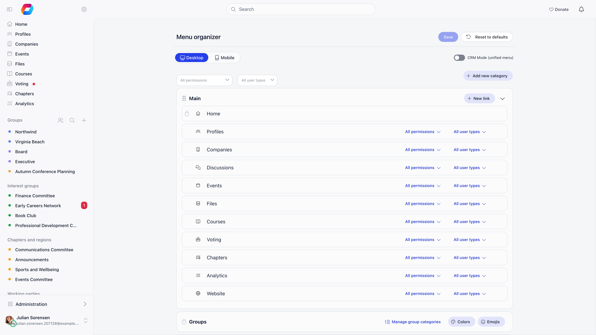
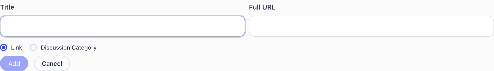

**Built for** organizations that use a subset of Orgo and want a sidebar that reflects it.
**Replaces** telling members to ignore half the menu.

The Menu Organizer edits the sidebar: the order of categories and items, their names and icons, who sees each one, and any custom links you add on top.

**Settings → Customization → Menu Organizer**

<Note>
  Requires the **Orgo administrator** flag. Changes are held locally until you press **save** (which stays greyed out until you have changed something); nothing is applied as you drag.
</Note>

---

## How the sidebar is built

The sidebar has two sections, and members switch between them:

- **Community**: the Main category, Groups and Projects.
- **Administration**: Communication, Finance and Management.

The Menu Organizer edits the **Community** categories. The Administration categories (Chapter Info, Communication, Finance, Management and Settings) are managed by Orgo and are not listed in the editor: their contents are already permission-scoped so that a member only sees what their role unlocks.

**CRM Mode (unified menu)** is a switch at the top right of the page. Turning it on merges everything into a single list and drops the Groups category, which suits organizations that use Orgo as a contact database rather than a community. In CRM mode the Administration categories become editable in the organizer too. A second switch, **Keep Groups in the CRM menu**, appears beside it and puts Groups back into the unified list.

---

## Editing the menu

<Steps>
  <Step title="Reorder">
    Drag a category by its grip handle to move it, or drag an item between categories. Categories with a padlock instead of a handle cannot be moved.
  </Step>
  <Step title="Rename">
    Click a category name to edit it inline. For an item, click the pencil next to it (or double-click the name) and type a replacement. Enter confirms, Escape discards.
  </Step>
  <Step title="Change an icon">
    Click the icon next to an item. The picker has an **Icons** tab with a searchable icon list and an **Emoji** tab.
  </Step>
  <Step title="Restrict who sees it">
    Every category and every item has a permission dropdown. Tick one or more permissions; the entry then shows for anyone holding **any** of them. Leave it empty for **All permissions**, meaning every member.
  </Step>
  <Step title="Restrict by user type">
    Where your organization uses user types, a second dropdown limits the entry to selected types. The default is **All user types**.
  </Step>
  <Step title="Hide an item">
    The **x** on an item hides it without deleting it. Hidden items stay in the list, greyed out, with a **+** to restore them.
  </Step>
  <Step title="Save">
    Click **save**. The new sidebar applies for everyone.
  </Step>
</Steps>

<Note>
  An item's permission cannot be looser than its category's. The dropdown greys out any permission weaker than the one already set on the category above it.
</Note>

---

## Permissions you can assign

The dropdown groups permissions by tier. Which ones appear depends on your enabled modules and structure.

| Tier | Permissions | Shown when |
|---|---|---|
| Organization | Admin, HR, HR Assistant, Communication Manager | Always |
| Organization | Financial | Payments module on |
| Organization | Event Manager | Events module on |
| Chapter | Admin, HR, HR Assistant, Financial, Communication Manager, Event Manager, at chapter level | Local centers enabled |
| Regional | The same roles, reaching an anchor chapter and every chapter beneath it | Parent chapters enabled |

**Orgo administrator** is offered as a separate top entry: it restricts an entry to accounts that carry the Orgo administrator flag. Note that an organization-wide Admin permission is a different, weaker thing than that flag; see [Permissions](/platform/permissions).

The two dropdowns at the top left of the page are **filters**, not settings. Pick a permission or a user type there to preview which entries that audience would see.

---

## Default menu contents

This is what a new organization starts with. Items whose module is off never render, whatever the Menu Organizer says. Some entries added to Orgo since an organization was set up (Reports, for example) are added to its sidebar automatically.

**Community → Main**

| Item | Needs |
|---|---|
| Home | Always (desktop only; hidden on mobile) |
| Members | **Who Can See Members in General Groups** permits it |
| Companies | Companies module |
| Events | Events module |
| Files | Drive module |
| Voting | Voting module |
| Chapters (Local Centers) | Local centers module |
| Courses | Courses module |
| Organisational Chart | Organisational chart and roles enabled |
| Analytics | Analytics module |

**Community → Groups** and **Community → Projects** are generated from your actual groups and projects. The editor shows their headers only, never their contents, so neither can be reordered internally. In the default menu both are also marked as not modifiable, which is why they carry a padlock instead of a grip handle. Projects requires the project management module. The Groups header carries three extra buttons: **Manage group categories**, **Colors** (the bullet colour per group kind) and **Emojis** (an emoji per group, replacing its bullet).

**Administration → Chapter Info**: the chapter's own details page. Local centers module.

**Administration → Communication**: Email campaigns, Campaign templates, Lists & Segments, Newsletter subscription, Email Log.

**Administration → Finance**: Products, Payments, Subscribers, Local products, Fee payments, Local members fees, Invoices.

**Administration → Management**: Adhesions, Contacts, Badges, Resignation requests, Merge Records, Waitlist, Transfer requests, Moderation queue, Database Queries, e-Documents, Forms, Reports, Companies, Organisation Settings.

**Administration → Settings** (chapter level): Membership fees, Waitlist and Stripe integration for a chapter's own admins.

<Note>
  Home cannot be renamed, moved, hidden or permission-scoped. It is the fixed entry point.
</Note>

On a phone, the sidebar menu lists a member's groups and group categories (five at first, then a **Show more** row that expands the rest). Projects are not shown in the phone menu.

---

## Adding your own links

**Add new category** creates an empty category you can name, order, permission-scope and fill.

**New link** on a category adds a custom entry. Two kinds:

| Kind | You provide | Behaviour |
|---|---|---|
| **Link** | A title and a **Full URL** | Opens that address |
| **Discussion Category** | A title, a **Group**, and optionally a **Category** | Jumps straight into that group's discussions, filtered to the chosen category or **All categories** |

Custom links carry the same permission and user type controls as built-in items, and can be renamed and re-iconed the same way.

---

## Previewing and resetting

The **Desktop** and **Mobile** buttons at the top switch the preview. The mobile view is read-only: it shows the Community and Administration tabs as members see them, with the reminder that changes are made in Desktop mode.

**Reset to defaults** reloads Orgo's standard menu. It asks for confirmation, then stages the reset like any other edit: nothing is applied until you press **save**, so you can navigate away to abandon it.

<Warning>
  Resetting discards every custom category, custom link, rename, icon change and permission restriction. There is no undo once saved.
</Warning>

---

## Troubleshooting

<AccordionGroup>
  <Accordion title="An item vanished for everyone">
    Check, in order: the module it belongs to is still enabled under **Settings → Modules** (a disabled module hides its entries regardless of this page), the item is not hidden (greyed with a **+**), and its category's permission is not narrower than you intended.
  </Accordion>
  <Accordion title="I cannot drag or rename Groups or Projects">
    Both are generated categories, built from your live groups and projects. The editor never lists their contents, and the default menu marks them as not modifiable, so they show a padlock. Groups gets its own colour, emoji and category tools from the buttons on its header.
  </Accordion>
  <Accordion title="Communication, Finance and Management are missing from the editor">
    Expected in normal mode: the Administration categories are managed by Orgo. Turn on **CRM Mode (unified menu)** if you need them in the editable list.
  </Accordion>
  <Accordion title="A permission is greyed out on an item">
    The category above it is already restricted to a stronger permission. An item cannot be visible to a wider audience than its category. Loosen the category first.
  </Accordion>
  <Accordion title="My renamed item shows the old name in another language">
    A rename here is a single piece of text used in every language. If you need per-language wording, use [Texts](/platform/customization/labels) instead, which has a column per language.
  </Accordion>
  <Accordion title="Nothing I changed took effect">
    The organizer is a staging area. Every action, including Reset to defaults, only applies after **save**.
  </Accordion>
</AccordionGroup>

---

## Related

- [Texts](/platform/customization/labels) - per-language wording changes across the whole interface
- [Modules](/platform/organisation/modules) - what is available to put in the menu at all
- [Permissions](/platform/permissions) - what each permission actually unlocks
- [Dashboard builder](/platform/customization/dashboard-organizer) - the dashboard equivalent
- [Customization](/platform/customization) - everything under Settings → Customization
