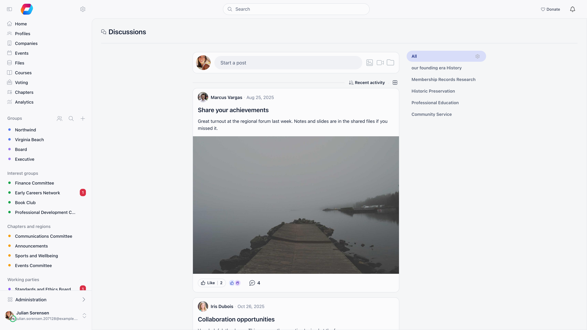
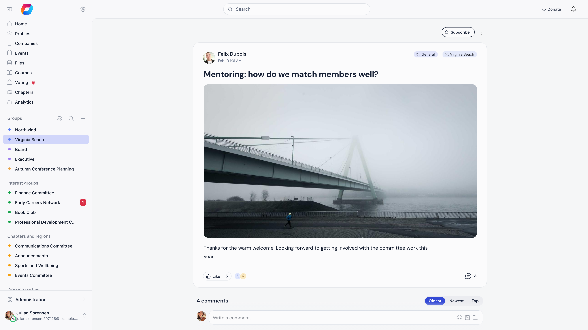
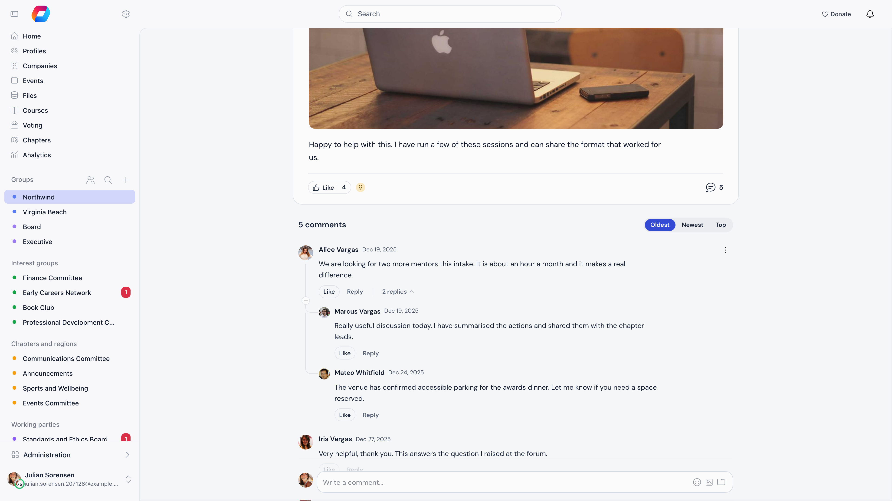
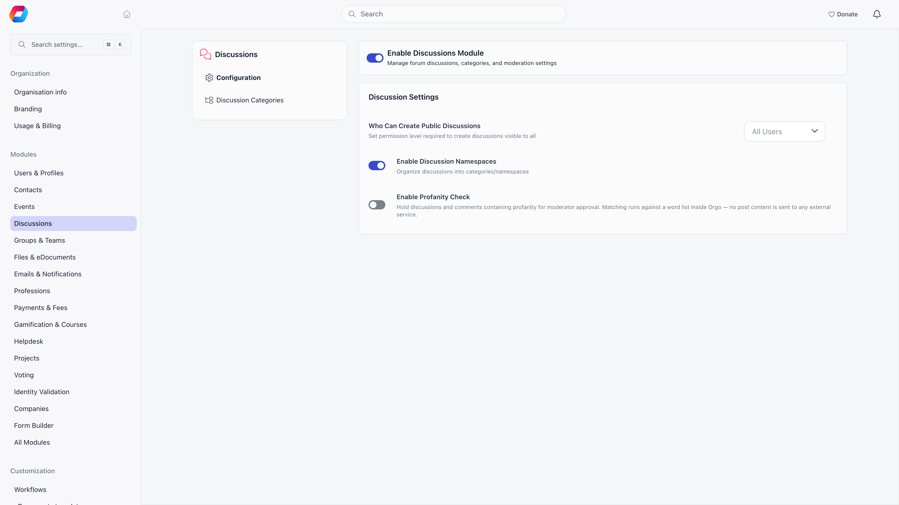

Discussions is Orgo's built-in forum. Members write posts, comment, reply, react and attach files, either in one shared organization-wide feed or inside a specific group, role group or local center.

**Built for** membership organizations that want conversation spaces tied to their own group structure: youth organizations, professional associations, alumni networks and advocacy groups.

**Replaces** Facebook Groups and standalone forums such as Discourse. It is not a chat tool: posts and comments are asynchronous, and everything is scoped by the group structure you already maintain in Orgo.

---

## Where a discussion lives

Every discussion is either organization-wide or attached to exactly one unit. Groups, role groups, local centers and organizational units are all units, so a discussion attaches to any of them the same way.

| View | URL | What it shows |
|------|-----|---------------|
| **Discussions** (default) | `/discuss` | Everything you can see: the organization-wide feed plus every group you belong to |
| Organization feed | `/discuss?generalUnit=1` | Only posts that are not tied to a group |
| One group | `/discuss?unit=<id>` | Only that group, role group or local center |
| One discussion | `/discuss/<id>` | The post, its comments and replies |

Visibility follows group membership: you see a discussion if it has no group, or if its group is one of yours (your local center, groups you hold a role in, groups that include all members, and open-access local centers when that setting is on). Administrators are not exempt, so a tenant admin does not see posts in groups they have not joined.

Events do not have discussions. Event conversations live in the event feed inside the event app.

---

## Writing a post

Select **Start a post** at the top of the feed, or the **+** button on mobile.

| Field | What it does |
|-------|--------------|
| **Title** | Optional headline. Decorative Unicode (styled "bold" characters, full-width text) is folded back to plain letters on save. |
| Body | Rich text with emoji, inline `@mentions` (up to 50 per post) and automatic link previews when you paste a URL |
| **Category** | Puts the post in a category. Picking a category that belongs to a group also posts it into that group. See [Discussion Categories](/platform/discussion/discussion-namespaces). |
| Tags | Extra tag pickers, shown only when the selected category has tag groups configured |
| **Posting in** | Where the post goes. Locked to the current group when you open the composer from inside one. |
| Comment toggle | The speech-bubble icon in the composer footer disables comments on the post |

Images, videos and files can be attached with the image, video and folder icons, or by dragging them onto the composer. One selection must stay under 1 GB in total.

---

## Reading and taking part

**Reactions.** Five reactions are available on a post or any comment: Like, I love, Agree, Applause and Insight. You hold one at a time. Selecting **Like** reacts with a like, and selecting it again takes the reaction back. To choose another reaction, hover over **Like** on a computer, or press and hold it on a phone, and pick from the tray. Hovering a reaction icon next to the count shows up to six of the people who used it and how many more there are, and selecting it opens the full list.

**Comments and replies.** Above the comments, a switch sorts them **Oldest** (the default), **Newest** or **Top**. Top puts the comments with the most reactions first, and comments with the same number of reactions stay oldest first. Every comment can be replied to, and replies can themselves be replied to, so threads nest as deep as the conversation goes. Long threads can be collapsed. Comments carry the same rich text, mentions and attachments as posts. On a phone the emoji button is hidden, because the phone keyboard has its own.

**Counts.** The footer of a post shows its reactions and its comment count. The comment count includes replies, and it leaves out comments that are held for review, hidden by a moderator or deleted. On the discussion page it updates while you watch as other members comment. Views are recorded too, as unique viewers with the author's own visits excluded, and they are shown on the discussion cards in the dashboard rather than in the feed. For how often posts are seen and opened across the whole organization, see [Communication analytics](/platform/communication-analytics).

**Following.** Creating a discussion, commenting on one, or reacting to a comment follows it automatically. **Subscribe** and **Subscribed** on the discussion page turn following on and off by hand.

---

## Who can post where

| Where | Rule |
|-------|------|
| Organization feed | The **Who Can Create Public Discussions** setting (default: All Users). Members below that level can still post in a category set to "Anyone can post". |
| A group, role group or local center | Anyone with access to it. If the group's **Who can post?** is set to **Only admins**, the composer is offered to group admins and organization-wide HR managers only. |
| Editing a post | The author. A moderator can hide it, and a chapter or organization admin can delete it. |
| Deleting a discussion or comment | The author, an admin of the group's chapter, or an organization admin for organization-wide posts. Deleting somebody else's content is written to the audit log. |

Deleting a comment deletes its replies with it, and deleting a discussion deletes all of its comments. Members who were notified of a deleted comment lose that notification too.

---

## Finding things

On a computer, the sort control under the composer offers **Recent activity** (the default), **Latest**, **Oldest**, **Most commented** and **Least commented**, and the icon next to it switches between the card view and a compact list. Phones have no sort control. Your choice is remembered on that device.

- **Recent activity** puts the discussion with the newest visible comment or reply first. A new comment lifts its discussion to the top, and hiding or deleting that comment sends it back. Edits and reactions do not move a discussion. Discussions with no comments sort by when they were posted, and ties go to the newer discussion.
- **Latest** sorts by when the discussion was first posted, whatever has happened since.

Categories appear as a panel beside the feed on desktop and as tabs on mobile. Selecting a `#tag` under a post filters the feed to that tag. Feeds load more posts as you scroll.

---

## Notifications

Followers are notified when a new comment is added, the author of a comment is notified of replies to it, and mentioned members are notified of the mention. The authors of a post or comment are also told when someone reacts to it, in the app only. Deleting a comment removes the notifications it created. Whether each one also arrives by email depends on the member's own settings and on the organization default **Email Notifications: Discussions**. See [Notifications](/platform/notifications).

---

## Settings

**Settings** and then **Discussions**. These are configuration screens, so changing them needs the **Orgo administrator** flag on your account, not only an admin permission. See [Permissions](/platform/permissions).

| Setting | What it does | Default |
|---------|--------------|---------|
| **Enable Discussions Module** | Turns the whole feature on or off | On |
| **Who Can Create Public Discussions** | Permission needed to post in the organization-wide feed | All Users |
| **Enable Discussion Namespaces** | Turns on categories and the Discussion Categories screen | On |
| **Enable Profanity Check** | Holds posts containing blocked words for a moderator. See [Moderation](/platform/discussion/moderation). | Off |

---

## Common questions

<AccordionGroup>
  <Accordion title="The organization feed is too noisy">
    Set **Who Can Create Public Discussions** to an admin level. The feed becomes an announcement channel, while members keep posting in their groups and local centers. Comments stay open either way, unless the author disables them on a specific post.
  </Accordion>

  <Accordion title="A member says they cannot see a post others are talking about">
    Discussions attached to a group are visible only to that group's members, and administrators get no exemption. Check which group the post is in, then check whether the member belongs to it. If the group checks out, have them look at [Blocking Members](/platform/discussion/blocking-members): a member they blocked is hidden from them everywhere in the forum, and only they can see that list.
  </Accordion>

  <Accordion title="Can members delete their own posts?">
    Yes, at any time. Deleting a comment also deletes the replies under it, so a member who wants to keep a conversation readable should edit the comment instead.
  </Accordion>

  <Accordion title="How is this different from the newsletter?">
    Discussions are two-way and live in the app. The [newsletter](/platform/newsletter) is a one-way email campaign. Use discussions for conversation, newsletters for announcements that must reach an inbox.
  </Accordion>
</AccordionGroup>

---

## Related

- [Discussion Categories](/platform/discussion/discussion-namespaces) organize posts by topic
- [Moderation](/platform/discussion/moderation) hold, review and hide posts
- [Blocking Members](/platform/discussion/blocking-members) how a member hides one other member's content for themselves
- [Groups](/platform/groups) where group discussions live
- [Notifications](/platform/notifications) what reaches a member and how
- [Communication analytics](/platform/communication-analytics) how often posts are seen, opened and liked, and the best time to post
- [Permissions](/platform/permissions) the permission levels used above
