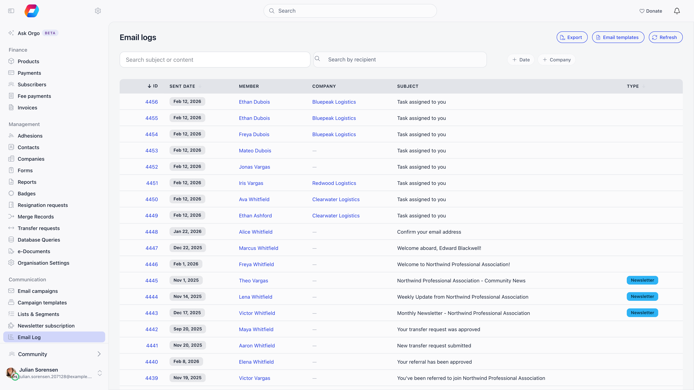
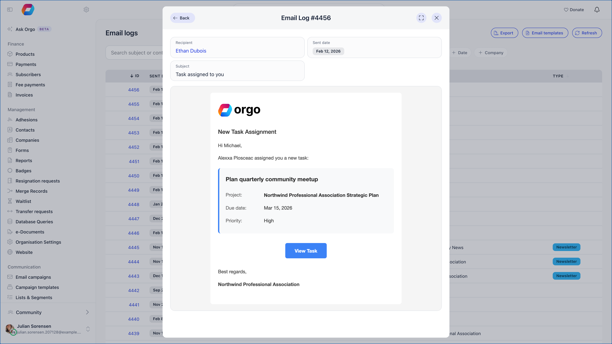

The email log answers one question well: did we send it, and what did it say. Most
email the platform sends is recorded with its recipient, subject, time and, where
available, the exact rendered body. Two gaps are worth knowing before you rely on
the log as proof: notification email (discussions, comments, mentions, events,
votes) is logged as **Transactional email** with the subject only and no body; and
a handful of emails are produced outside the logging path and leave no row at all,
among them the fee payment approval, the newsletter signup confirmation, waitlist
messages, family invitations, the vote seal and the discussion digest.

**Built for** whoever fields "I never got the renewal reminder". **Replaces**
taking the member's word for it, or your own.

The log is at **Administration** → **Email logs** (`/email-log`) and needs
organization communication managers, which organization admins also satisfy. It is also embedded in two places where you are more likely to want it: a member profile has **Email Logs** under its **More** menu (that entry itself needs the organization admin permission), and a contact record shows an **Email logs** card.

---

## Reading the list

Newest first, twenty per page. Each row shows:

| Column | What it is |
|---|---|
| **ID** | The log entry number, and the link to the full entry |
| **Sent date** | When Orgo handed the message to the mail service |
| **Member** | The member, contact or company it went to, linked to their record. When the address matches nobody, the address itself is shown |
| **Subject** | The subject line as sent, with placeholders already filled in |
| **Type** | Which kind of email it was. Only the labelled kinds carry a tag: welcome, the four membership fee reminders, the two subscription renewal results, transactional email, newsletter, and admin notification. Everything else is logged with its own internal type and leaves this column blank, so a blank Type is normal for most system mail |

ID, sent date and type are sortable.

---

## Searching and filtering

The row of filters above the table narrows the list. They combine, and none of
them can show you an email outside your organisation or outside the member or
contact you are already looking at.

| Filter | What it does |
|---|---|
| **Search subject or content** | Shows only emails whose subject or body contains what you type. Not case sensitive, and it matches part of a word. Needs at least 2 characters; with fewer, nothing is filtered. The list updates a moment after you stop typing |
| **Search by recipient** | Finds a member or contact and filters the list to them. Not shown on a profile or contact record, where the list is already theirs |
| **Date** | Emails sent on or after, and on or before, the dates you pick |
| **Company** | Emails sent to the company itself or to anyone who is, or ever was, a member or contact in it. Pick a company from the suggestions, or type part of a name and apply. Shown only when the company module is on |

On a member profile (**More** → **Email Logs**) and on a contact record's **Email
logs** card, only the **Search subject or content** box is offered, applied to
that person's emails.

<Note>
The content search reads the body Orgo stored. Notification emails (discussions,
comments, mentions, events, votes) store only the subject, and one-time codes
store no body, so searching for text from inside those messages
finds nothing. Search by a word from the subject instead.
</Note>

**Export** (top right of the standalone list) downloads the list as a CSV file
without the message body. Up to 10,000 emails go in one file; above that, Orgo asks
which page of 10,000 you want. The export follows the **Date** and **Company**
filters. The **Search subject or content** box does not reach the export: the
file holds every email in the date and company range, not only the ones you
searched for.

---

## Reading one entry

Opening an entry shows the recipient, the subject, the sent date, the type, and
**Email Preview**: the message body exactly as it was rendered for that person,
with their name, dates and links already substituted. Rows tagged
**Transactional email** that came from a notification (a discussion, comment,
mention, event or vote alert) store the subject only, so their preview is empty.
Everything else stores the full body.

This is the part that settles arguments. If a member says the payment link did not
work, you can see the link that was in their copy.

---

## Answering "the member never got it"

<Steps>
  <Step title="Find them in the log">
    Search by recipient, or open their profile and use **More** → **Email Logs**. Working
    from the profile is usually faster and avoids picking the wrong person.
  </Step>
  <Step title="No row at all?">
    Usually Orgo did not send it: either the email is switched off (check
    the [Emails page](/platform/emails/system-emails)) or the thing that triggers it
    did not happen. Check first that the email is one Orgo logs. Waitlist
    messages and family invitations are never written to the log, so their
    absence here is normal.
  </Step>
  <Step title="A row exists?">
    Orgo handed it to the mail service. Check the address on the row: an old
    address, a typo, or a placeholder address left by a data import all produce a
    row that was never going to arrive. If a whole day's mail is missing for
    everybody rather than for one member, it is not the address: tell Orgo
    support, because the row records the handover and not the delivery.
  </Step>
  <Step title="Is the address blocked?">
    An address that has hard-bounced or reported spam is blocked from further
    sending, and the person's record carries an **Emails not delivered** tag. A
    row in the log plus that tag means Orgo stopped trying on purpose, not that
    delivery failed silently. What each kind of failure does is on
    [Contacts and the newsletter](/platform/contacts/newsletter).
  </Step>
  <Step title="Right address, still missing?">
    It is a delivery problem, not an Orgo problem. Ask them to check spam and
    quarantine, and check whether their employer's mail filter is involved.
  </Step>
  <Step title="Subject starts with FAILED?">
    The message was queued but could not be delivered after repeated attempts, and
    the entry records why instead of the body. Usually the address is invalid.
  </Step>
</Steps>

---

## Questions

<AccordionGroup>
  <Accordion title="How do I find every email that mentions a word or an invoice number?">
    Type it into **Search subject or content** on **Administration** → **Email
    logs**. It checks the subject and the stored body, ignores capital letters
    and needs at least 2 characters. To limit it to one person, run it on that
    member's profile under **More** → **Email Logs**.
  </Accordion>

  <Accordion title="The search finds nothing, but I know the email was sent">
    Check three things. The text may sit in a notification email, which stores
    only the subject. It may be in a one-time-code email, which stores no body.
    Or the search has fewer than 2 characters, in which case it is ignored and
    the full list shows. Also clear any **Date**, **Company** or recipient filter
    that is hiding the row.
  </Accordion>

  <Accordion title="Can the search show me emails from another organisation or another member?">
    No. The search only narrows what the list already shows you, so it never
    reaches beyond your organisation, or beyond the member or contact whose
    profile you are on.
  </Accordion>

  <Accordion title="My export has more rows than my search showed">
    The export ignores the search box and follows only the **Date** and **Company**
    filters. Filter the downloaded file in a spreadsheet instead.
  </Accordion>
</AccordionGroup>

---

## What the log does not tell you

The log is a record of sending, not of delivery. It has no opened, clicked,
bounced or delivered status. Those exist only for newsletter campaigns, where they
are shown as campaign statistics: see [Newsletter](/platform/newsletter).

Two more gaps worth knowing:

- **Login and multi-factor codes are not logged.** Nothing at all is written for
  them. Other one-time codes (email verification, password reset, password change,
  email change, event app sign-in) do get a row, but with the code removed from
  the subject and no body stored, so nobody with access to the log can use it to
  get into a member's account.
- **Deleting a member deletes their email history.** Log entries are attached to
  the member or contact record and go with it. Export anything you need to keep
  before deleting an account.

---

## Newsletters in the log

Campaign sends appear here too, one entry per recipient, tagged as **Newsletter**
and linked to the campaign that produced them. So a member who says they received
a campaign they should not have appears in the log with the campaign named.

---

## Retention

Orgo does not expire log entries on a schedule: they stay until the person they
belong to is deleted. On a large organisation the log grows to millions of rows,
which is why it always opens filtered to a page rather than counted in full.

<Warning>
The log stores the full body of most emails, which means it holds personal data:
names, addresses, amounts, membership dates. It is restricted to organization communication managers and admins for
that reason. Take that into account in your data retention policy.
</Warning>

---

## Related

- [System emails](/platform/emails/system-emails) - what should have been sent, and its switch
- [Email templates](/platform/emails/email-templates) - changing what a message says
- [Emails](/platform/emails) - sender identity and deliverability
- [Newsletter](/platform/newsletter) - campaign statistics, including opens and clicks
- [Users & Profiles](/platform/users) - the profile's Email Logs view
- [Activity log](/platform/logs) - who changed what, with before and after values
