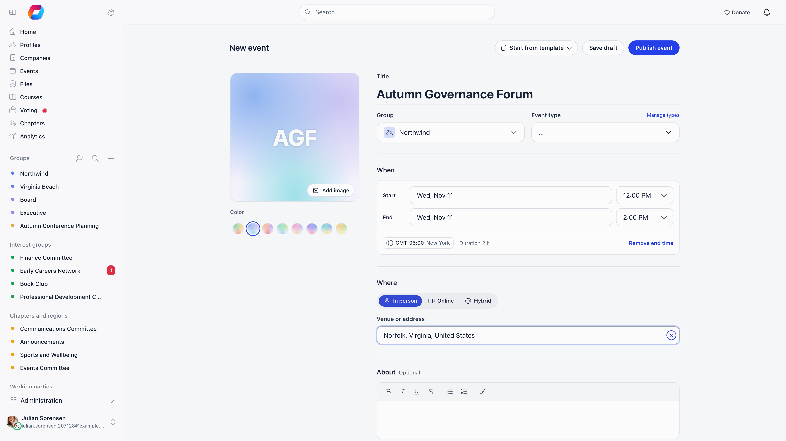
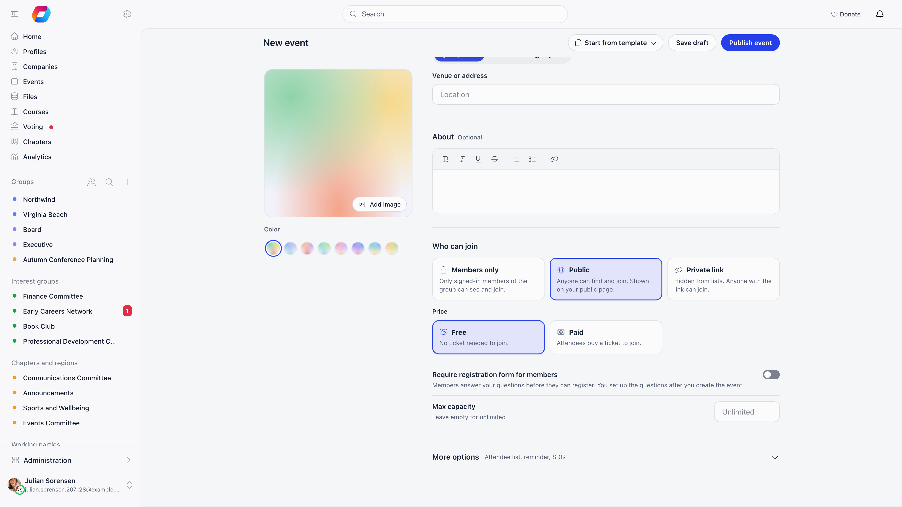

The event form is the same for a 10-person committee meeting and a 500-person ticketed conference. Sections appear or stay hidden depending on your permissions, which modules your organization has enabled, and the [event type](/platform/events/event-types) you pick (a type can hide individual fields), so most people see a shorter form than the one described here.

The form has a cover panel on the left and these sections on the right: title, group and type; **When**; **Where**; **About**; **Who can join**; and a collapsed **More options**. On a computer the action bar sits at the top, on a phone at the bottom.

**Built for** anyone in your organization who runs events: national staff, local center coordinators, and group admins.

---

## Before you start

Go to **Events** and select **Create an event**, or open a group and use its Events tab.

You can reach the form if you either hold the permission set in **Settings → Modules → Events → Who Can Create Public Events**, or belong to at least one group. If neither is true, the page tells you so and offers an **All groups** link to browse groups.

If your organization has event templates, a **Start from template** button in the action bar offers the first few, plus **Start without a template** and **Browse all templates**. See [Event Templates](/platform/events/event-templates).

Reaching the form is not the same as being allowed to save into every group it offers. Each chapter carries its own **Who can create events in this chapter** setting, and a group can be set so that only its admins create events; either is checked when you save and refuses with a permission message. See [Local Centers](/platform/groups/local-groups#creating-a-chapter).

---

## Cover image and page background

The cover panel sits on the left of the form. Choose **Add image** (or **Change image**, or drop a file on it), upload a PNG or JPEG, and a cropper opens: position and scale the image there, then confirm. **Remove image** clears it. Until you add an image the panel shows a coloured tile with the event's initials, and the **Color** swatches under it pick that colour.

The panel suggests a square image of 1000 by 1000 pixels or larger. Covers are **square (1:1) and saved at 800 by 800 pixels**. If you keep design templates for event artwork, build them at 1:1. A 16:9 banner gets cropped to the centre square, so text near the left and right edges disappears. The same file is reused at several sizes across the event list, the event page, the public page, and the mobile app.

Under the cover, **Color** sets one color used for the event's thumbnail when it has no image. **No color** leaves it plain.

### Page background

The **Background** button (**Add background** until you set one) controls what sits behind the event page and the [public page](/platform/events/public-page). It is on the form and, on a published event, at the top of the event page, where the change shows as you make it. Press **Save** in the panel to keep it.

| Tab | What it does |
|---|---|
| **Color** | A background color of its own, apart from the thumbnail color. **Match cover** reuses the cover image or the color above |
| **Photo** | Search free photos from Pixabay and pick one. The photo is copied to your organization's storage, so it keeps showing even if the original is removed from Pixabay. **Remove photo** goes back to a color |
| **Upload** | Your own image. Offered where the event can store it, and removed when the event is deleted |

The photo search needs Pixabay to be set up for your Orgo installation; where it is not, the Photo tab says **Photo search is not available**. Searching is limited to 40 searches a minute and 20 picks an hour per person.

---

## Event details

| Field | What it does |
|---|---|
| **Title** | Required. |
| **Group** | Who the event belongs to. The dropdown has two sections: **Main groups** (your organization as a whole, local centers, role groups, and unit-typed groups) and **groups** (regular groups you belong to), and is searchable. The organization-wide option only appears if you hold the **Who Can Create Public Events** permission. A chapter is offered whether or not you may create events in it, so picking one is only accepted on save if you meet that chapter's own threshold. Once the event is published the group is locked and shown as a tag. |
| **Event type** | Optional category, with a colour dot per type and a search box. Admins get a **Manage types** shortcut next to the label. See [Event Types](/platform/events/event-types). |
| **Custom Status** | Only when **Enable Custom Statuses** is on. Pick one of your organization's statuses, or None. Admins get a **Manage event statuses** link. |

### When

| Field | What it does |
|---|---|
| **Start** | A date picker plus a time dropdown. |
| **End** | Optional. Use **Add end time** and **Remove end time**. Adding an end time sets it to the event type's default length, or two hours after the start, and moving the start past the end pushes the end to start plus two hours. The form shows the **Duration** once both ends are set. |
| **Timezone** | Set per event, defaulting to your own profile timezone. Click the timezone label to choose from **Popular Time Zones** or search **All Time Zones**. Picking a venue from the address suggestions replaces it with that venue's zone, so a host in one city can create an event in another without doing the sums; choosing a zone by hand overrides it. Attendees see the event in this zone and, when theirs differs, their own time as well: see [Times and timezones](/platform/events/index#times-and-timezones). Opening a saved event never changes its zone. |

An event whose dates are already in the past is published immediately on save, and the form says so ("Past events are published immediately").

### Where

When both location and online fields are available, a switch offers **In person**, **Online** or **Hybrid**, and shows only the matching fields.

| Field | What it does |
|---|---|
| **Venue or address** | Address autocomplete backed by Google Places. Picking a suggestion stores coordinates, draws a map preview on the form and the event page, sets the event's timezone to the venue's, and makes the event findable in the events list's [location search](/platform/events/index#search-by-location) (US organizations). You can also type a plain address, which has no map, no radius match and no timezone change. Clearing the location also removes the map. |
| **Meeting link** | A URL for Zoom, Meet, Teams, or anything else. The event page shows a **Join meeting** button, named after the service when it is Zoom, Google Meet or Microsoft Teams. On a ticketed event, or one that needs a registration form, the link itself appears only once the person has registered; hosts always see it. Choose **Hybrid** to fill in both a venue and a link. |

### About

An optional rich-text **About** section holds the description, with formatting, links, and pasted images. It is collapsed until you open it.

Choosing the event type set as **Training Event Type** in module settings adds a **Training type** selector. Choosing the type set as **General Meeting Event Type** adds the general meeting checkboxes (general meeting, elective, extraordinary).

<Note>
There is no recurrence feature. For a weekly meeting, create the first event and use **Duplicate Event** from the event's **Actions** menu for each later date, or build an [event template](/platform/events/event-templates) so each new instance starts pre-filled.
</Note>

---

## Who can join

This section only appears if you can manage events (event admin rights on the group, or the organization's public-posting permission).

**Audience** is a choice of three cards:

- **Members only**: only signed-in members of the group can see and join.
- **Public**: anyone can find and join, and the event is shown on your public page.
- **Private link**: hidden from lists; anyone with the link can join.

The Audience cards only appear if you hold the permission named in **Who Can Create Public Events**, and **Public** and **Private link** are hidden entirely for non-joinable (private) groups. The server enforces both rules, so a request that sets Public without the permission is saved as Members only rather than rejected.

**Price** is **Free** ("No ticket needed to join") or **Paid** ("Attendees buy a ticket to join"). Paid is only offered when the Online Payments module is active, and only to organization-wide event admins and finance admins. Choosing Paid turns the event into a ticketed one and creates a linked product behind the scenes, plus a Stripe product when a Stripe account is connected; a note then says ticket types, prices and add-ons are managed from the **Tickets** menu. Saving a Paid event needs the organization-wide event permission specifically: finance admins see the option, but the save is rejected with a permission error. See [Ticketing](/platform/events/ticketing).

| Setting | What it does |
|---|---|
| **Require registration form for members** | Members fill in a form instead of a one-click RSVP. Forced on and locked for paid events, and switched on by the Public and Private link audiences. You set up the questions after you create the event. |
| **Max capacity** | A cap on registrations. Empty means unlimited. Hidden for paid events, where seats are set per ticket type instead. |

**Close registrations** is no longer on the form: open the event and use the **Actions** menu in its header (it then reads **Reopen registrations**). It stops all new registrations and ticket purchases without deleting anything.

---

## More options

A collapsed **More options** section holds the rest. Its one-line summary shows what you changed.

| Setting | What it does |
|---|---|
| **Visibility of attendee list** | **Only hosts** or **Attendees** (hosts and everyone registered). |
| **Enable 1:1 networking** | Lets attendees book 15-minute meetings with each other in the [event app](/platform/events/event-app). Requires the attendee list to be visible to attendees, and turning that off again clears this. Manage spaces from **Networking spaces** in the sidebar. |
| **Send reminder 1 hour before event starts** | Emails everyone who registered an hour ahead. |
| **Guest tickets** | Shown on events that use a registration form or are paid. Lets you give each person you add extra tickets to share. |

The speakers tab no longer has a switch on this form: the **Program & Speakers** entry is always in the event sidebar, and adding a speaker turns speakers on for the event.

---

## Optional sections

These sit inside **More options** when they apply.

**Gamification** (when tiers are enabled and you are an organization-wide event admin): award **Points** for the event, and optionally a badge granted to participants marked as attended.

**SDG** (when the SDG setting is on): tag the event with any of the 17 UN Sustainable Development Goals. **Detect SDGs** proposes tags from the title and description, and needs a title plus at least 20 characters of description.

**Send attendance reminder 24 hours after event ends** appears when the module setting is on: the reminder goes to you, the host, so attendance actually gets recorded.

**Restrict editing to user type** appears when **Restrict Event Editing by User Type** is on and you are an organization-wide event admin or organization admin. Local users then need the chosen user type to edit the event, and deleting it requires the organization-wide event permission.

**Propagate event to all local centers** appears on creation only, for organization-wide event admins, when both the Local Centers module and **Propagate Events to Local Centers** are on, and the selected group is not private. Saving then creates one **published** copy in every active local center rather than a single event (the form warns that copies publish right away, so create the event without propagation first to test), and returns you to the events list. A template whose agenda is too large to copy to every chapter blocks propagation. A second toggle, **Send invites to members**, adds every member of all those centres to each copy's participant list as **Invited**. It does not currently send any email, so announce the event separately.

---

## Draft, publish, invite

The action bar offers two buttons: **Save draft** and **Publish event**. A draft is visible only to people who can edit the event: its owner, organization-wide event admins, and the event admins of its group or chapter. Ordinary members are turned away. An event whose dates are already in the past is published immediately on save, so only a single save button shows.

Open a draft and its banner reads "Draft: Only organizers can see this event". It offers **Preview public page**, **Share preview** (a link organizers can send to people who cannot otherwise see the draft; it stops working when you publish) and **Publish Event**. On a draft you can click through the public page and its checkout as a visitor would, but the final payment or registration is disabled.

<Steps>
  <Step title="Publish">
    Publishing a future event notifies the members of its group. Publishing a past event, or a **Private link** event, does not notify anyone.
  </Step>
  <Step title="Choose whether to invite">
    If **Bulk Invites** is enabled, publishing asks whether to invite all members of the group, with **Send Invites** and **Skip Invites**.
  </Step>
  <Step title="Invite later">
    A published event shows **Send Invites to All Members** until invites go out. Sending switches to "Sending invites..." and then to a confirmation. Invites cannot be sent while the event is still a draft.
  </Step>
</Steps>

---

## After publishing

Editing is the **Edit** button in the event header. Everything stays editable except the hosting group, which the form locks on publish. Attendees are not told automatically when you change details, so send them a message from the event's **Messages** entry.

The **Actions** menu next to it holds **Close registrations** (or **Reopen registrations**), **Duplicate Event** (pick the target group), **Save as Template** (organization admins only; see [Event Templates](/platform/events/event-templates)) and **Delete**.

Deleting behaves differently either side of five participants. Under five, the delete is refused if any attendee has a payment attached. From five upwards the event is hidden rather than erased: it disappears from every list and its address stops working, but the record and its attendees are kept. There is no undo button, so recovering one means asking Orgo support.

---

## Related

- [Events overview](/platform/events) - module settings and the event workspace
- [Event Types](/platform/events/event-types) - categories and custom statuses
- [Event Templates](/platform/events/event-templates) - pre-filled events, tickets, and forms
- [Ticketing](/platform/events/ticketing) - ticket types, add-ons, and checkout
- [Attendance](/platform/events/attendance) - invitations, RSVPs, and check-in
