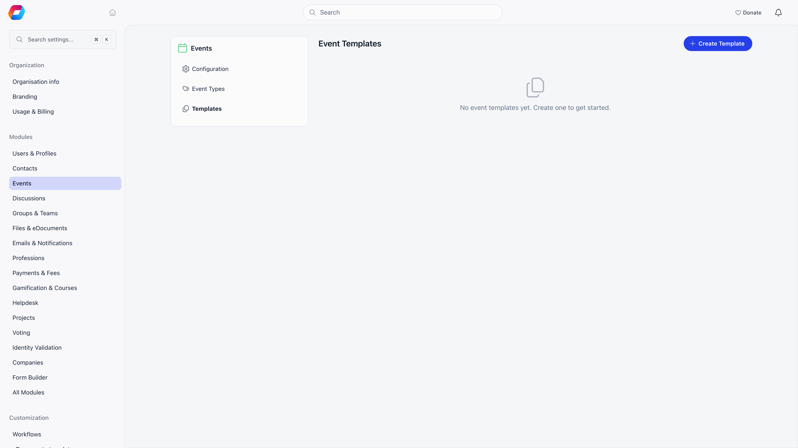
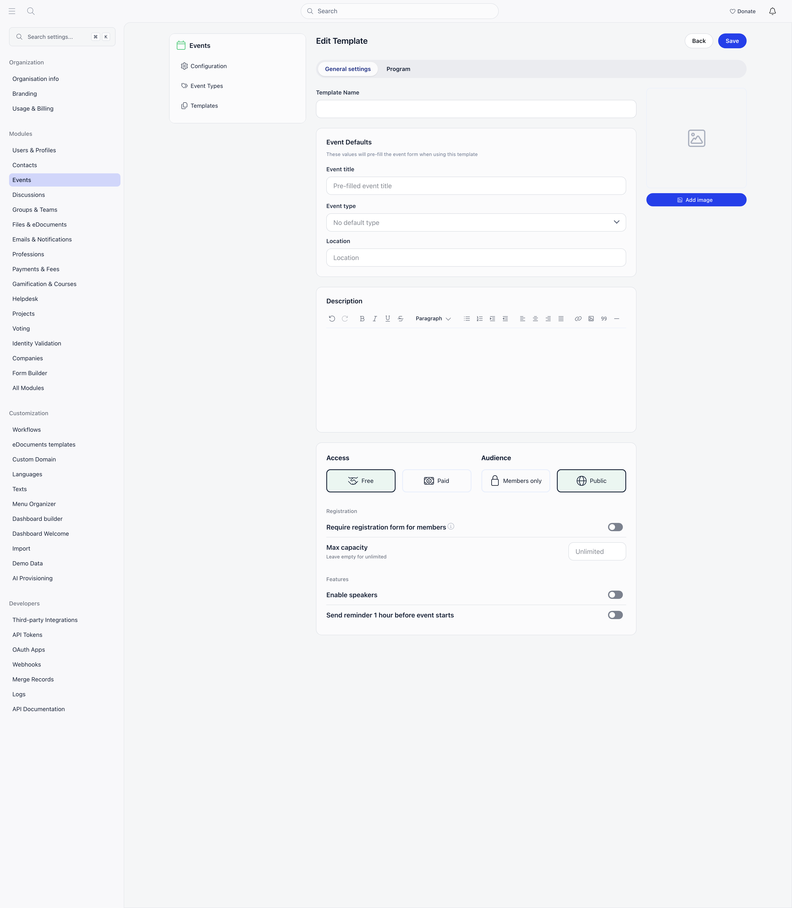
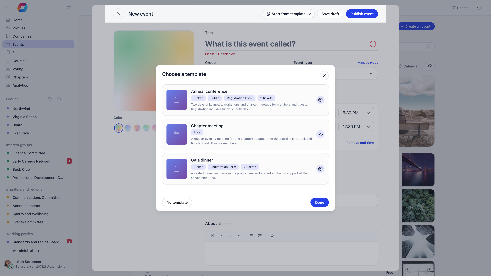

An event template is a saved blueprint: title, type, location, description, cover image, access settings, registration form, ticket types, add-ons, discount codes, and an agenda of sessions. Organizers pick a template when creating an event and everything arrives pre-filled.

**Built for** organizations that run the same shape of event repeatedly (monthly meetups, a standard training, a recurring gala) and want every organizer to start from the approved setup instead of rebuilding it.

**Replaces** the copy-paste-and-hope approach of duplicating last year's event.

---

## Where templates live

**Settings → Modules → Events → Templates**. Creating, editing, and deleting templates requires the **Orgo administrator** flag on your account, not only an admin permission. Templates belong to the whole organization, not to a group or local center.

Each card shows the template name, whether it is free or ticketed, whether it is members-only or public, whether it needs a registration form, how many ticket types it carries, and its default event type. Selecting a card opens it for editing; the trash button deletes it after a confirmation ("Delete Template").

---

## Two ways to create one

<Steps>
  <Step title="Build it from scratch">
    **Settings → Modules → Events → Templates → Create Template**.
  </Step>
  <Step title="Or save an existing event as a template">
    Open any event, then choose **Save as Template** from the **Actions** menu in the event header and give it a name. This copies the event's settings, its cover image, its live ticket types (skipping archived ones), its vouchers, its custom registration fields, and its agenda sessions. Requires the **Orgo administrator** flag.

Two limits to know: ticket **add-ons** and the membership level or chapter lists on a ticket are not copied this way, so re-add them in the template editor. Agenda sessions are stored as a day number counted from the event's start date plus a start and end time; a session that starts before the event's start date is left out, and a template holds at most 200 sessions.
  </Step>
</Steps>

---

## What a template stores

The editor has two tabs, **General settings** and **Agenda**.

| Section | Fields |
|---|---|
| Identity | **Template Name** (what admins see in the list; never shown to attendees) |
| Event Defaults | **Event title**, **Event type**, **Location** (with Places autocomplete and map preview) |
| Description | Rich text, pre-filled into the event description |
| Access | **Free** or **Paid** |
| Audience | **Members only** or **Public** (there is no private-link option on a template) |
| Registration | **Require registration form for members** (locked on for paid), **Max capacity** |
| Features | **Enable speakers**, **Send reminder 1 hour before event starts** |
| Registration Form | Form fields, form settings, and styling (see below) |
| Tickets | Ticket types and add-ons, when Access is Paid |
| Vouchers | Discount codes, when Access is Paid |
| Agenda | Sessions on the **Agenda** tab |
| Cover image | Uploaded and cropped in the right-hand panel |

A template deliberately does **not** carry the event's dates, the hosting group, attendees, or speakers. Those are decided per event. Agenda sessions are the exception to "no dates": they are kept as day offsets and times and re-dated when you pick the event's start date.

### Registration form

This card appears once the template requires a registration form or is Paid. The **Form fields** tab is a drag-and-drop builder. Standard fields available: Email and Name (always required), plus Phone, Organisation, Role, Town, LinkedIn, X (Twitter), Instagram, Company Identifier, Company Name, and Company Address. You can also define custom fields with a name and a type: text input, text area, dropdown, radio, checkboxes, date, or yes/no. Dropdown, radio, and checkbox fields need at least two options. See [Registration Forms](/platform/events/registration-forms) for what each field does.

The **Settings** tab holds **Disable newsletter subscription**, **Disable register checkbox**, and **Custom text at bottom of registration form** (shown above the consent checkboxes).

The **Styling** tab holds **Display title**, **Selected color**, **Button color** and **Hero image border radius**.

### Tickets, add-ons and vouchers

When Access is Paid, the template shows the same **Ticket types**, **Add-ons** and **Vouchers** lists as an event's Tickets page, with the same editors, working on the template's draft copies. A ticket carries a name, price, description, who can buy it (**Everyone**, **All members** or **Specific members** by level or chapter) and a seat count; there is no sales window on a template, because a template has no dates. Add-ons carry a name, price, which tickets they are offered with, a per-ticket limit, a total and **Adds a separate attendee**. Vouchers carry a code, a percentage or fixed discount, **Never more than**, **Tickets per order**, **Max orders**, **Active** and an optional restriction to ticket types. Ticket links and invitations are not part of a template. See [Ticketing](/platform/events/ticketing) for what each of those does at checkout.

### Agenda

The **Agenda** tab builds the event's schedule ahead of time. "Days count from the event start date; times are in the event timezone." Use **Add session** to add sessions, and the pencil and bin icons on each row to edit or delete one. Sessions with stage colours show them in the list, and you can filter by stage.

---

## Using a template

On the events list, select **Create an event**. When your organization has at least one template, a **Start from template** button appears in the action bar of the create form. It lists up to five templates, followed by **Start without a template** (once one is chosen) and **Browse all templates**.

The picker, titled **Choose a template**, lists every template with its badges (ticket count, session count, free or ticket, public, registration form). The eye button opens a full preview: cover image, event title, type, location, description, ticket types, vouchers, the agenda, registration form fields, and max capacity. From the preview you can select **Use this template**.

Selecting a template pre-fills the form. You can still change anything before saving. If the template's agenda runs over more days than the event, the form warns you and offers **Extend end date to N days**. **Start without a template** clears the form back to defaults while keeping the timezone and the group you already chose.

When you save, Orgo creates the event and then applies the rest of the template: it copies the cover image, creates the agenda sessions on the right dates, creates the ticket types, add-ons and vouchers, creates the custom fields, and writes the registration form layout. If any ticket, add-on or voucher fails to create, a message names it and you can add it from the Tickets page. A template with a very large agenda cannot be used with **Propagate event to all local centers**.

<Note>
Template management is admin-only, but the picker itself works for any organizer who can create an event. That is the point: admins curate the setups, everyone else uses them.
</Note>

---

## Common questions

<AccordionGroup>
  <Accordion title="I changed a template. Do existing events change too?">
    No. A template is applied once, at creation. Events created earlier keep whatever they had.
  </Accordion>

  <Accordion title="A template or a duplicate: which should I use?">
    Duplicate copies one specific event, including its group and its agenda, and is quickest for "same event, new date". A template is the right tool when several people create similar events and you want a consistent starting point without them hunting for last year's event.
  </Accordion>

  <Accordion title="Can a template set the hosting group?">
    No. The group is always chosen on the event form, because it decides who sees the event and which permissions apply.
  </Accordion>

  <Accordion title="Why does a paid template force the registration form on?">
    Ticket buyers have to supply at least a name and email to receive a ticket, so paid events always collect a form. The toggle is shown but locked.
  </Accordion>
</AccordionGroup>

---

## Related

- [Create Event](/platform/events/create-event) - the form a template pre-fills
- [Event Types and Statuses](/platform/events/event-types) - the type a template can default to
- [Ticketing](/platform/events/ticketing) - ticket types, vouchers, and checkout
- [Registration forms](/platform/events/registration-forms) - the per-event form builder
- [Events overview](/platform/events) - module settings and the event workspace
