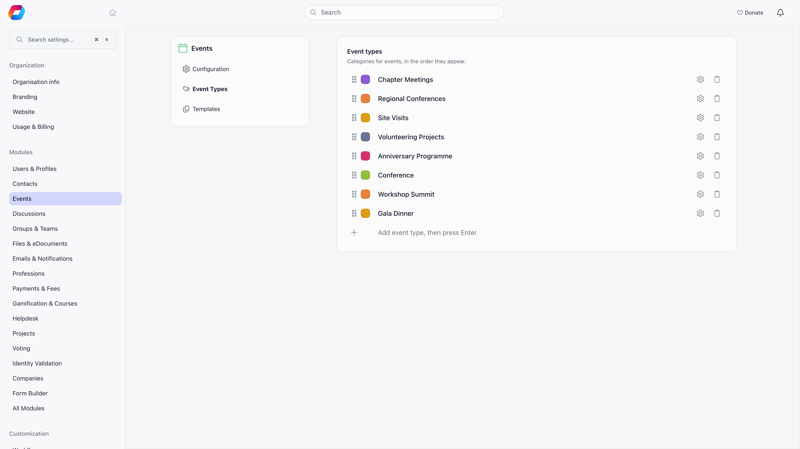
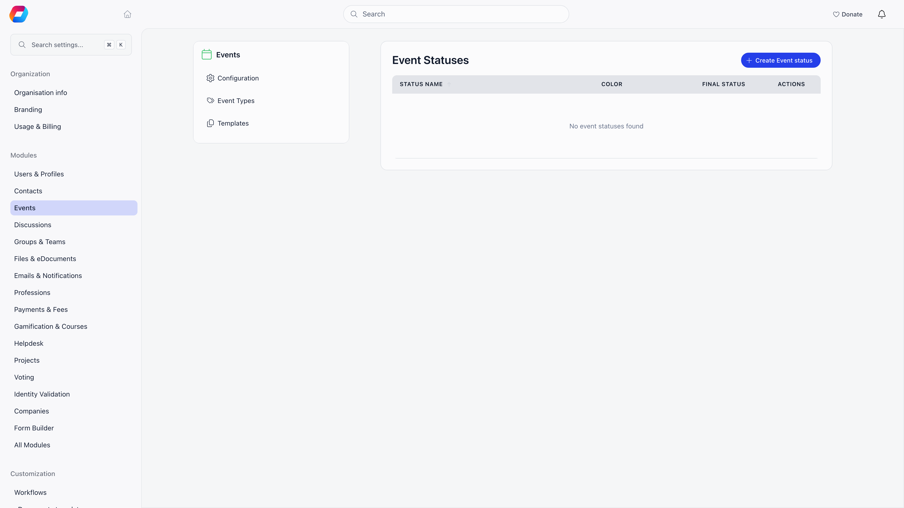

Two separate lists shape how events are labelled. **Event types** say what kind of event it is (Workshop, Camp, General Assembly). **Event statuses** say where the event is in your own workflow (Planned, Confirmed, Finalized). Types are always available; statuses are an opt-in feature.

**Built for** organizations running more than one kind of event and wanting to filter and report on them.

---

## Event types

**Settings → Modules → Events → Event Types**. Creating, renaming, and deleting types requires the **Orgo administrator** flag on your account, not only an admin permission. Every member can see and choose types.

The page lists your types in the order members see them. To add one, type a name in the **Add event type, then press Enter** row at the bottom. To rename a type, edit its name in the row; the coloured dot beside it sets the type's **Color**. Drag the handle at the left of a row to reorder the types. The gear icon (**Event form**) opens the type's settings, and the trash icon deletes it.

Once created, the type appears in the **Event type** dropdown on the event form and in the **Type** filter on the events list. Its coloured name shows on event cards.

### What a type controls

The gear icon opens a panel with two sections. Both only shape events created from now on: existing events are not changed.

**Event form** lists the fields of the event form in groups (Details, Access and audience, Registration, Features, Other). Each row has a switch to show or hide that field for events of this type. Where a field has a starting value, a **Default value** appears beside it, for example Access (**Free** or **Paid**), Audience (**Members only**, **Public** or **Private (link only)**), **Max capacity**, or **Send reminder 1 hour before event starts**. When you hide a field, every event of that type gets its default value and the organizer never sees the field. **Default duration (hours)** prefills the end time from the start time; when the end time is hidden, events end after this duration (leave it empty for no end time).

**Event menu** has a switch for each sidebar entry an event of this type can show: **Event app**, **Program**, **Votes**, **Analytics**, **Messages**, and **Report** (when event reports are on). Switch one off and that entry disappears from the sidebar of every event of this type.

A type you leave untouched keeps showing every field and entry, with the usual defaults.

<Warning>
Deleting a type does not delete its events. Those events simply lose their type and become uncategorized, which also removes them from type-filtered views. Reassign them first if the history matters.
</Warning>

### The two special types

Two settings under **Settings → Modules → Events → Configuration** point at a type and change what the event form shows when it is selected:

| Setting | What selecting that type adds to the event form |
|---|---|
| **Training Event Type** | A **Training type** selector. The event also gains a **Trainers** entry in its sidebar. Members flagged as trainers can pick this type even when their permission level would not normally allow it. |
| **General Meeting Event Type** | Three checkboxes: **is general meeting** (set automatically and read-only), **with elections** and **is extraordinary**. Switching away from the type clears all three. |

Nothing else about an event changes with its type. Ticketing, capacity, visibility, and permissions are all set on the event itself.

---

## Custom event statuses

Statuses are off by default. Turn on **Enable Custom Statuses** in **Settings → Modules → Events → Configuration** and an **Event Statuses** entry appears in the module menu. Click **Create Event status** to add one; each row can be edited or deleted.

Each status has:

| Field | What it does |
|---|---|
| **Name** | What shows in the status dropdown and the events list filter. |
| **Color** | The colour of the status tag. New statuses default to amber. |
| **Mark as final status** | Flags the status as an end state. Statuses marked final are labelled **Final** in the status dropdown on the event form. Each time someone saves an event whose status is a final one, a **Congratulations!** dialog appears for them ("Your event has wrapped up successfully"), not only the first time. Only one status can be final: when you mark a second one in this settings screen, the first is un-marked for you. |

Creating, editing, and deleting statuses requires the **Orgo administrator** flag on your account, not only an admin permission.

### Using statuses

On the event form, a **Custom Status** dropdown appears (unless the event's type hides it) with your statuses plus a **None** option. Admins get a **Manage event statuses** shortcut next to it.

On the events list, a **Custom status** filter appears in the filter bar next to **Type**.

<Note>
Custom statuses are a label you control. They are independent of the built-in draft and published states, which decide who can actually see an event. Moving an event to a status named "Cancelled" does not hide it or stop registrations; use **Close registrations** in the event's **Actions** menu for that.
</Note>

---

## Choosing your types

Most organizations settle on five to eight types. Fewer and the filter is not worth using; more and organizers start picking at random. Some working sets:

| Organization | Types |
|---|---|
| Youth or scouting | Meeting, Training, Camp, Social Event, General Assembly, Volunteer Activity |
| Professional association | Networking, Conference, Webinar, Workshop, Board Meeting, AGM |
| Community group | Meetup, Workshop, Social, Fundraiser, Meeting |

Statuses work best as a short pipeline, for example Planned, Confirmed, Running, Finalized, with only the last one marked final.

---

## Common questions

<AccordionGroup>
  <Accordion title="Can I merge two event types?">
    Not directly. Open the events on the type you want to retire, switch each to the type you are keeping, then delete the empty type.
  </Accordion>

  <Accordion title="Do members see event types?">
    Yes. The type name appears on event cards and members can filter the events list by it, so name them for members rather than for admins.
  </Accordion>

  <Accordion title="Can an event have more than one type?">
    No. One type per event. Use [SDG tags](/platform/events/create-event) if you need a second, multi-value dimension for reporting.
  </Accordion>

  <Accordion title="What happens to the special-type settings if I delete that type?">
    The setting keeps pointing at a type that no longer exists, so the training and general meeting fields stop appearing. Pick a new type in **Settings → Modules → Events → Configuration**.
  </Accordion>
</AccordionGroup>

---

## Related

- [Create Event](/platform/events/create-event) - where types and statuses get applied
- [Event Templates](/platform/events/event-templates) - templates can carry a default event type
- [Events overview](/platform/events) - all Events module settings
- [Annual Report](/platform/events/annual-report) - reporting across events
