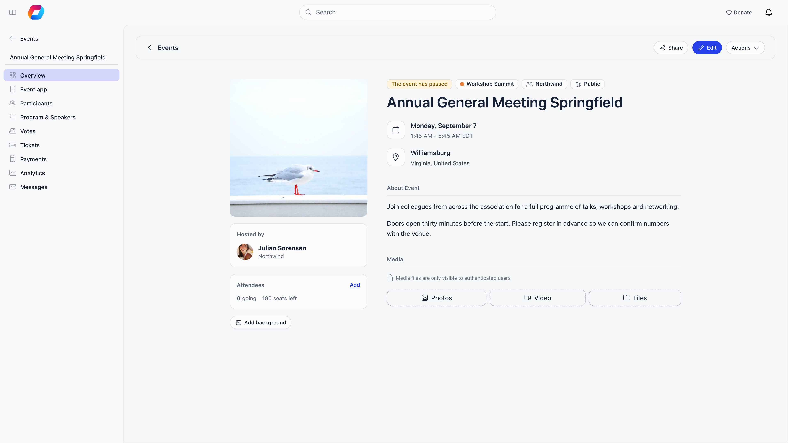
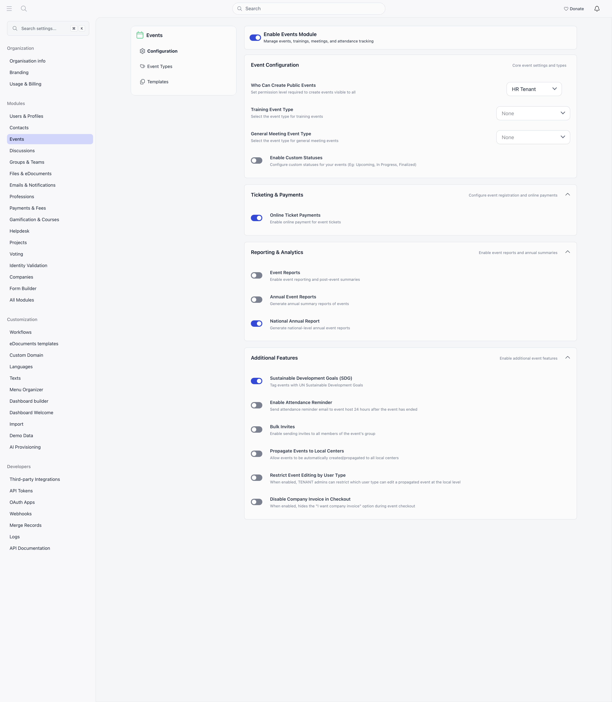

Orgo Events lets your organization create and publish events, take free RSVPs or sell tickets, run the event day itself, and report on what happened, all against your member database rather than a separate tool.

**Built for** membership organizations running events for members and the public: professional associations, youth organizations, alumni networks, faith communities, and federated nonprofits.

**Replaces** Eventbrite for ticketing and RSVP management tied to your member list, not for public marketplace discovery.

Running events for a specific kind of organization? [Scouting and youth organizations](/platform/templates/scouting#camps-and-events) covers camps end to end, and [Political parties](/platform/templates/political-party#internal-elections) covers internal elections. See all [Setup Templates](/platform/templates).

---

## What you can do

<CardGroup cols={2}>
  <Card title="Create events" icon="calendar-plus" href="/platform/events/create-event">
    Dates, timezone, location or online link, cover image, capacity, and visibility.
  </Card>
  <Card title="Sell tickets and add-ons" icon="ticket" href="/platform/events/ticketing">
    Multiple ticket types with seat limits and sale windows, add-ons, discount codes, and Stripe checkout.
  </Card>
  <Card title="Publish a public page" icon="globe" href="/platform/events/public-page">
    A page non-members can open and register on without an Orgo account.
  </Card>
  <Card title="Check people in" icon="clipboard-check" href="/platform/events/check-in">
    QR tickets, a scanner in the mobile app, and manual check-in from the participant list.
  </Card>
  <Card title="Run the event app" icon="mobile" href="/platform/events/event-app">
    Program, live feed, participants, 1:1 networking, and in-event votes for attendees.
  </Card>
  <Card title="Report on it" icon="chart-line" href="/platform/events/analytics">
    Per-event analytics, event reports, and annual summaries.
  </Card>
</CardGroup>

---

## The events list

**Events** in the main menu opens the list. A **Search events** box sits at the top, with **Upcoming** and **Past** tabs below it and a **List** / **Calendar** switch beside them. On **Upcoming**, a highlighted card at the top shows the next event ("Next up", or "Happening now" while it is on; "Your next event" if you are registered). The **Calendar** view shows one month at a time, with a stepper and a **Today** button.

The filter bar offers **Show only** (**Registered**, **Not registered**, **Hosted by you**, **Online**, **Local events**, **Unit events**), **Location** (a ZIP code and radius, only for organizations in the United States), **Type**, **Status** (**Draft** or **Published**), **Custom status** (only when custom statuses are enabled) and **SDG** (only when SDG tagging is enabled).

The clock icon opens **Sync to my calendar** and **Change your timezone**. Times follow your account timezone.

**Create an event** opens the form in a panel over the list, with a **Start from template** button when your organization has event templates.

---

## Where events live

Every event belongs to one place, chosen in the **Group** field on the event form.

| Choice | Who sees it |
|---|---|
| Your organization (the top option in **Main groups**) | Everyone, subject to the audience setting. Only offered if you hold the permission set in **Who Can Create Public Events**. |
| A **local center** | People in that center. Creating here follows that chapter's own **Who can create events in this chapter** setting, which is **Event managers** until the chapter changes it. See [chapter event permissions](/platform/groups/local-groups#creating-a-chapter). |
| A **group** | Group members. If the group is marked so that only its admins can create events, you need to be a group admin or owner, or be an organization admin or an organization-wide event manager. |

Chapters set their own bar. **Who can create events in this chapter**, on the chapter edit form, is one of **Event managers (default)**, **Any member of this chapter**, or **Chapter admins only**. The form notes that it applies to this chapter only and that organisation admins and event managers can always create events. That holds for all three settings, **Chapter admins only** included: organization admins and organization-wide event managers are never refused. **Any member of this chapter** in practice means any signed-in member of your organisation: chapter membership is not checked. The setting covers only the chapter it is set on and is never inherited by the chapters below it, and anyone below the bar is refused on save with *You do not have permission to create events in this local center*.

Each event is also **Members only**, **Public** or **Private link**. Public and Private link need the **Who Can Create Public Events** permission and is never offered for non-joinable (private) groups. A third audience, **Private link**, is public but hidden from lists: anyone with the link can join. Events start as **drafts** until someone publishes them. A draft is visible only to the people who can edit it (its owner, event managers and the admins of its group or chapter); ordinary members cannot see it in the list or open it. See [Create Event](/platform/events/create-event).

---

## The event workspace

Opening an event gives people who run it a sidebar whose entries depend on the event's own settings and your permissions. Ordinary members do not see the sidebar. "Manager" below means anyone who can manage the event: its owner, or a holder of the event permissions listed under [Who can do what](#who-can-do-what). An [event type](/platform/events/event-types) can hide some entries (Event app, Agenda, Votes, Analytics, Messages, Report) for every event of that type.

The registration panel on the right only appears while the event is still ahead. On a past event the event page carries a **The event has passed** tag and the panel is gone.

The bar above the event page holds **Share** (once the event is published), **Edit**, and an **Actions** menu. The **Actions** menu holds **Close registrations** / **Reopen registrations**, **Duplicate Event**, **Save as Template** and **delete**, each shown only to people allowed to use it.

| Entry | Shown when | What it does |
|---|---|---|
| **Overview** | always | The event page members see |
| **Event app** | the event has a location | Opens the [attendee app](/platform/events/event-app) |
| **Participants** | manager | [Participants, invitations, and check-in](/platform/events/attendance) |
| **Trainers** | the event uses the training type | Assign trainers |
| **Program & Speakers** | always (the word follows the label chosen on the event: speaker, coordinator or moderator) | Managers build the agenda from sessions and add internal members or external people as speakers when **Enable speakers** is on; others see the speakers only |
| **Networking spaces** | **Enable 1:1 networking** is on | Define where and when meetings can be booked |
| **Votes** | manager | [Votes](/platform/e-voting) attached to this event |
| **Registration form** | the event requires a registration form | [The form builder](/platform/events/registration-forms) |
| **Tickets** and **Payments** | ticketed event, plus Financial or Event admin rights across the organization | [Ticket types and orders](/platform/events/ticketing) |
| **Analytics** | manager | [Registration and revenue metrics](/platform/events/analytics) |
| **Messages** | manager who is an organization-wide event or communication admin | Email the event's audience |
| **Public page** | the event is published and public | Opens the [public page](/platform/events/public-page) |
| **Preview public page** | the event is a public draft and you can edit it | Opens a preview of the public page |
| **Report** | **Event Reports** is on | [The post-event report](/platform/events/event-report) |

To change an event, use the **Edit** button in the bar above the event page. The shareable link comes from **Share**. **Duplicate Event** copies everything except attendees into a new draft, in the group you choose. **Save as Template** (organization admins only) turns the event into a reusable [template](/platform/events/event-templates), agenda included. **delete** is refused if a payment is attached to any attendee; once an event has five or more participants it is hidden rather than erased.

---

## Module settings

**Settings → Modules → Events**, requiring an organization admin.

The module menu also holds **Event Types**, **Templates** and, once the matching setting is on, **Event Statuses** and **Attendance Reminder**.

| Setting | What it does |
|---|---|
| **Who Can Create Public Events** | The permission level needed to create an organization-wide event and to mark any event Public. Defaults to HR Tenant. This is a ceiling: a local event manager cannot exceed it. It does not decide who may create an event inside a chapter, which each chapter sets for itself. |
| **Training Event Type** | Which [event type](/platform/events/event-types) marks an event as a training. |
| **General Meeting Event Type** | Which event type marks an event as a general meeting. |
| **Enable Custom Statuses** | Adds your own event statuses alongside draft and published. |
| **Online Ticket Payments** | Listed under Ticketing and Payments. In practice the Paid option on the event form is gated by the Online Payments module being active and by your Stripe connection. |
| **Event Reports** | Adds the post-event report. |
| **Annual Event Reports** | Generates annual summaries of events. |
| **National Annual Report** | Annual reporting at organization level. |
| **Local Annual Report** | Annual reporting per local center. |
| **Sustainable Development Goals (SDG)** | Adds SDG tagging and the SDG filter. On by default. |
| **Enable Attendance Reminder** | Emails the host 24 hours after the event ends to record attendance. |
| **Bulk Invites** | Lets organizers invite every member of the event's group at once. |
| **Propagate Events to Local Centers** | Lets an organization-wide event manager create one event as a published copy in every active local center. Needs the Local Centers module. |
| **Restrict Event Editing by User Type** | Lets tenant admins limit which user type may edit a propagated event locally. |
| **Disable Company Invoice in Checkout** | Hides the "I want company invoice" option at ticket checkout. Needs the Invoices module. |

<Warning>
Paid tickets need Stripe connected first. See [Stripe integration](/platform/fees/stripe-integration). Without it you can create free events and free ticket types only.
</Warning>

---

## Who can do what

| Who | What they can do in Events |
|---|---|
| Chapter event managers | Create and manage events in their own chapter (creating also has to clear that chapter's **Who can create events in this chapter** setting), and manage organization-wide events (events with no group) |
| Parent-chapter event managers | The same, extended across every chapter below their own, at any depth |
| Organization-wide event managers | Manage any event, enable ticketing, and propagate events to all chapters |
| Organization financial managers | See the Price (Free or Paid) choice, and the Tickets and Payments tabs |
| Organization admins | Everything above, plus event types, statuses, and templates |

Event owners can always manage their own event, whatever their permission level. For an event that belongs to a troop (a unit inside a chapter), the troop's admins and the chapter's event managers can manage it too.

<Note>
An event created at organization level has no group, so chapter event managers can manage organization-wide events, not only events in their own chapter. Creating one needs the level set in **Who Can Create Public Events**.
</Note>

---

## Related

- [Create Event](/platform/events/create-event) - every field on the form
- [Event Types and Statuses](/platform/events/event-types) - categories and workflow labels
- [Event Templates](/platform/events/event-templates) - reusable event setups
- [Ticketing](/platform/events/ticketing) - ticket types, add-ons, and checkout
- [Attendance](/platform/events/attendance) - invitations, RSVPs, and check-in
- [Public event pages](/platform/events/public-page) - what non-members see
