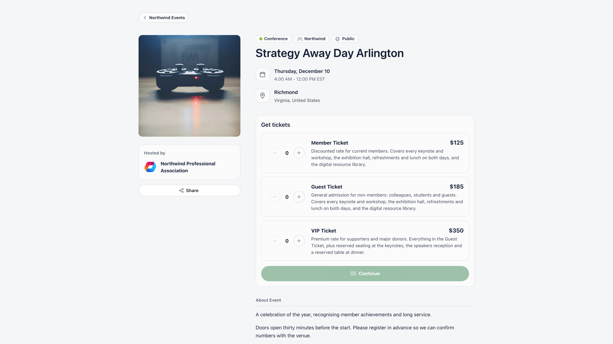

Some events have a page that anyone can open without signing in: cover image, description, speakers,
an agenda when the event has sessions, and a card to register or buy a ticket.

**Built for** organisers promoting an event to people who are not members yet, and who should be able
to register without creating an account first.

**Replaces** a separate event site or ticketing page that has no idea who your members are.



---

## Which events have one

One rule, and both halves of it must be true:

- the event is **published**, and
- its audience is set to **Public** or **Private link**.

Ticketing does not change this. A members-only event with ticketing enabled has no public page,
because members buy their tickets on the event page inside the app. Anything that fails either
half refuses the request: the visitor gets a "not found" page, not a login prompt and not the event
details.

**Private link** events have a public page like any other, but they are left out of the public event
directory and public lists, and the page asks search engines not to index it. Only people you give
the link to will find it.

An unpublished public event (a draft) has no public page for visitors. You can still look at it
yourself with **Preview public page**, and you can send people without an account a preview link
(see [Previewing a draft](#previewing-a-draft)).

Marking an event public is gated by **Settings → Events → Who Can Create Public Events**. That
setting is a ceiling, not an alternative route: if it is set to organization-wide event managers, someone who is only a
chapter event manager and ticks "Public" has the flag silently dropped on save. Events hosted by a private
(non-joinable) group can never be public. Ticketing needs an organization-wide event manager. Organization financial managers see the
Paid option and the Tickets and Payments screens, but saving a Paid event still needs
an organization-wide event manager.

---

## The address

```
https://<your app domain>/public/event/<event uuid>
```

On the shared domain `app.orgo.space` the link also needs `?workspace=<your slug>` so the page knows
which organisation it belongs to. On a [custom domain](/platform/custom-domain) the organisation is
resolved from the domain and no parameter is needed.

Open the event and use **Public page** in the event sidebar to see the page as a visitor does, with
the right parameters already attached. The entry appears once the event is published and public.

---

## What a visitor sees

| Area | Content |
|------|---------|
| Cover image | The event image, falling back to the last photo in the event gallery, then to a coloured placeholder |
| Hosted by | Your organisation, and the group the event belongs to |
| Back to events | A button at the top (and your logo on a phone) that opens your public event list |
| Share | A **Share** button that opens **Quick Share**: copy the link, or post to Facebook, WhatsApp or LinkedIn. Desktop only |
| Title, date, time | With a timezone switcher, so a visitor can read the times in their own zone |
| Location | Address, plus a map when the venue was picked from the place search |
| Online event | An "online" marker only. The joining link is never sent to the public page |
| About | Description, event videos, and SDG icons when **Sustainable Development Goals** is on |
| Program | Sessions on their own **Program** tab, with times, stages, and session speakers |
| Speakers | A tab of speaker cards with photo, headline and bio, grouped by day on multi-day events. The tab is named after the word the event uses (speakers, coordinators or moderators) |
| Tickets or registration | Ticket types and prices, or a single **Register** button on free events |

Someone who already registered sees their own status instead of the ticket picker: their ticket or
registration, a button to show the QR code, and, when the event runs votes, a **Vote** tab. That
also works for a non-member ticket holder, whose emailed link carries a personal `hash` parameter
that identifies them without an account. The `{eventAgendaUrl}` placeholder in emails and newsletters
produces exactly that personalised link.

Registration is covered in [Ticketing](/platform/events/ticketing) and
[Registration forms](/platform/events/registration-forms). The page also shows state: "Registrations
are closed" when the organiser used **Close registrations** in the event's **Actions** menu, "This event is full" when capacity is reached, and no
registration card at all once the event has ended (after its end time, or 24 hours after the start
when no end time was set).

---

## What is never exposed

The public payload is a deliberately narrow slice of the event. These are left out entirely, so they
cannot leak through the page or through the underlying request:

- the online meeting link (visitors see only that the event is online),
- the attendee list, and the organiser and hosting group,
- the event's draft or published state, and any internal report fields,
- **ticket types that name specific membership levels**, which are fetched separately after sign-in
  and only for a member whose level is on the allowlist.

<Warning>
  A plain **Members only** ticket, one with no membership levels named, is **not** hidden from the
  public page. Its name, price and remaining seats are served to anonymous visitors, greyed out with
  a **members only** badge. Only tickets that name specific levels are withheld.

  Treat a ticketed event page as public. If a price should not be seen by non-members, do not put it
  on a ticketed event.
</Warning>

Cover images and agenda images are copied into a public storage folder when an event becomes public
or ticketed, so they can be served to signed-out visitors.

---

## Previewing a draft

While an event is a draft, organisers see an **Only organizers can see this event** banner on the event
page with two buttons, shown for public drafts only:

- **Preview public page** opens the public page as a visitor will see it, with a "Preview, not
  published" notice. Nothing on a preview can register, hold or pay.
- **Share preview** gives a link and QR code that anyone can open without an account, until you publish
  the event or press **Reset link** (which makes the old link stop working).

---

## Appearance

The page behind the event (a colour, a searched photo or an uploaded image) is set on the event page
itself, from the **Add background** (or **Background**) button in its left column, and shows on the
public page too. Colours and the hero image rounding are set per event under **Registration form → Appearance**
(**Selected color**, **Button color**, **Hero image border radius**, **Display title**). That editor
only exists on events that require a registration form, which every ticketed event does. See
[Registration forms](/platform/events/registration-forms) for the full table. There is no per-event
logo control and no theme picker: the page uses your organisation logo and follows the visitor's
light or dark preference unless the link carries `?light` or `?iframe`.

---

## Common questions

<AccordionGroup>
  <Accordion title="The page is blank for people I send it to">
    The link is missing `?workspace=<slug>` and the visitor has never opened your organisation in
    that browser. Copy the link from **Share** on the event page, or open **Public page** in the event sidebar, rather than from your
    address bar.
  </Accordion>

  <Accordion title="Can I use my own domain for event pages?">
    Yes, if your organisation has a custom domain. The page is then served from it and the workspace
    parameter is unnecessary. Otherwise it lives on `app.orgo.space`.
  </Accordion>

  <Accordion title="The social preview shows my organisation name, not the event">
    The `/public/event/...` address is a JavaScript page, and social platforms do not run it, so they
    show generic details. See [Sharing events](/platform/events/sharing).
  </Accordion>

  <Accordion title="Members cannot see their discounted price">
    Member-only tickets are only returned to a signed-in member whose current membership level
    matches the ticket. Ask them to sign in on the same page, then reload.
  </Accordion>

  <Accordion title="I want the page to stay up after the event">
    It does. Past events keep their address and keep showing the description, agenda and speakers.
    Only the registration card disappears.
  </Accordion>
</AccordionGroup>

---

## Related

- [Sharing events](/platform/events/sharing) - the Share button, embeds and the public event directory
- [Ticketing](/platform/events/ticketing) - ticket types, pricing and checkout
- [Registration forms](/platform/events/registration-forms) - the questions asked at registration
- [Create an event](/platform/events/create-event) - visibility, capacity and cover image
- [Attendance](/platform/events/attendance) - what happens after someone registers
