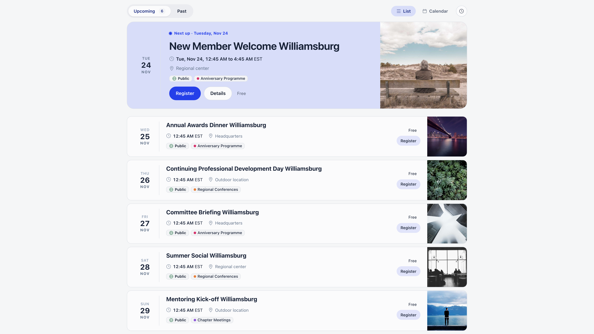
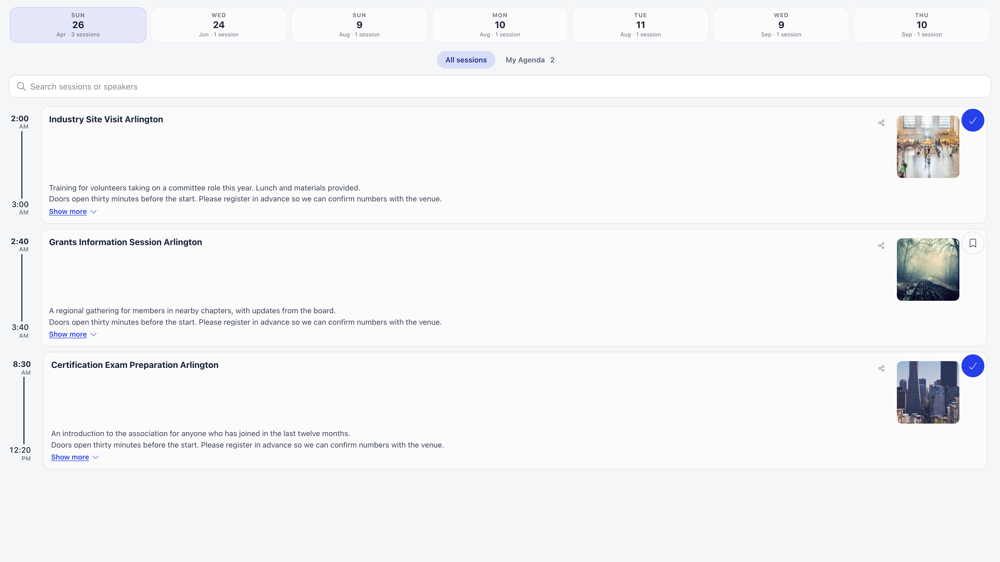

Once an event has a [public page](/platform/events/public-page), there are three ways to put it in
front of people: the **Share** button, a directory of everything coming up, and
embeds for your own website.

**Built for** organisers who post events to Facebook or LinkedIn, keep an events page on their own
site, and want both to stay current without copying details around.

**Replaces** manually maintained "upcoming events" pages and hand-built social cards.

---

## Sharing from the event page

Open a published event and use **Share** in the bar above the event page. It opens **Quick Share**:
**Your unique link** with a **Copy link** button, and buttons to post to Facebook, WhatsApp or
LinkedIn.

- For a **Public** or **Private link** event, the link is the event's [public page](/platform/events/public-page).
- For a **Members only** event, the link is the event page inside the app, which only signed-in members can open.
- A draft has no **Share** button. For a public draft, use **Share preview** instead (see
  [Previewing a draft](/platform/events/public-page#previewing-a-draft)).

Visitors can share too. The public event page has its own **Share** button with the same options
(desktop only).

<Note>
Social platforms and messaging apps read a page's preview tags without running its JavaScript, and the
public event page is a JavaScript application. A pasted link may therefore show your organisation's
generic details rather than the event's title and cover image.
</Note>

---

## The public event directory

Every organisation has a page listing its public events:

```
https://<your app domain>/public/events?workspace=<your slug>&upcoming=1
```

From inside the app, open **Events** (with no group selected) and choose **Public events** in the header
menu to jump to it. Visitors reach it from the button at the top of any public event page, which carries your
organisation's name and "Events", or from "Explore events" on a phone.



It shows only events that are both **published** and **Public**. **Private link** events are never
listed, and a members-only ticketed event has no public page at all.

| Element | Behaviour |
|---------|-----------|
| Next event card | The next upcoming event, shown large above the list ("Next up", or "Happening now" while it is on) |
| Upcoming / Past | Two tabs; past events stay browsable indefinitely |
| List / Calendar | A switch between the list and a month calendar with a month stepper and a **Today** button |
| Event cards | Date, title, location and cover image, each opening the event's public page |
| Subscribe to our events | In the clock menu: a calendar link visitors add to their calendar app so it stays up to date with your public events |

Visitors get no search box and no filters. Those controls are for signed-in members on the internal
event list.

---

## Embedding on your own website

The directory and the agenda are both embeddable in an `iframe`. Adding `iframe=true` to the address
strips the page down for embedding: it hides your logo and the "built with Orgo.space" line, and
forces the light theme so the embed does not turn dark on a visitor whose device prefers dark mode.

```html
<iframe
  src="https://<your app domain>/public/events?workspace=<your slug>&upcoming=1&iframe=true"
  width="100%"
  height="1600"
  frameborder="0"
  loading="lazy">
</iframe>
```

Give it generous height. The embed does not resize its parent frame, so a short frame cuts the list
off rather than scrolling neatly.

<Note>
If your organisation uses the built-in website, its "Upcoming events" section already embeds this
exact page for you, so you do not need to paste anything.
</Note>

---

## Embedding the agenda

For a conference the agenda is often what people want on the website. Open the event, go to
**Program & Speakers** (the second word follows the label the event uses for speakers), and use **Iframe URL**.
The button appears for people who can edit the event, and only when the event is public or ticketed.

It copies an address of the form
`https://<your app domain>/public/event-agenda/<event uuid>?workspace=<your slug>&iframe=true`,
ready to drop into an `iframe`. The embed shows the sessions grouped by day with their times, stages
and locations, and speaker cards that open a profile with the speaker's bio and their other sessions.
The event title is hidden in embed mode so it sits under your own heading.



Session data is cached for five minutes, so a change to the schedule shows up on the embed shortly
after you save it. For events that are neither public nor ticketed the address returns "not found",
which is the same rule the public page follows.

---

## Print and QR codes

The public page address is a plain URL, so any QR code generator can turn it into a code for posters
and flyers. Nothing in Orgo needs to be configured for that, and the code keeps working as long as
the event exists.

Do not confuse it with the QR code an attendee receives after registering. That one identifies the
person, not the event, and is what gets scanned at
[check-in](/platform/events/check-in).

---

## Search engines

Do not plan a search strategy around the public event page. It is a JavaScript application whose
browser tab title is your organisation name, not the event name. **Private link** events ask search
engines not to index them.

If search visibility matters, publish the event on your own site and link out to the Orgo page for
registration.

---

## Permissions

| Action | Needs |
|--------|-------|
| Mark an event public | The level set in **Settings → Events → Who Can Create Public Events** |
| Enable ticketing | An organization-wide event manager. Organization financial managers see the Paid option and the Tickets and Payments screens, but saving a Paid event still needs an organization-wide event manager |
| Use **Share** | Anyone who can open the published event page |
| Use **Preview public page** and **Share preview** on a draft | People who can edit the event: its owner, a chapter event manager for the event's group, or an organization-wide event manager |
| Copy the agenda embed address | Access to the event's **Program** screen: owner, a chapter event manager for the group, or an organization-wide event manager |

Organization admins can do all of these across the organization.

---

## Related

- [Public event page](/platform/events/public-page) - what the page shows and what it never exposes
- [Ticketing](/platform/events/ticketing) - tickets, pricing and checkout
- [Create an event](/platform/events/create-event) - visibility, cover image and description
- [Custom domain](/platform/custom-domain) - serving public pages from your own domain
- [Check-in](/platform/events/check-in) - the attendee QR code and scanning at the door
