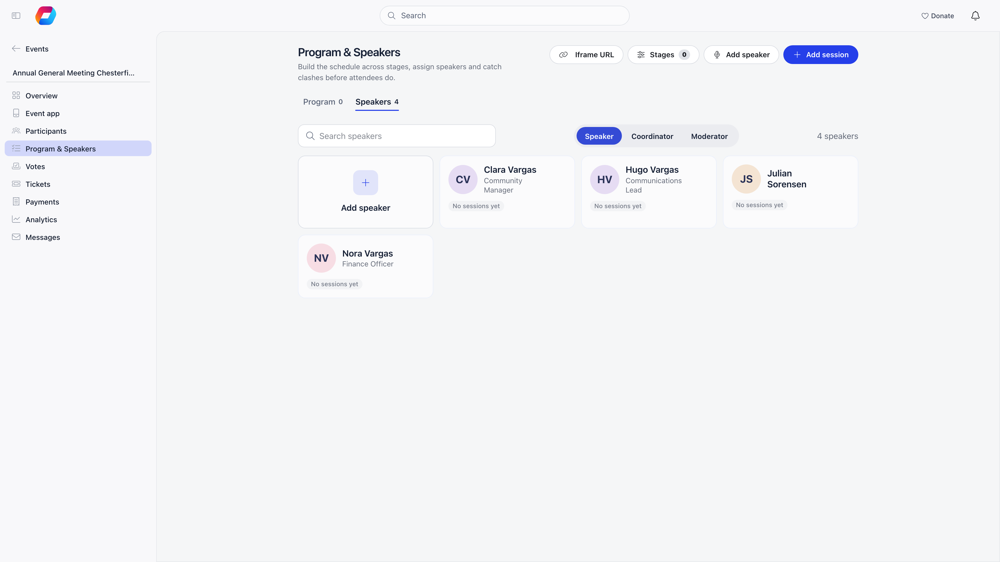

An event can list two kinds of people who are not simply attending: **speakers**, who appear on the
event page and sell the event, and **trainers**, who are recorded against training events and show up
on the member's own profile.

**Built for** conferences, general meetings and training programmes where the line-up is part of the
offer and the record of who taught what has to survive the event.

**Replaces** a hand-written line-up on a landing page, and a separate list of who ran which course.

<Note>
Neither list registers anybody for the event. A speaker who also needs a seat, a badge or a QR code
must be added on **Participants** as well. See [Attendance](/platform/events/attendance).
</Note>

---

## Speakers

### Where the list lives

Open the event and choose **Program & Speakers** in the sidebar. It has two tabs: **Program** (the
sessions) and **Speakers** (everyone who speaks). Adding the first speaker switches speakers on for the
event; there is no separate switch to find.

On the **Speakers** tab, a **Speaker / Coordinator / Moderator** choice renames the list for this event
("Coordinators", "Moderators") everywhere attendees see it. It is a label only.

### Adding speakers

<Steps>
  <Step title="Click Add speaker">
    The button is at the top of the page and as the first card of the **Speakers** tab. A dialog opens
    with **Find a member or contact**: search and pick the person.
  </Step>
  <Step title="Or create one">
    Skip the search and fill in the form instead: **Name** (required), **Role and organization**, **Bio**,
    a photo (**Upload photo**, square, at least 400 px) and an optional **Profile link**. This creates a
    contact record for the speaker.
  </Step>
  <Step title="Save">
    The speaker appears as a card with their photo, name, headline and the sessions they are in.
    Adding somebody who is already on the list is ignored.
  </Step>
</Steps>

Click a card to edit it, or the trash icon to remove it. Removing a speaker takes them off the event and
off every session they were in.

### Calling them something else

Not every event has speakers. Open the event → **Program & Speakers** → **Speakers** tab and choose
**Speaker**, **Coordinator** or **Moderator** in the selector beside the search box. It saves at once
and is per event: the sidebar entry, the tab, the buttons and dialogs, the empty states, the public
event page, the event app and the embedded agenda all use the word you chose.

The selector is only shown to people who can edit the event. An event that never set it keeps
**Speaker**.

<Note>
Only the wording changes. The **Enable speakers** switch, the list, the permissions and the
session assignments are the same whichever word you pick. The word is shown in **English** and
**Romanian**; in other languages the screens keep the translated "speaker" wording until a
translation is added.
</Note>

### What the audience sees

Each speaker is rendered as a card with their photo, name, headline and bio.

A member's name, photo and bio come from their profile, so the speaker dialog shows them read-only:
to fix a title or a bio, edit the member. For a contact (a non-member) you edit the details in the
speaker dialog itself.

Speakers show on the event page inside Orgo and on the [public event page](/platform/events/public-page)
(as a **Speakers** tab, once there is at least one), which is the argument for filling in a decent photo
and headline before you publish.

### Speakers per session

Each session can have its own speakers. In **Add session** (or when you edit a session), use the
**Speakers** field: search for someone already on the list, or choose **Find or add** to create them.
A speaker added to a session joins the event's speaker list, and the dialog warns you when someone is
already busy in another session at the same time. Somebody chairing two sessions appears on both.

### Permissions

| Action | Who |
|--------|-----|
| Add a speaker | The event owner, a chapter event manager for the event's group, an organization-wide event manager, or an organization admin |
| Edit or remove a speaker | The event owner, or an organization admin |

<Warning>
Removing a speaker is narrower than adding one. Somebody who is an organization-wide event manager but does not own the
event can add speakers but cannot delete them. Either hand the event over or ask an organisation
administrator.
</Warning>

---

## Trainers

Trainers exist only where the organisation runs training as an event type.

### Prerequisite

Set **Settings → Modules → Events → Configuration → Training Event Type** to one of your
[event types](/platform/events/event-types). A **Trainers** entry then appears in the sidebar of every
event using that type, and nowhere else.

### Managing the list

**Add trainer** searches members only: a trainer has to be a member record, because the assignment is
written back to their profile. Removing one asks for confirmation and needs the event owner or
an organization admin.

Trainers carry no dates, topics or rates. The record is simply "this member trained at this event".

### The trainer flag on a member

On a member's profile, open the pencil (**Edit**) and choose the **Membership status** tab. Its last group holds a **This member is a trainer** checkbox. Ticking it reveals an optional **Trainer since** date picker beside it, with an **x** to clear the date. Save with the tab's **Save** button. The group is visible once a Training Event Type is configured. It is shown only to people allowed to change the member's permissions.

Editing needs `HR_LOCAL` on the member's local centre, and `HR_TENANT` when **Allow Local Admins to Modify User Permissions** (**Settings** → **Users & Profiles** → **Configuration**) is turned off. Other staff and the member themselves do not see the checkbox.

The flag does three things:

- the member may create events of the training type, even without the permission that event type normally requires;
- the member's profile shows a **Trainer** row in its main card, described below;
- the trainings they led are listed on their profile, in the **Courses & trainings** card.

**Trainer since** is a calendar date with no time. It is for your own records and changes nothing else: it does not limit which trainings are listed or which events the trainer may create.

### On the member's profile

With a Training Event Type configured, a profile shows two things for a trainer.

| Where | What it shows |
|---|---|
| **Trainer** row in the main card at the top left | Only for members flagged as trainers. With a **Trainer since** date it shows how long ago that was, for example "3 years ago", and hovering shows the date. Without a date it shows a **Yes** tag |
| **Courses & trainings** card | One list of training events: the ones the member attended and, for a flagged trainer, the ones they ran. Each row shows the date, the length when it ran longer than a day, and the event name, which links to the event. When the Courses module is active, course enrollments follow with a status tag |

The card is shown only while it has something to list, and the list does not mark which trainings were attended and which were led.

<Note>
Certifications on a profile are typed in by hand and are not produced by attending a training. Nothing
in Orgo turns an attendance record into a certificate automatically.
</Note>

---

## Troubleshooting

<AccordionGroup>
  <Accordion title="There is no Trainers entry">
    Either the organisation has no Training Event Type set, or this event is not using that type.
    Check the event's type first.
  </Accordion>

  <Accordion title="Where do I record when someone became a trainer?">
    On the member's profile: **Edit** → **Membership status** → tick **This member is a trainer** and fill in **Trainer since**. The date is optional; without it the profile shows a **Yes** tag in the **Trainer** row instead of "x years ago".
  </Accordion>

  <Accordion title="The Trainer row or the Courses & trainings card is missing from a profile">
    Both need a Training Event Type in **Settings** → **Modules** → **Events** → **Configuration**. The **Trainer** row also needs the member to be flagged as a trainer. The **Courses & trainings** card is hidden while the member has no trainings or course enrollments to list.
  </Accordion>

  <Accordion title="I cannot find the trainer checkbox">
    It is on the **Membership status** tab of the profile editor, not on the Permissions tab where older versions had it. It is shown only when a Training Event Type is set and you hold `HR_LOCAL` over the member (and `HR_TENANT` if local admins may not modify permissions).
  </Accordion>

  <Accordion title="I chose Moderator but a screen still says speaker">
    The word is applied in English and Romanian only. In another language the screens keep that
    language's word for speaker. An email or a page you wrote by hand is not changed either.
  </Accordion>

  <Accordion title="A speaker's title or photo is wrong">
    Fix it on the person, not the event. Members show their profile headline and photo; contacts show
    their organisation and logo. The change appears on every event they speak at.
  </Accordion>

  <Accordion title="The speaker I added is not in the participant count">
    Correct: speakers and trainers are separate lists. Add them on **Participants** too if they need a
    seat or a ticket.
  </Accordion>

  <Accordion title="The Speakers tab is missing on the public page">
    It appears only once at least one speaker is on the event. Add one on **Program & Speakers**.
  </Accordion>
</AccordionGroup>

---

## Related

- [Attendance](/platform/events/attendance): the participant list, where speakers also need a place
- [Create an Event](/platform/events/create-event): the event form and the event type
- [Event Types](/platform/events/event-types): including the type used for training
- [Public Event Page](/platform/events/public-page): where the speaker line-up is shown
- [QR Check-in](/platform/events/check-in): getting speakers through the door
- [Member Profile](/platform/users/member-profile): where the Trainer row and the Courses & trainings card appear
