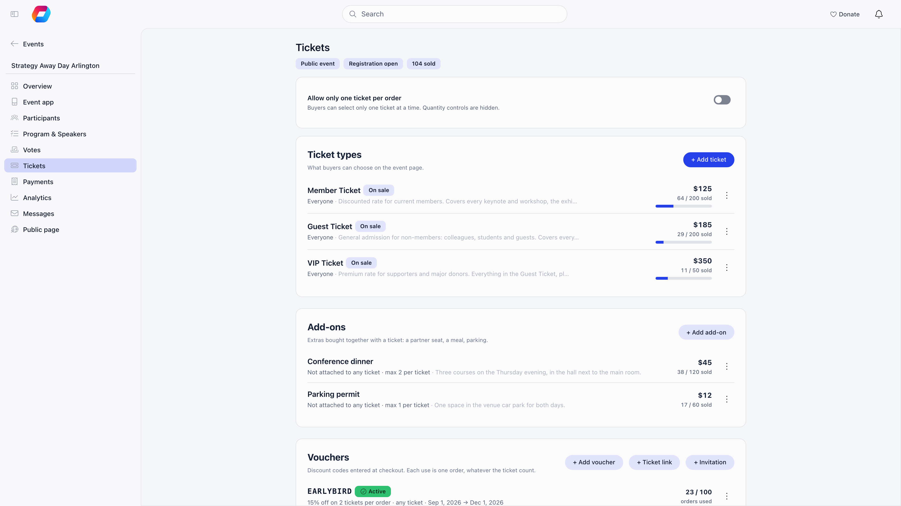
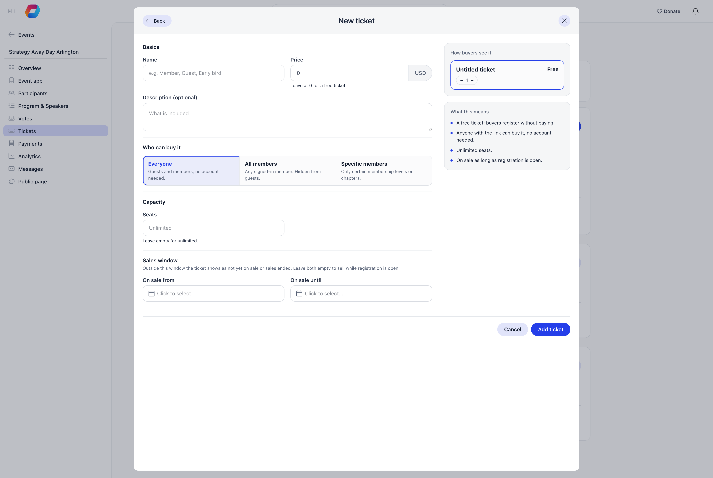
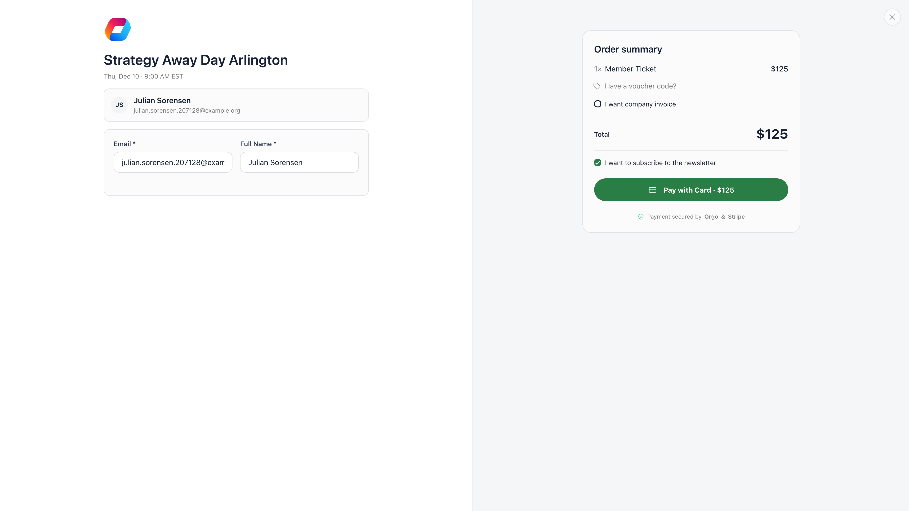
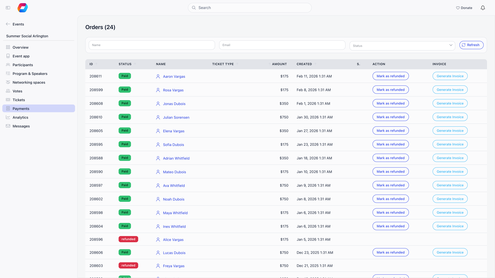
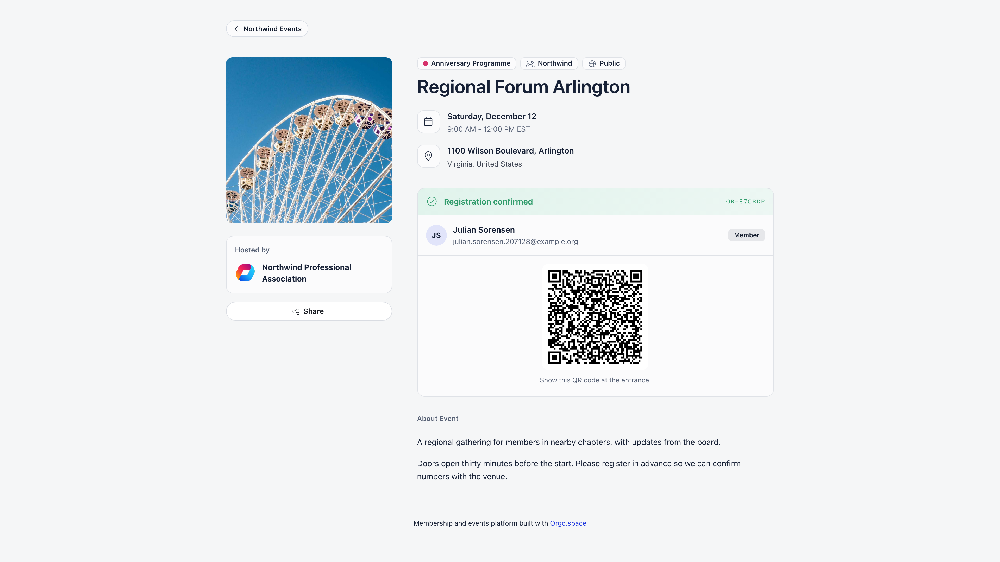

Orgo Event Ticketing sells event tickets from inside your membership platform, with member-only
pricing tied to your fee levels, add-ons, discount vouchers, and QR code check-in.

**Built for** membership organisations running paid events for members and non-members: professional
associations, youth organisations, alumni networks, trade unions, and similar member-based groups.

**Replaces** Eventbrite, Ticket Tailor or Cvent with ticketing tied directly to your member database
and your own Stripe account. Orgo charges no per-ticket fee, you pay only Stripe's rate.

Buyers pay by card in an inline Stripe checkout, receive a ticket by email, and check in at the door
by QR scan.

The screen is three cards: **Ticket types** first, then [Add-ons](#add-ons) and
[Vouchers](#vouchers) below it.

---

## Turning ticketing on

Ticketing is a property of the individual event, not a module you switch on once.

<Steps>
  <Step title="Connect Stripe">
    The **Online Payments** module must be active and your Stripe account connected, otherwise the
    **Paid** option does not appear on the event form. See
    [Stripe Setup](/platform/fees/stripe-integration).
  </Step>
  <Step title="Set the event to Paid">
    On the event form, under **Who can join**, set **Price** to **Paid** instead of **Free**. This
    choice is only visible to organisation-wide event admins and finance admins.
  </Step>
  <Step title="Add ticket types">
    A **Tickets** entry appears in the event sidebar. Open it and add one or more ticket types.
  </Step>
  <Step title="Publish">
    Tickets appear on the [event page](/platform/events/public-page) once the event is published and
    they are inside their sales window. A draft event is only visible to the people who can edit it.
  </Step>
</Steps>

<Note>
Switching an event to **Paid** also forces **Require registration form for members** on, and the
toggle becomes read only. Every ticket buyer goes through the
[registration form](/platform/events/registration-forms), never a simple RSVP.
</Note>

<Warning>
The **Max capacity** field disappears from the event form once ticketing is on, and event-level
capacity is not applied to ticket sales. Cap attendance with **Seats** on each ticket type
instead.
</Warning>

The **Tickets** and **Payments** sidebar entries appear only for organisation-wide event admins and
finance admins, and only once the event is Paid. Every change on the Tickets page (ticket types,
add-ons, vouchers and registration links) needs the organisation-wide event permission, which
organisation admins also hold. A chapter-level event admin can run the event and edit its
[registration form](/platform/events/registration-forms) but cannot change what is on sale.

---

## Ticket type settings

Open the event, then **Tickets** in the sidebar. The **Ticket types** list shows each ticket with its
price, who can buy it, a status tag and a sold counter with a small fill bar. Use **+ Add ticket** to
create one, or click a ticket's name to edit it. The `...` menu on each row offers **Edit ticket**,
**Duplicate**, **Archive** (or **Restore**) and **Delete**.

| Setting | What it does |
|---------|-------------|
| **Name** | What buyers see: "Member", "Guest", "Early bird". |
| **Price** | Amount in your organisation's currency. Leave at 0 for a free ticket. |
| **Description** | Optional text shown under the ticket name on the event page. |
| **Who can buy it** | **Everyone** (guests and members, no account needed), **All members** (any signed-in member, hidden from guests) or **Specific members** (see [Member pricing](#member-pricing)). |
| **Seats** | Seats for this ticket type. Empty means unlimited. Cannot go below the number already sold. |
| **On sale from** / **On sale until** | Optional sales window. Leave both empty to sell while registration is open. The window cannot start before the event was created or end after the event ends. |

The editor shows a "How buyers see it" preview and a plain summary of what your choices mean.

<Warning>
The **Price** is locked after the first sale. To change a price, archive the ticket and add a new one.
Tickets with no sales can still be edited freely.
</Warning>

When the event is not public (**Members only** on the event form), **Everyone** is switched off and
every ticket is members only. Make the event public to sell to guests.

**Allow only one ticket per order**, a switch at the top of the Tickets page, hides the quantity
controls so a buyer can select one ticket per checkout.

### Archive and delete

**Archive** takes a ticket off sale but keeps its sales history; archived tickets are hidden from the
list until you choose **Show N archived**, and **Restore** puts one back. **Delete** is only possible
while nothing has been sold on the ticket: once it has sales the menu shows **Delete (N sold)**
greyed out and you archive instead. An archived ticket is gone for everyone, including signed-in
members who previously saw it as a members-only offer.

### Ticket status tags

The admin list labels each ticket automatically: **On sale**, **On sale from (date)** (the window has
not opened), **Sales ended**, **Sold out** and **Archived**. The count beside the price reads "N / M
sold", or "N sold, unlimited" when there is no seat limit.

The public event page uses its own, vaguer tags: **Sold Out**, **Only N left!** (10 seats or fewer,
with the exact number), **Limited availability** (11 to 20 seats) and nothing above 20. Tickets whose
window has not opened appear under **Coming soon**, and ended ones under **Past offers**.

---

## Member pricing

Under **Who can buy it**, **All members** and **Specific members** tickets are members only.

- **All members**: the ticket stays visible to logged-out visitors but cannot be selected. It carries a
  **members only** badge, and the public page shows a notice with **login** and **register** buttons.
- **Specific members**: the ticket is narrowed by **Membership levels**, by **Chapters**, or both.
  Guests and members who do not qualify never see it: it is simply absent from the page, with no badge
  and no explanation, which is why the usual report is "the members ticket is not on the page".

Members only is enforced when the person pays or registers, not only on the page: the buyer must be
signed in with an active account in your organisation, and the ticket is issued to them. The checkout
fills in their own name and email and locks those fields, and only **one** members-only ticket can be
bought per order. A signed-out person, or someone from another organisation, is refused.

<Warning>
  **Members only** checks that the buyer is an active account in your organisation. It does not check
  that their membership fee is paid, unless you narrow the ticket by membership level. Do not use a
  plain **All members** ticket to keep a price away from lapsed members.
</Warning>

How **Specific members** decides:

- **Membership levels** (shown when your organisation has a membership fee with levels): tick one or
  more. Members on any ticked level qualify. A member with no level assigned sees no level-restricted
  tickets. The ticket appears on the page only to members whose membership is currently active; the
  level itself is what the checkout then compares.
- **Chapters** (shown when the Local Centers module is on): tick one or more. Members of a ticked
  chapter or any of its sub-chapters qualify. A member with no chapter does not.
- Tick nothing in one list and that list does not restrict. Tick both and the member must match a
  level **and** a chapter. At least one box must be ticked.

A member cannot take a second level-restricted ticket on the same event: the limit is one per
attendee, counted across the whole event rather than per ticket type.

These checks are skipped when the person doing the booking is an organisation-wide event admin, a
chapter event admin for the event's group, or the event's owner, so an organiser can still book on
someone's behalf. The test is against the person doing the booking, not the person attending.

<Note>
The membership level list is read from your organisation's [membership fee](/platform/fees/fees)
product. If none is configured the **Membership levels** list does not appear.
</Note>

Two tickets with adjoining sales windows give you early bird then regular pricing; an **All members**
ticket beside an **Everyone** one gives you member and non-member prices; tickets priced 0 still
separate members from guests.

---

## Common ticket structures

Every structure below is built from the same ticket type fields. The amounts and dates are
**examples**, not defaults: nothing here is preconfigured.

| What you want | How to build it |
|---|---|
| **Early bird, then regular** | Two ticket types on the same event. "Early Bird" at 60, **On sale until** 31 March 23:59. "Regular" at 80, **On sale from** 1 April 00:00. Both stay listed in the admin list: the early bird turns **Sales ended** and the regular reads **On sale from (date)** until its window opens. Buyers see the regular under **Coming soon** and the early bird under **Past offers**, and neither is selectable outside its window. |
| **Member versus non-member** | "Member" at 40 with **Who can buy it** set to **All members**, "Standard" at 70 with **Everyone**. A logged-out visitor sees both, can select only Standard, and gets the login and register prompt on the member one. |
| **Tiered access by membership level** | Choose **Specific members** and tick levels under **Membership levels**: "Student rate" at 25 for your Student level, "Full rate" at 55 for Standard and Senior. A member whose level is not ticked does not see the ticket. Because only one membership-restricted ticket is allowed per attendee per event, these tiers are mutually exclusive by construction. Tick **Chapters** instead (or as well) to price by chapter. |
| **Free event with categories** | Price every type 0: "In person" with **Seats** 120, "Online" with no seat limit. A zero-priced ticket goes through free registration with no card step, so the attendee still fills in the registration form and still gets a QR ticket. An event where every ticket has a price cannot be used for free registration. |
| **Paid event with one free category** | Mix them: a paid ticket type and a 0 priced one on the same event. The free one is completed without a card; the paid ones go to Stripe. |
| **One ticket per person** | Turn on **Allow only one ticket per order** at the top of the Tickets page. For anything larger, note that one browser session can hold at most 10 tickets per event, so a company buying 12 places has to do it in two checkouts. To invite one named person at no charge, use an [invitation link](#registration-links). |

<Note>
A ticket priced 0 is not the same as a members-only ticket priced 0. Price decides whether Stripe is
involved; **Who can buy it** decides who can select it. You can combine them freely.
</Note>

---

## Add-ons

Add-ons are extras sold alongside a ticket: a meal, a workshop track, parking, a partner place. They
live in the **Add-ons** section of the Tickets page, and you need at least one ticket type first
(**+ Add add-on** stays greyed out until then).

| Setting | What it does |
|---------|-------------|
| **Name** | What buyers see, for example "Partner seat". |
| **Price** | Cost per unit. Set to 0 for a free extra. Locked after the first sale. |
| **Description** | Optional detail line under the name. |
| **Offered with** | Tick the ticket types the add-on appears under. At least one is required. Locked after the first sale. |
| **Max per ticket** | How many of this add-on one ticket can carry. Empty means unlimited. |
| **Total available** | Overall stock across all buyers. Empty means unlimited. When it runs out the add-on shows **Sold Out**. Cannot go below the number already sold. |
| **Adds a separate attendee** | The buyer fills in a name for each one, and each gets its own badge and check-in. Use it for partner or child seats, not for meals or parking. Locked after the first sale. |

Each add-on row shows what it is offered with, a "max N per ticket" note, an **Adds an attendee** tag
where it applies, and "N sold" (or "N / M sold" when there is a total).

<Note>
An add-on that has been sold cannot be deleted: the menu shows **Delete (N sold)** greyed out. Use
**Archive** instead, which hides it from checkout while keeping the sales history, and **Restore** to
bring it back.
</Note>

---

## Vouchers

Vouchers are per-event discount codes, listed under **Vouchers** on the Tickets page with **+ Add
voucher**. Buyers enter the code at checkout under **Have a voucher code?**. The same panel also holds
[registration links](#registration-links).

| Setting | What it does |
|---------|-------------|
| **Voucher code** | Letters, numbers and dashes, up to 50 characters. Unique within the event and matched in upper case. **Generate** suggests one. |
| **Active** | Turns the code off without deleting it. Inactive codes are refused at checkout, so you can prepare one and switch it on later. |
| **Discount** | **Percentage** (a share of each ticket) or **Fixed amount** (a sum off the order total). |
| **Percent off** / **Amount off** | The percentage (1 to 100) or the fixed amount, in your organisation currency. |
| **Never more than** | Percentage vouchers only. A ceiling on the money taken off one order. |
| **Tickets per order** | Percentage vouchers only. Discount only the first N tickets in an order. |
| **Max orders** | Number of separate checkouts that may use the code. Each checkout counts once whatever the ticket quantity. Empty means unlimited, and it cannot be set below the uses already taken. |
| **Valid** | Optional start and end date. |
| **Applies to** | Tick ticket types to limit the code to them; add-ons are then left out. Tick nothing and it applies to every ticket type, with add-ons in the same order included. |

The editor shows an **Example order** so you can see the effect before saving. Each voucher row shows
its rule, what it applies to, its dates and "N / M orders used". The status is **Active**, **Starts
(date)**, **Expired**, **All uses taken** or **Inactive**, and vouchers that can still be used are
listed first. The `...` menu offers **Edit voucher**, **Copy code**, **Deactivate** or **Activate**,
and **Delete**. A voucher that takes the order to zero completes without a card payment. Deleting a
voucher does not change discounts already applied to past orders, and a refund does not give a use
back.

### How the discount is worked out

A fixed-amount voucher comes off the order total once, not off each ticket. A percentage voucher is
the one that surprises people, because the percentage is applied to the order's **average** ticket
price, multiplied by the number of tickets it is allowed to cover.

**Example.** An order of two Regular tickets at 80 and one Student ticket at 25 totals 185.

| Voucher | Discount taken | Why |
|---|---|---|
| 20%, no other limits | 37.00 | 20% of the whole 185. |
| 20%, **Tickets per order** 2 | 24.67 | The average ticket is 61.67; two of them is 123.34; 20% of that. Not 20% of the two dearest tickets. |
| 20%, **Tickets per order** 2, **Never more than** 20 | 20.00 | The cap wins. |
| 20%, **Applies to** Regular only | 32.00 | Only the two Regular lines count, so the average is 80. |

If you want a percentage to apply to specific tickets, tick them under **Applies to**. **Tickets per
order** limits how many tickets are covered but does not choose which ones.

---

## Registration links

Two single-use links sit beside vouchers on the Tickets page. Both are for one named person and both
need a **public** event, because the link opens the public event page; on a members-only event the
buttons are disabled with a note saying so. Creating them needs the organisation-wide event permission.

| Link | What it does |
|------|--------------|
| **+ Invitation** | Registers one person on the ticket you choose, free of charge. |
| **+ Ticket link** | Lets one person buy the chosen ticket at its normal price, even outside its sales window. |

In both cases the registration form still has to be filled in. Pick the **Ticket** and a **Valid to**
date (the link stops working after it; it must be in the future), then **Create link**. The editor then
shows the **Link** with a **Copy link** button; the row menu offers **Copy link** too. Send that link
to the person.

A link works once. After someone registers through it the row reads **Used**, and the editor lists
under **Registrations** who used it, when, and whether that registration was later canceled or is
awaiting payment. Switch **Active** off to revoke an unused link (the row reads **Revoked**), or
**Delete** it, which stops it working immediately. An expired link reads **Expired**.

---

## Seat holds

When a buyer starts selecting tickets, the seats are held so two people cannot buy the last one at
the same time.

- A hold lasts **8 minutes**, reset to a fresh 8 minutes when the buyer adds more of the same ticket.
- One browser session can hold at most **10 tickets** per event, counted across ticket types. Beyond
  that the buyer is told how many more they can hold.
- Holds are released when the buyer leaves the page, when the purchase completes, or by a
  scheduled cleanup once they expire.
- Held seats are unavailable to everyone else, so a ticket can read "Sold Out" while carts are open
  and free up again when they expire.
- Members-only tickets are not held in a cart: their seats are only taken when someone pays, so two
  members can reach checkout for the last seat and only the first to pay gets it.

---

## What a buyer sees

<Steps>
  <Step title="Pick tickets">
    Listed cheapest first. Sold out tickets are shown but not selectable; tickets whose window has not
    opened appear under **Coming soon** and ended ones under **Past offers**. A signed-in member sees any
    members-only tickets that match them, some marked **just for you**.
  </Step>
  <Step title="Fill in the registration form">
    One card per ticket, collecting every attendee's details; logged-in members arrive prefilled. See
    [Registration Forms](/platform/events/registration-forms).
  </Step>
  <Step title="Add extras and a voucher">
    Add-ons appear under **Extras** in the order summary. A voucher code can be applied and removed
    before paying.
  </Step>
  <Step title="Consent and pay">
    The buyer confirms your GDPR policy and terms, then pays inline through Stripe without leaving
    the page.
  </Step>
  <Step title="Get the tickets">
    A paid order sends the buyer one confirmation email with every ticket attached as its own PDF,
    including tickets created by add-ons. On a free order each attendee registered under a different
    email address gets their own confirmation too.
  </Step>
</Steps>

With the **Invoices** module on, the checkout also offers **I want company invoice**. Ticking it
adds a billing step for company details, after which the buyer can still pay by card or choose
**Pay via bank transfer**, which issues an invoice and confirms the tickets once payment arrives.
Hide the option with **Settings → Events → Disable Company Invoice in Checkout**.

---

## Orders

The **Payments** entry in the event sidebar opens the order list, headed **Orders**.

Each row shows the order id, status, the buyer (member or contact), amount, the voucher code if one
was used, and the payment date. Filter by name, email, or status (**open**, **paid**, **refunded**);
rows can also read **on-hold** or **canceled**. Where a Stripe account is connected, an arrow link
opens the payment or invoice in the Stripe dashboard.

The **Ticket type** column stays empty for event ticket orders. It reads a product *option*, which is
a fee-product concept; event ticket purchases record the ticket tier as the product *price* instead.
To see which tier someone bought, use the Ticket column on
[the participant list](/platform/events/attendance) or the Revenue by ticket table in
[Analytics](/platform/events/analytics).

**Refund** appears on paid orders that were paid by card, for finance admins. It
refunds the full amount, with no partial refund in the interface, and on success cancels every
attendee record created by that order, returns their seats to the ticket type, and returns any add-on
quantities to stock. Voucher usage is not returned. An order with no Stripe payment behind it (recorded outside Orgo)
shows **Mark as refunded** instead: it sends no money back, so confirm you have already refunded the
buyer elsewhere. Orders paid by bank transfer have neither button: handle those in Stripe or through
[invoice cancellation](/platform/fees/cancelling-invoices).

With the Invoices module on, an organisation admin gets a **Generate Invoice** button on paid orders
that have no invoice yet, and a **View Invoice** link once one exists.

---

## Tickets and check-in

Every attendee record carries a random token that becomes their QR code, delivered in the
confirmation email and shown on the event page. Scanning it at the door opens the check-in screen
with the attendee's name, ticket type, payment status and add-ons.

<Note>
Scanning requires organisation-wide HR or event permission. A chapter-level event admin cannot
scan. The full flow, walk-ins and manual check-in are covered in
[Check-in](/platform/events/check-in).
</Note>

A member can download their own ticket as a PDF from the internal event page, and an administrator
can download someone else's only with HR permission over that person. The public event page above has no
download button: it renders the status badge and the QR code only.

---

## Common scenarios

<AccordionGroup>
  <Accordion title="I need a discount code rather than a separate cheap ticket">
    Use a [voucher](#vouchers). It is the only discount mechanism in Orgo: there is no automatic
    group or bulk pricing.
  </Accordion>

  <Accordion title="Someone bought a ticket but cannot attend, can they transfer it?">
    There is no self-service transfer. An administrator cancels and refunds the original
    registration, then invites the replacement as a complimentary attendee or has them buy a ticket.
  </Accordion>

  <Accordion title="I set a ticket price wrong and it is already saved">
    Prices are locked once a ticket has sold, because payments reference them. If nothing has sold, edit
    the price directly. Otherwise add a corrected ticket and **Archive** the wrong one, which keeps its
    history.
  </Accordion>

  <Accordion title="A ticket says Sold Out but I know seats are free">
    Seats in other people's carts count as taken. Wait for the 8 minute hold to clear before raising
    **Seats**.
  </Accordion>

  <Accordion title="A member cannot select the members-only ticket">
    Check that they are signed in with an active account in your organisation. For a ticket limited to
    **Specific members**, check that their membership is active and on a ticked level, or that they are
    in a ticked chapter, then whether they already hold another membership-restricted ticket for this
    event: only one is allowed.
  </Accordion>

  <Accordion title="I want to stop sales without deleting anything">
    Open the event and choose **Close registrations** from the **Actions** menu in the header (it
    becomes **Reopen registrations** afterwards). No new registrations or ticket purchases are
    accepted, and existing attendees keep their tickets.
  </Accordion>
</AccordionGroup>

---

## Troubleshooting

<AccordionGroup>
  <Accordion title="Orgo will not let me delete a ticket type">
    Deletion is blocked as soon as the ticket type has history: the menu shows **Delete (N sold)**
    greyed out, and the server also refuses when payments, attendees or a ticket bundle point at it.
    The records that point at it have to keep pointing at something. **Archive** the ticket instead: it
    stops selling, keeps its history, and can be restored later.
  </Accordion>

  <Accordion title="Saving a ticket is rejected because of its dates">
    The sales window has to sit inside the event's own lifetime: **On sale from** cannot be earlier
    than the date the event was created, and **On sale until** cannot be later than the event's end
    (its start, if no end is set). The end must also come after the start.
  </Accordion>

  <Accordion title="A buyer is told they cannot hold more than 10 tickets">
    One browser session can hold at most 10 tickets per event across all ticket types, and the
    message tells the buyer how many more they may take. This is a cap on a single cart, not on the
    event: they complete that checkout and start another one for the rest.
  </Accordion>

  <Accordion title="A voucher code is rejected as invalid">
    "Invalid voucher code" covers three cases at once: the code does not exist on **this** event
    (vouchers are per event, so a code created on last year's event will not carry over), it is
    switched off with **Active**, or it is outside its **Valid** dates. A code that has used up
    **Max orders** says so instead ("reached its usage limit"). Codes are stored and matched in upper
    case, so capitalisation in the email you sent does not matter.
  </Accordion>

  <Accordion title="The voucher took off less than the buyer expected">
    See [How the discount is worked out](#how-the-discount-is-worked-out). The usual causes are
    **Never more than** capping the money, **Tickets per order** limiting how many tickets the
    percentage covers, or the percentage landing on the order's average ticket price rather than on
    the dearest tickets.
  </Accordion>

  <Accordion title="Checkout fails with a message about the name">
    "Name can only contain letters, spaces, hyphens, apostrophes and periods." Something that is not
    a name went into a name box, most often a phone number. Orgo checks every buyer, attendee and
    add-on attendee name before the card is charged rather than after, so the money is never taken.
  </Accordion>

  <Accordion title="Checkout fails because the tickets use different currencies">
    One order cannot mix currencies. This only happens when ticket types on the same event were
    saved with different currencies; rebuild the odd one out in the event's currency.
  </Accordion>

  <Accordion title="An add-on cannot be added to an order">
    Three separate limits produce three different messages: **Max per ticket** ("Maximum N of X per
    ticket allowed"), **Total available** ("Only N X available"), and an archived add-on ("no longer
    available"). Inventory counts sales across all buyers, so it can run out mid-event.
  </Accordion>

  <Accordion title="An attendee lost the confirmation email, can I resend it?">
    There is no resend button. A signed-in member can open the event page and download their own
    ticket as a PDF; an administrator with HR permission over that member can download the same PDF and
    forward it. The QR code is fixed when the attendee record is created and never regenerated, so a
    re-downloaded ticket scans exactly like the original, and an attendee who shows the QR from the
    original email is equally valid.
  </Accordion>

  <Accordion title="The Tickets page and the public event page disagree about how many seats are left">
    They count differently, and both are right. The **Sold Out** and **Only N left!** tags on the
    admin ticket list subtract only tickets already sold. The public page also subtracts seats
    currently held in other people's carts, so it can warn buyers, or refuse them outright, while
    your list still looks comfortable. The two converge once the open carts are paid for or their
    8 minute holds expire.
  </Accordion>

  <Accordion title="I refunded an order but the voucher still counts as used">
    Refunding returns seats and add-on stock but never a voucher use. On a limited-use code, raise
    **Max orders** by the number of orders you refunded, otherwise the code retires early.
  </Accordion>
</AccordionGroup>

---

## Related

- [Create Event](/platform/events/create-event) - the event form and its Access setting
- [Registration Forms](/platform/events/registration-forms) - what buyers are asked
- [Public Event Pages](/platform/events/public-page) - where tickets are sold
- [Check-in](/platform/events/check-in) - QR scanning and walk-ins
- [Stripe Setup](/platform/fees/stripe-integration) - connecting the payment account
