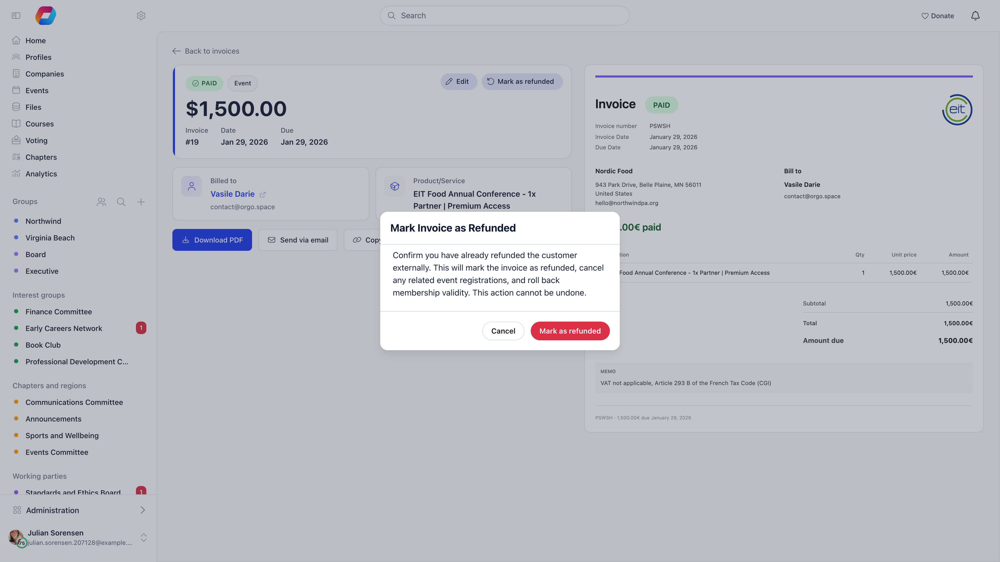

Invoices get raised in error. Someone books twice because the first confirmation
never arrived, an administrator creates a test registration to check the payment
flow, or a member is invoiced on the wrong plan.

Which action you need depends entirely on whether money changed hands.

| Situation | Action | Where |
|---|---|---|
| The invoice is unpaid and should not exist | **Void** | The invoice |
| The invoice was paid and you have already returned the money yourself | **Mark as refunded** | The invoice |
| The customer paid by card and you need Stripe to send the money back | **Refund** | **Payments** |
| A payment was made outside Orgo (recorded by hand or imported), has no invoice, and you have already returned the money | **Mark as refunded** | **Payments** |

All of them need administrator rights: voiding and marking an invoice refunded
need the Admin (Organization) permission, and refunding from **Payments** needs
Financial (Chapter) for the payment's chapter, or Financial (Organization) when
the payment has no chapter on it.

---

## Voiding an unpaid invoice

**Invoices**, open the invoice, then **Void**. The button only appears while the
invoice is unpaid, and the action cannot be undone.

Voiding sets the invoice to **voided** and leaves it in the list. That is the
point: an invoice that vanishes leaves an unexplained gap in your numbering and
no answer to the question "what happened to invoice 214?". A voided one answers
it.

For an **event registration** invoice, voiding also unwinds the booking. Every
registration still waiting on that invoice is cancelled and the seats it held are
released back to the ticket, along with any add-ons. The payment record attached
to the invoice is cancelled too. You do not need to remove the attendee
separately.

<Note>
A plain unpaid invoice has no payment record to cancel. One is only created when
the invoice is marked as paid, so voiding an unpaid manual invoice touches
nothing but the invoice itself.
</Note>

---

## Duplicate bookings

When someone registers twice, void the duplicate rather than removing the person.

<Steps>
  <Step title="Identify which one to keep">
    Keep the invoice the member has already paid or already sent to their finance
    department. Ask if you are unsure, because the reference they quoted
    internally is the one that must survive.
  </Step>
  <Step title="Void the other">
    If it is unpaid, **Void** removes it from your totals and, for an event
    invoice, frees the seat.
  </Step>
  <Step title="Check the attendee list">
    Voiding releases seats held by registrations that were still awaiting
    payment. A registration that was already confirmed is not touched by a void,
    because a confirmed registration means the invoice was paid, and a paid
    invoice cannot be voided.
  </Step>
</Steps>

<Warning>
Do not use a real member's account to test a payment flow. If you later mark that
invoice paid while tidying up, the member is emailed a paid invoice for something
they never bought.
</Warning>

---

## Marking a paid invoice as refunded

A paid invoice cannot be voided. The action offered instead is **Mark as
refunded**, and it is exactly what it says: **it does not move any money.** Use it
after you have already returned the money yourself, by bank transfer or in
Stripe.

What it does do is unwind everything the payment set off:

- The invoice becomes **refunded**, with your name and the date recorded, and a
  **REFUNDED** badge added to the document.
- The linked payment record is marked refunded, so it drops out of your totals.
- On a **membership** invoice that Orgo raised (a bank-transfer request, a
  renewal reminder to a company, or a membership invoice made after an online
  payment), the member's fee validity date is recalculated from the payments
  that survive, and a company's membership is rolled back to what its remaining
  payments justify.
- On an **event registration** invoice, the confirmed registrations are cancelled
  and their seats and add-on places are released.

A refunded invoice reports nothing as settled and its full total as still
outstanding, rather than continuing to read as paid in full.

<Note>
Marking as refunded does not email the customer. Tell them yourself.
</Note>

A paid invoice of the first two kinds with no payment record behind it cannot be
marked refunded: the action stops with the error "Cannot refund invoice: no
linked payment record found." rather than changing the invoice and leaving the
payment untouched. Marking an invoice refunded twice, or one that is not paid,
is refused too. An event registration invoice is more
forgiving: if no payment or registration can be resolved it is still marked
refunded, on the assumption the money was handled in Stripe.

---

## Returning money through Stripe

If the customer paid by card and you want Stripe to send the money back, do it
from **Payments**. Open the row menu on the payment and choose **Refund**. The
option only appears on a successful payment.

The refund covers that payment row in full. There is no partial-amount option in
the interface, and where one charge produced several payment rows (a membership
fee and its separate joining fee, for example) only the row you acted on is
refunded. The amount sent to Stripe is the row's amount rounded to the nearest
cent.

Refunding through Stripe also cancels any event registrations paid for by that
payment, releasing their seats and add-on places, and recalculates the member's
fee validity if the payment was for a membership fee (or for a donation, when
**Donations count towards membership** is on).

### Payments made outside Orgo

A payment with no Stripe reference was paid outside Orgo: recorded by hand
or imported. Its row menu on **Payments** says **Mark
as refunded** instead of **Refund**, and the confirmation reads "Nothing is sent
back through Orgo. Confirm you have already refunded it outside Orgo." No money
moves. The payment becomes refunded, its event registrations are cancelled and
the member's fee validity is recalculated, exactly as for a Stripe refund.

If such a payment belongs to an invoice, the row has no refund action, and
the server refuses the request with "This payment has an invoice. Mark the
invoice as refunded instead." Use **Mark as refunded** on the invoice, so the invoice and
its payment stay in step.

<Warning>
Do not mark an invoice as refunded and expect the customer to get their money.
The invoice will read refunded while the money stays where it is, and nobody will
notice until they ask.
</Warning>

---

## Related

- [Recording a payment](/platform/fees/record-payment) marking an invoice paid
- [Invoices](/platform/fees/invoices) creating invoices, numbering and templates
- [VAT and invoice templates](/platform/fees/vat) tax details on the document
- [Stripe integration](/platform/fees/stripe-integration) card payments and payouts
- [Membership fees](/platform/fees/fees) how fee validity is calculated
