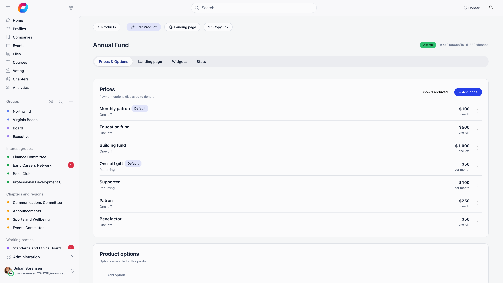
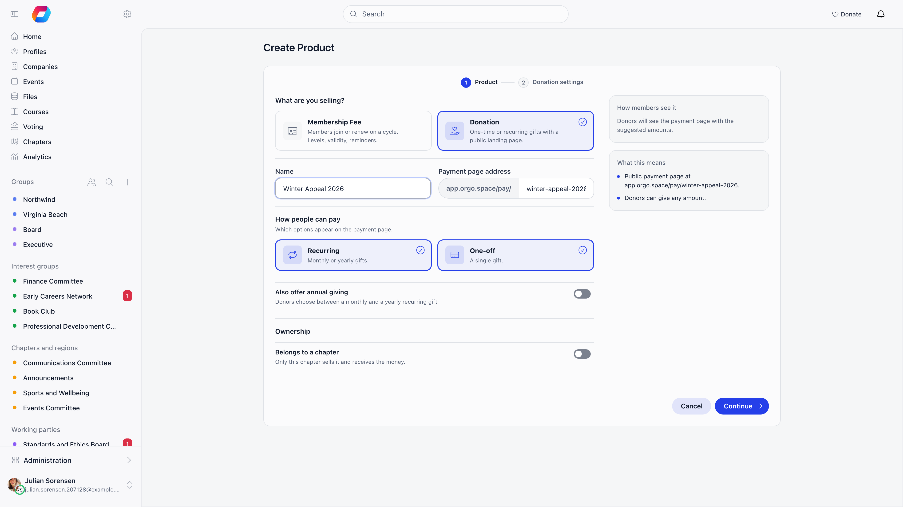
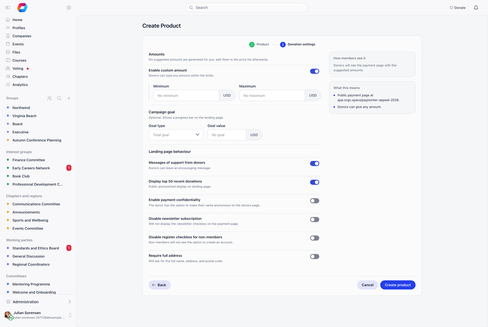
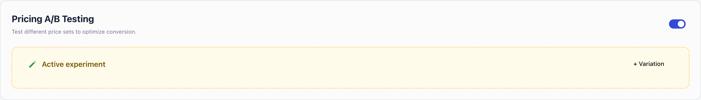
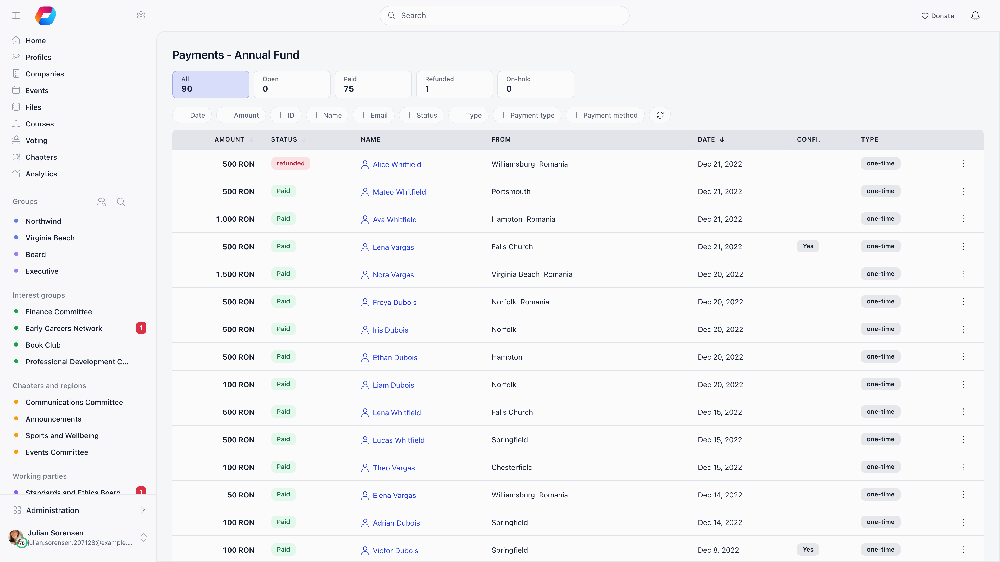
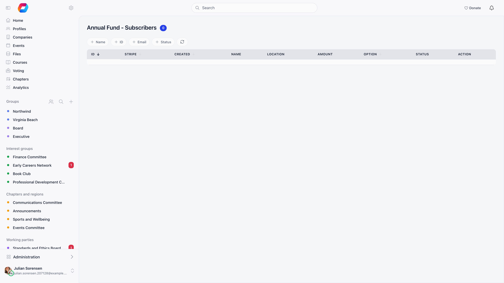
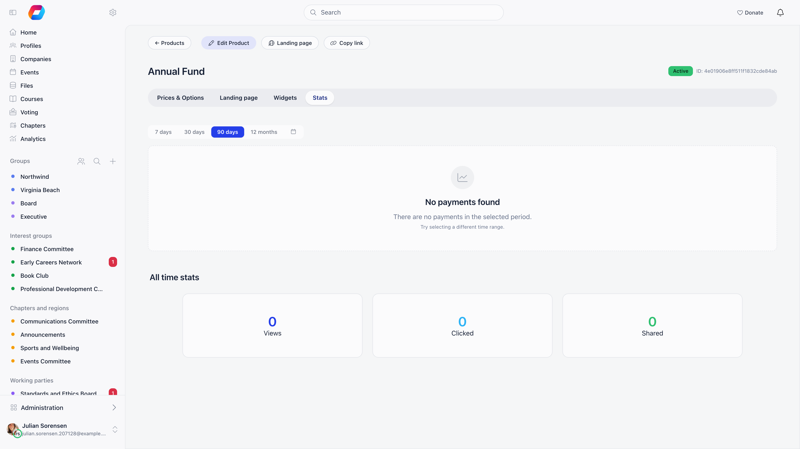

A donation campaign in Orgo is a product of type **Donation**. It gets a public payment page, suggested amounts, an optional goal, donor messages, and embeddable widgets, and every gift lands in the same payments ledger as your fees and ticket sales.

**Built for** membership organizations and nonprofits that fundraise from supporters alongside membership dues: youth organizations, faith communities, alumni networks, advocacy groups.

**Replaces** standalone donation-page tools for goal-based campaigns, suggested-amount A/B testing, and embeddable widgets. It is not a peer-to-peer or team fundraising tool.

---

## Before you start

- **Online Payments** must be on (**Settings → Modules → Payments & Fees → Online Payments**, the **Enable Online Payments** switch). It is on by default.
- A **Stripe account must be connected**, or the one-off payment option cannot be enabled at all; a campaign owned by a chapter needs that chapter's own account. See [Stripe Integration](/platform/fees/stripe-integration).
- The **Financial (Organization)** permission, or **Financial (Chapter)** for a chapter campaign, to create, edit or delete one. The same permissions gate the payments list, widgets, and message moderation.

---

## Donations vs fees

| Use **Donations** when | Use **[Fees](/platform/fees/fees)** when |
|----------------------|--------------------------------------|
| Contributions are voluntary | Payment is required for membership |
| The donor chooses the amount | The amount is fixed per level, or chosen above a minimum on a Flexible amount level |
| Anyone can give, members and non-members | Only existing members pay |
| Goal-based (raise a target for a project) | Period-based (annual dues) |

Both are products, so both share prices, payments, invoices, and Stripe. Only donations get goals, donor messages, the donor wall, and widgets.

---

## Creating a campaign

**Finance → Products → Create Product**, then pick the **Donation** card. Creation is two steps: **Continue** takes you from the product basics to the donation settings, and **Create product** saves it.

| Step | What to set |
|---|---|
| Name it and check the URL | The **Payment page address** is generated from the **Name** as you type and shown as `https://<your payment host>/pay/<slug>`. It is fixed once the campaign exists, so check it before you create. |
| Choose how people can pay | **Recurring** and **One-off** are independent tiles; both start on. **One-off** stays off until a Stripe account is connected. Once a campaign has been saved with only one of them, that one cannot be switched off. |
| Offer annual giving (optional) | With **Recurring** on, **Also offer annual giving** lets donors choose between a monthly and a yearly recurring gift. A yearly gift is charged every 12 months. It is off by default. |
| Allow a custom amount | **Enable custom amount** is on by default. Set an optional **Minimum** and **Maximum** in your organisation's currency; with multiple currencies, the same limits apply to all of them. |
| Add a campaign goal (optional) | Under **Campaign goal**, enter the **Goal value** and optionally a **Target date**. The **Goal type** (**Total goal** for one-off gifts, **Monthly goal** for recurring revenue per month) is only a choice when both payment types are on. Goals are not available for multi-currency campaigns. |
| Owner (optional) | Shown when chapters are on. **Belongs to a chapter** scopes the whole campaign to one chapter, which sells it and receives the money. **Let donors pick a chapter** adds a chapter selector at checkout and needs **Products with Local Center Option** switched on under **Settings → Modules → Payments & Fees → Online Payments**; the extra **Top-level chapters only** switch then limits the choice to chapters without a parent chapter. |

### Landing page behaviour

Switches on the same form, donation campaigns only:

| Setting | What it does | Starts |
|---------|-------------|--------|
| **Messages of support from donors** | Lets donors leave a message with their gift | On |
| **Display top 50 recent donations** | Shows the anonymized donor wall on the public page | On |
| **Enable payment confidentiality** | Gives the donor a checkbox to keep their name off the donor wall and comments | Off |
| **Disable newsletter subscription** | Hides the newsletter checkbox on the payment page | Off |
| **Disable register checkbox for non-members** | Hides the "create an account" option. Only shown when **Create Accounts for External Buyers** is enabled for the organisation | Off |
| **Require full address** | Asks for full name, address, and postal code before payment | Off |

<Note>
  The first **organisation-level** donation campaign you create is registered as the organisation's default donation product, and, if it accepts recurring gifts and none is set yet, also as the **Main Recurring Donation Product**. A campaign owned by a chapter never claims either. The default is what the shortcut URLs `/donate`, `/doneaza`, and `/presedinte` resolve to. You can change both later under **Settings → Modules → Payments & Fees → Donation Product** (**Main Donation Product** and **Main Recurring Donation Product**).
</Note>

---

## Suggested amounts and options

The **Prices & Options** tab holds everything the donor picks from.

**Prices** are the suggested amount buttons: name, amount, currency, description, tagged one-off or recurring. In a price, **Members can pay** picks one-off, recurring or both, and on a campaign with annual giving a recurring price is set to **Monthly** or **Yearly** under **Recurring gift**. **Default price** is the one pre-selected on load. Archive retired prices rather than deleting them so past payments keep resolving; **Show n archived** brings them back into view.

A new campaign arrives with suggested amounts already created, in your organisation currency. One-off: 50, 100, 200, 300, 500 and 1000, with 100 pre-selected. Monthly (when **Recurring** is on): 25, 50, 100, 200, 300 and 500, with 50 pre-selected. Yearly (when **Also offer annual giving** is on): the same six as one-off. Edit or archive them to suit your campaign.

**Generate** only appears while a campaign has no prices at all, so you have to remove the seeded ones first. It reads your organization's country and currency and the campaign title and description, then creates three A/B variations of three amounts each, registers the prices in Stripe, and switches A/B testing on.

**Product options** are the designations a donor chooses from, such as which program the gift funds. Add them inline, drag to reorder, rename in place, and archive when a designation closes; each has its own shareable link that pre-selects it on the public page. They appear under **Designate to** at checkout, and when **Has local center option** is on a **Support chapter** entry is appended to the same dropdown and opens a chapter picker.

### A/B testing suggested amounts

Turn on **Pricing A/B Testing** to run more than one set of suggested amounts side by side. Add a variation, drop prices into it, and enable it. Traffic is split evenly between the enabled variations, and the split percentage is shown on each row.

Each variation reports **total** raised, **average** donation, and **transaction** count, and one that has already collected money cannot be deleted. While A/B testing is on, the default price setting on individual prices is hidden: the variation decides what a donor sees.

---

## Tracking the money

**Payments** lists every donation with its status, donor, location, designation, amount, date, confidentiality flag, and type (one-time or recurring). Everyone who can open the list can filter by date, amount, payment ID, user ID, name, status (**Open**, **Paid**, **Refunded**, **On-hold**), type (one-time or subscription) **Payment type** (what the money was for) and **Payment method**: **Card (online)** is anything paid through Stripe, including wallets, and **Recorded manually** is a payment an admin recorded or marked paid, an import or a bank transfer. On a single donation campaign every row is a **Donation**, so **Payment type** earns its keep on the organisation-wide **Payments** list, where it separates donations from fees, event tickets and shop sales. The email, designation and chapter filters are shown only to the Financial (Organization) permission. There is no record button on this list: record an offline gift from the donor's own profile, see below.

**Refund**, from the row actions, returns the full amount through Stripe and moves the payment to refunded; only a paid payment can be refunded. A gift with no Stripe charge behind it (an import or a gift an admin recorded) shows **Mark as refunded** instead: it only marks the payment, nothing is sent back through Orgo, so return the money yourself first. If that payment has an invoice, mark the invoice as refunded instead. A payment still on hold for an identity check shows **Accept** and **Cancel & refund** instead. These actions need the Financial (Chapter) permission on the chapter the donation was designated to, or Financial (Organization) when it was not designated to one. Admin (Organization) covers both. A chapter treasurer cannot refund an undesignated gift. Refunding a donation also takes away any membership it earned, see the switch below.

**Subscribers** lists the recurring donors on the campaign: name, status, chapter, designation, amount, and identity-validation state where that is required. Statuses are Active, Canceled, Canceling, No identity upload, Identity validation pending, Waiting for subscription, and Pending - Orgo validated. A yearly gift shows its amount with "/ year". An admin with the Financial (Organization) permission can cancel a subscription from here with **Unsubscribe**.

A donor who opens the card form for a recurring gift and does not finish leaves an unpaid attempt. It does not appear in this list as a cancelled subscription: when the donor tries again, or when Stripe expires the attempt about 23 hours later, the attempt is simply deleted, and a donor who comes back can retry at once, for example after ticking **Cover the processing fee**. If the first payment is already being processed, the retry is refused with a message saying so.

**Stats** is page analytics rather than a payments chart: all-time **Views**, **Clicked**, and **Shared**, views over time (daily or monthly), device distribution, sessions, a widget-versus-public-page comparison for both views and donations, and UTM source, medium, and campaign breakdowns for both views and donations. Charts can be downloaded as images.

---

## What the donor pays

**Cover the processing fee** lets the donor add the card processing cost on top, so the amount they chose reaches you in full. It is always offered on a donation, there is no organisation switch for it. The fee is grossed up, not added as a flat percentage: the donor is charged `(amount + fixed fee) / (1 - percentage)`, so after Stripe takes its share of the whole charge you still net exactly the gift. The percentage follows the country of your Stripe account (for example 1.5% for most European countries and the UK, 2.9% for the US, Canada and Switzerland, with 2.9% used for any country not listed), and the fixed part follows the currency (for example 0.30 USD, 0.25 EUR, 0.20 GBP, 1.00 RON, 6.50 CZK). Orgo recomputes the fee on its own side and ignores a figure sent by the browser. The result is rounded to the nearest cent; for HUF it is rounded up to a whole forint.

Amounts are converted to cents by rounding, so a donation of 19.99 is charged as 19.99, not 19.98.

Donations are supported in 22 currencies: USD, EUR, GBP, CAD, AUD, CHF, DKK, NOK, SEK, PLN, CZK, HUF, BGN, RON, HRK, JPY, MXN, SGD, HKD, NZD, AED and INR. Each of the first 19 carries its own minimum charge (0.50 USD and EUR, 0.30 GBP, 2.00 RON, 15.00 CZK), so a very small custom amount can be rejected even when your own minimum allows it.

If you set **Annual Donation Limit per Donor** (under **Settings → Modules → Payments & Fees → Online Payments**, empty means no limit), a donor cannot give more than that in a calendar year. A donation that would pass it is refused, and a recurring donation is cancelled before the charge that would take the donor over the limit. When a payment is refunded or a recurring gift is stopped for this reason, the donor is emailed.

After a successful one-off donation the donor sees your thank-you message on the page and, as soon as Stripe confirms, gets a **Donation thank you** email with the amount and the campaign name. Edit its wording in the **Donations** section of the [Emails page](/platform/emails/email-templates). It is written in your organisation's language, not the donor's own. A recurring gift, monthly or yearly, shows a neutral thank-you message instead.

Offline gifts (cash, cheque, bank transfer) are not handled by the public page. Record them from the donor's profile: open the member, go to **Payments**, then **Add payment record**, choose the campaign, and press **Record payment**. This needs the Financial (Organization) permission. See [Recording payments](/platform/fees/record-payment).

### Donations that count towards membership

This applies only if you turn on **Donations count towards membership** (**Settings → Modules → Payments & Fees → Membership fees → Validity Period**). It is off by default, and it is hidden while **Fixed Starting Date for Fees** is on. With it off, donations never touch a member's membership.

With it on, a donation to any campaign extends the donor's membership from the day it is paid, provided the amount you keep (the processing fee the donor covered is excluded) reaches the minimum of your organisation's **Flexible amount** membership level, scaled to the period the gift covers, and the gift is in the same currency as that level. For a level with a minimum of 60 over 12 months, a monthly gift needs 5 and a yearly or one-off gift needs 60. A gift is judged once, when it is saved, and the membership it earned is kept even if you later change or archive the level. Recording a donation for a member by hand is judged the same way, and refunding a donation takes its membership away. See [Membership Fees](/platform/fees/fees).

---

## Two other places donations show up

**Supporters.** Nominate one campaign as the **Main Recurring Donation Product** under **Settings → Modules → Payments & Fees → Donation Product**. A member with an active, non-confidential subscription to it is flagged as a supporter on their profile and in the member directory. Cancelling clears the flag; a subscription the donor marked confidential never sets it. An abandoned, unpaid attempt does not clear the flag of a donor who already supports you.

**Donation ask at fee checkout.** A membership fee product can carry an optional donation prompt on its own checkout. Turn on **Offer a donation at membership checkout** under **Settings → Modules → Payments & Fees → Membership fees → Checkout donation**, with an optional custom amount, a minimum and maximum, and a prompt; the suggested tiers are edited on the fee product under **Checkout donation add-ons**. Separate from a donation campaign; see [Membership Fees](/platform/fees/fees).

---

## Common questions

<AccordionGroup>
  <Accordion title="How do I run a time-limited fundraiser?">
    Set a **Target date**. When a goal is set, the public progress bar shows that date instead of the completion percentage, which is what creates the deadline pressure. The date does not stop payments by itself; archive the campaign to close it, which replaces the form with a "payments disabled" notice.
  </Accordion>

  <Accordion title="How do I push monthly giving over one-off?">
    Enable both payment types. The public page then shows a **One time / Monthly** toggle (with **Annual** as a third choice if you turned on annual giving) and a "Boost your impact by giving monthly" prompt. In popup widgets, set **Default Donation Type** to monthly and leave **Show Monthly Upsell** on.
  </Accordion>

  <Accordion title="Can a donor give anonymously?">
    Yes, if **Enable payment confidentiality** is on. The donor ticks the box and their name becomes "anonymous" on the donor wall and on their message; their identity is still recorded on the payment for your records.
  </Accordion>

  <Accordion title="Why can I not delete a campaign?">
    A campaign with any recorded payment cannot be deleted. Archive it instead, which keeps the history and stops new donations.
  </Accordion>
</AccordionGroup>

---

## Related

- [Donation pages and widgets](/platform/fees/donation-pages) - the public page, donor messages, embeds
- [Products](/platform/fees/products) - product types, prices, and payment settings
- [Stripe Integration](/platform/fees/stripe-integration) - connecting payment processing
- [Membership Fees](/platform/fees/fees) - required, non-voluntary payments
- [Local Center Fees](/platform/local-group-fees/create-local-fees) - chapter-level collection
