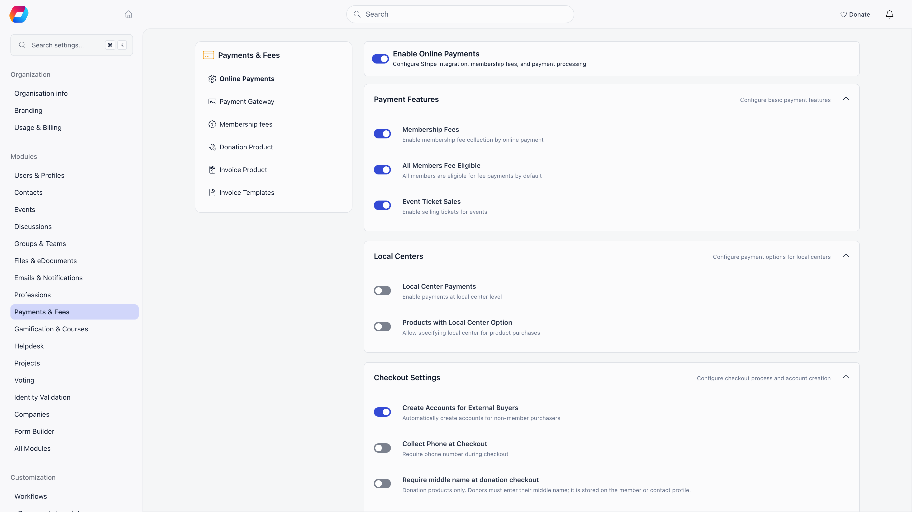
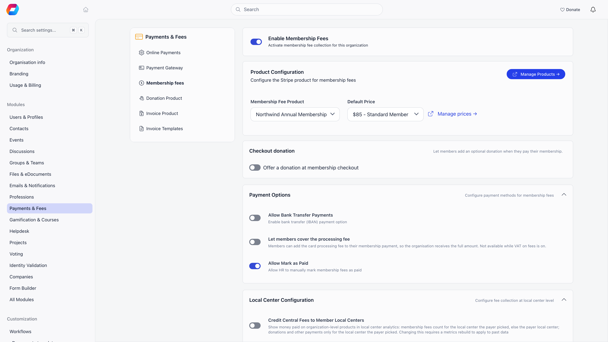
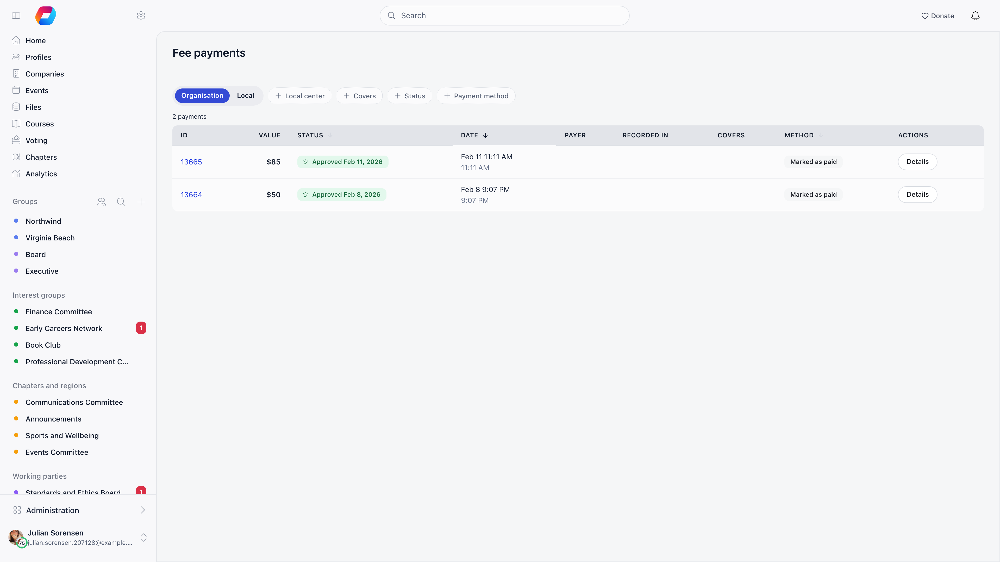
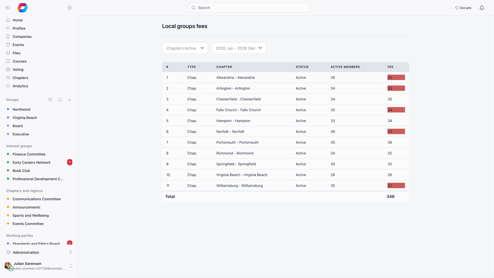
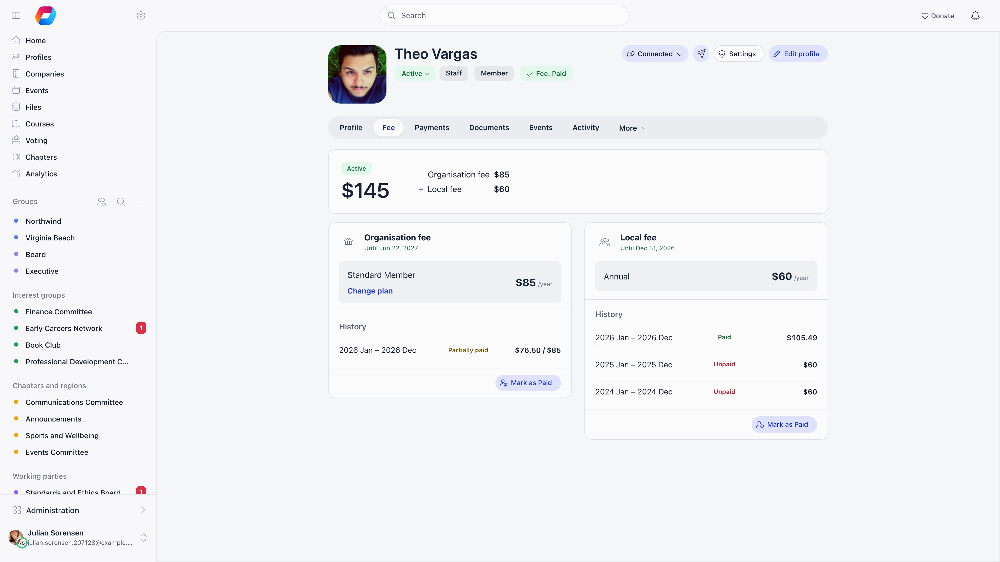

Orgo Membership Fees is the dues collection and billing module that charges, tracks and reconciles member payments.

**Built for** membership organisations collecting dues from a distributed member base: professional associations, alumni networks, youth organisations, faith communities and federated nonprofits.

**Replaces** the spreadsheet that tracks who has paid. It is not accounting software; payment data feeds into that.

---

## How the pieces fit

A membership fee is a product of type **Membership Fee** with one price per membership level, called a level in the interface. Each member is assigned one of those levels. A successful payment stamps a billing period on the member, and the end of that period becomes their **valid fee date**, which reminders, mandatory-fee gating and chapter statistics all read.

A product can instead be set up with a single **Flexible amount** level, where each member chooses how much to pay above a minimum. See [Products](/platform/fees/products) and [Flexible amount memberships](#flexible-amount-memberships) below.

---

## Setting up

All three steps need an Orgo administrator.

<Steps>
  <Step title="Connect Stripe">
    **Settings** → **Modules** → **Payments & Fees** → **Payment Gateway**. Without it you can still record payments by hand, but members cannot pay online. See [Stripe Integration](/platform/fees/stripe-integration).
  </Step>
  <Step title="Create the fee product and its prices">
    **Finance** → **Products** → **create product** → **Membership Fee**. Set **Cycle length** and **Cycle starts in**, then add one level per membership tier. See [Products](/platform/fees/products).
  </Step>
  <Step title="Point the organisation at it">
    **Settings** → **Modules** → **Payments & Fees** → **Membership fees** → **Enable Membership Fees**, then pick the **Membership Fee Product** and its **Default Price**. Nothing charges until a product is selected here.
  </Step>
</Steps>

---

## Membership fee settings

| Setting | Section | Default | What it does |
|---------|---------|---------|--------------|
| **Membership Fee Product** / **Default Price** | Product Configuration | none | The fee product members are billed against and the price new members get. |
| **Allow Bank Transfer Payments** | Payment Options | off | Shows your IBAN as a payment option. |
| **Enable Membership Payments via Bank Transfer** | Payment Options | off | Extends bank transfer to membership fees specifically. |
| **Let members cover the processing fee** | Payment Options | off | Adds a **Cover the processing fee** tick to the card step of a member's membership payment, so the organisation receives the full price. Hidden, and ignored, while **Enable VAT on Fees** is on. See [What a payment buys](#what-a-payment-buys). |
| **Allow Mark as Paid** | Payment Options | on | Lets an administrator record a fee as paid without a card charge. |
| **Credit Central Fees to Member Local Centers** | Local Center Configuration | off | Reporting only. Shows money paid on organisation-level products in each chapter's analytics, so an organisation that collects centrally can still see per-chapter figures. It changes nothing about how money is collected, and past figures update only after a rebuild of the statistics. |
| **Local Center Fees Enabled** | Local Center Configuration | off | Turns on a second, chapter-level fee. |
| **Local Center Members Table** | Local Center Configuration | off | Adds the per-chapter [Member fees table](/platform/local-group-fees/member-fees). Shown once **Local Center Fees Enabled** is on. |
| **Minimum Members per Local Center** | Local Center Configuration | 25 | Below this paid count, a chapter is flagged on the Stats table. |
| **Minimum Active Members Percentage** | Local Center Configuration | 100% | Same flag, expressed as a share of the chapter's active members. |
| **Lifetime Membership Available** | Validity Period | off | Allows a price to be marked lifetime. |
| **Fee Valid Days** / **Fee Valid Months** | Validity Period | 0 / 0 | Grace kept after expiry. Zero means no grace. |
| **Fixed Starting Date for Fees** | Validity Period | off | Anchors periods to the product's cycle month instead of the payment date. Hidden while **Donations count towards membership** is on. |
| **Donations count towards membership** | Validity Period | off | A donation to any campaign extends the donor's membership from the day it is paid, when it reaches the minimum of the flexible-amount level. Needs a flexible-amount level and cannot be combined with **Fixed Starting Date for Fees**. See [Flexible amount memberships](#flexible-amount-memberships). |
| **Allow Next Year Payment** | Eligibility Rules | on | Lets members pay the next period before the current one ends. |
| **Advance Payment Window (Months)** | Eligibility Rules | 1 month | How early a multi-month fee may be paid. |
| **Advance Payment Window (Days)** | Eligibility Rules | 7 days | How early a monthly fee may be paid. |
| **Minimum Cycles to Pay** | Eligibility Rules | none | Forces members with arrears to settle several cycles at once. |
| **Who Can See User Fee Status** | Eligibility Rules | Any User | Any User, Local HR, Tenant HR or Tenant Admin. |
| **Enable Age Restrictions on Prices** | Pricing Options | off | Adds age-conditioned prices. |
| **Enable VAT on Fees** | Pricing Options | off | While off, no VAT is charged, even on prices that store a rate. |
| **Enable One-time Registration Fee** | Pricing Options | off | While off, no registration fee is charged. |
| **Fee Payment Mandatory** | Membership Requirements | off | Restricts the platform for members whose fee has expired. |
| **Continuity Mandatory** | Membership Requirements | off | Requires an unbroken payment history. |
| **Require Contract for Membership** | Membership Requirements | off | Members must sign the membership contract before paying. |
| **Company Fee Payment Mandatory** | Membership Requirements | off | Gates company members on the company's fee instead of their own. |
| **Auto-deactivate on Fee Expiry** | Membership Requirements | off | Sets members inactive after expiry. Requires **Fee Payment Mandatory**. |
| **Days Until Deactivation** | Membership Requirements | none | Grace before deactivation, 1 to 365 days. The job runs daily at 07:00 UTC. |

A **Checkout donation** section (shown once a membership fee product is selected) adds an optional gift to the membership checkout: **Offer a donation at membership checkout**, **Allow a custom donation amount** with a **Minimum amount** and **Maximum amount**, and the **Prompt shown to members** (the default prompt is "Add a donation?"). The suggested amounts are tiers you add on the product's **Membership levels** tab, under **Checkout donation add-ons**. A gift added this way is recorded as its own payment row on the same card charge, and the membership row is reduced by the gift so the rows add up to what was charged.

---

## What a payment buys

**Fixed Starting Date for Fees** decides the period:

- **Off (anniversary):** the period runs from the payment date for the product's number of months, ending the day before the anniversary. An annual fee paid on 1 September covers to 31 August.
- **On (fixed cycle):** the period is anchored to the product's **Cycle starts in** month, so a September-anchored annual fee always runs 1 September to 31 August and a January payment buys only the remainder.

When a member pays online with **Fixed Starting Date for Fees** off, the period starts where their current membership ends if it is still valid (so an early renewal loses no days), and starts on the payment day otherwise. It ends one cycle later: the cycle length of their level if it has its own, otherwise the product's. With **Donations count towards membership** on, every payment starts on its own payment day instead and nothing stacks.

Proration decides the price, not the end date. With **Pro-rate the first cycle** off, a mid-cycle payer still ends on the cycle boundary and pays in full; with it on the amount is reduced for the remaining months, unless **Charge the full price when joining within** vetoes it for members who join in the opening months of the cycle.

### Worked example: joining mid-cycle

**An example, not a default.** An annual membership priced at 120, **Cycle length** yearly, **Cycle starts in** September, with **Fixed Starting Date for Fees** and **Pro-rate the first cycle** both on.

| The member joins | The period on offer | Charged |
|---|---|---|
| September 2025 | 1 Sep 2025 to 31 Aug 2026 | 120, the whole cycle |
| January 2026 | 1 Jan 2026 to 31 Aug 2026 | 80, eight months of twelve |
| June 2026 | 1 Jun 2026 to 31 Aug 2026 | 30, three months of twelve |

Every partial period still ends on the cycle boundary, so everyone renews together on 1 September.

Now set **Charge the full price when joining within** to 3 months of the cycle start. Anyone joining in the first three months of the cycle (September, October, November) is charged the full 120 instead, and proration only starts with a December join. The setting exists so that a member joining a few weeks late does not get a discount for it.

Proration is measured from the member's join date, not from the day they pay: a member who joined in January but only settles in June still buys the January to August period at 80.

### Covering the processing fee

With **Let members cover the processing fee** on and **Enable VAT on Fees** off, the card step of a member's membership payment offers a **Cover the processing fee** tick with the amount it adds. It applies to the organisation fee and to a chapter fee, and on automatic renewal the fee is added to every charge. It is not offered on a payment link an administrator copies for a member, or to a company paying for a company membership.

The amount is an estimate of Stripe's standard fee for a domestic card in the country of your Stripe account, grossed up so that you receive the full membership price after Stripe takes its share of the whole charge: `(price + fixed part) / (1 - percentage)`, rounded to the nearest cent. The fixed part depends on the currency (0.25 EUR, 0.30 USD, 0.20 GBP) and the percentage on the country (1.5% for most European countries, 2.9% for the United States, Switzerland and Canada, and also 2.9% where no rate is listed). A card from outside that region costs Stripe more, and your organisation absorbs the difference. The covered fee is kept apart from the price: it buys no membership time, is left off the membership invoice, and is ignored when Orgo works out what a period has already been paid.

---

## Which price a member pays

Each member carries an assigned membership level, plus an optional local one. For a given date Orgo resolves the amount in this order:

1. If the product is set to **Flexible amount**, its single level, whatever is assigned.
2. If the member's level is the free companion level of a bundle, that level.
3. The effective-dated assignment covering that date, otherwise the member's current assigned level.
4. The version of that level that was valid on the date.
5. The organisation **Default Price** (age-appropriate, when age restrictions are on).

Raising a price therefore never reprices history: a 2024 payment still resolves against the 2024 version.

On **Finance** → **Local members fees** the fee column is a per-member dropdown, and the change is recorded against the fee year on screen, so a member can sit on one level this year and another next. **Change plan** on a member's profile follows the same rule once the member has year-based levels: the new level applies from the next unpaid cycle, and the plan line shows it as, for example, "From 2027: Student". On a profile, changing a level for someone else needs both the Financial and the HR permission for that member's chapter; a finance-only administrator changes levels on the Local members fees table instead. The first future-dated change pins the member's current level to the current cycle, so promoting the new level later cannot reprice earlier periods. The change is refused with a conflict once a successful payment covers the target cycle or any later one; the lock icon marks the rows the server would refuse.

**Example.** With **Cycle starts in** September, the fee year labelled 2026 means 1 September 2026 to 31 August 2027, and in July 2026 the current fee year is still 2025. So in July 2026 you can move a member from Student to Standard for 2026 even though they have paid 2025 in full: the earliest period the change touches is 1 September 2026, and no payment reaches it yet. Once that member pays 2026, the 2026 dropdown locks and only 2027 onwards remains editable.

---

## The valid fee date

Fee validity is not hand-set. It is the furthest period end among the member's successful, unrefunded payments for the fee product, recomputed whenever a payment is recorded, approved or refunded. Recording an older period never pulls the date backwards. Local fees keep a separate date. With **Donations count towards membership** on, the end of a counted donation competes in the same way: the latest end wins and nothing stacks.

A member whose status is inactive and whose recomputed date is in the future is set back to active, unless an approved resignation is on file. This happens whenever a payment is recorded or approved, after a payment import finishes or is rolled back, and whenever the organisation recomputes fee dates, as if an administrator had activated them (the welcome email, workflows and webhooks run as usual).

Two levels bypass payment: a **Lifetime** level with no price sets validity 100 years out, and an **Admins only** level with no price (shown as an **Exemption** level in the list) sets validity to today plus the cycle length each time it is applied. With **Fixed Starting Date for Fees** on and a cycle month set on the product, it instead runs to the end of the cycle that contains today, and a nightly job (06:30 UTC) moves every active member on an exemption level to the end of the current cycle, so they roll over with everyone else. That covers honorary and free memberships. An exemption level does not add to whatever the member already had, so re-applying it to a member with longer remaining validity shortens it.

Exemption comes from the user type, not the individual: a user type with **Not eligible for fee** on, the organisation's designated non-eligible user type, or an active user-type role carrying that flag. Exempt members are never assigned a fee and see "You are not eligible for paying fees" on their profile.

---

## Collecting payments

| Method | How it works |
|---|---|
| **Online** | Members pay from their profile's fee tab or a payment link, but only once their fee has expired or the advance-payment window has opened. |
| **Bank transfer** | With **Allow Bank Transfer Payments** and **Enable Membership Payments via Bank Transfer** on, and the Invoices module configured, a member raises an unpaid membership invoice and gets your account details plus the invoice's series code as the identifier to quote. It is settled with **Mark as paid** on that invoice, and never appears on **Fee payments**. |
| **Mark as paid** | With **Allow Mark as Paid** on, an admin picks the periods to settle on the member's fee tab. If part of the period is already covered, Orgo records only the remainder. On a flexible-amount level the administrator also picks the amount (see below). |
| **By someone else** | A parent listed as managing a member can pay for them, and companies can cover their members. A company-covered member sees "Membership managed by" instead of a pay button. |

On the **Local members fees** table an admin may only record a payment for a member they manage: chapter and organisation finance admins for their whole scope, unit admins only for members in their own units. **Mark as paid** is a finance-admin action and is not offered to unit admins at all.

### Worked example: recording a part-paid year

**An example, not a default.** A member on a 120 level with a September cycle already paid 30 by card for 1 June to 31 August 2026. An administrator now ticks the whole 1 September 2025 to 31 August 2026 cycle under **Mark as paid**.

Orgo works out what the cycle costs (120), subtracts the overlapping part of what is already paid (the 30), and records a single 90 row. The member's periods do not double up and the totals still add up to what was actually collected. If the selection turns out to be fully covered, nothing is recorded for that member at all and they simply do not appear in the batch.

An early renewal is stacked the same way. When a member pays while their membership is still valid, the new period starts at their current validity date rather than at the payment date, so paying two weeks early costs them nothing in days.

---

## Flexible amount memberships

A membership product can be set to **Flexible amount** instead of **Fixed levels** (choose it under **Pricing model** when you create the product or in **Edit product**; switching archives the existing levels, and members keep their validity). It holds one level where each member chooses how much to pay: a **Minimum amount** (required, a whole number above zero), an optional **Maximum amount**, a **Prefilled amount** and up to eight **Quick-pick amounts**, each inside the minimum and maximum. The level can be offered one-off, recurring or both. Whole amounts only.

- Anyone paying at or above the minimum gets the membership. There are no per-member levels: the level is the only one offered, and assigning another level is refused.
- Nothing is prorated or netted against earlier payments: the period is charged in full at the amount chosen. The minimum and maximum are enforced by the server.
- When an administrator uses **Mark as paid**, the amount chooser shows the quick picks plus any whole amount between the minimum and the maximum.
- The member's fee card reads "Up to you" with the minimum rather than a fixed price.

With **Donations count towards membership** on, a gift to any donation campaign also earns membership on this level, judged once when the gift is saved:

- The gift must be in the currency of the level. A 60 RON gift never meets a 60 USD minimum.
- It counts when the amount your organisation keeps (a processing fee the donor covered is not counted) reaches the minimum scaled to the period it covers, to the cent. On a 60 level with a 12-month cycle, a monthly gift needs 5 and a yearly or one-off gift needs 60.
- A recurring donation covers the period of each charge; a one-off gift covers one membership cycle. Either way the period starts on the day the gift is paid.
- Changing the minimum later never undoes a membership already earned or grants one retroactively. A refunded donation takes its membership away. Gifts saved while the switch was off, or imported, are judged when the switch is turned on or when fee dates are recomputed.
- Turning the switch on recomputes every member's validity date. It is refused unless a flexible-amount level with a minimum exists, and while **Fixed Starting Date for Fees** is on.

---

## Approving recorded payments

**Finance** → **Fee payments** is the queue of recorded fee batches. It requires Financial (Chapter); unit fee admins also reach it, scoped to their own chapter.

The **Organisation** / **Local** toggle appears only with **Local Center Fees Enabled** on. On the **Organisation** view, organisation-wide finance administrators also get a **Local center** pill (where the batch was recorded), a **Covers** pill (batches that pay for a member of a chapter, unit or group, matched through the members rather than through where it was recorded) and a **Status** pill (**pending** or **approved**). Everyone who can open the screen gets a **Payment method** pill with **All**, **Card (online)**, **Bank transfer** and **Marked as paid**, and a count of the payments found. Each row shows the ID, total, status, date, payer, the chapter it was **Recorded in**, **Covers** chips (the chapters paid for and, for each member, the one unit they were registered in on the payment date; the **Covers** filter still matches any unit or group), the method and the actions.

What arrives approved is decided by how the batch was written, not by how the member paid. A card batch arrives approved, and only Stripe fulfilment ever writes one. A **Mark as paid** batch, method **check**, arrives approved too. What arrives pending is the batch written by **Pay** on **Finance** → **Local members fees**, stamped as a bank transfer (`iban`), for organisation and chapter fees alike.

Approving marks every payment in the batch successful, saves them, and only then recalculates each affected member's valid fee date, the chapter date for a chapter fee product and the organisation date otherwise. Until then the periods show as paid-but-pending on the fee tables and no validity date moves. **Approve** is shown only to Admin (Organization). A chapter administrator with Admin (Chapter) sees **Cancel** instead, which deletes the batch and every payment row in it.

---

## Watching collection

**Finance** → **Local members fees** shows one row per member and one column per fee period: which periods each member has settled, with "X of Y paid" under each period heading (following the unit filter), a switch between the organisation and local fee, filters for year, member status and unit, and recording payment for the selection. Requires Financial (Chapter) and the **Local Center Members Table** setting. See [Member fees table](/platform/local-group-fees/member-fees).

The fees-by-chapter statistics page, at the address `/fee/stats` (the standard **Finance** menu has no entry for it), shows fees by chapter for a chosen fee period, for active or closed chapters: chapter, status, active member count and fees paid, with a total. It requires Financial (Organization); for Admin (Organization) it also highlights chapters below **Minimum Members per Local Center** or **Minimum Active Members Percentage**.

Per-member history lives on **Members** → open a member → **Fee**. A summary card at the top shows the status (**active** or **Unpaid**), the amount, the **Plan** with a **Change plan** link where the member can pick another level, and the **Pay** or **Automatic Renewal** buttons when they apply. Below it, the **History** lists every period with its amount and a tag (**Paid**, **Partially paid**, **Pending**, **Unpaid**, **Refunded** or **Exempt**), newest first; older periods sit behind a **+N older** link. When the member also has a local fee, the **Organisation fee** and **Local fee** cards appear side by side and the summary shows each amount plus the combined total. Fee periods are separate from the member's other purchases: the profile's **Payments** tab lists every payment and can be narrowed with the **Payment type** filter (see [Recording a payment](/platform/fees/record-payment#finding-payments-by-payment-type)).

The payment screens have no built-in CSV export. To pull payment data out, build a payments report (**Reports** in the sidebar, Admin (Organization) only): **Payments** is one of the report builder's starting points, with columns from the product, the price, the payer, the company, the invoice and five other related records, and the download holds every matching row rather than one page. See [Reports](/platform/reports). For a one-off question rather than a repeatable file, the Ask Orgo assistant (**Ask Orgo** in the sidebar, Admin (Organization) only) also exports query results as CSV.

---

## Reminders and renewal

Renewal reminders run automatically once a day; there is no "send reminder" button on a member list. Company-covered members are excluded from the personal ladder. See [Renewals](/platform/fees/renewals).

---

## When fees are mandatory

With **Fee Payment Mandatory** on, a member whose valid fee date has passed is redirected to the payment page and cannot use the rest of the platform until they pay. Organisation HR and finance administrators are never gated, and neither are fee-exempt user types. With **Company Fee Payment Mandatory** on, a member who belongs to a company is gated on the company's fee instead of their own.

<Info>
  Making fees mandatory degrades the experience for every unpaid member. Pair it with **Days Until Deactivation** rather than **Auto-deactivate on Fee Expiry** alone, so members get a grace window before their account is deactivated.
</Info>

---

## Refunds

Open the payment on **Finance** → **Payments** and use the row menu. A card payment offers **Refund**: Orgo refunds exactly that payment row through Stripe, so refunding a membership charge does not claw back the registration fee booked alongside it. A payment with no Stripe charge behind it (recorded by hand or imported) offers **Mark as refunded** instead: nothing is sent back through Orgo, it only records that you returned the money yourself. A payment that belongs to an invoice is refunded from the invoice, see [Cancelling and correcting invoices](/platform/fees/cancelling-invoices). Either way the member's valid fee date is recalculated from what remains (including a donation that had earned membership), and any event attendance paid by that payment is cancelled. Refunds are always the full row amount; there is no partial-amount field. Chapter payments need Financial (Chapter) for that chapter; organisation payments need Financial (Organization).

---

## Troubleshooting

<AccordionGroup>
  <Accordion title="A member paid but their fee still shows as expired">
    Validity is the end of the paid period, not the payment date, so a payment recorded against last year's period will not clear this year. Also check the batch was approved on **Finance** → **Fee payments**; pending batches do not count.
  </Accordion>

  <Accordion title="A member cannot pay yet">
    Payment opens when the fee expires or the advance-payment window opens, one month before expiry for multi-month fees and seven days for monthly ones unless you changed it under **Eligibility Rules**.
  </Accordion>

  <Accordion title="I cannot change a member's fee level">
    The level locks once a successful payment covers that cycle or a later one ("The fee is already paid and can no longer be changed"). Change it for a later year instead. A product set to **Flexible amount** has no levels to assign at all.
  </Accordion>

  <Accordion title="VAT or the registration fee is not being charged">
    Both are opt-in: **Enable VAT on Fees** and **Enable One-time Registration Fee** under **Pricing Options**. While either is off it is never charged, whatever the price row stores. See [VAT](/platform/fees/vat).
  </Accordion>

  <Accordion title="A member should not pay fees at all">
    Do not delete their price. Mark their user type **Not eligible for fee**, or assign an admin-only price with no amount to keep an active membership without paying.
  </Accordion>

  <Accordion title="Chapters need their own dues on top">
    Turn on **Local Center Fees Enabled** and configure each chapter's fee product. Members then hold two independent validity dates. See [Local Center Fees](/platform/local-group-fees/create-local-fees).
  </Accordion>

  <Accordion title="I am on a member's fee tab and there is no pay button">
    Working as designed: the online payment buttons only ever appear to the member looking at their own fee tab. An administrator settles someone else's fee with **Mark as paid**, or sends them the payment link to pay themselves. Before digging further, confirm whether it is you or the member who cannot see the button, because the two have completely different causes.
  </Accordion>

  <Accordion title="The member has no way to pay at all, not even the advance window">
    Three conditions close the member's own payment route regardless of dates. An active, uncancelled subscription on the fee product, because they are already being charged automatically. A bank transfer already in progress, because Orgo is waiting for that money to land. And, with **Require Contract for Membership** on, an unsigned or lapsed membership contract, which also fails on the server with "Please sign the mandatory membership contract before any payments". The last two also hide **Mark as paid** on the member's fee tab; an active subscription does not, which is how you settle a period for a subscriber whose charge went astray.
  </Accordion>

  <Accordion title="A member is told to select more periods before paying">
    Two arrears settings do this. **Minimum Cycles to Pay** produces "You must select at least N cycles to pay", and only bites when the member actually has that many unpaid periods. **Continuity Mandatory** produces "Your account has unpaid balances from previous fee periods": the selection has to start at the oldest unpaid period and run without gaps, so a member cannot pay this year while last year is open. One checkout also covers at most 12 periods; a member further behind than that pays in two goes.
  </Accordion>

  <Accordion title="A pending batch has no Approve button">
    **Approve** is shown only to Admin (Organization), and only while the batch is still pending. A chapter administrator with Admin (Chapter) sees **Cancel** instead, which deletes the batch rather than approving it. A finance-only administrator, Financial (Chapter) or Financial (Organization) without an admin permission, sees the queue and the batch details but neither button, so the batch stays pending and the members it covers stay unpaid.
  </Accordion>

  <Accordion title="How do I list only the fee payments in the payments list?">
    On **Finance** → **Payments**, or a member's **Payments** tab, open the **Payment type** pill and choose **Fee**. The type comes from the product that was paid: membership fee products are **Fee**, donations **Donation**, event tickets **Event ticket**, shop items and digital downloads **Shop**, and everything else, including payments from invoices, **Admin**. See [Recording a payment](/platform/fees/record-payment#finding-payments-by-payment-type).
  </Accordion>

  <Accordion title="A returning member was not charged the registration fee">
    The one-time registration fee is due only to a member who has never had a membership validity date. Any date at all in their history exempts them, including one that came from a lapsed membership, a level switch, or a free or lifetime price an administrator assigned. There is no way to charge it a second time.
  </Accordion>
</AccordionGroup>

---

## Related

- [Products](/platform/fees/products): fee products, levels and price changes
- [Renewals](/platform/fees/renewals): the reminder schedule and what expiry does
- [VAT](/platform/fees/vat): VAT and the one-time registration fee
- [Record a payment](/platform/fees/record-payment): recording offline payments
- [Local Center Fees](/platform/local-group-fees/create-local-fees): chapter-level dues
