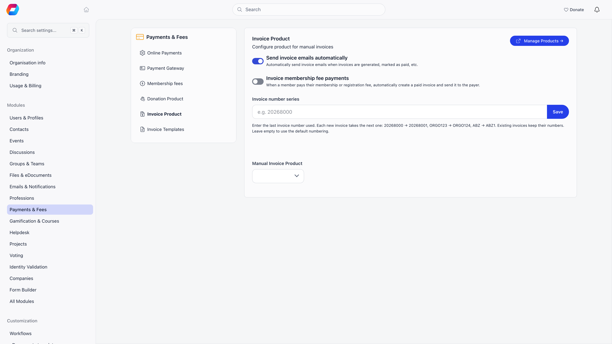
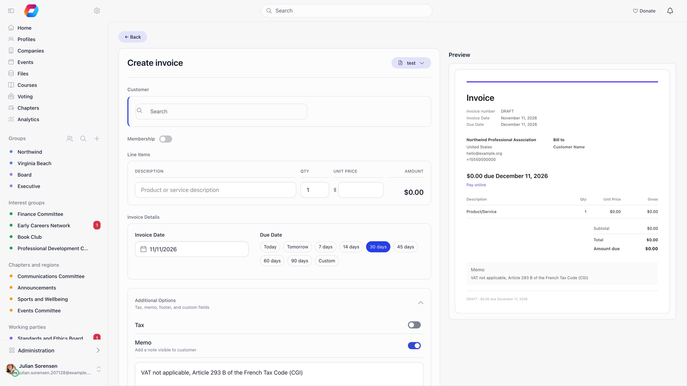
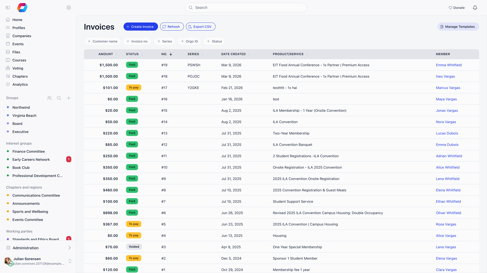
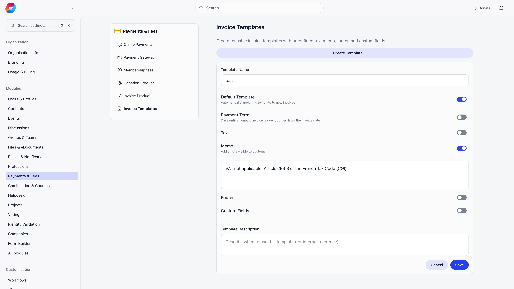

An invoice in Orgo is a document plus a state machine. The document is a PDF you
can download, email and re-send. The state (unpaid, paid, voided, refunded) is
what drives membership validity, event attendance and your financial totals.

**Built for** membership organisations that need to bill members, companies and
external contacts for dues, event places and one-off services, and to show a
proper document for each.

**Replaces** hand-made invoice spreadsheets and separate invoicing tools for
member billing, not a full accounting ledger.

<Note>
Invoices are a module. Switch **Invoices** on in **Settings** → **All Modules**.
While it is off, **Invoices** does not appear in the sidebar, opening the list
sends you back to the dashboard, and the **Invoice Templates** settings tab is
hidden. Every administrator action described here needs the Admin (Organization)
permission.
</Note>

---

## Before you can create an invoice

Set **Manual Invoice Product** in **Settings** → **Modules** → **Payments & Fees**
→ **Invoice Product**. Without it, invoice creation fails with a message telling
you to review that screen. The same screen holds the rest of the invoicing
behaviour:

| Setting | What it does |
|---|---|
| **Send invoice emails automatically** | On by default. Sends the invoice to the customer when it is created and again when it is marked as paid. Turn it off to send only by hand. |
| **Invoice membership fee payments** | Off by default. When a member pays a membership or registration fee online, create a paid invoice and email it to them. |
| **Invoice template** | Only appears when the setting above is on. Which template those automatic invoices use. Leave on **Default template** to follow the tenant default. |
| **Invoice number series** | Optional. The last invoice number you used, so numbering continues from your existing books (see [Numbering](#numbering-and-series)). Empty means Orgo's own numbering. |
| **Manual Invoice Product** | The product every manual invoice is booked against. Required. |

---

## Creating an invoice

**Invoices** → **create invoice**. The form is on the left, a live preview of the
document on the right.

<Steps>
  <Step title="Pick the customer">
    Search for a member, a contact or a company. Exactly one of the three: an
    invoice cannot be split across two payers. Selecting one loads its billing
    block (**Billing Name**, **Address**, **Postal code**, **Secondary address**,
    **Secondary postal code**, **VAT Number**, **Registration Number**,
    **Email**, **Phone**), which you can edit for this invoice only.
    Leave **Also update customer record with these details** ticked to write your
    edits back to the member, contact or company as well.
  </Step>
  <Step title="Decide whether it is a membership invoice">
    The **Membership** switch turns the invoice into a membership invoice: pick a
    membership level (or **Custom**), a start date and an end date. This is what
    makes marking it paid extend the member's or company's membership. Contacts
    cannot be given membership invoices.
  </Step>
  <Step title="Enter the line">
    A manual invoice carries one line: description, quantity and unit price.
    Multi-line invoices exist, but only on invoices Orgo generates itself for
    membership payments, where the joining fee is a second line.
  </Step>
  <Step title="Set the dates">
    **Invoice Date**, then a **Due Date** chip: Today, Tomorrow, 7, 14, 30, 45,
    60 or 90 days, or Custom. 30 days is the default. Picking a template that
    has a **Payment Term** (see [Templates](#templates)) sets the chip to that
    many days after the invoice date.
  </Step>
  <Step title="Add anything else">
    **Additional Options** holds the tax name and rate, a **Memo** (visible to
    the customer), a **Footer**, and **Custom Fields** (label and value pairs
    printed on the document). **Internal Notes** at the bottom are never shown to
    the customer.
  </Step>
</Steps>

Saving creates the invoice as **unpaid**, gives it a number, renders the PDF,
and (unless you turned automatic emails off) sends it to the customer straight
away. Membership start and end dates print as the calendar day you picked.

---

## Numbering and series

Every invoice shows one number, everywhere: on the PDF, in the email, in the
list and in the file name of the download.

- **Without an invoice number series**, the number is the highest number already
  used in your organisation, plus one. It starts at 1, is unique to your
  organisation, and does not reset at the start of a year.
- **With an invoice number series**, you enter the last number you used (for
  example `20268000`, `ORGO123` or `ABZ`) under **Settings** → **Modules** →
  **Payments & Fees** → **Invoice Product** → **Invoice number series**, and
  every new invoice takes the next one: `20268000` becomes `20268001`,
  `ORGO123` becomes `ORGO124`, `ABZ` becomes `ABZ1`, `ABZ99` becomes `ABZ100`.
  Zeros in front are kept (`ABZ000` becomes `ABZ001`). Existing invoices keep
  their numbers. Clear the field to go back to the default numbering.
  If you enter a number lower than one already issued with the same prefix,
  Orgo asks you to choose between keeping your value or continuing after the
  highest one issued; a number already taken by another invoice is skipped.

Separately, Orgo gives every invoice a **Series**: five random characters drawn
from `ABCDEFGHJKMNOPQRSTUVWXYZ` and `123456789`, so the code cannot be misread
(no I, L or 0). It is an internal reference, used to match bank transfers and
for payment links. It is not printed on the document. You can still search the
list on it.

The list lets you filter on customer name, invoice number (your series number
when you have one), series, the internal Orgo ID and status.

### Exporting to CSV

On the list, **Export CSV** turns on checkboxes. **Export selected** exports the
rows you ticked (up to 5000); **Export all** exports every invoice matching the
filters you have applied, across all pages. Orgo gives you a download link to
one CSV file with a row per invoice: number, series, type, status, issue, due
and refunded dates, customer and billing details, net, VAT, total, paid and
balance due, currency, line items, memo and membership dates. Amounts are plain
numbers such as `3000.00`, so a spreadsheet can calculate with them. Only the
Admin (Organization) permission can export.

Voided and refunded invoices keep their number. That is the point: a missing
number would be unexplainable, a voided one is not.

---

## Templates

Templates pre-fill the parts of an invoice that are the same every time.
**Settings** → **Modules** → **Payments & Fees** → **Invoice Templates**, or
**Manage Templates** from the invoices list.

| Field | What it does |
|---|---|
| **Template Name** | How the template appears in the picker. |
| **Default Template** | Applied automatically to new invoices. Setting a new default clears the old one. |
| **Payment Term** | Days until an unpaid invoice is due, counted from the invoice date: Due on receipt, 7, 14, 30, 45, 60 or 90 days, or Custom. |
| **Tax** | A **Tax Name** (for example VAT, GST) and a **Tax Rate** in percent. |
| **Memo** | A note printed on the invoice, visible to the customer. |
| **Footer** | Footer text at the bottom of the document. |
| **Custom Fields** | Label and value pairs printed on the invoice, with optional default values. |
| **Template Description** | Internal reminder of when to use this template. Not printed. |

Pick a template from the **Templates** menu on the invoice form. It replaces the
tax, memo, footer and custom fields on the invoice you are editing with the ones
the template fills in, so apply it first and type your overrides afterwards.
The default template is applied automatically when the form opens. On invoices
Orgo generates for membership payments the template's flat tax rate is ignored,
because each line carries the VAT rate from its own price.

The **Payment Term** also drives the due date of invoices Orgo raises for you
(bank-transfer membership invoices, company renewal invoices, event invoices),
using the default template or, for the invoices made after an online fee
payment, the template chosen under **Invoice template** in settings. Without a
payment term, event bank-transfer invoices are due in 30 days, company renewal
invoices in 60 days, and member bank-transfer membership invoices get no due
date. A card-paid invoice is due the day it was paid.

The invoice layout itself is fixed. There is no place to write your own
placeholders into a memo or footer: the organisation and customer details, line
table, totals and VAT breakdown are filled in by Orgo from your organisation
profile and the customer record.

---

## Getting the invoice to the customer

Open an invoice and you get three actions under the document.

- **Download PDF** saves it as `Invoice - {your short name} - {number}.pdf`.
- **Send via email** sends it now, even when automatic emails are switched off.
  The email carries the PDF as an attachment and lands in your
  [email log](/platform/emails/email-log).
- **Copy payment link** copies a public link (it ends in the invoice's secret
  code) that opens Stripe Checkout for this invoice. The link works only while
  the invoice is unpaid.

You can also change an invoice with **Edit**, which regenerates the document from
the new values. **Mark as paid**, **Void** and **Mark as refunded** are covered
in [Recording a payment](/platform/fees/record-payment) and
[Cancelling and correcting invoices](/platform/fees/cancelling-invoices).

The email goes to the member's address, or the company's contact address (with
the company's additional CC addresses copied in), or the contact's address. The
PDF is attached and the message is saved in your email log. If the recipient has
no email address, nothing is sent.

<Note>
Automatic invoice emails need the **Send invoice emails automatically** switch.
**Send via email** ignores it, so you can keep automatic sending off and still
send individual invoices by hand.
</Note>

---

## What language the invoice is in

The document and the email that carries it are written in your organisation's
default language, the one set at **Settings** → **Customization** →
**Languages**. Not the customer's own language: everyone billed by the same
organisation gets the same wording.

Fourteen languages ship with their own invoice wording, and a default outside
them falls back to English. A Czech organisation gets **Faktura**, Czech column
headings and totals, **IČO** and **DIČ** where an English document says Reg and
VAT, dates written the Czech way and comma decimals. The email follows the same language:
subject line, the paid or due-on line, the labels and the **Pay this invoice**
button.

What you typed is never translated. Line descriptions, the memo, the footer and
your custom fields print exactly as entered, which is worth remembering if you
write them in a different language from your organisation default. The one line
Orgo writes itself, the joining fee on a membership invoice, follows the
organisation language like the rest of the document.

---

## Where invoices come from

Not every invoice is typed by hand.

| Type | Created by | Shown as |
|---|---|---|
| Manual invoice | An administrator using **create invoice** | **Invoice** |
| Membership renewal | A member or company choosing bank transfer for a membership fee, **Invoice membership fee payments** after an online fee payment, or the renewal reminder sent to a company (which attaches the company's open renewal invoice) | **Membership** |
| Event registration | An attendee choosing to pay an event registration by invoice | **Event** |

You can also raise an invoice after the fact for a membership fee that was
already paid: **Payments**, open the row menu on a successful fee payment that
has no invoice yet, then **Generate Invoice** (shown to the Admin (Organization)
permission while the Invoices module is on; joining-fee rows and donations do
not get one). It creates a paid invoice for that payment and opens it for editing. The payer is not emailed, so you can check it first
and send it yourself.

An invoice that Orgo creates for an online card payment never states more than
was actually charged. If the VAT configured on the price was not collected on
that charge, the invoice is issued without VAT at the amount paid. A processing
fee the member chose to cover is not part of the invoice.

<Note>
The payment that **Mark as paid** creates for an invoice uses your **Manual Invoice Product**, so in the payments lists its **Payment type** is **Admin**, not **Fee** or **Event ticket**. Filter on **Admin** to find invoice-settled money.
</Note>

---

## Related

- [Recording a payment](/platform/fees/record-payment) marking an invoice paid and logging offline payments
- [Cancelling and correcting invoices](/platform/fees/cancelling-invoices) voiding and refunding
- [VAT and invoice templates](/platform/fees/vat) tax on the document
- [Membership fees](/platform/fees/fees) what members are billed for
- [Stripe integration](/platform/fees/stripe-integration) online payment setup
