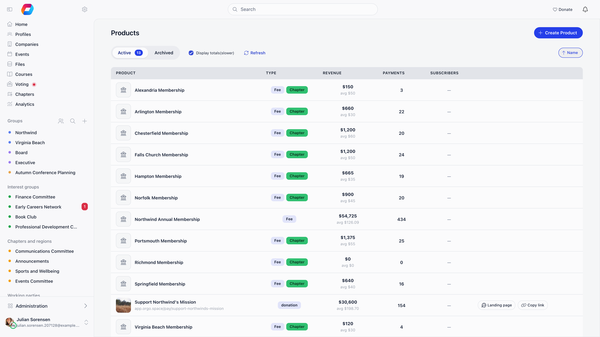
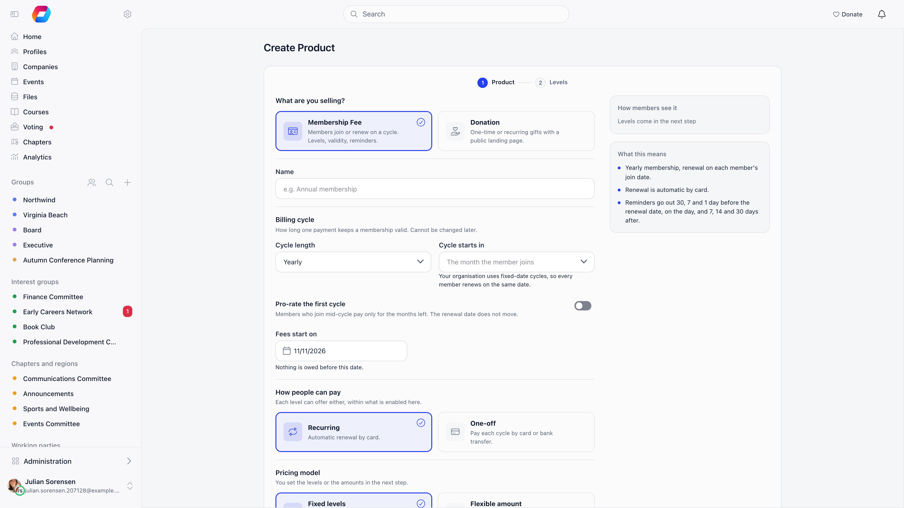
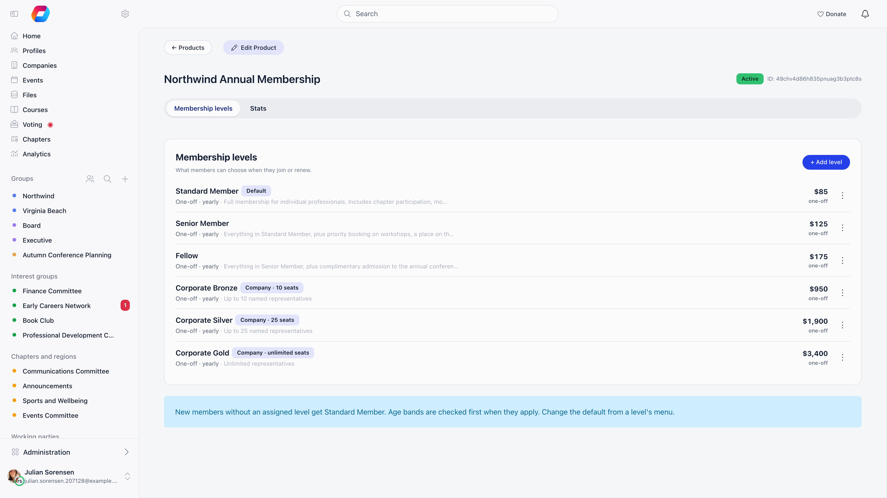
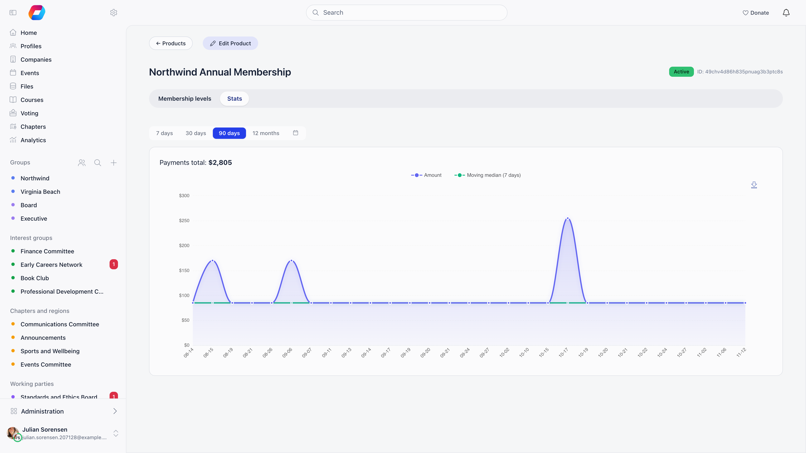

A product is what Orgo charges for. Membership dues, donation campaigns, event tickets and manual invoices all resolve to a product with one or more prices. For membership dues a price is called a **level** in the interface. Products are mirrored into Stripe when you save them, so a product is also the unit that Stripe reports on.

**Built for** organisations that collect more than one kind of payment and need each one tracked separately.

---

## Where products live

**Finance** → **Products**. The **Finance** section appears when the Payments or Fees module is active. An organisation-wide finance administrator (Financial (Organization)) sees the organisation's products, and only they can create or edit them. A chapter finance administrator (Financial (Chapter)) sees **Finance** → **Local products** instead, shown when chapter fees or chapter online payments are in use, and anything they create is stamped with their own chapter.

The list has **Active** and **Archived** tabs, a **Display totals(slower)** checkbox that adds revenue, payment counts and subscriber counts per product (the counts link to that product's payments and subscribers), and a **Recent** / **name** sort. Event ticket products are not listed, being managed inside the event. Without a connected Stripe account the list shows "Stripe account is not configured in organisation settings" with a link to the settings page.

---

## Product types

| Type | Where it is created | What it is for |
|------|--------------------|----------------|
| **Membership Fee** | **Create product** | Membership dues, billed on a cycle |
| **Donation** | **Create product** | Fundraising campaigns with a public page |
| **Event** | Inside an event, on the Ticketing tab | Event tickets |
| **Manual Invoice** | Created for you when the Invoices module is set up | The line item behind manually issued invoices |

The create form only offers Donation and Membership Fee. Two further types exist in the data, commerce and digital asset, but neither can be created from the interface.

When an organisation-wide administrator creates the **first** product of a kind, Orgo wires it in for them:

- The first donation product (not belonging to a chapter) becomes the **Main Donation Product** under **Settings** → **Modules** → **Payments & Fees** → **Donation Product**. If it accepts recurring gifts and no **Main Recurring Donation Product** is set yet, it becomes that as well.
- The first membership fee product with fixed levels becomes the organisation's **Membership Fee Product**, and its first level becomes the **Default Price**. A product created as **Flexible amount** is not picked up this way: select it yourself under **Settings** → **Modules** → **Payments & Fees** → **Membership fees**. Later membership products are never picked up automatically.

---

## Creating a product

**Products** → **create product** opens a two-step form. Step 1 is the product itself, step 2 is its levels or its donation settings, and **Create product** (or **Create product and levels**) saves everything at once.

**Step 1**

| Field | What it does |
|-------|--------------|
| **What are you selling?** | **Membership Fee** or **Donation**. Shown only while creating; the type cannot be switched afterwards. |
| **Name** | Required. A blank name is rejected, because Stripe refuses a product with no name. |
| **Payment page address** | Donations only. The public address, `https://{your-payment-host}/pay/{slug}`, generated from the name while you type. Fixed after creation. Membership products have no public page and get an internal address. |
| **Cycle length** | Membership only: **Monthly**, every 3 months, every 6 months or **Yearly**. Locked once saved. |
| **Cycle starts in** | Membership only: **The month the member joins**, or a fixed calendar month. With **Fixed Starting Date for Fees** on, every member then renews on the same date. |
| **Pro-rate the first cycle** | Membership with a cycle longer than a month: members who join mid-cycle pay only for the months left, and the renewal date does not move. |
| **Charge the full price when joining within** | With pro-rating on: **Always pro-rate**, or the full price for anyone joining in the first 1 to 12 months of the cycle. Stops tiny pro-rated charges right after a cycle begins. |
| **Fees start on** | Membership only: nothing is owed before this date. |
| **Recurring** / **One-off** | How people can pay. Both can be on. Recurring is automatic renewal by card for memberships and monthly gifts for donations; for a chapter product it needs the chapter's own Stripe account. **One-off** needs a connected Stripe account (the organisation's, or the chapter's own for a chapter product). A saved product must keep at least one of the two, and once saved you cannot switch off whichever one is alone. |
| **Also offer annual giving** | Donations with **Recurring** on: donors choose between a monthly and a yearly recurring gift. See [Donations](/platform/fees/donations). |
| **Pricing model** | Membership only: **Fixed levels** (Adult, Student, Family, each with its own price and rules) or **Flexible amount** (one level where each member chooses how much, above a minimum). See [Membership Fees](/platform/fees/fees). |
| **Belongs to a chapter** | Donations, when chapters are in use: only that chapter sells it and receives the money. |
| **Let donors pick a chapter** | Donations: adds a chapter selector at checkout. Needs **Products with Local Center Option** under **Settings** → **Modules** → **Payments & Fees** → **Online Payments**. **Top-level chapters only** limits the choice to chapters without a parent chapter. |

**Step 2**

- Fixed-level membership: a row per level with **Level name**, **Price** and, when the product offers both, **Members can pay**. Age bands, registration fees, company seats and visibility are edited per level afterwards.
- Flexible-amount membership: **Minimum amount**, **Maximum amount**, **Prefilled amount** and **Quick-pick amounts**.
- Donation: **Enable custom amount** with a **Minimum** and **Maximum**; the **Campaign goal** (**Goal type**, **Goal value**, **Target date**); and the **Landing page behaviour** switches (**Messages of support from donors**, **Display top 50 recent donations**, **Enable payment confidentiality**, **Disable newsletter subscription**, **Disable register checkbox for non-members** and **Require full address**). Six suggested amounts are generated for you. These settings are explained in [Donations](/platform/fees/donations) and [Donation pages](/platform/fees/donation-pages).

To change a product later, open it and use **Edit Product**. The same form appears in one piece, with **Archive** and **Delete** at the bottom. Changing the pricing model on a membership product archives the current levels (or the flexible amount); members keep their validity.

---

## Levels and prices

Open a product. Its first tab is **Membership levels** for a membership product and **Prices & Options** for a donation. Every purchasable amount is a row; there is no separate concept of a "tier". **Add level** (or **Add price**) opens the editor. **Show N archived** reveals archived rows.

Each row shows its name with tags (**Default**, **Archived**, **Exemption**, **Admin-assigned only**, **Company**, **Lifetime**, **Bundle**, the age band, and **Inactive price** for a version whose end date has passed) and its amount per cycle, per year, once or one-off.

A membership level's editor is organised around three questions.

| Section | Field | What it does |
|---|---|---|
| **Basics** | **Name**, **Price per cycle**, **Description** | The name and amount shown to the payer and on the payment record, in your organisation currency. Leave the price empty only on an **Admins only** level. |
| **Who it is for** | **Everyone**, **An age group**, **Companies** | **An age group** (**Under the age of** or **Or over the age of**; either condition qualifies, and members without a birth date do not see it) needs **Enable Age Restrictions on Prices**. **Companies** (with **People covered**, 0 meaning unlimited) is offered when company fees are enabled. |
| **Who can choose it** | **Members**, **Admins only** | **Admins only** hides the level from members; an administrator assigns it from the member's profile. The organisation's default level cannot be admins only. Shown to HR (Organization) holders; not available on company levels. |
| **How it renews** | **Product cycle**, **Own cycle**, **Lifetime** | **Own cycle** sets a different length (1, 3, 6, 12 or 24 months) for this level alone, and reminders and validity follow it. **Lifetime** needs **Lifetime Membership Available** and saves the cycle as 1200 months. |
| **How it renews** | **Members can pay** | **One-off** and **Recurring**, when the product offers both. At least one is required. |
| **Extra charges** | **Registration fee**, **VAT on the registration fee**, **VAT on the fee** | The registration fee is charged once, on a member's first membership payment ever, never on renewals, and never on chapter products or company levels. It needs **Enable One-time Registration Fee**. VAT rates (or **Not taxable**) need **Enable VAT on Fees**; the registration fee has its own VAT only once an amount is entered. |
| **Advanced** | **Bundle** | One person pays and adds others, who get a free companion level. Shown to HR (Organization) holders, hidden when fixed-date cycles are on and on company levels. |
| **Price changes** | **New amount**, **Applies from**, **Schedule change** | See below. |

Donation prices have a shorter editor: **Name**, **Amount**, **Description**, **Default price** (preselected on the payment page), **Show the name on the payment page**, **Members can pay**, and **Recurring gift** (**Monthly** or **Yearly**, when annual giving is on for the product).

The row menu offers **Edit level**, **Set as default level**, **Schedule a price change**, **Go to Price in Stripe**, **Archive** or **Restore**, and **Delete**. **Set as default level** is available to an Admin (Organization) on the organisation's membership product and to an Admin (Chapter) on a chapter's product; it is not offered on admins-only or company levels. The default is also visible under **Settings** → **Modules** → **Payments & Fees** → **Membership fees** → **Default Price**. Members only ever see levels that are not archived, not admins only, and inside their valid dates; administrators with a finance permission see them all.

A **Flexible amount** product shows a single card instead of rows, with the **Minimum**, **Maximum**, **Prefilled** amount and **Suggested amounts**, and **Edit amounts**. Per-member level assignments do not apply to it.

### Checkout donation add-ons

On a membership product, once **Offer a donation at membership checkout** is on (under **Settings** → **Modules** → **Payments & Fees** → **Membership fees** → **Checkout donation**), a **Checkout donation add-ons** card lists the suggested extra amounts offered next to the membership at checkout. **Add tier** takes a name and a whole amount; **Remove** archives a tier and **Restore** brings it back. They are not membership levels.

### Worked example: a membership fee product

**An example, not a default.** One fee product, **Cycle length** yearly, **Cycle starts in** September, holding five levels. Nothing here is preconfigured; each row is one level you add with **Add level**.

| Level | Amount | What makes it behave that way |
|---|---|---|
| Standard | 120 | The default level. This is the level a new member starts on. |
| Student | 60 | **An age group**, **Under the age of** 26. Needs **Enable Age Restrictions on Prices**. |
| Senior | 60 | **An age group**, **Or over the age of** 65. A member has to be under the first value or over the second, so one level can carry both. |
| Honorary | left empty | **Admins only** with no price (tagged **Exemption**). Members never see it, and applying it grants a cycle of validity without a payment. See [Membership Fees](/platform/fees/fees). |
| Corporate | 900 | **Companies** with **People covered** 10. |

<Warning>
  Once any payment has been taken against a level, its amount is frozen. Saving a different amount returns "You cannot edit the price of this product." Schedule a price change instead. This does not apply to the single level of a Flexible amount product, where the amount is only a prefill.
</Warning>

---

## Price changes

A membership level carries **Valid from** and **Valid to** dates, and each version points back at the one it replaced. That chain lets a payment recorded for 2024 still resolve at the 2024 amount after you raise the price for 2026. In the editor, **Price changes** lists the chain and explains it: members pay the amount that was valid on the day their cycle started, and past payments are never recalculated.

To raise a price, open the level (or choose **Schedule a price change** from its menu), then fill in **New amount** and **Applies from** and press **Schedule change**. Orgo closes the old version by setting its end date to the day before the new one starts, so the two never overlap. To work out what a member owed on a given date, Orgo first takes the member's level for that date, then the version of it whose window contains that date; if none does, it falls back to the organisation default level.

### Worked example: taking a level from 120 to 135

You charge 120 a year and want 135 from the 2026 membership year, which starts on 1 September 2026.

<Steps>
  <Step title="Schedule the change">
    Open the 120 level, go to **Price changes**, enter **New amount** 135 and **Applies from** 1 September 2026, then press **Schedule change**.
  </Step>
  <Step title="Let Orgo close the old one">
    The 120 version is closed on 31 August 2026 and linked to the new one. You do not set that date yourself, and you should not: setting both by hand is how gaps and overlaps appear.
  </Step>
  <Step title="Check what history resolves to">
    A payment recorded in March 2026 against the 2025 period still resolves at 120, because the date it covers falls inside the old window. Anything covering 1 September 2026 onwards resolves at 135. Members carry on pointing at the same level; there is nothing to reassign. Once 31 August has passed, the 120 version stays in the list with an **Inactive price** tag.
  </Step>
  <Step title="Next year, change the newest version">
    A 2027 rise is a new change on the 135 version, not a second change on the 120 one. Versions form a chain, and the chain has to stay in order.
  </Step>
</Steps>

Two dates with no version between them fall through to the organisation default level, so leave no gap. Deleting a version that a newer one points back at is refused until you delete the newer one first.

Price changes apply to membership levels only. On a donation, retire a price by archiving it and adding its replacement.

---

## Options

Donation products, and only donation products, can carry **Product options**: a designation the donor picks on the payment page, for example which programme the gift supports. Add them inline under the prices (**Add option**), drag to reorder, rename in place, archive the ones you retire. Each active option has its own deep link into the payment page, so you can send donors straight to one designation.

---

## The rest of a product

| Tab or page | What it shows |
|-------------|---------------|
| **Membership levels** / **Prices & Options** | Levels or prices, price changes, checkout donation add-ons, and for donations the product options and **Pricing A/B Testing**. |
| **Landing page** | The public page editor: hero media, colours, text. Donations only. |
| **Widgets** | Embeddable donation widgets. Donations only. |
| **Stats** | Payment totals and a trend chart over 7 days, 30 days, 90 days or 12 months. Donations also get page analytics. |

The header offers **Edit Product**, and for donations **Landing page** and **Copy link**.

Payments and subscribers are not tabs of the product. Open **Finance** → **Payments** or **Finance** → **subscribers**, or turn on **Display totals(slower)** in the products list and follow the payment count or the subscriber count of a product. The payments list can be filtered by payer name, payment ID, user ID, email, status, type, **Payment type**, payment method, option, chapter and date, and has **Add payment record** and **Refund** or **Mark as refunded** actions; see [Record a payment](/platform/fees/record-payment).

**Archive**, in **Edit Product**, takes a product out of circulation while keeping its payment history: it moves to the **Archived** tab and, if it exists in Stripe, is archived there too. **Delete** works only while a product has no payments at all; otherwise Orgo refuses with "This product has a payments already, it cannot be deleted." Archive it instead.

---

## Troubleshooting

<AccordionGroup>
  <Accordion title="The Recurring option is missing, or One-off is greyed out">
    **One-off** is greyed out until a Stripe account is connected: the organisation's for organisation products, the chapter's own for chapter products. **Recurring** is hidden on a chapter product until the chapter has its own Stripe account. See [Stripe Integration](/platform/fees/stripe-integration).
  </Accordion>

  <Accordion title="I cannot change a level's amount">
    The level already has payments against it. Use **Schedule a price change** instead, so past payments keep resolving at the old amount.
  </Accordion>

  <Accordion title="Members do not see a level I created">
    It is archived, **Admins only**, or outside its validity dates. On a product set to **Flexible amount**, members see only that one level.
  </Accordion>

  <Accordion title="The VAT or registration fee fields are missing">
    Both are opt-in per organisation: **Enable VAT on Fees** and **Enable One-time Registration Fee**, under **Settings** → **Modules** → **Payments & Fees** → **Membership fees** → **Pricing Options**. While they are off, no VAT and no registration fee are charged, whatever a level stores. The registration fee field also never appears on chapter products or company levels.
  </Accordion>

  <Accordion title="The age band, company or lifetime choices are missing">
    **An age group** needs **Enable Age Restrictions on Prices**, **Companies** needs company fees enabled, and **Lifetime** needs **Lifetime Membership Available**. **Admins only** and **Bundle** are shown only to HR (Organization) holders.
  </Accordion>

  <Accordion title="A chapter needs its own fee">
    Create it from **Finance** → **Local products** and configure it per chapter. See [Chapter Fees](/platform/local-group-fees/create-local-fees).
  </Accordion>

  <Accordion title="Orgo refuses to delete a level">
    Four different things block it, and the message says which: payments already taken against it, event attendees registered on it, use by a ticket bundle, or a newer version pointing back at it. The last one is the only one you can clear, by deleting the newer version first. Otherwise archive the level: it disappears from checkout and keeps its history.
  </Accordion>

  <Accordion title="Orgo refuses to delete a product">
    Deletion is only for products that have never taken money; anything with payments against it is refused, and the message tells you so. Archive it instead, which also archives it in Stripe when it exists there.
  </Accordion>

  <Accordion title="Creating the product fails and the name looks fine">
    A name made only of spaces counts as blank and is rejected with "Product name is required.", because Stripe will not accept a product without a name. Type a real name rather than a placeholder space.
  </Accordion>

  <Accordion title="Access denied when opening or saving a product">
    Organisation products need Financial (Organization). Financial (Chapter) reaches only products belonging to a chapter the holder is attached to, which is why a chapter finance administrator can open **Local products** but not the organisation membership fee. Event ticket products are the exception: they are gated on Event Manager (Organization) instead.
  </Accordion>

  <Accordion title="A level will not accept the settings I give it">
    Two combinations are refused outright. "The default price cannot be set as admin assignable only" means the level you chose as the default cannot also be **Admins only**: make another level the default first. And a level created as a bundle cannot be turned back into an ordinary level once its bundle has been sold, has event attendees, or has members assigned to it.
  </Accordion>

  <Accordion title="A level exists in Orgo but not in Stripe">
    Levels are only pushed to Stripe when an account is connected at the time you save them, so anything created before you connected Stripe stays local, and **Go to Price in Stripe** is not offered. The product itself is created in Stripe on the first checkout that needs it, and saving the level again after that pushes it across.
  </Accordion>
</AccordionGroup>

---

## Related

- [Membership Fees](/platform/fees/fees): turning a fee product into collected dues
- [VAT](/platform/fees/vat): when VAT applies and how it is stored
- [Stripe Integration](/platform/fees/stripe-integration): connecting payment processing
- [Donations](/platform/fees/donations): running fundraising campaigns
- [Chapter Fees](/platform/local-group-fees/create-local-fees): chapter-level fee collection
