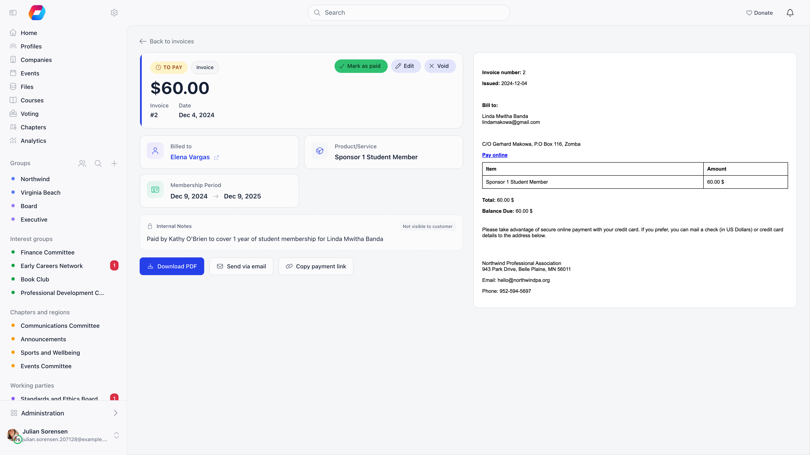
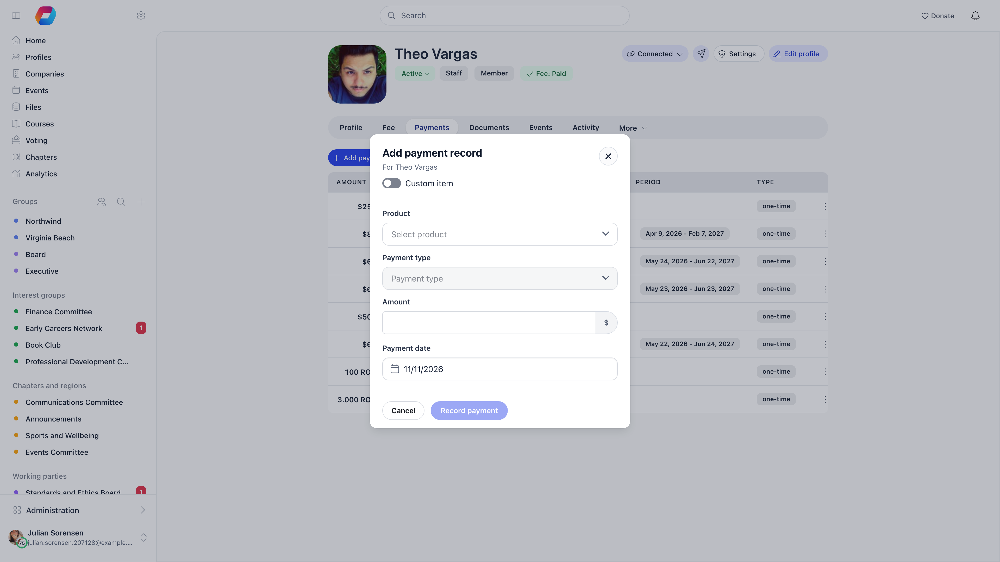

Not every payment goes through the platform. Members pay by bank transfer, hand
over cash at a meeting, or send a cheque. Recording those payments keeps
membership status, payment history and reporting correct.

There are three places to do it, and they are not interchangeable. Pick by what
was paid for.

| What was paid | Where to record it | Permission |
|---|---|---|
| An invoice you raised | The invoice, **Mark as paid** | Admin (Organization) |
| A membership fee period | The member's **Fee** tab, **Mark as paid** | Financial (Organization) for the organisation fee, Financial (Chapter) for a local fee |
| Anything else (a donation, a course place, merchandise, a one-off service) | The member's **Payments** tab, **Add payment record** | Financial (Organization) |

---

## Marking an invoice as paid

**Invoices**, open the invoice, then **Mark as paid**. The button is only there
while the invoice is unpaid.

Four things happen.

1. The invoice becomes **paid** and Orgo records which administrator marked it,
   so the action stays attributable. The invoice shows the day you marked it paid
   as its paid date, not its due date.
2. A **PAID** badge is added to the stored document, the amount due line changes
   to read as paid, and the "Pay online" link is removed from it.
3. A payment record is created for the gross total (net plus VAT) and linked to
   the invoice. That record is what updates membership status and shows in
   payment history, dated the day you marked the invoice paid.
4. The paid invoice is emailed to the customer.

An invoice that is already paid, voided or refunded cannot be marked as paid
again: Orgo refuses with "Only unpaid invoices can be marked as paid", so a
double click or two administrators acting at once records one payment, not two.

<Warning>
Step 4 catches people out. Marking an invoice as paid emails the customer. If you
are tidying historical records, they still get the email. Switch off **Send
invoice emails automatically** in **Settings** → **Modules** → **Payments & Fees**
→ **Invoice Product** first if you are doing a batch of corrections. With it off,
nothing is emailed when you mark an invoice paid; you can still send the invoice by
hand from the invoice itself.
</Warning>

### Membership invoices

If the invoice has the **Membership** switch on, marking it paid also books the
membership period on the invoice and moves the member's fee validity date
forward. For a company, it updates the company membership end date, applies the
member slots that come with the chosen level, and pushes the new validity date
out to everyone the company covers.

This is why the membership level and the start and end dates matter on the
invoice form: they are the period being bought.

### Event registration invoices

Marking an event registration invoice as paid confirms the registrations
attached to it. The attendees move from awaiting payment to confirmed, the linked
payment is marked successful, and ticket confirmation emails go out. Always
record an event payment against the event's own invoice rather than raising a
separate one, otherwise the attendance is never confirmed and check-in and
attendee reports stay wrong.

---

## Recording a membership fee period

An invoice is not required to record a membership fee. On the member's profile,
open the **Fee** tab and use **Mark as paid**. Orgo asks which period you are
recording, shows the period end it works out from your fee configuration, and
records the payment against that period using the price that was valid at the
period start, not today's price.

<Note>
The action needs **Allow Mark as Paid** switched on in **Settings** →
**Modules** → **Payments & Fees** → **Membership fees**. With it off, nobody can
record a fee manually and members must pay online.
</Note>

An **Enter different amount** switch appears only if your organisation uses
**Fixed Starting Date for Fees** (**Settings** → **Modules** → **Payments & Fees**
→ **Membership fees** → **Validity Period**). Without that setting the amount is
locked to the member's price, and a different figure is rejected.

If your membership product has a **Flexible amount** level (members choose their
own amount above a minimum), the window instead shows an amount chooser with the
level's quick-pick amounts and a field for any whole amount between its minimum
and maximum, and you must choose one. The server applies the same limits.

The button is not offered while the member has a bank transfer in progress, or,
with **Require Contract for Membership** on, while their membership contract is
unsigned or lapsed.

Manual fee payments are recorded with the payment method **check** and count
immediately: the member's validity date moves forward as soon as you confirm.

Recording a batch that resolves to nothing (every period deselected, or a member
with no fee price for that period) is refused with an explanatory error rather
than saved half-formed.

Local centre fees have their own **Mark as paid** on the same profile, needing
the Financial (Chapter) permission for that member's local centre. Both behave the same way: what
an administrator marks as paid counts straight away, because a mark-as-paid batch
is written as already approved and carries the method **check**.

The pending state you see on **Fee payments** in the sidebar comes from somewhere
else. It is the batch written by **Pay** on the
[Member fees table](/platform/local-group-fees/member-fees), stamped as a bank
transfer (`iban`) and left pending, for organisation and chapter fees alike.
**Approve** there is shown only to Admin (Organization); a chapter administrator with
Admin (Chapter) sees **Cancel**, which deletes the batch instead. Members never
submit a fee payment for approval: a member paying their own fee by bank transfer
raises an unpaid invoice, which is settled with **Mark as paid** on the invoice.

---

## Recording any other payment

For everything that is not membership, open the member (or contact), go to the
**Payments** tab, and use **Add payment record**. It needs the Financial
(Organization) permission. The same button is on a
[contact's](/platform/contacts/payments) **Payments & Subscriptions** card.

<Steps>
  <Step title="Choose what was bought">
    Either pick an existing product, or switch on **Custom item** and type an
    **Item name**. A custom item creates a hidden one-off product so the payment
    has something to hang from without cluttering your product list. An archived
    product, or a ticket product of an event that is still a draft, is refused.
  </Step>
  <Step title="Check the payment type">
    **Payment type** (fee, donation, event ticket, shop or admin) follows the
    product you picked and is greyed out. Only for a custom item do you choose it.
  </Step>
  <Step title="Check the payment type">
    **Payment type** says what the money was for. With an existing product the
    field is greyed out and shows the type Orgo will use, taken from the product.
    With a custom item you choose it yourself: **Fee**, **Donation**,
    **Event ticket**, **Shop** or **Admin**. It starts on **Admin**.
  </Step>
  <Step title="Choose the price">
    Products with active prices require you to pick one, and the **Amount** is
    then locked to it. Only products configured to accept a custom amount let you
    type a figure.
  </Step>
  <Step title="Set the payment date">
    Defaults to today. Set it to the day the money actually arrived so reporting
    lines up with your bank statement. Press **Record payment** to save.
  </Step>
  <Step title="Confirm">
    Select **Record payment** at the bottom of the window.
  </Step>
</Steps>

The payment is saved as successful, stamped with your name as the administrator
who recorded it, and carries no Stripe charge. The amount you enter is treated as
the net figure, with VAT derived on top of it. It appears in the payments list
under **Payment method**, **Recorded manually**.

If your organisation has **Donations count towards membership** switched on
(**Settings** → **Modules** → **Payments & Fees** → **Membership fees** →
**Validity Period**) and you record a donation for a member, the gift is judged
like an online one: when it reaches the minimum of the Flexible amount level, the
member's validity date moves at once. With the switch off, a recorded donation
never changes membership. See [Donations](/platform/fees/donations).

Recorded this way by mistake? Open the payment's row menu and choose **Mark as
refunded**. Nothing is sent anywhere, it only corrects the record, and for a
donation it also takes back any membership the gift earned. A payment that has an
invoice is marked as refunded from the invoice instead.

<Warning>
Membership fee products are deliberately not offered here, and are rejected if
you try. A fee payment also has to carry the period it buys, which this form does
not collect. Use the **Fee** tab instead.
</Warning>

### Payment type

Every payment carries one payment type, and the payment lists can be filtered by it
(see [Finding payments by payment type](#finding-payments-by-payment-type)). It is a
label for reporting and filtering. It does not change what the payment does.

| Payment type | Set automatically when the product is |
|---|---|
| **Fee** | A membership fee |
| **Donation** | A donation |
| **Event ticket** | An event ticket |
| **Shop** | A shop item or a digital download |
| **Admin** | Anything else, including payments from invoices and custom items you leave on **Admin** |

<Note>
Labelling a custom item as **Fee** does not extend anyone's membership. Fee
validity only moves when the payment is a real membership fee recorded from the
**Fee** tab. If you choose a type for a custom item, it is kept as you set it;
if you pick an existing product, Orgo ignores any other type and uses the
product's own.
</Note>

Payments added through a data import get the type from the product they were
matched to, so imported history is filterable too.

---

## Finding payments by payment type

The **Payment type** filter (a pill with the options **All**, **Fee**,
**Donation**, **Event ticket**, **Shop** and **Admin**) is on:

- the organisation-wide **Payments** list
- a product's **Payments** tab
- the **Payments** tab of a member's profile

Pick one option to see only that kind of money; pick **All** to clear it. The
filter is separate from the **Product** pill (one specific product) and the
**type** pill (one-time or recurring); combine them to narrow further. The
payment type is a filter only: the lists do not show it as a column.

---

## Getting it wrong

If you mark the wrong invoice as paid, do not delete it. See
[cancelling and correcting invoices](/platform/fees/cancelling-invoices):
the trail of what happened is worth more than a tidy list.

---

## Questions

<AccordionGroup>
  <Accordion title="Where did the Record payment button go?">
    It is now called **Add payment record** and sits at the top of the member's
    **Payments** tab. The button that saves the window is still **Record
    payment**.
  </Accordion>

  <Accordion title="The Payment type field is greyed out">
    You picked an existing product, so the type comes from that product and
    cannot be overridden. Switch on **Custom item** if you need to choose it
    yourself.
  </Accordion>

  <Accordion title="Why does a payment from an invoice show as Admin?">
    Invoices use a built-in invoice product, which has no fee, donation, event or
    shop meaning, so its payments are typed **Admin**.
  </Accordion>
</AccordionGroup>

---

## Related

- [Invoices](/platform/fees/invoices) creating invoices, numbering and templates
- [Cancelling and correcting invoices](/platform/fees/cancelling-invoices) voiding and refunding
- [Membership fees](/platform/fees/fees) how fee periods and prices are configured
- [Local group fees](/platform/local-group-fees/create-local-fees) fees collected by a local centre
- [Stripe integration](/platform/fees/stripe-integration) taking payment online instead
