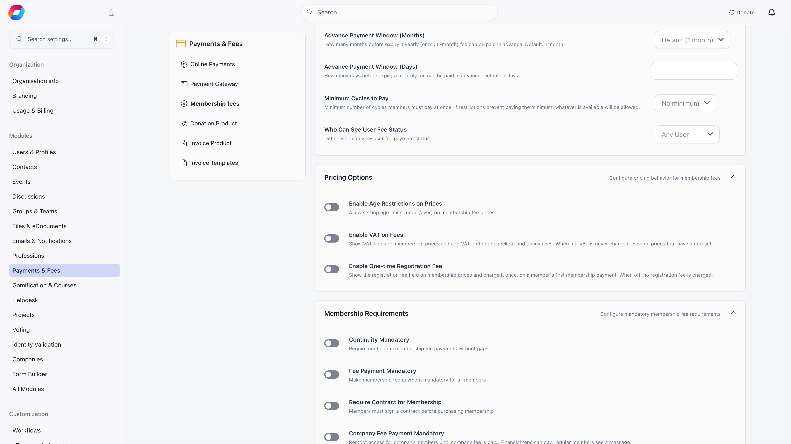

Two optional charges sit on top of a membership price: VAT, and a one-time
registration fee paid when someone first joins. Both are off until you turn them
on, and both are configured per membership level rather than once for the whole
organisation.

Tax on manual invoices is separate and is set on the invoice template.

---

## Turning them on

**Settings** → **Payments & Fees** → **Membership fees** → **Pricing Options**.
Requires the Admin (Organization) permission.

| Setting | What it does |
|---|---|
| **Enable VAT on Fees** | Shows the VAT fields on membership levels and adds VAT on top at checkout and on invoices |
| **Enable One-time Registration Fee** | Shows the registration fee field on membership levels and charges it once, on a member's first membership payment |

<Warning>
These two switches are authoritative. With **Enable VAT on Fees** off, a price
that already holds a VAT rate is charged and invoiced with no VAT at all, and
every invoice line is issued as non-taxable. Turning the switch on later starts
applying the stored rates immediately, so check your prices before you flip it.
</Warning>

<Info>
Most organisations leave both switches off, which is their default. With them
off, the VAT and registration fee fields do not appear on membership levels, and
members pay exactly the price on the level.
</Info>



---

## Setting a rate per membership level

Once VAT is on, each membership level (open a product, then **Add level** or
**Edit level**) gains a **VAT on the fee** field under **Extra charges**:

- **Not taxable**: the level carries no VAT and is excluded from the taxable
  base. The percentage box is disabled while it is ticked.
- **VAT on the fee**: the rate in percent, used when the level is not marked
  not taxable. Leave it empty or at 0 and no VAT is added.

The help text under the field reads: "Added on top of the price and shown
separately at checkout and on the invoice."

That is how one organisation charges VAT on a standard membership and none on a
reduced or honorary level: they are separate prices, so they carry separate
treatments. Donation options on a fee product never show the VAT fields, and
neither does any product that is not a fee product.

---

## VAT is added on top

Orgo uses the exclusive model everywhere. The price you type is the net amount,
and VAT is calculated on top of it:

```
VAT     = net × rate / 100
Gross   = net + VAT
```

A level priced at 100 with a 19% rate charges 119. Nothing in the product is
VAT-inclusive, so do not enter a gross figure and expect Orgo to work backwards
from it.

---

## The one-time registration fee

The registration fee is a joining fee: it is the **Registration fee** field on a
membership level, and it is charged once per member, on their first membership
payment. The field carries the note "Charged once, on the first membership
payment ever. Never on renewals."

<Note>
"First payment" means the member has never had a membership validity date. A
member who paid once and then lapsed for years counts as a returning member and
is never charged the registration fee again. There is no way to re-arm it for an
individual short of clearing their membership history.
</Note>

Other things worth knowing:

- It is only available on organisation-level fee products, and not on company
  levels. A local center fee product or a company level does not show the field.
- It has its own VAT treatment, set independently of the price VAT, under **VAT
  on the registration fee** (with its own **Not taxable** tick). Those controls
  appear only once you have entered a registration fee amount, and only when
  **Enable VAT on Fees** is also on.
- It is recorded as its own payment row and appears as its own invoice line, so
  reports separate joining income from recurring dues. It rides on the same card
  charge as the first membership payment, but it stays a separate row: **Refund**
  in Orgo returns only the row you act on, so refunding the membership does not
  return the joining fee. Refund both rows, or refund the whole charge in the
  Stripe Dashboard, which marks both refunded in Orgo.
- It buys no membership time. Only the membership portion extends the member's
  validity date.

---

## What the member is charged

At checkout the member sees one total built from up to six parts:

| Part | When it applies |
|---|---|
| Membership (net) | Always |
| VAT on membership | VAT on, level not exempt, rate above zero |
| Registration fee | Registration fee on, level has an amount, member has never paid |
| VAT on registration fee | VAT on, registration fee not exempt, rate above zero |
| Donation | Only if the member adds one at checkout |
| Processing fee | Only if the member chooses to cover it, and only when **Let members cover the processing fee** is on (it is off by default, and is not offered at all while **Enable VAT on Fees** is on) |

The membership summary card, the fee cards and the card payment panel all
compute this the same way, so the amount on the button matches the amount on the
card form. The amount charged to the card is rounded to the nearest cent (an
earlier version cut fractions of a cent off, which could charge one cent less
than the price).

---

## VAT on an invoice

Membership invoices carry VAT per line, not once for the document. Each line
stores either a rate or an exempt flag at the moment the invoice is created, so
a historical invoice keeps the treatment that was correct on the day it was
raised. Changing a price or a template later never rewrites an issued invoice.

The invoice shows a VAT column per line, then a totals block with **Subtotal**,
one **VAT** row per distinct rate (labelled with the rate and the base it was
applied to), **Total** and **Amount due**. The VAT on each line is rounded to
two decimals before the lines are added up, so the invoice total equals what the
card was charged.

An invoice that Orgo creates for an online card payment never states more than
was charged. If VAT was configured on the price but was not collected on that
charge, the invoice is issued with every line non-taxable at the amount actually
paid.

When at least one line is exempt, the invoice prints the VAT exemption note,
which is the free-text wording that states the legal basis for the exemption.

<Note>
The exemption note is stored on the invoice template and copied onto invoices
Orgo generates itself for membership fee payments. It is not copied onto
invoices you raise by hand, and there is no field for it in the invoice template
form or the invoice form. It can only be set through the API, on the template
(for automatic invoices) or on the individual invoice. If you need it on your
documents, ask support to set it for you.
</Note>

---

## Tax on manual invoices

Manual invoices take their tax from the invoice template rather than from a
membership price. **Settings** → **Payments & Fees** → **Invoice Templates**,
Admin (Organization) permission.

| Field | What it is for |
|---|---|
| **Tax** | Switch that reveals the two fields below |
| **Tax Name** | What the tax is called on the document, for example VAT or GST |
| **Tax Rate (%)** | A whole percentage between 0 and 100 |
| **Memo**, **Footer** | Standing text on every invoice from this template |

The template's tax name and rate are copied onto an invoice when it is created
from that template. Create one template per tax treatment and issue each
invoice from the one that matches it.

---

## Your organisation's VAT number

The VAT identification number printed in the issuer block of every invoice comes
from **Settings** → **Organisation info** → **VAT Number**. It is a display
field: Orgo does not validate it and does not use it to decide whether VAT
applies.

---

## Related

- [Membership Fees](/platform/fees/fees) for collecting and tracking dues
- [Products](/platform/fees/products) for the fee products and price levels these settings live on
- [Renewals](/platform/fees/renewals) for what happens when a membership expires
- [Invoices](/platform/fees/invoices) for numbering, templates and delivery
- [Stripe Integration](/platform/fees/stripe-integration) for card payments and payouts
