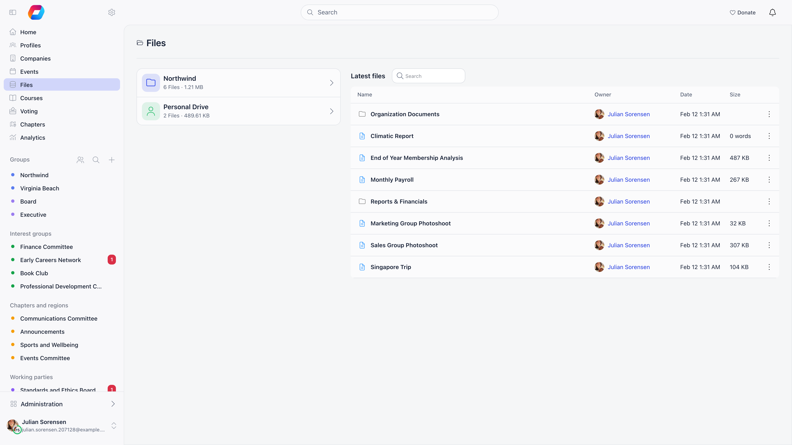
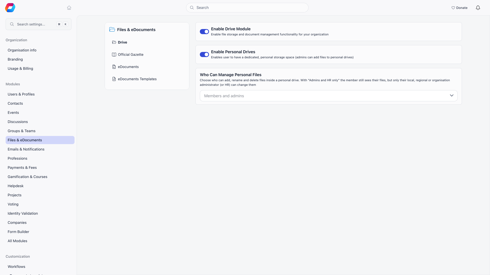
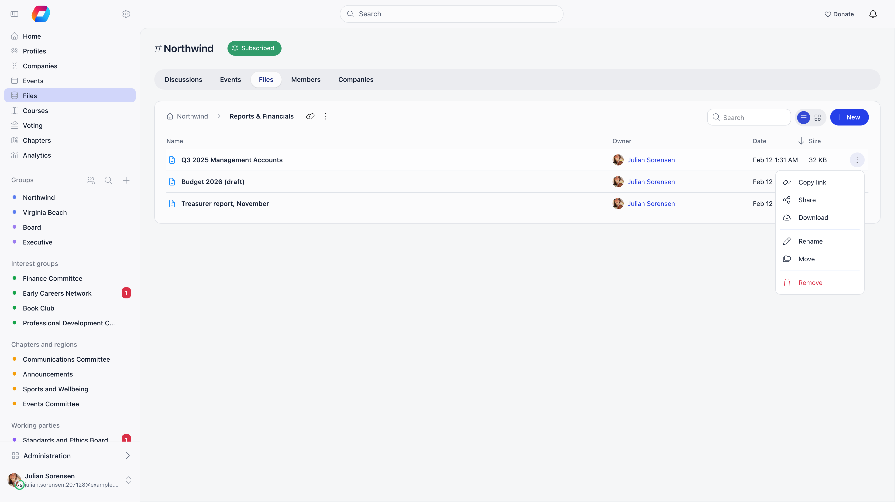
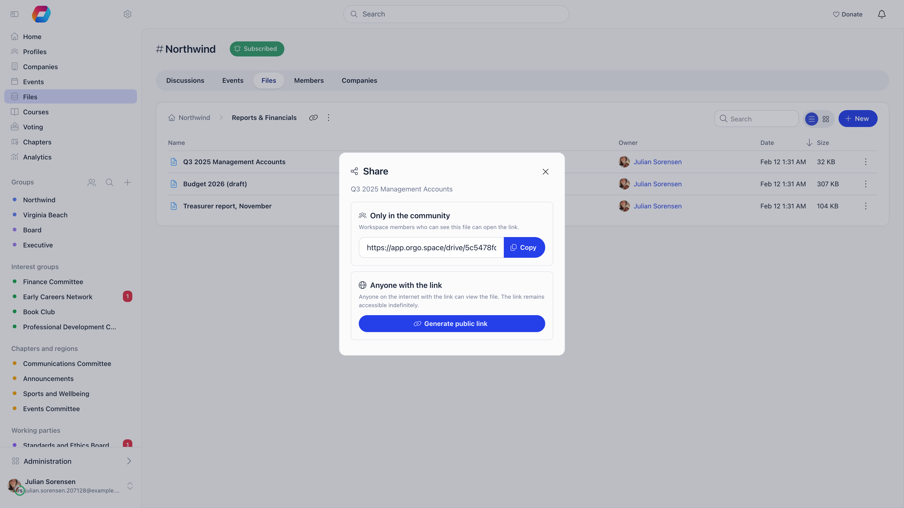

Orgo Files (the Drive) gives your organisation one place for documents: an organisation-wide drive, a drive inside every group and local center, and an optional private drive per member. You can also write documents directly in Orgo and publish any file or folder as a public link.

**Built for** membership organisations that need policies, minutes, templates and forms in the same place as their members, events and groups.

**Replaces** an unstructured shared folder in Google Drive or Dropbox for member-facing documents, because access follows your existing group membership instead of a separate list of email addresses.

---

## Turning it on

Files is a module. The Orgo administrator turns it on at **Settings → Modules → Files & eDocuments → Drive**:

| Setting | What it does |
|---|---|
| **Enable Drive Module** | Shows **Files** in the sidebar and the **Files** tab on groups. Off hides the whole surface. |
| **Enable Personal Drives** | Gives every member a private drive, and lets HR and admins add files to it. |
| **Who Can Manage Personal Files** | Appears once personal drives are on. **Members and admins** (the default) lets the member add, rename and delete files in their own drive. **Admins and HR only** makes the drive read-only for the member: they still see and download their files, and only HR of their local center, **HR_TENANT** and **ADMIN_TENANT** can change them. |

Two behaviours are off by default and not exposed on this screen: embedding external media (YouTube and Spotify) in a drive, and showing your logo on the public video player.

Each group has its own controls in its settings: a **Files** feature toggle that shows or hides the group's Files tab, and **Who can post?**, set to **Everyone in the group** or **Only admins**. **Only admins** is one choice covering posts, events and file uploads together, so it hides the upload, document and folder buttons from ordinary members of that group.

---

## Where files live

**Files** shows one card per drive you can reach, with its file count and total size.

| Drive | Who can see it | Who can add to it |
|---|---|---|
| **Organisation drive** | Every member of the organisation | Organization HR managers and above by default |
| **Group drive** (any group, local center or role group) | Members of that group | Members of that group, unless the group is set to **Only admins** |
| **Personal Drive** | The member, **HR_LOCAL** of their local center, **HR_TENANT**, **ADMIN_TENANT** | The same people, unless **Who Can Manage Personal Files** is set to **Admins and HR only**, which removes the member from this column |

Renaming, moving, removing an item, and publishing or revoking its public link all need the same thing: you own it, you administer its group (the group owner, an active group admin, or **ADMIN_LOCAL** of the group's local center), or you are **ADMIN_TENANT**. Local admins get no rights over the organisation drive; their authority is scoped to the groups and local centers they administer, so an **ADMIN_LOCAL** from another local center cannot remove a file in your group. The row menu only offers actions you are allowed to do, because the app asks the server what you can do with each item.

Group drives are how you restrict who sees what. There is no per-file permission: a file inherits the audience of its drive, so leadership documents go in a leadership group.

<Note>
The organisation drive is the drive with no group attached. Uploading there is restricted to organization HR managers and organization admins by default, which is why an ordinary member sees the organisation card but no upload button on it. Group drives are open to their members unless the group sets **Who can post?** to **Only admins**.
</Note>

A personal drive is also reachable from the member's profile, on the **Personal Drive** tab, which appears only when personal drives are enabled.

---

## What you can put in a drive

Inside a drive, the **New** button (the **+** icon on a phone) opens one menu. It appears only where you may add things. In an empty folder the page says **No file uploaded yet** and **Drag files here, or use New**.

| **New** menu item | What it does |
|---|---|
| **New document** | Opens Orgo's own editor on a blank page, described under [Writing documents](#writing-documents). Documents live in the drive like any other item. |
| **New folder** | Folders nest. Move an item by dragging it or using **Move**; items can only be moved into folders, and a folder cannot be moved into itself. |
| **Upload file** | Opens the file picker. You can also drag files anywhere onto the page; the page then says **Drop files to upload them to** the open folder. Up to 100 files per batch, uploaded one at a time with a progress panel. |
| **Embed media** | Shown only when embedding is enabled. Adds a YouTube or Spotify link as a drive entry. Orgo checks the URL against the allowed providers and pulls the title and thumbnail. Nothing is copied into your storage. |
| **From eDocuments template** | Shown only inside a member's Personal Drive, when the E-Documents module is on and you are **HR_TENANT** or above. Opens the send panel with that member already chosen, so you can send them a contract to sign. See [E-Documents](/platform/contracts). |

### Upload limits

| Limit | Value |
|---|---|
| Maximum file size | 5,000 MB (about 5 GB) |
| Files per drag-and-drop batch | 100 |
| Blocked file types | PHP, HTML and XHTML, SVG, Windows and Linux executables, shell scripts |
| Everything else | Allowed, including PDF, Office files, images, video, archives |

There is no allowed-types list: any format that is not blocked uploads. The blocked ones can execute code in a browser when opened from a link. Orgo also renames every uploaded file in storage to the original name plus 24 random characters, so the storage address cannot be guessed from the name.

### Previews

Images, PDFs and videos get an automatic thumbnail in the gallery; other formats show an icon. Office files (DOC, DOCX, XLS, XLSX, PPT, PPTX) offer a read-only browser preview through Microsoft Office Online, or a download, and cannot be edited inside Orgo. A video in a format browsers cannot play (MKV or AVI, for example) prompts you to upload it as download-only.

---

## Writing documents

**New document** opens Orgo's editor on its own page, with a path across the top (for example `Scouts Cluj: Files > Camp > Untitled Document`), a back arrow, a save indicator and the title above the text. The drive's name comes first in the path, so you can tell a group's document from a personal one (a member's Personal Drive reads **Documents** instead of **Files** when E-Documents is on). Every folder in the path is a link back to that folder.

| Behaviour | What happens |
|---|---|
| Saving | Automatic, about a second after you stop typing. The bar shows **Saving...**, then **Saved**, or **Error saving** if it failed. **Ctrl+S** (or **Cmd+S**) saves at once. Nothing is created until you have typed something, so opening **New document** and leaving leaves no empty file behind. |
| Title | Follows your first line until you type in the title box yourself. A document with no text is called **Untitled Document**. |
| Leaving | Going back, or to another page in Orgo, saves anything still pending. Orgo only stops to ask (**Unsaved Changes**, **Leave** or **Stay**) when the last save failed. Closing or refreshing the browser tab with unsaved text shows the browser's own warning. |
| Refreshing | The editor has its own address (`/drive-doc/<number>`), so a refresh or a pasted link reopens the same document, with the same path. **Back** returns you to the folder it sits in and briefly highlights its row. |
| Details | On a computer, the **Details** menu shows **Owner**, **Created**, **Last Modified**, **Reading time** (in minutes, from 225 words a minute, never less than 1) and the word and character count. Phones do not show it. |
| Read only | If you cannot edit the document, the title and text are locked and a **Read Only** badge shows. |

### Classic and Blocks

Two editing modes write the same document, so a document written in one opens in the other without losing anything, including task lists. The switch **Editing mode** (**Blocks** or **Classic**) is in the top bar, and only people who can edit see it.

| | Classic | Blocks |
|---|---|---|
| Formatting | A fixed toolbar above the text: undo and redo, bold, italic, underline, strikethrough, headings, lists, indent, alignment, link, image, quote, horizontal rule, highlight colour, clear formatting | No toolbar. Select text and a small menu appears with **Heading 1**, **Heading 2**, **Bold**, **Italic**, **Underline**, **Strikethrough**, **Link** and **Highlight** |
| Adding things | Toolbar buttons | Type `/` on an empty line, or use the **Add block** (+) button that appears beside a line. The `/` menu lists **Text**, **Heading 1** to **Heading 3**, **Bulleted list**, **Numbered list**, **Task list**, **Quote**, **Divider** and **Image**; keep typing to filter, use the arrow keys and **Enter**, **Esc** to close. The empty page says **Start writing, or type / for commands** |
| Moving things | Cut and paste | Drag a line by the grip beside it |

Classic is the default for everyone; nobody is moved to Blocks unless they choose it. Phones always use Classic and have no switch. You can also paste or drop images into either mode.

---

## Working with files

| Action | Notes |
|---|---|
| **Download** | Single file. |
| **Copy link** | In the row menu, and **Copy link to folder** at the top of an open folder. For a file it is the same link as the **Only in the community** link in **Share**; for a folder or document it is an ordinary in-app link. |
| **Download folder as archive** | In the folder's **...** menu. Zips in your browser the files directly inside the open folder (up to the 100 shown on the page). Subfolders and Orgo documents are not included. |
| **Rename** | Changes the display title only. |
| **Move** | Drag, or use **Move** and pick a destination folder. |
| **Remove** | Permanent. Asks "Are you sure you want to delete ...? This action cannot be undone.", and on **Delete** removes the stored file too. There is no recycle bin. |
| **Share** | Opens the share dialog described below. |
| **Search** | On the Files home, the **Search** box searches titles across every drive you can reach (two characters minimum, ten results). Inside a drive, its own search box filters that drive once you have typed four characters. |

### Finding your way around

| You are on | What you see |
|---|---|
| Files home, computer | A card for each drive (**Personal Drive**, the organisation, each group) with its file count and size, and a **Latest files** table beside it. |
| Files home, phone | A **Locations** list of the same drives, then **Latest files** grouped as **Last 7 days**, **Last 30 days** and **Earlier**. |
| Inside a drive, computer | A table with **Name**, **Owner**, **Date** and **Size** (documents show **words** instead of a size). Narrow windows hide the less important columns. Click a column heading to sort. The switch beside the search box changes between **List** and **Gallery**; the gallery shows photos and videos as thumbnails. |
| Inside a drive, phone | Rows showing size and date, with a sort menu: **Name**, **Newest** or **Largest**. |

The path across the top of a drive (a house or person icon, then each folder) is clickable. Long paths fold the middle folders behind **...**, and on a phone the arrow goes up one folder. In group and organisation drives an open folder is part of the address, so a refresh or a pasted link stays in that folder. Clicking an Office file asks **How would you like to open this file?** with **View in browser (Microsoft Online Viewer)** or **Download**.

<Warning>
Removing is not reversible and it removes the underlying file from storage. Removing a folder removes everything inside it, subfolders included, and deletes their uploaded files from storage too.
</Warning>

---

## Sharing

The **Share** dialog offers two links, and they behave differently.

**Only in the community** is an ordinary in-app link, of the form `/drive/<id>`, and it is exactly as safe as it sounds. It **never expires**, because it carries no access of its own: opening it needs a session in your workspace, and the file is then fetched through the same permission checks as everywhere else. Somebody outside your organization who is sent the link gets nothing. For a folder it opens the folder in its drive; for a file it opens that file's preview.

<Note>
This used to be a direct storage link that expired after 7 days, and it did grant access to whoever held it. It was changed because a link pasted into a discussion post stopped working once it expired, leaving members with a storage error page. If you have older notes or posts saying these links expire, or warning that anyone holding one can open the file, both are now wrong.
</Note>

If the file already has a public link, **Only in the community** gives you that public address instead, since that is the one that works for everybody.

**Anyone with the link**, via **Generate public link**, publishes a permanent public address of the form `go.orgo.space/d/<code>`.

| Question | Answer |
|---|---|
| Does the visitor need an account? | No. Anyone on the internet with the link can open the file. |
| Can the link be guessed? | No. The code is 10 random characters drawn from a cryptographic random source, roughly 51 bits, so it cannot realistically be enumerated. |
| How long does it last? | Until you revoke it. |
| How do I take it back? | Open **Share** on the file and click **Revoke public link**. The public address stops working and the file becomes unreadable to visitors again. Copies already downloaded are of course still out there, so rotate anything sensitive. |
| Who can publish or revoke it? | The same people who can edit the file: its owner, the admins of the group it sits in, and organization admins. |

Publicly shared files show a globe marker (tooltip **Shared publicly**) in the list, so you can see what is exposed. Video files get a branded viewer page instead of a raw download, with the organisation logo when video branding is enabled, and playable files also give you an **Embed** snippet for an external website.

### Sharing a whole folder

Sharing a folder publishes a public folder page. Visitors browse the subfolders and open the files, and cannot navigate above the folder you shared.

<Warning>
Public folder shares are inherited. Every file already in the folder becomes public, and any file you upload or move into it afterwards becomes public automatically. Revoking the folder share removes public access from the whole subtree.
</Warning>

Publishing and revoking a large folder finishes in the background. The dialog shows **Publishing...** while that runs; the link itself works immediately.

Files sit in Orgo's cloud storage, readable without a login only while a public share link exists. There is no automatic expiry or archival, so an uploaded file stays until someone deletes it.

---

## Troubleshooting

<AccordionGroup>
  <Accordion title="A member cannot see a file, or I want different members to see different files">
    Check which drive it is in: a group drive is visible only to that group. Groups are the boundary, so leadership documents go in a leadership group and general resources in the organisation drive. There is no per-file permission to set.
  </Accordion>

  <Accordion title="An upload failed">
    Files over 5 GB are rejected, and so are HTML, SVG, PHP, executable and script files. The upload panel shows the reason per file. Very large uploads also need the tab to stay open until they finish.
  </Accordion>

  <Accordion title="Can members edit an uploaded Word file in Orgo?">
    No. Office files open read-only. Download, edit locally and upload the new version, or use **+ → Document** for content you want to keep editing inside Orgo.
  </Accordion>

  <Accordion title="Why did a file in a shared folder become public on its own?">
    That is by design: a public folder share covers everything inside it, including items added later. If you need one file kept private, move it out of the shared folder.
  </Accordion>

  <Accordion title="Why does the rejection message say the maximum is 50 MB?">
    The message is wrong, in every language. The size text shown when Dropzone
    rejects a file still quotes 50 MB, while the limit the uploader actually
    enforces is 5,000 MB. Trust the behaviour, not the sentence: anything under
    about 5 GB uploads.

    If a file well under 5 GB is refused, the reason is the type, not the size.
    PHP, HTML, XHTML, SVG, Windows and Linux executables and shell scripts are
    blocked because they can run code in a visitor's browser when opened from a
    share link. Zip the file, or convert an SVG to PNG.
  </Accordion>

  <Accordion title="We deleted a group and its files went with it">
    Yes, and there is no way back. A group drive belongs to its group at the
    database level, so removing the group removes every file, folder and document
    that lived in its drive, along with the stored copies.

    Before you delete or merge a group, download each folder as an archive (files
    only, one folder at a time), or upload anything worth keeping to the
    organisation drive. Note that this is
    the one case where **Move** does not help you, because Move never changes
    which drive an item is in (see the next answer).

    Deleting a group is refused outright while a newsletter is still attached to
    it, so a group that survives a delete attempt for that reason has not lost
    its files. Anything else goes through.
  </Accordion>

  <Accordion title="How do I move a file from a group drive to the organisation drive?">
    You cannot, in one step. **Move** only changes which folder an item sits in
    inside the drive it already belongs to, and the destination picker only lists
    folders from that same drive. Dragging behaves the same way.

    Download the file and upload it again in the destination drive, then delete
    the original. For a folder, use **Download folder as archive** per folder (it
    skips subfolders and Orgo documents).

    Uploading into the organisation drive needs organization HR or organization admin by
    default, so an ordinary member who wants a document promoted from their
    group to the organisation drive has to ask somebody with that permission to
    do the second half.
  </Accordion>

  <Accordion title="A member cannot rename or delete a file in their own Personal Drive">
    Expected. Inside a personal drive, editing rights belong to whoever uploaded
    the item, plus chapter HR managers over that member's chapter, organization HR
    managers and organization admins. Being the owner of the drive lets a member see and download
    everything in it, but not change items somebody else put there.

    Worked example: HR uploads a signed contract into a member's personal drive.
    The member opens the Personal Drive tab, downloads the contract, and finds no
    Rename, Move or Delete on that row. Files the member uploaded themselves show
    all three. Ask HR to remove it, or upload a corrected copy alongside.
  </Accordion>

  <Accordion title="Can I stop members changing the files in their own Personal Drive?">
    Yes. In **Settings → Modules → Files & eDocuments → Drive**, set **Who Can
    Manage Personal Files** to **Admins and HR only**. The setting appears once
    **Enable Personal Drives** is on. The member then keeps read access: they see
    and download every file, and the **New** menu and the row actions
    (**Rename**, **Move**, **Remove**) disappear for them. HR of their local
    center, **HR_TENANT** and **ADMIN_TENANT** can still add and change files.
    The default, **Members and admins**, lets members manage their own uploads.
  </Accordion>

  <Accordion title="What is the difference between Classic and Blocks in a document?">
    Only how you write. **Classic** has a toolbar above the page. **Blocks** has no
    toolbar: formatting appears when you select text, and you add headings, lists,
    task lists, quotes, dividers and images by typing `/` on an empty line. The
    document itself is identical, so you can switch at any time with **Editing
    mode** in the top bar. Classic is the default, and phones always use Classic.
  </Accordion>

  <Accordion title="Do I need to press save in an Orgo document?">
    No. The document saves about a second after you stop typing, and again when
    you leave. Watch the indicator in the top bar: **Saved** means it is stored,
    **Error saving** means it is not, and in that case Orgo asks before you leave
    so the text is not lost. A blank new document is not saved at all until you
    type something.
  </Accordion>

  <Accordion title="Why can't I see the Classic / Blocks switch?">
    The switch is shown only to people who can edit the document, and only on a
    computer. A document you can only read shows a **Read Only** badge instead, and
    on a phone the editor always uses Classic.
  </Accordion>

  <Accordion title="Does Download folder as archive include everything in the folder?">
    No. It zips the files directly inside the open folder, as listed on the page
    (up to 100). Subfolders, Orgo documents and embedded media are skipped. To keep a
    whole tree, open each subfolder and download it in turn.
  </Accordion>

  <Accordion title="The Personal Drive tab is missing from a member's profile">
    Two things put it there. **Enable Personal Drives** has to be on in the Drive
    module settings, and you have to be the member yourself, a chapter HR manager over
    their chapter, an organization HR manager, or an organization admin. Any other viewer, including a
    local admin from a different local center, sees the profile without the tab.

    Personal drives are also left out of the normal drive listing on purpose, so
    they never appear on the Files home as somebody else's card.
  </Accordion>

  <Accordion title="Search does not find a file I know is there">
    The search box on the Files home matches file titles only. It does not read
    inside documents, it needs at least two characters, and it returns at most
    ten results, ordered exact match first, then titles that start with your
    term, then titles that contain it.

    Worked example: type `minutes` in an organisation with forty files whose
    titles contain that word and you get ten of them, with no "show more". Add
    the month or the committee to narrow it, or open the drive you expect the
    file to be in and browse.

    The search also only reaches drives you can already open: your personal
    drive, the organisation drive, and the drives of groups and local centers you
    belong to. A file in a group you are not a member of is not missing, it is
    out of scope. And because **Rename** changes the display title, search
    follows the new name, not the name the file had when it was uploaded.
  </Accordion>

  <Accordion title="Is Who can post? Only admins a security boundary?">
    Treat it as tidiness, not as access control. Set to **Only admins** it hides
    the upload, document and folder buttons from ordinary members of that group,
    which is what you want for an announcements-style group where files come from
    the committee. It is one choice covering posts, events and files together, so
    you cannot lock files while leaving posts open.

    The real boundary is who is in the group. Everyone in a group can read
    everything in its drive whatever this setting says, and the setting is not
    what keeps a determined member from adding a file. Put material that a
    specific audience must not see in a group whose membership is that audience,
    rather than relying on the posting rule.
  </Accordion>

  <Accordion title="A link I copied from Only in the community stopped working, or never expired">
    Both happen, depending on the file.

    For a file that is not publicly shared, that link is a signed address to the
    stored file with a seven-day life. After seven days it returns an error from
    the storage provider rather than an Orgo page. Open **Share** again to get a
    fresh one.

    For a file you have already published with **Generate public link**, the same
    button hands you the permanent public address instead, because the file is
    already world readable and a signed link would add nothing. That link outlives
    the seven days, and revoking the public share kills it, which surprises people
    who thought they had sent an internal link.

    Check the globe marker in the file list if you are not sure which of the two
    you sent.
  </Accordion>
</AccordionGroup>

---

## Related

- [Groups](/platform/groups/index) - group drives and who belongs to them
- [Permissions](/platform/permissions) - what the HR and Admin permissions unlock at each scope
- [E-Documents](/platform/contracts) - documents members sign electronically
- [Discussions](/platform/discussion/index) - attaching files to posts
- [Modules](/platform/organisation/modules) - turning the Drive module on
