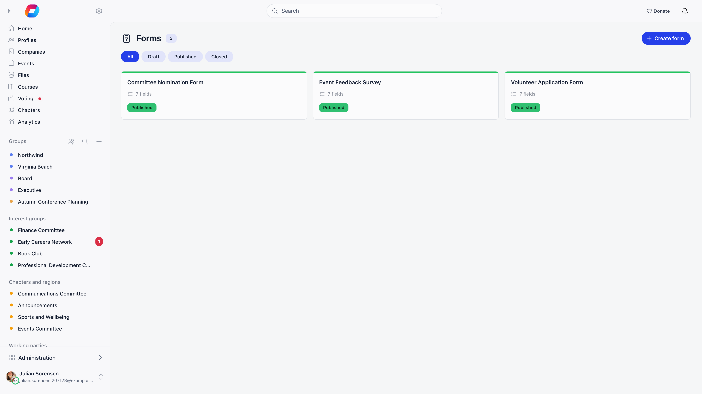
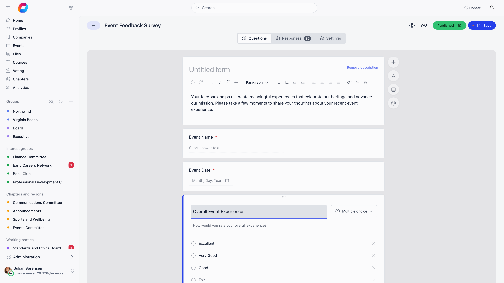
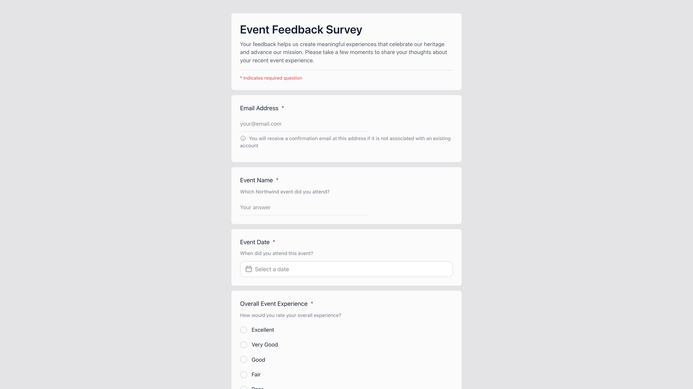
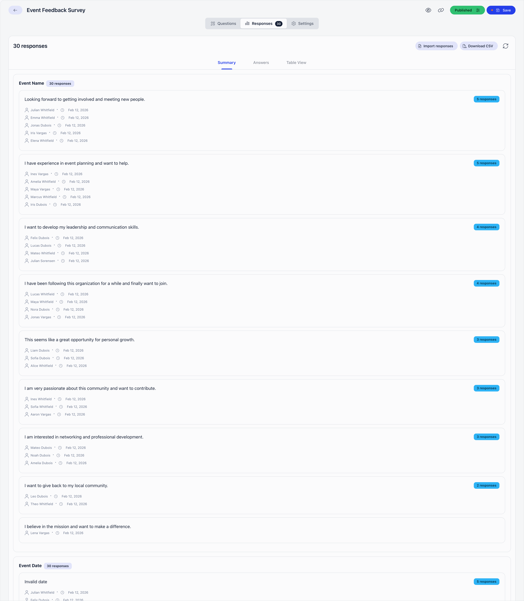

Forms is Orgo's standalone form builder. You write the questions, publish the
form, share one link, and read the answers back inside Orgo. Anyone who answers
with an email address that Orgo does not already know becomes a contact, so a
survey doubles as a way to grow your contact list.

**Built for** the one-off questionnaire that is not part of joining your
organisation: a satisfaction survey, an interest poll, a call for volunteers, a
sign-up sheet for an activity.

**Replaces** Google Forms or Typeform for members and the public. It has no
file-upload questions and no payment collection. A question can be shown only
when an earlier answer calls for it, and an answer can be saved straight onto the
respondent's member or contact record.

---

## Turning it on and who can use it

Enable the module at **Settings** → **Modules** → **Form Builder** →
**Enable Form Builder Module**, which only organization admins can do.

The Forms area opens for organization admins, HR managers, communications
managers and organization-wide event managers. Creating a form takes one of the
same three non-admin roles, and so does editing or deleting someone else's form;
you can always edit or delete your own. Organization admins can do everything on
this page.

A form you create belongs to you: its statistics, responses, and publish action
are open to you as its owner, and to organization admins, communications
managers and organization-wide event managers.

---

## Building a form

**Create form** makes a draft called "Untitled form" immediately and opens the
builder; rename it in the top bar. On the **Questions** tab, the header card
holds the title respondents see and an optional rich-text description. Add
questions with the **+** button on the right, each with a title, an optional
description shown under it, a type, and a **Required** toggle. **Add text**
inserts a rich-text block that displays instructions between questions and
collects no answer. **Add database field** adds a question that is already
connected to a member field (see below). Drag a question by the handle at the top of its card to
reorder. **Save** keeps the form as a draft; **Publish** saves everything and
opens the form to responses.

Deleting a question inside the builder marks it "Will be deleted" and offers a
**Restore** button until you press Save. To copy a question, use the duplicate
action in the question editor: questions belong to one form, cannot be reused on
another, and never appear on the
[Custom Fields](/platform/users/custom-fields) settings page.

### Question types

| Type | Answer |
|---|---|
| **Short answer** | One line of text |
| **Paragraph** | Multi-line text |
| **Multiple choice** | One option, all shown at once |
| **Checkboxes** | Any number of options |
| **Dropdown** | One option, picked from a list |
| **Number** | A number |
| **True / False** | A switch |
| **Date** | A calendar date |

Three more types appear only where they apply. **Local center** (a chapter
picker) is offered when your organisation uses local centers, **Profession
industry** when the professions module is on, and **Gender** always. They exist
so the answer can be saved onto the matching profile field.

There is no file-upload question. Questions appear in the order you set. For a file, collect it
through a [custom field](/platform/users/custom-fields) on the profile or
registration form, or ask for a link to it in a short-answer question.

### Showing a question only for certain answers

Open a question and switch on **Show only if**. Pick an earlier question on the
same form, then tick the answers (**is any of**) that should reveal this one.
The question you depend on has to sit above it and be a dropdown, multiple
choice, checkboxes or true/false question. Respondents who do not pick one of
those answers never see the question: it is not required of them, and anything
sent for it is discarded. If you later drag the parent question below its
dependent, delete it, or change it to a type with no fixed answers, the rule is
cleared and Orgo tells you. On the **Summary** view such a question carries a
**Conditional** tag and shows how many submissions it was shown to.

### Saving answers onto the member or contact record

An answer can update the respondent's own record, not only sit on the form.
There are two ways to set that up.

- **Add database field** (the floating toolbar) offers two groups. **Your
  database fields** are your organisation's own profile fields (custom fields):
  the question uses that field directly, and its name and options are managed in
  the database field settings. Admin-only and encrypted fields, files and text
  blocks are not offered. **Built-in profile fields** creates an ordinary
  question of the right type, already pointed at that property.
- On any ordinary question, the **Save the answer to the profile** switch picks
  a destination from a list built for that question type. Destinations are
  matched to the type: a text question (**Short answer** or **Paragraph**) can
  fill the text properties below, a date question can fill **Date of birth**,
  and only the matching picker can fill **Local center**, **Gender** or
  **Profession industry**. A text question can also fill a text, paragraph or
  other same-type custom field from your database fields. A date question never
  fills a text column.

Built-in destinations: **Local center**, **First Name**, **Middle name**, **Last
Name**, **Phone number**, **Address**, **Town**, **Postal code**, **Country**,
**Twitter**, **LinkedIn**, **Instagram**, **Bluesky**, **Facebook**,
**Website**, **Signal**, **Telegram**, **TikTok**, **Current organization**,
**Current role**, **Profession industry**, **Gender** and **Date of birth**.
The built-in picker lists **Local center** only when local centers are on, and
the two profession entries only when the professions module is on.

Some destinations exist for members only and some for contacts only, because
the two records have different columns. When the respondent is a record that has
no such column, the answer stays on the submission and nothing is copied:

| Destination | Member | Contact |
|---|---|---|
| Postal code, Facebook, Website, Signal, Telegram, TikTok, Profession industry | Saved | Not saved |
| Country | Not saved | Saved |
| First Name, Last Name | Saved to the first and last name | Spliced into the contact's single name |
| Everything else in the list | Saved | Saved |

Rules for what is written:

- **Only a proven submitter is written to.** The copy happens straight away when
  the respondent is signed in as themselves, or when this submission just
  created the contact. For everyone else, it waits until they open the
  confirmation link in the email. An anonymous submission has no record, so
  nothing is copied.
- **A blank answer never wipes a field.** An unanswered question, or one the
  respondent was not shown, leaves the record as it is. A filled answer replaces
  what is on file.
- **A member's chapter is only ever filled, never moved.** If the member already
  has a chapter, a **Local center** answer is ignored, because changing a
  chapter ends the member's roles there.
- **A value the destination refuses is skipped.** A name that does not look like
  a name, for instance, loses that one copy and the rest of the submission
  stands. The answer is still on the response for you to read.
- **Choice answers are matched by their label.** When a choice question fills a
  dropdown, multiple choice or checkboxes database field, the option text has
  to match (ignoring capitals). An option the destination does not offer is
  dropped. The builder warns you when the lists differ.
- **A deleted destination stops copying.** If the database field was deleted
  after you linked it, the question still records answers but no longer copies
  them. Changing a question to a type its destination cannot take clears the
  link.

A small tag on the question in the builder shows when it saves to the profile.
When a signed-in member opens the form, those questions open filled with what
is already on file, so a "check your details" form changes only what they
correct. Questions already filled in are not overwritten by the prefill. A form
that maps a **First Name** or **Last Name** question hides the built-in name
boxes that unknown respondents would otherwise see, so people are not asked
twice.

---

## Settings

The **Settings** tab holds who may answer and when.

| Setting | What it does |
|---|---|
| **Only registered users** | Only an email that matches an existing member account is accepted. Anyone else is refused. |
| **Anyone with email verification** | An email is required. A known member or contact is accepted straight away; an unknown address creates a new contact and the response stays pending until the confirmation link is clicked. |
| **Anyone (Anonymous)** | No email asked. Responses are stored with no submitter and the submitter columns disappear from the responses table. |
| **Offer newsletter subscription** | Only for **Anyone with email verification** forms. People who are not members see an unchecked box to subscribe to your newsletter; members manage that from their profile. On by default. |
| **Limit to one submission per device** | A second attempt from the same device shows the thank-you page instead of the form. |
| **Schedule auto-close** | A date and time after which the form reports itself closed and stops showing the questions. |
| **Thank You Custom Message** | Rich-text page shown after a successful submission, in place of the default "Thank you!" screen. |

The device check behind **Limit to one submission per device** is a hash of the
respondent's IP address and browser user agent. It deters casual repeat entries
but is not an identity check: a different network or browser gets a fresh
attempt.

Display options live behind the palette button on the **Questions** tab: a
header image, whether to show the title and description, whether to show your
organisation's logo, and the colour of the submit button.

---

## Publishing and sharing

Publishing generates a seven-character short code and builds a shareable page
with social-media preview tags. The link button in the top bar copies the
responder link, `https://<your-app-host>/share/form/<code>`. Respondents do not
need an Orgo account to open it unless the form is set to **Only registered
users**, and a signed-in member gets their email filled in automatically and
skips the verification step.

To stop responses without losing the link, open **Published options** in the top
bar and turn on **Not accepting responses**, or set a date under **Schedule
auto-close**. Either shows a "Form Closed" panel in place of the questions, and
turning the switch off reopens the form. Deleting a form from the list does not
free the link either: it hides the form everywhere but keeps the record and its
responses.

---

## Reading the responses

The **Responses** tab counts confirmed responses, and flags separately how many
are still pending an email confirmation. It offers three views, plus **Import
responses**, which takes an export of answers (from Google Forms, for example)
and lets you map each column to a question of this form or create a new one.

- **Summary** draws a chart per choice question and lists the text answers
  grouped by identical value, each with who submitted it and when.
- **Answers** walks through responses one at a time, in the same layout the
  respondent saw. Covers the 100 most recent confirmed responses.
- **Table View** is one row per response, one column per question, paginated 100
  rows at a time.

**Download CSV** exports up to 10,000 responses with the same columns as the
table. On an anonymous form the submitter and email columns are absent from both
the table and the export.

Response counts are cached and refresh themselves as answers arrive. If the
numbers look stale, the refresh button next to **Download CSV** forces a full
recalculation. Closing a form freezes its statistics. You can delete a single
response from the **Answers** view, permanently.

---

## What a response creates

On a form set to **Anyone with email verification**, an email that matches a
member is linked to that member, an email that matches an existing contact is
linked to that contact, and an unknown email creates a new
[contact](/platform/contacts) with the first and last name given on the form,
marked as coming from a form. A signed-in member submitting with their own email
is confirmed at once, with no email.

Unless the respondent is signed in as the owner of that email, the response is
held as pending and a confirmation email goes out. Clicking the link inside
confirms the response, confirms the contact's email address, and lands the
respondent on the thank-you page. **The link is valid for 24 hours**; after that
the form has to be submitted again. Pending responses are counted separately and
are excluded from the charts, the table, and the export until they are confirmed,
which is the usual reason a response someone swears they sent is not visible.
Questions that save to the profile follow the same rule: nothing is copied until
the submitter is confirmed.

If two contacts are later merged, their form responses are kept on the merged
contact.

---

## A member's or contact's submissions on their record

Every form a person has answered is also listed on their own record, so you can
see what they told you without opening each form's Responses tab.

- **Member:** open the member, then **More** → **Forms** (the **More** menu sits at the
  end of the profile's tab row).
- **Contact:** open the contact and look for the **Forms** card.

Who sees it: administrators who hold `HR_LOCAL` or `FINANCIAL_LOCAL` for that
person (so `HR_TENANT` and `FINANCIAL_TENANT` holders, and chapter administrators
for members of their own chapter). The member themself does not get this tab on
their own profile, and a person with form-builder rights alone (for example
`COMMUNICATION_TENANT`) does not see it either.

<Steps>
  <Step title="Read the list">
    A table, newest first, ten rows per page, with **Form** (the form's name),
    **Submitted** (date and time) and **Status**. Status reads **Confirmed**, or
    **Awaiting confirmation** while the person has not yet clicked the confirmation
    link in the email (see [What a response creates](#what-a-response-creates)).
  </Step>
  <Step title="Open the answers">
    Select a row. A window titled with the form's name shows the person's answers.
    The same window opens from a **Forms** entry on the
    [Activity](/platform/users/profile-activity) timeline.
  </Step>
</Steps>

An empty record shows **No forms submitted**.

<Note>
Unlike the Responses tab above, the list includes submissions still awaiting
confirmation, and it is open to anyone with `HR_LOCAL` or `FINANCIAL_LOCAL` on the
person, whether or not they own the form or hold `COMMUNICATION_TENANT` or
`EVENT_TENANT`. Opening a submission from here therefore follows the profile's
permissions, not the form builder's.
</Note>

A submission is attached to a member when the respondent was signed in, or gave
the email address of that member account. Anonymous forms store no submitter, so
they never appear here.

---

## Standalone forms versus the other builders

| Use | Builder | Why |
|---|---|---|
| A survey, poll, or one-off questionnaire | **Forms** (this page) | Public link, no account needed, answers stored as responses |
| Collecting data when somebody joins | [Registration form](/platform/users/registration-form) | Writes to the member's profile and creates the account |
| Different questions per kind of member | [Per-user-type registration forms](/platform/users/user-types) | One field set per user type |
| Data every member keeps up to date | [Profile form](/platform/users/profile-fields) | Fields live on the profile and can be required or filtered on |
| A membership application to review and sign | [Adhesion](/platform/users/adhesion) | Has an approval workflow and a generated document |
| Extra questions asked when booking a place | [Event registration form](/platform/events/registration-forms) | Answers attach to the event attendance |

If the answer belongs on a person's profile forever, use one of the
profile-based builders. If it belongs to one question you asked once, use Forms.

---

## Troubleshooting

<AccordionGroup>
  <Accordion title="Where can I see which forms a particular member answered?">
    On the member's profile, **More** → **Forms**. It lists each form with the date
    and whether the answer is confirmed, and selecting a row shows the answers. It
    needs `HR_LOCAL` or `FINANCIAL_LOCAL` on that member. Contacts have the same
    list in their **Forms** card.
  </Accordion>

  <Accordion title="The Forms tab is missing from a member's profile">
    Only holders of `HR_LOCAL` or `FINANCIAL_LOCAL` for that member see it. It is
    in the **More** menu rather than the main tab row, and it disappears from the
    menu once it has been opened, because it then has its own tab. Holding
    `COMMUNICATION_TENANT` or `EVENT_TENANT` does not help: those open the form
    builder's Responses tab, not this list.
  </Accordion>

  <Accordion title="Why can I open the Forms area but not the responses on a colleague's form?">
    The Responses tab, the statistics, the recalculate button and the **Publish**
    action all check the same thing: that you created the form, or that you are
    an organization admin, a communications manager or an organization-wide event
    manager. HR managers are not on that list, and the role does not imply any of
    the three.

    Worked example: two colleagues are both HR managers. Both reach the Forms
    area, both create and publish their own forms, and neither can open the
    other's Responses tab, because for each of them the other's form fails every
    branch of the check. The requests are refused rather than returning an empty
    table.

    Fixes, in order of preference: give the people who read results the
    communications manager or organization-wide event manager role, keep one
    shared account as the owner of forms the whole team reads, or ask the owner to
    send the CSV.

    Note the asymmetry: an HR manager can edit and delete a colleague's form, but
    not read its answers. Reading results is deliberately the narrower right.
  </Accordion>

  <Accordion title="I deleted a form. Can I still reach its answers?">
    Not from the app. Deleting sets the form's status to `DELETED`, and every
    signed-in read of forms filters that status out: the form disappears from the
    list, and so do its Responses tab, its statistics and its CSV export. The
    public link stops working too, because the public page only serves forms that
    are published or closed.

    Nothing is destroyed. The submissions, the answers and the contacts created
    from them all stay in the database. But there is no undelete button, so
    **Download CSV** before you delete anything you might want to read again. To
    take a form out of circulation without losing access to the answers, use
    **Not accepting responses** instead of Delete.
  </Accordion>

  <Accordion title="Which really stops responses, Schedule auto-close or Not accepting responses?">
    They work differently and only one of them is a hard stop.

    **Not accepting responses** changes the stored status of the form to closed.
    The submit endpoint accepts nothing but a published form, so responses stop
    at the source, and closing the form also computes its final statistics.

    **Schedule auto-close** is evaluated when the form is read. Once the date has
    passed, the form reports itself as closed and the public page shows the
    "Form Closed" panel in place of the questions, but the stored status is still
    published.

    For an audited cut-off (a vote, a deadline with money attached) set the
    switch when the deadline arrives rather than relying on the date alone. One
    detail worth knowing: turning **Not accepting responses** on clears the
    scheduled date, so reopening the form later does not silently re-arm an old
    schedule. Reopening also queues a fresh recalculation of the statistics.
  </Accordion>

  <Accordion title="Two people tried to answer and the second one got the thank-you page">
    That is **Limit to one submission per device**. The device is a hash of the
    respondent's IP address and browser user agent, so it is really "one answer
    per network plus browser build", not one answer per person.

    Worked example: five colleagues answer from the same office router. The first
    two use different browsers and both get through. The next three are all on
    the same version of the same browser, so they produce the same hash as one of
    the first two and see the thank-you page without their answers being saved.
    The same person on a phone that switches from office wifi to mobile data
    counts as a new device and can answer again.

    Two more details. Only confirmed responses block a device, so on a form set
    to **Anyone with email verification** a first respondent who never clicks the
    confirmation link leaves the device open. And nothing deduplicates by email
    or by member account: the device hash is the only repeat guard there is, on
    every submission mode.
  </Accordion>

  <Accordion title="The Summary count and the Table count do not agree">
    They read different sources. **Table View** counts confirmed submission rows
    live. **Summary** reads a stored statistics record that Orgo maintains in the
    background as answers arrive.

    When the background update falls behind, Orgo forces a full recalculation
    only once 50 or more responses have landed since the last one. Below that it
    serves what it has, which is why a form collecting a handful of answers a day
    can show a Summary that trails the table by a few responses for a while. The
    refresh button next to **Download CSV** forces the recalculation immediately.

    On a closed form the stored record is final by design: the refresh button
    will not move it, and that is what "closing a form freezes its statistics"
    means in practice.
  </Accordion>

  <Accordion title="My CSV is missing the oldest responses">
    The export stops at 10,000 rows and takes the newest ones, ordered by
    submission date, with no warning in the file or on screen.

    Worked example: a form with 12,300 confirmed responses exports a CSV with the
    most recent 10,000 in it. The 2,300 oldest are simply absent, and the row
    count in the file is the only clue.

    Below 10,000 the export is complete. Above it, read the older responses in
    **Table View**, which pages through everything 100 rows at a time, or split
    long-running collection across more than one form.
  </Accordion>
</AccordionGroup>

---

## Related

- [Contacts](/platform/contacts) for the records created by public responses
- [Profile activity](/platform/users/profile-activity) for the timeline that also links to form answers
- [Custom Fields](/platform/users/custom-fields) for fields that live on member profiles
- [Registration Form](/platform/users/registration-form) for collecting data at sign-up
- [Event Registration Forms](/platform/events/registration-forms) for questions asked at booking
- [Permissions](/platform/permissions) for what each role unlocks
