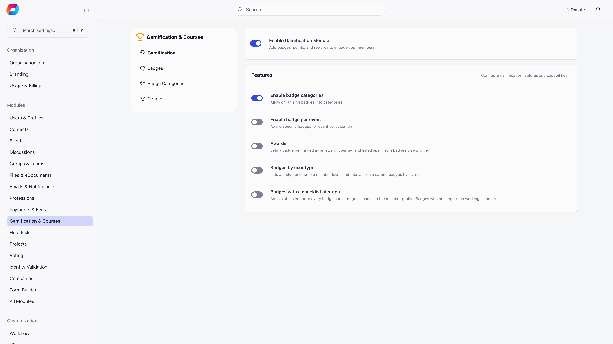

Gamification adds a points ledger on top of [badges](/platform/badges). Members earn points for things they already do (buying, attending, referring, posting), those points feed a leaderboard, and badges with a points threshold act as tiers members climb.

**Built for** organizations with a large, quiet membership where the goal is to surface and reward the people who actually turn up.

**Replaces** the engagement spreadsheet and the manual "member of the month" shortlist. It is not a loyalty scheme with redeemable rewards: Orgo counts points, it does not spend them.

Gamification has two layers:

| Layer | What it gives you | Who turns it on |
|---|---|---|
| **Badges** | The catalogue, awards by hand, from events and courses, categories, checklists of steps, awards, member levels | You, with the switches in [Turning it on](#turning-it-on) |
| **Points and tiers** | Point rules, the points total on each profile, the **Membership level** card, tier badges, the leaderboard, and the event points and event badge fields | Orgo support, per organisation. There is no switch for it in Settings. Ask support to enable **tiers** for your organisation |

Without tiers, badges still work but no points are recorded anywhere. Everything below the [Turning it on](#turning-it-on) section applies only to organisations that have tiers enabled.

<Note>
Volunteering-hours tracking was removed from Gamification, together with the hours-based badge award. Points and point rules are not affected.
</Note>

---

## Turning it on

**Settings** → **Modules** → **Gamification & Courses** → **Gamification**, which is for the Orgo administrator. Changes save as you flip each switch.

| Switch | What it turns on |
|---|---|
| **Enable Gamification Module** | Badges, the **Achievements** card and **Badges** tab on member profiles, and the Badges entry in the sidebar |
| **Enable badge categories** | Grouping badges into categories |
| **Enable badge per event** | The per-event badge field. The event form's **Gamification** section, where that field lives, appears only when tiers are enabled for your organisation |
| **Awards** | Lets a badge be marked as an award, counted and listed apart from badges on a profile |
| **Badges by user type** | Lets a badge belong to a member level, and tabs earned badges by level on a profile |
| **Badges with a checklist of steps** | A steps editor on every badge and a progress panel on the member profile. See [Badges](/platform/badges#checklists-of-steps) |
| **Members may record their own progress** | Appears under the checklist switch. Off: only HR assistants can record a step |

Tiers have no switch here. Once support has enabled them, two more panels, **Point Rules** and **Engagement Points**, appear at the bottom of this same screen.

---

## How members earn points

With tiers enabled, **Point Rules** and **Engagement Points** are on the Gamification settings screen. Set a rule to 0 and that source stops awarding.

| Setting | Awards points when | How much |
|---|---|---|
| **Purchase points (per ...)** | A product payment is recorded | Payment amount multiplied by the rate, rounded down to whole points. The label ends with your organisation's currency symbol |
| **Event attending default points** | A participant's RSVP becomes attending or attended | The event's own **Points** field when it is filled in, otherwise this default |
| **Referral points (per user)** | A referred signup completes | Awarded to the referrer, not the new member |
| **Create discussion** | A member starts a discussion | Flat amount. Help desk issues are excluded |
| **Create comment** | A member comments or replies | Flat amount |
| **Receive reaction** | Someone reacts to a member's post | Awarded to the post's author. Reacting to your own post awards nothing |

Every rule ships with a fallback that applies only until you save the panel for the first time: 1 point per currency unit, 100 for an event, 100 for a referral, 50 for a discussion, 10 for a comment, 2 for a reaction. After the first save, the numbers on screen are the numbers in force.

Event points are recorded once per attendance record, and they are taken back if the attendance is deleted or the RSVP moves away from attending. Points are for members only: [contacts](/platform/contacts) never accumulate them.

---

## Tiers

A tier is a badge with **Points required** set on it (the field is on the badge form, and appears once tiers are enabled). On a member's profile, the **Membership level** card shows the member's points as a **Total Points** tag, their current tier by name, and every tier as a card with its **Required Points**, marked **Achieved** or **Locked** against that total. The card appears for every viewer of the profile, only when Gamification and tiers are both on. People with `HR_ASSISTANT_LOCAL` over the member get a pencil on it that opens the member's **Badges** tab.

Tier badges are shown only in this card. They are left out of the **Achievements** card's badge pictures and its in-progress list.

<Note>
Tier cards on the profile light up from the points threshold alone, but the automatic promotion that actually writes the badge onto the member also needs an ordering number (`level`) on each tier badge. The settings screen does not expose that field today, so set it through the API (`PATCH /badges/{id}`) or award tier badges by hand. When automatic promotion does run, it grants the highest tier the member qualifies for and removes their lower tier badges, so a member holds one tier at a time.
</Note>

---

## The points ledger

Every point movement is a dated row: how many points, which activity type (purchase, event, engagement, referral, manual), a description, and a reference to the record that caused it. The member's total is the sum of those rows, and it is what the **Membership level** card and the leaderboard show.

The profile shows only the total. No screen lists the individual rows or lets you add, edit or delete one, so a wrong total (a refunded purchase, say) is corrected through Orgo support.

---

## The leaderboard

**Analytics** (`/stats`) → **Leaderboards** → **Points** ranks the top 50 members by points, over the last 7 days, the last 30 days, or all time. It uses the same filters as the rest of the analytics page: member status, user type, and local center. The card only appears when both the module and tiers are on.

Who can open the Leaderboards tab at all is set by the **Leaderboards** permission under Analytics on the **Permissions setup** page (**Settings** → **Modules** → **Users & Profiles** → **Security & Permissions**). It defaults to every member, so raise it if rankings should stay with staff.

The same tab carries leaderboards that do not depend on gamification at all: events attended, posts written, reactions received, and referrers. Those stay visible whether or not points are switched on.

---

## Common questions

<AccordionGroup>
  <Accordion title="How do I enable tiers, points and the leaderboard?">
    Ask Orgo support to enable tiers for your organisation. The **Enable tiers/levels by points** switch is no longer on the Gamification settings screen, so you cannot turn it on yourself. Once it is on, **Point Rules** and **Engagement Points** appear on that screen, **Points required** appears on the badge form, and the **Membership level** card and the points leaderboard appear.
  </Accordion>

  <Accordion title="Nobody is earning points">
    First check that tiers are enabled for your organisation: if the **Point Rules** panel is not on the Gamification settings screen, they are not, and nothing is recorded. Then check the rules themselves: a rule left at 0 awards nothing. Points also start from the moment tiers are enabled, so nothing is backfilled for past activity.
  </Accordion>

  <Accordion title="Why is there no Membership level card or Points required field?">
    Both need tiers, which Orgo support enables for your organisation. The Gamification module also has to be on.
  </Accordion>

  <Accordion title="Do points expire?">
    No. The ledger is permanent, and the 7 and 30 day buttons only narrow the leaderboard window, not the member's total.
  </Accordion>

  <Accordion title="What happens if tiers are turned off for us?">
    Recording stops and the leaderboard card and Membership level card disappear, but nothing already earned is deleted. If tiers are enabled again, the old totals are still there.
  </Accordion>

  <Accordion title="Can I give a member points as a one-off reward?">
    Not from the interface: there is no add-points button. Award a badge by hand instead.
  </Accordion>

  <Accordion title="A member's points look too high after a refund">
    Purchase points are awarded when the payment is recorded and are not reversed by a refund. The ledger rows cannot be edited from the interface, so ask Orgo support to correct the total.
  </Accordion>

  <Accordion title="Can I still track volunteer hours?">
    No. The hours switch, the Hours number badge field, Add volunteering hours and the badges awarded from hours were removed. Badges and points continue to work.
  </Accordion>

  <Accordion title="Why does my demo organisation have badges but no points or tiers?">
    Generating demo data no longer turns tiers on by itself. Badges and sample points are still created, but the points features show only for an organisation that has tiers enabled.
  </Accordion>
</AccordionGroup>

---

## Related

- [Badges](/platform/badges) - The catalogue tiers are built from, and the checklist, award and member level options
- [Products](/platform/fees/products) - Purchases that award points
- [Event attendance](/platform/events/attendance) - Attendance that awards points and event badges
- [Referral program](/platform/users/referral) - Referrals that award points
- [Discussions](/platform/discussion) - Posts, comments, and reactions that award points
