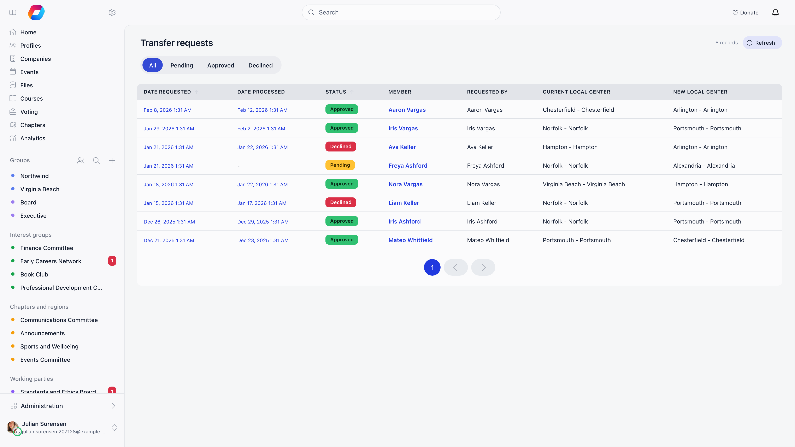
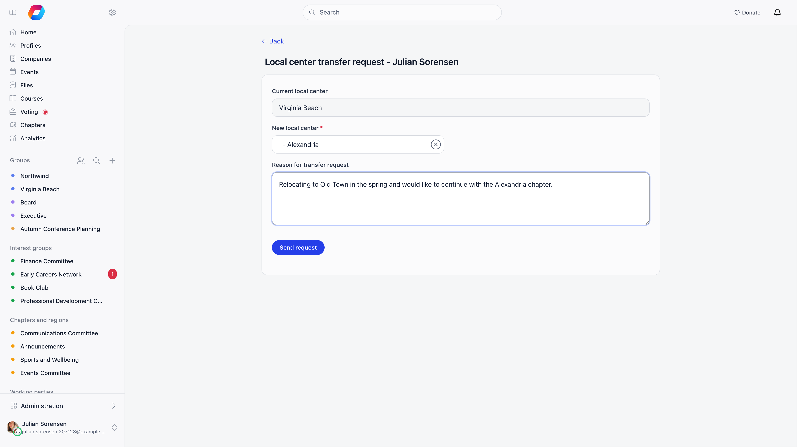

**Built for** organizations where members relocate and the receiving branch expects a say before someone lands on their roll.
**Replaces** the email thread between two branch secretaries, and the silent database edit that leaves neither side with a record.

A transfer request moves a member's primary chapter. Someone raises it with a written reason, the receiving chapter approves or denies it, and Orgo keeps the whole exchange: who asked, who decided, when, and why.

---

## Before you start

| Requirement | Where |
|---|---|
| **Enable Local Centers Module** switched on | **Settings** → **Modules** → **Groups & Teams** → **Local Centers** |
| **Group transfer request**, **Group transfer approved** and **Group transfer declined** switched on | **Settings** → **Modules** → **Emails & Notifications** → **Emails** |
| Chapter HR manager rights to see the requests list and to decide on a request | Scoped to the chapter concerned |

---

## Raising a request

Two **Request local transfer** buttons lead to the same form:

- On a member's profile, on the **Membership status** tab, next to the **Chapter** field. This is the admin route, and it opens the form as a panel over the profile. It shows to chapter HR managers over the member's current chapter, whenever the Local Centers module is on.
- On the support page, for members who are not part of the support team. This requires the Support module to be active.

The form itself needs nothing beyond a signed-in session, so members without a support page can be sent to it directly.

<Steps>
  <Step title="Confirm the current chapter">
    The **Current local center** field is filled in and locked. When an admin raises the request, the member's name is shown above it, also locked.
  </Step>
  <Step title="Pick the destination">
    **New local center** is a searchable chapter selector and is required.
  </Step>
  <Step title="Write the reason">
    **Reason for transfer request** is a required free text field. It is shown verbatim to whoever decides.
  </Step>
  <Step title="Send request">
    The request is created with status **pending** and stamped with the current chapter and the time.
  </Step>
</Steps>

Below the form, the requester sees **My transfer requests**: date requested, destination chapter, status, date processed, and a link into each one.

### Who may raise one for someone else

| Requester | Allowed |
|---|---|
| The member, for themselves | Always |
| Organization admin | For any member in the organization |
| Anyone else | Only with chapter HR manager rights over the member's **current** chapter |

Four rules are checked before the request is accepted:

- A destination chapter must be selected.
- The member and the destination chapter must both belong to your organization.
- The destination cannot be the member's current chapter.
- The member cannot already have an open request. Decide the existing one first.

Once the request is saved, every organization admin and every HR manager of the destination chapter (including HR managers of the chapters above it, whose reach covers it) with a valid email address is notified, except the member themselves. The email links to the transfer requests list.

---

## Deciding a request

Open the request from the transfer requests list. The detail panel shows status, date requested, member, requester, both chapters, and the reason.

**Approving requires chapter HR manager rights over the destination chapter**, not the source. The receiving chapter is the one that decides, so a source-chapter admin can raise a request but cannot wave it through.

- **Approve** applies immediately.
- **Deny** first reveals a **Deny reason** box, which must be filled in, then **Confirm deny** applies it.

A request that has already been approved or declined cannot be decided again.

### What actually moves

On approval Orgo:

1. Sets the member's primary chapter to the destination.
2. Ends the member's open role assignment for their member type, stamping it to the chapter they are leaving so the history stays correct.
3. Creates a new open role assignment of the same member type in the destination chapter.
4. Ends the member's other plain memberships in the chapter they are leaving and in its units, stops their notifications and discussion follows from that chapter, and subscribes them to the new one.
5. When local fees are in use, moves the member's local fee to the destination chapter. A card subscription at the old chapter is cancelled at the end of the period already paid, and a period already paid at the old chapter keeps its price until it runs out; the new chapter's default price applies from the day after.

It also records the approver and the timestamp, and emails the member.

Positions stay where they were. A role that carries permissions, or a unit **Admin** flag, is not ended, so a leader can move home chapter without losing the troop they lead. With **Multi local center access** on, a position kept in the old chapter keeps that chapter in the member's sidebar.

<Warning>
  Nothing else follows the member. Discussions they wrote, events they attended, files they uploaded, fee payments and invoices all stay attached to where they were created, and so do their group memberships outside the chapter. Treat a transfer as a change of home chapter, not as a data migration.
</Warning>

On denial, the member stays where they are. Orgo records who declined it, when, and the deny reason, and emails the member with that reason included.

---

## The transfer requests list

Reachable with chapter HR manager rights; anyone without them is bounced to the dashboard. The list has no menu entry of its own, so bookmark it. Filter buttons across the top: **All**, **Pending**, **Approved**, **Declined**. Thirty rows per page, sorted newest first, with **Date requested** and **Status** sortable.

| Column | Shows |
|---|---|
| **Date requested** | When the request was raised |
| **member** | Who is being moved |
| **Requested by** | Who raised it |
| **Current local center** | The chapter being left |
| **New local center** | The destination |
| **Date processed** | When it was approved or declined, or a dash |
| **Status** | Pending (amber), Approved (green), Declined (red) |

What you see is scoped to what you administer:

| Your permission | Rows shown |
|---|---|
| Organization-wide HR manager | Every request in the organization |
| Parent-chapter HR manager | Requests for your anchor chapter and every chapter beneath it, at any depth, plus your own chapter |
| Chapter HR manager | Requests for your own chapter |

Your anchor is your own chapter when it is flagged **It's a parent chapter** or has no parent, and otherwise the chapter directly above it. See [What a parent-scope permission reaches](/platform/groups/local-groups#what-a-parent-scope-permission-reaches). Everybody also sees their own requests and the ones they raised for somebody else, whatever their permissions.

**details** opens the request in a panel with the approve and deny actions, and the panel can be expanded to a full page.

---

## Transfer request or direct reassignment?

There are two ways to change someone's chapter, and they are not equivalent.

| | Transfer request | Direct reassignment |
|---|---|---|
| Where | The transfer form or a member's **Membership status** tab | The **Chapter** selector on a member's **Membership status** tab |
| Who | The member, an organization admin, or a chapter HR manager on the current chapter | Organization-wide HR managers |
| Approval | Required, by the destination chapter | None |
| Reason recorded | Required | None |
| Role assignments rewritten | Yes, the member-type role is closed at the old chapter and reopened at the new one | The old chapter's plain memberships end as in a transfer, but the move does not open one at the new chapter |
| Audit trail | Full, kept indefinitely | The change alone |

Use direct reassignment for corrections (someone was filed under the wrong chapter on import). Use a transfer request whenever the move is a real one that the receiving chapter should know about.

---

## Common questions

<AccordionGroup>
  <Accordion title="Does the source chapter have to agree?">
    No. Only the destination chapter decides. The source-side admin can raise the request, but approval sits with chapter HR managers on the receiving chapter.
  </Accordion>

  <Accordion title="Can a member have two requests open at once?">
    No. A second request is rejected while one is still undecided. Approve or deny the open one first.
  </Accordion>

  <Accordion title="Can I move someone into another organization?">
    No. Both the member and the destination chapter must be in the same organization, and the request is refused otherwise.
  </Accordion>

  <Accordion title="The member never got an email.">
    Check that the group transfer emails are switched on at **Settings** → **Modules** → **Emails & Notifications** → **Emails**, and check that the member has a valid email address on their profile. Orgo skips the send rather than failing the transfer when either is missing, so the transfer itself will still have gone through.
  </Accordion>

  <Accordion title="What happens to their unpaid fees?">
    They stay as they are. Fee records, payments, and invoices are not rewritten by a transfer, so a debt raised at the old chapter remains recorded against the old chapter. Settle or write off outstanding items before approving if your accounting requires it. What does move is the member's go-forward local fee: see step 5 under [What actually moves](#what-actually-moves).
  </Accordion>

  <Accordion title="Can I delete a chapter that has transfer requests pointing at it?">
    Not outright. A chapter named in any transfer request, as either side, is closed rather than deleted, keeping the request history readable.
  </Accordion>
</AccordionGroup>

---

## Related

- [Local Centers](/platform/groups/local-groups) - the chapters a member moves between
- [Units](/platform/groups/units) - team assignments inside a chapter
- [Permissions](/platform/permissions) - how chapter and parent-chapter HR rights are evaluated
- [Groups Overview](/platform/groups) - all group types and when to use each
