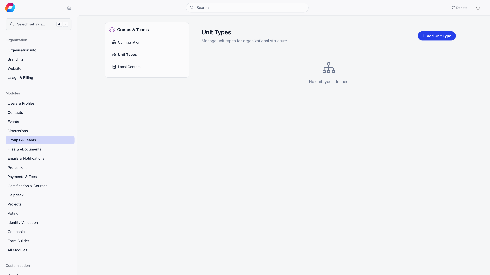

**Built for** organizations whose chapters are themselves subdivided: patrols inside a troop, sections inside a branch, departments inside a council.
**Replaces** the naming conventions people invent to fake structure ("Berlin - Team A", "Berlin - Team B") and the side spreadsheet that tracks who is in which one.

A unit is a named team that lives inside a chapter. Units are typed, so you name the layers once (Section, Patrol, Department) and then create as many units of each type as you need. Units can nest, one type inside another, to whatever depth your structure requires.

The segmented board is the view you will spend most time in: a column per unit, the members of each shown as cards. You move people by dragging a card from one column to another.

---

## Units, chapters, and groups

All four sit on the same underlying structure in Orgo, which is why they share features like member roles and a name, but they behave differently:

| | Belongs to | Membership | Created by |
|---|---|---|---|
| **Chapter** (local center) | The organization, or another chapter when parent chapters are on | The member's primary chapter, one per member | Organization admins |
| **Unit** | A chapter (usually) and optionally a parent unit | Assigned by an admin | Chapter HR managers, within their own chapter |
| **[Private group](/platform/groups/private-groups)** | The organization | People join or are invited | Any member allowed to create groups |
| **[Role group](/platform/groups/role-groups)** | The organization | Filled automatically from a query | Organization admins |

The practical difference: a unit describes where someone sits in the org chart, a group describes what they are working on.

Units and chapters both nest, and they are separate trees. Chapters nest into each other to any depth (national, region, district, branch), and units nest inside one chapter along your chain of unit types. A unit never spans two chapters, and a unit is never the parent of a chapter.

---

## Before you start

| Requirement | Where |
|---|---|
| **Enable Organizational Units** switched on | **Settings** → **Modules** → **Groups & Teams** → **Configuration** |
| At least one unit type defined | **Settings** → **Modules** → **Groups & Teams** → **Unit Types** |
| Chapter HR manager rights to open the board, add members and create units; chapter admin rights to edit and delete units | Scoped to the chapter |

---

## Unit types

A unit type is the template for a layer of your structure. Define them once at **Settings** → **Modules** → **Groups & Teams** → **Unit Types**, then create units of that type inside each chapter.

| Field | What it does |
|---|---|
| **Title** | Singular name, used on buttons like "add Patrol" |
| **Plural name** | Used as the page heading and the chapter tab label |
| **Parent unit type** | The type one level up. Setting this is what makes units nest, and it drives the parent selector on the unit form |
| **Within local center** | Units of this type belong to a chapter. New units are stamped with the creator's chapter automatically |
| **Has user type** | Units of this type carry a member type, which colors them in the lists and boards |

Creating, editing, and deleting unit types is restricted to the Orgo administrator. Delete a type only after nothing uses it.

<Note>
  **Within local center** is the switch that decides whether a type shows up as a chapter tab and in the chapter row menu. A type without it produces units that are not tied to any chapter, so only tenant-level admins can manage them.
</Note>

---

## Working with units

### The unit list

In the chapters list, the **...** row menu has one entry per local unit type, shown to members of that chapter and to organization-wide HR managers. Each opens a list of every unit of that type in the chapter.

The heading is the type's plural name. Chapter HR managers get an **active** / **archived** filter. Chapter admins get an **add** button naming the type, and a pencil on each row. Each row shows the member type badge or logo, the unit name linking to its members, the member count, and the parent unit name (with an **archived** tag if the parent is closed).

Clicking a row slides in the unit form:

| Field | Notes |
|---|---|
| **name** | Required |
| **dateBegin** | Existing units only |
| **dateEnd** | Only when the unit is archived |
| **userType** | Only when the type has **Has user type** and member types are enabled |
| Parent selector | Labelled with the parent type's name. Archived parents are marked |
| **status** | **active** or **archived** |

Deleting a unit asks for confirmation and removes its role assignments with it.

### The segmented board

The chapter header carries a tab named after your local unit types (for example **Patrols**), and the chapter's shortcut card has the same link. It opens the drag-and-drop board for the whole chapter. Chapter HR managers see every unit; a unit admin sees only the units they run. When your types nest, the board renders as columns: one per parent unit, with its child units stacked inside. Any child unit that has not been given a parent is collected in a final **Unassigned** column. When the type you are looking at has no parent type, the board is flat instead: one section per unit.

Chapter HR managers can drag a member from one unit to another, use **Add member** to search and place someone, create a unit, set each member's role, and mark a member as **Admin** of their unit. Editing or deleting a unit takes chapter admin rights. A unit admin can add and remove members in their own units only.

**Add member** searches active members only, so a suspended or inactive member cannot be placed. If a placement fails, the reason shows under the search box: "This member already has this role in this unit", or "You do not have permission to add members to this unit".

To create a unit, use the dashed **add** tile on the board. On a flat board (no parent unit type) it sits above the units and shows even when the chapter has no units yet. It is labelled with the unit type's name, or with all the local type names separated by a slash when there are several; with several types, clicking it asks you to pick one, and with one type it opens the form straight away. A new unit is created in the chapter whose board you are on.

<Warning>
  The **Admin** flag on a unit member is not cosmetic. It delegates scoped fee access and unit event attendance, so it is restricted to people who already hold chapter HR, chapter finance or organization admin rights over the chapter. Unit admins cannot appoint each other.
</Warning>

### From the chapters list

When units are enabled, each chapter row in the chapters list grows a chevron. Expanding it loads that chapter's whole unit tree inline, indented by depth, showing each unit's type, member type color, and member count.

A unit name in that tree is a link only if you can open it. You can when you hold chapter HR manager rights over the chapter, or you are an admin of that unit or one above it, or you hold a role on that unit type (or any type above it in the parent chain).

<Note>
  Chapter admin rights reach the units of the holder's own chapter only, however deeply those units are nested inside it. They do not reach units belonging to a chapter below yours in the chapter tree, even one directly below. To administer a branch's units you need a parent-chapter permission, which is the permission family that travels down the chapter tree.
</Note>

---

## Who can do what

| Action | Requires |
|---|---|
| See the board | Chapter HR manager (a unit admin sees their own units) |
| Add or move members on the board | Chapter HR manager (a unit admin, in their own units) |
| Create a unit | Chapter HR manager over the chapter, or the parent-chapter equivalent when the chapter is a parent chapter. Organization-wide HR managers may create in any chapter. The unit list's **add** button is shown to chapter admins |
| Edit or delete a unit | Chapter admin on the unit's chapter |
| Toggle a member's unit **Admin** flag | Chapter HR or chapter finance manager, or an organization admin |
| Create, edit, or delete unit types | Orgo administrator |

Chapters and role groups can never be created or edited through the unit screens even by tenant admins; they have their own flows.

---

## Common questions

<AccordionGroup>
  <Accordion title="How deep can units nest?">
    As deep as your chain of unit types. Each type points at one parent type, and units of a type can only sit under units of that parent type. The chapters list renders the resulting tree at whatever depth it finds.
  </Accordion>

  <Accordion title="A member should be in two units.">
    Unit membership is a role assignment, so a member can hold roles in more than one unit at the same time. Dragging on the segmented board moves them; adding them from a second unit's **Add member** leaves both.
  </Accordion>

  <Accordion title="Why does no unit tab appear on my chapter?">
    Three things must all be true: **Enable Organizational Units** is on, at least one unit type has **Within local center** ticked, and you hold chapter HR manager rights over the chapter.
  </Accordion>

  <Accordion title="What happens to members when a unit is archived?">
    Archiving sets the unit's status to closed and records an end date. It stays visible under the **archived** filter and keeps its history; it just stops appearing in the active list and in the chapter's unit tree.
  </Accordion>

  <Accordion title="Should I use a unit or a group for a committee?">
    A unit if the committee is a permanent part of the chapter's structure and you want it in the org chart and in fee scoping. A [private group](/platform/groups/private-groups) if it is a working space people join for a project.
  </Accordion>
</AccordionGroup>

---

## Related

- [Local Centers](/platform/groups/local-groups) - the chapters that units live inside
- [Groups Overview](/platform/groups) - all group types and when to use each
- [Role Groups](/platform/groups/role-groups) - membership defined by a query instead of an assignment
- [Member Transfers](/platform/groups/transfers) - what happens to assignments when a member changes chapter
- [Permissions](/platform/permissions) - how the local roles are evaluated
