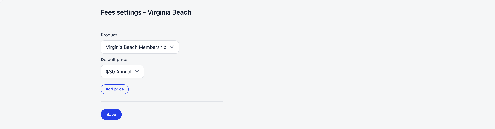
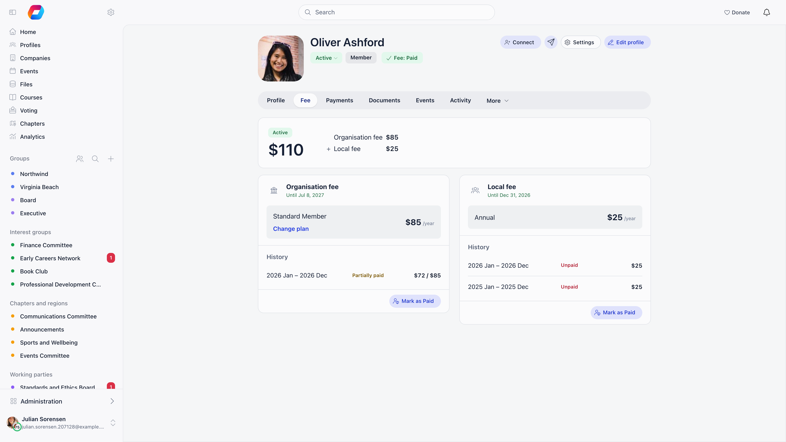

A chapter (local center) can charge its own membership fee on top of the organisation fee. It picks its own fee product and its own default price, and when it has its own Stripe account the money settles into that account. A member then carries two independent fee validity dates: one for the organisation, one for the chapter.

**Built for** federations where chapters keep their own budget: scout districts, regional branches, county associations.

**Replaces** the parallel spreadsheet each branch treasurer keeps.

---

## Turning it on

**Settings** → **Modules** → **Payments & Fees** → **Membership fees**, section **Local Center Configuration**. Needs an Orgo administrator.

| Setting | What it does |
|---|---|
| **Local Center Fees Enabled** | Master switch, off by default. Everything on this page is hidden until it is on. |
| **Credit Central Fees to Member Local Centers** | Reporting only, off by default. Shows money paid on organisation-level products in each chapter's analytics, so an organisation that collects centrally and redistributes afterwards can still see per-chapter figures. Past figures update only after the statistics are rebuilt. |
| **Local Center Members Table** | Adds the per-chapter [Member fees table](/platform/local-group-fees/member-fees) used to record offline payments. |
| **Minimum Members per Local Center** | Flags chapters whose count of paid fees falls below this number (default 25), on the chapter fee statistics page (at the address `/fee/stats`, Financial (Organization)). |
| **Minimum Active Members Percentage** | Same flag, comparing paid fees against this share of the chapter's active members (10% to 100%, default 100%). |

---

## Setting up one chapter

<Steps>
  <Step title="Open the chapter's Fees settings">
    In the chapter's settings menu, pick **Membership fees**. It is listed when fees and **Local Center Fees Enabled** are on, and the page, titled **Fees settings** with the chapter's name, needs Admin (Chapter) on that chapter (Admin (Organization) qualifies everywhere).
  </Step>
  <Step title="Create the chapter fee product">
    With no chapter fee product yet you get **Start local fees by adding your first product** and an **Add product** button, which opens the [product form](/platform/fees/products) for this chapter. A fee product created by anyone who is not Financial (Organization) is stamped with their own chapter, and if that chapter has no fee product yet it is set as the chapter's fee product automatically, with its first level as the chapter's default.
  </Step>
  <Step title="Add the price tiers">
    **Add price** opens the product's **Membership levels** tab. Each level is one membership tier (for example Youth, Adult, Family). Archived levels are not offered.
  </Step>
  <Step title="Select Product and Default price, then Save">
    **Product** lists only products belonging to this chapter. **Default price** lists that product's non-archived levels with their amount and the organisation currency symbol. A level's own menu on the product page also offers **Set as default level**.
  </Step>
  <Step title="Connect the chapter's Stripe account (optional)">
    Without one, chapter fee charges fall back to the organisation's Stripe account. See [Stripe Integration](/platform/fees/stripe-integration).
  </Step>
</Steps>

<Note>
  The **Membership fees** entry and the screen behind it both need Admin (Chapter). A chapter administrator who only holds Financial (Chapter) does not see them: they can still create and edit the chapter's products from **Finance** → **Local products**, but someone with Admin (Chapter) has to choose the chapter's product and default price.
</Note>

---

## What the default price does

The default price is not just a suggestion. Whenever the [Member fees table](/platform/local-group-fees/member-fees) or a member's fee view loads, every fee-eligible member of the chapter who has no chapter fee tier yet is given the chapter's **Default price**. With **Enable Age Restrictions on Prices** on, the age-appropriate variant of that price is chosen instead.

Change an individual member's tier from the Member fees table (Financial (Chapter) on their chapter), or from the member's **Fee** tab with **Change plan**. On the **Fee** tab a member can change their own chapter level, and an administrator needs both Financial (Chapter) and HR (Chapter) for that member; a finance-only administrator uses the Member fees table.

When a member moves to another chapter, their chapter level follows: an automatic renewal on the old chapter's fee ends at the end of the period already paid, a paid period is never repriced, and the member is given the new chapter's default level (the age-appropriate one when age restrictions are on) at once, or none if the new chapter charges no fee. If the old chapter's paid period has not ended yet, the new level starts the day after it.

---

## How a member pays both fees

A member's profile **Fee** tab shows a summary card, then two cards side by side, **Organisation fee** and **Local fee**. The summary card shows the status and splits the total into an organisation line and a chapter line (plus the registration fee, when one is due). The local card only appears when chapter fees are on, the member's chapter has a fee product, and the member has a chapter fee level. While the two fees are shown together, the member pays each from its own card; the summary card carries no pay button.

The two are charged separately, never in one checkout:

- The chapter fee charge is routed to the chapter's own Stripe account when it has one, otherwise to the organisation account.
- The amount is charged in the chapter's currency when the chapter has its own currency override, otherwise in the organisation currency.
- The one-time registration fee is organisation-level only. It is never added to a chapter fee.
- The local fee card offers one-off payment only. Recurring subscriptions are not available for chapter fees.
- Members can start a chapter fee payment for themselves only. Admins record payments on a member's behalf instead of paying for them.

Online payment of the chapter fee also needs the **Online Payments** module active with **Membership Fees** on, plus either **All Members Fee Eligible** or, on the chapter's own edit form, **Enable members in this chapter to pay membership fees by online payments**.

---

## Fee validity

Paying the chapter fee stamps a billing period and sets the member's **chapter fee validity date** to the end of that period. It is stored and evaluated separately from the organisation fee validity date, so a member can be current on one and expired on the other. A lifetime price with no amount sets the date 100 years out.

---

## Recording offline payments

Cash and bank transfers collected by the chapter are recorded in the [Member fees table](/platform/local-group-fees/member-fees), which stages the amounts as a draft and then writes them as one pending fee payment batch for an Admin (Organization) to approve. Settling a single member instead, with **Mark as paid** on their profile's **Fee** tab, needs no approval: that batch is written as already approved and the validity date moves at once. See [Recording a payment](/platform/fees/record-payment).

---

## Who can do what

| Action | Permission |
|---|---|
| Turn chapter fees on for the organisation | Orgo administrator |
| Choose the chapter's fee product and default price | Admin (Chapter) on the chapter |
| Create or edit the chapter's fee product and levels | Financial (Chapter) on the chapter |
| Change a member's chapter fee level | Financial (Chapter) on their chapter (on the Member fees table), or the member for themselves |
| Mark a chapter fee period as paid | Financial (Chapter) on the member's chapter, and **Allow Mark as Paid** must be on |
| Record a chapter fee payment batch | Financial (Chapter) on the chapter, or an active unit-admin role in it |
| Approve a pending batch | Admin (Organization) |
| Cancel a pending batch, which deletes it | Admin (Chapter), and the server keeps it to that admin's own chapter |

---

## Troubleshooting

<AccordionGroup>
  <Accordion title="The Product dropdown is empty on Fees settings">
    It lists only products that belong to this chapter. A product created by a Financial (Organization) user is an organisation product and will not appear. Create the product from the chapter's **Membership fees** page or **Finance** → **Local products** so it is stamped with the chapter.
  </Accordion>

  <Accordion title="Members of the chapter have no local fee showing">
    Check that the chapter has both a **Product** and a **Default price** saved, that the member is fee eligible, and that their member type is not flagged as not eligible for fees. Members with no chapter fee level get one assigned automatically the next time the fee views load.
  </Accordion>

  <Accordion title="Chapter fee money is landing in the organisation account">
    That chapter has not connected its own Stripe account. Charges fall back to the organisation account by design until it does.
  </Accordion>

  <Accordion title="The chapter's IBAN is not on any invoice">
    The IBAN fields on a chapter record are reference details. The native-currency one is shown on the chapter's info page under **Legal details**, but bank-transfer invoices and PDF payment proofs use the organisation IBAN.
  </Accordion>
</AccordionGroup>

---

## Related

- [Member fees table](/platform/local-group-fees/member-fees): recording chapter payments member by member
- [Membership Fees](/platform/fees/fees): the organisation-level fee and its settings
- [Products](/platform/fees/products): fee products, prices and tiers
- [Stripe Integration](/platform/fees/stripe-integration): chapter Stripe accounts and currency rules
- [Chapters](/platform/groups/local-groups): chapter records, settings sidebar and waitlist
