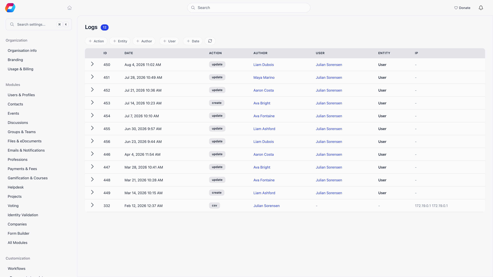
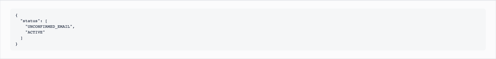

The activity log answers "who changed this, and when". Every entry names the person who acted, the record they acted on, and, for edits, exactly which fields changed and what they changed from.

**Built for** answering member disputes, audits, and the moment someone asks why a profile no longer says what it said last week.

**Replaces** guessing from database backups.

**Settings → Developers → Logs**

<Note>
  The organization-wide log page needs the **Orgo administrator** flag on your account, like the other configuration screens. The organization admin permission alone does not open it, and there is no chapter-admin view of it. The log tabs on individual records (a member's **Audit Logs** tab, an event attendance, an adhesion) are different: they stay open to anyone holding the organization admin permission. See [the same log, scoped to one record](#the-same-log-scoped-to-one-record).
</Note>

---

## Reading an entry

| Column | What it holds |
|---|---|
| **ID** | The entry's own identifier |
| **Date** | When it happened, to the minute |
| **Action** | What kind of change it was |
| **Author** | The person who made the change, linked to their profile |
| **User** | The member the change was about, when the entry concerns one person |
| **Entity** | The record type and its name, or its id when there is no name |
| **IP** | The address the request came from |

Click the arrow at the start of a row to expand the details. For an edit, the details show only the fields that actually changed, each with its old and new value. Fields whose value did not really change are dropped before storage, as is the automatic "last updated" timestamp, so the detail block is the real diff rather than a dump of the whole record. For a deletion, the details hold a snapshot of the key fields as they were just before the record went away.

Entries are 15 to a page, newest first.

---

## Filtering

The pills above the table combine, and the result is written into the page URL, so a filtered view can be bookmarked or pasted to a colleague.

| Filter | Notes |
|---|---|
| **Action** | The kinds of change listed below |
| **Entity** | Record type. See the caveat below: it matches deletions and query exports, not every edit |
| **Author** | Search by name or email from two characters up |
| **User** | The member the entry is about, same search |
| **Date** | A "date after" and a "date before" picker, either or both |

**Refresh** re-runs the current filter.

---

## What gets recorded

| Action | Written when |
|---|---|
| **create** | An adhesion, an identity submission, a unit or group, or an event attendance is created, or a tag is added to a member or contact profile |
| **update** | A member profile is edited (the diff of changed fields), an adhesion or identity changes status, a unit or group is edited, an attendance changes, a contract is updated, a member's email is changed or their password is reset, an administrator unsubscribes a contact from the newsletter |
| **remove** | A record is deleted through the application: newsletters and newsletter templates, email templates, events, courses and lessons, products, forms, users, adhesions, identities, contracts, contacts, roles, role groups, groups, local centers and units, plus discussions, posts and comments. Also written when a tag is removed from a member or contact profile, and when a [profile note](/platform/users/profile-activity) is deleted |
| **moderate** / **unmoderate** | A discussion post or comment is hidden or restored |
| **csv** | Members, role-group members, contacts, invoices, the email log, a saved query or a [report](/platform/reports) are exported. A report export names the report |
| **upload_identity** | A member uploads an identity document |
| **confirm_identity** | An identity is confirmed before a subscription charge |
| **custom_field_encryption_enabled** / **custom_field_encryption_disabled** | Encryption is switched on or off for a custom field |
| **decrypt_custom_field** / **decrypt_custom_field_failed** | An encrypted custom field value is read, or a read fails |

Creating or changing a [report](/platform/reports) is logged too, as a create or update on a report definition.

A few more actions are written but are not offered in the Action filter, so you find them by author, user and date instead: record merges and merge rollbacks (review those on the merge history page), **personal_id_changed** (a personal identification number was changed, with old and new values kept encrypted), **personal_id_revealed** (an admin viewed one), **personal_id_exported** (one went out in a report or a personal data export), **personal_data_exported** (a person's data and files were exported for a data request) and **district_tag_updated** (an automatic district tag changed).

### What is not recorded here

<Warning>
  Deletions are logged only when they come through the application. A cascade (deleting a group that takes its memberships with it), a bulk operation run by Orgo support, and background jobs do not each write a row. This is deliberate: one cascade should not produce thousands of entries.
</Warning>

- **Logins** are not in this log.
- **Email delivery** is not in this log. Use the [email log](/platform/emails/email-log).
- **Webhook deliveries** have their own log on each webhook subscription.
- **Imports** report per-row results on the import itself, not here.
- **Changes made without a signed-in account** produce no entry. A visitor registering for a public event, for example, creates the attendance but no log row, because there is nobody to attribute it to.

### The Entity filter is narrower than the table

The **Entity** column and filter are populated for deletions and for saved-query exports. Most edit entries identify their subject through the **User** column instead and carry no entity type, so filtering by, say, `User` will not return profile edits. To review edits to one member, filter by **User**, or open that member's profile and use its own log tab.

The filter dropdown is also a fixed list, and it is shorter than the set of entity types the table displays. Tag changes (`ProfileTag`), note deletions (`UserNote`, `ContactNote`), report saves and exports (`ReportDefinition`, `Report`) and resignation requests write rows that show their type in the **Entity** column but have no option in the filter, so they cannot be narrowed down that way. Filter by **User** and **Action** instead, or read them in order on that person's [Activity tab](/platform/users/profile-activity).

---

## The IP and impersonation columns

The IP address is captured from the browser request that made the change, so entries written from an asynchronous handler rather than directly from the request carry no IP in that column. Encrypted custom field reads are the notable case: they are recorded asynchronously, and their IP is stored inside the details block instead.

Deletion entries also record an **impersonator** when the deletion happened while an administrator was viewing the platform as another user. That tells you the account the action was attributed to and the account that actually performed it.

---

## The same log, scoped to one record

The organization-wide page is not the only way in. The same entries appear filtered on:

- a **member profile**, on its **Audit Logs** tab, which has a search box over action, details and author, and sits beside an **Email Logs** view on the same profile;
- an **event attendance**, behind the logs button on a row of the attendees screen;
- an **adhesion**, on its **Logs** tab.

All three read the same store and need the organization admin permission, so a chapter admin or an HR manager without it will not see them (an adhesion page opens for chapter HR managers, but its **Logs** tab stays empty for them). Unlike the organization-wide page, they do not need the Orgo administrator flag.

---

## Retention and export

Entries are kept for as long as your organization exists. Nothing prunes them on a schedule, and deleting your organization removes them along with everything else.

The log is strictly read-only: entries cannot be edited or deleted from the interface, and there is no endpoint that would let anyone do so. There is no export button on this page; if you need the entries outside Orgo, read them through the API.

---

## Troubleshooting

<AccordionGroup>
  <Accordion title="A change I know happened is not in the log">
    Three common reasons. It was a cascade or a background job, which are not logged per record. It was a kind of change that has no log action at all (see the table above; not every screen writes an entry). Or the Entity filter is hiding it, because edits generally carry no entity type: clear the filters and narrow by **User** and date instead.
  </Accordion>
  <Accordion title="The IP column is empty on some rows">
    The address is taken from the browser request that made the change. Entries written from an asynchronous handler rather than directly from the request, such as reading an encrypted custom field, carry no IP. The author is still recorded.
  </Accordion>
  <Accordion title="I need to know who deleted a member">
    Filter Action = **remove** and Entity = **User**, then expand the row. The snapshot holds the email, first and last name and status the account had at deletion, and the Author column names who did it.
  </Accordion>
  <Accordion title="A local admin says the log is empty for them">
    It is not visible to them. The organization-wide page needs the Orgo administrator flag, and the log tabs on individual profiles need the organization admin permission.
  </Accordion>
  <Accordion title="Who read an encrypted custom field?">
    Filter Action = **decrypt_custom_field**. Failed attempts are recorded separately as **decrypt_custom_field_failed**, and switching encryption on or off for a field is recorded as its own action.
  </Accordion>
</AccordionGroup>

---

## Related

- [Permissions](/platform/permissions)
- [Reports](/platform/reports)
- [Email log](/platform/emails/email-log)
- [Merging duplicates](/platform/users/merging-duplicates)
- [Custom fields](/platform/users/custom-fields)
- [Workflows](/platform/workflows)
