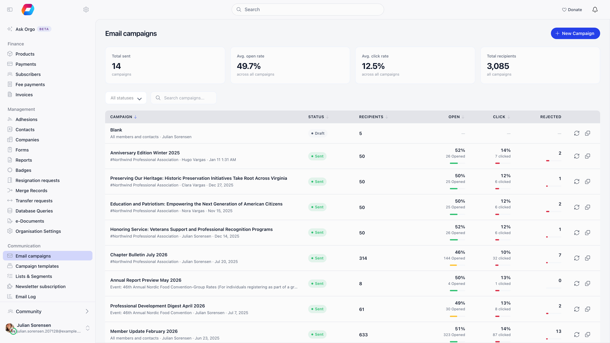
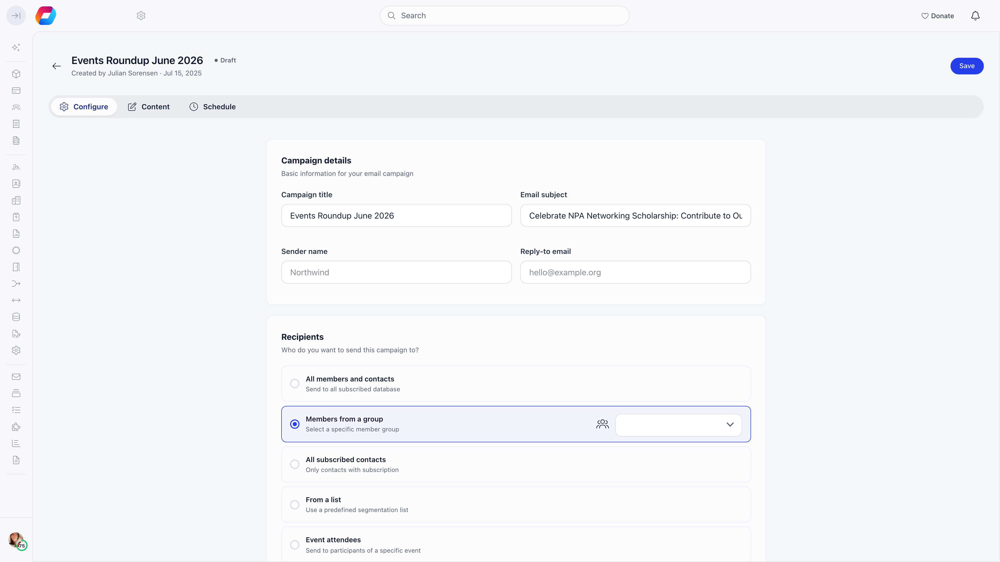
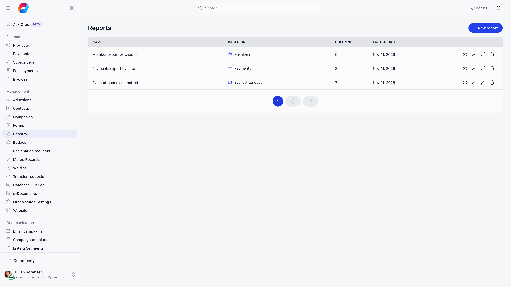

Newsletter is Orgo's email campaign tool. You pick who receives the email from
the data already in the platform (members, contacts, a group, a list, the
attendees of an event), design it, then send or schedule it.

**Built for** membership organizations that need to reach a specific slice of
their people, not a generic mailing list: one local center, one role group, the
people registered for one event.

**Replaces** Mailchimp or Constant Contact for member communication. It has no
marketing automation and no A/B testing.

---

## Turning it on and who can use it

**Settings** → **Modules** → **Emails & Notifications** → **Enable Email
Campaign Module**. The same page holds the **Default Newsletter Widget UUID**
used by [signup widgets](/platform/newsletter-widgets).

| Who | What they can do |
|---|---|
| Organization-wide communication managers | Create, send, and report on any campaign that is not attached to an event |
| Chapter communication managers and chapter admins | The same, but only for campaigns that belong to a chapter they manage (or one below it). Every campaign they write has to name such a chapter, and they are normally offered only the **Members from a group** and **From a list** audiences. See [Who a campaign can reach](#who-a-campaign-can-reach) |
| Organization-wide event managers | Campaigns attached to an event ("event messages"), and only those |
| Organization admins | See every campaign |

The list of campaigns follows the same lines: each person sees only the campaigns they are allowed to work on.

The module adds a **COMMUNICATION** sidebar section: **Email campaigns**
(chapter communication managers and up), **Campaign templates**,
**Newsletter subscription** (organization-wide communication managers),
**Lists & Segments** (also open to organization HR managers and to chapter
communication managers and admins), and **Email Log** (organization-wide
communication managers).

**Auto-subscribe to newsletter** on the same settings page is offered only to
organizations in the United States. When it is on, people who submit a form,
donate or register for an event are subscribed automatically and shown a
notice, instead of being given an opt-in checkbox.

---

## Building a campaign

Three steps: **Configuration**, **Design content**, **Preview & send**.

<Steps>
  <Step title="Fill in the campaign details">
    **Campaign title** is internal, **Email subject** is what recipients see.
    **Sender name** defaults to your organization's short name and **Reply-to
    email** to its contact email; override either per campaign. The reply-to must
    be a real email address, or the save is refused.
  </Step>
  <Step title="Choose the audience and a template">
    Pick a recipient option below (its recipient count appears next to it), the
    chapter it belongs to when your organization uses local centers, and the
    email type, then start from Blank or from a saved template.
  </Step>
  <Step title="Design, test, send">
    Build it in the [editor](/platform/newsletter-builder), check it with
    **Send test to your email** against your own data, then **Send** or use the
    **Schedule** tab.
  </Step>
</Steps>

After the first save the campaign opens as tabs: **Configure**, **Content** and
**Schedule** while it is a draft, then **Report** and **Sent message** once it
has gone out. Content auto-saves in the editor.

---

## Audiences

| Option | Who it resolves to |
|---|---|
| **All members and contacts** | Every subscribed member plus every subscribed contact. Organization-wide communication managers get a **Local center** dropdown (when local centers are enabled) that narrows the send to one center |
| **Members from a group** | The members of one group, role group, or local center. Leaving the group empty sends to all members |
| **All subscribed contacts** | Contacts only, no members. Gains the same **Local center** dropdown when contacts are assigned to local centers |
| **From a list** | A [user list](/platform/users/lists), static or dynamic |
| **Event attendees** | Everyone registered for one event, members and external registrants, except people who answered that they are not attending |

A member is included when the account has an email address and newsletter email
is on in their notification settings; a contact when it has an email address and
is marked newsletter subscribed. The database-wide audiences also require the
account to be active. A manual list does not: it sends to the people in it,
inactive included, and drops only accounts that were merged away or deleted.
Addresses that cannot receive mail are skipped automatically: permanent bounces
and spam complaints put the address on a block list that is checked before every
send, and a spam complaint also unsubscribes that person from your newsletters.
A member or contact in that state carries an **Emails not delivered** tag on
their profile. Only Orgo staff can lift it.

<Note>
New members inherit the **Newsletter Notifications** default from **Settings** →
**Modules** → **Emails & Notifications** at the moment their account is created.
Changing that default later does not touch anyone who already exists.
</Note>

A list with an attendance rule counts only people who actually attended the
event. Someone who answered "attending" but was never marked as attended does not
count. This differs from **Event attendees** above, which includes anyone
registered who has not declined.

### Email type

Every campaign is either **Marketing** or **Informational**.

- **Marketing** (the default) is sent only to people subscribed to the
  newsletter.
- **Informational** is sent to everyone the audience selects, whether or not
  they are subscribed. Use it only for essential notices such as a change of
  venue or a legal notice, not for promotion. The recipient count updates when
  you switch.

Informational campaigns still skip addresses on the block list described above.

### Who a campaign can reach

Reach for lists and newsletters flows down the chapter tree and nowhere else.
A campaign that belongs to a chapter goes to the people of that chapter, and the
only way it widens is the **Include sub-chapters** switch, which adds the
chapters below it. The switch appears only for a chapter that has sub-chapters.

Which chapters a sender may choose from depends on the scope of the permission
they hold, and the two scopes behave differently:

- A **chapter-scope** permission starts at the sender's own chapter. It never
  reaches the chapter above or a sibling chapter.
- A **regional (parent chapter)** permission starts at the sender's anchor
  chapter instead, and for an ordinary chapter the anchor is the chapter
  directly above it. Because reach then runs down from the anchor, it covers
  the sibling chapters under that same parent. That is the intended effect of a
  regional grant, not an accident: see
  [what a parent-scope permission reaches](/platform/groups/local-groups#what-a-parent-scope-permission-reaches).

| Sender | Chapters they can choose |
|---|---|
| Organization-wide communication managers | Every chapter, or no chapter at all (**All local centers**) |
| Chapter communication managers and chapter admins | Their own chapter, any chapter where they hold a role that carries communication or admin rights, and all the chapters below those |
| Regional (parent chapter) communication managers and admins | The same, plus the parent chapter they are anchored to and everything below it |

The chapter is chosen in the **Local center** dropdown under the audience. Its
rules apply to every audience option, lists and groups included, so a chapter
campaign sent to a list still reaches only the list members who belong to that
chapter, or to its sub-chapters when the switch is on. When a chapter sender
picks a list that belongs to a chapter, the campaign takes that chapter and
scope. A chapter sender cannot use a list that belongs to a chapter outside
their reach, and the API refuses the save with a reason shown in the toast.

The rules are checked again when a scheduled campaign is due. If its list was
deleted, or its owner no longer manages its chapter, the campaign is marked
**Failed** and does not go out.

Two ways to reuse a campaign:

- **Follow up with non-openers** (count in the button) creates a draft named
  "Follow-up: ..." locked to people who received the original but never opened
  it, minus anyone who bounced, complained, or unsubscribed. The set is
  recalculated at send time, so late openers drop out; if nobody is left, Orgo
  refuses both the copy and the send.
- **Duplicate campaign** creates a draft named "Copy ..." keeping the content,
  the subject, and the audience.

---

## Sending and scheduling

| Behaviour | Detail |
|---|---|
| Queue | The audience is frozen into a list of recipients when you press Send, and the emails are then delivered in the background, so a large send arrives over minutes rather than all at once |
| Resend guard | A campaign that is already **Sending** or **Sent** cannot be sent or scheduled again, and a resend to the same recipient is skipped even if the queue retries |
| Schedule window | At least 2 minutes in the future, on a 15-minute boundary (:00, :15, :30, :45), because the scheduler runs every 15 minutes. Today is the earliest selectable date, so a send later this afternoon is fine |
| Schedule fields | Date, time, and timezone (defaults to your own timezone, falling back to the organization's) |
| Schedule failure | Retried, then marked **Failed** after three failures. A scheduled campaign is also marked **Failed**, without retry, if its list was deleted or its owner no longer manages its chapter by the time it is due |
| Statuses | **Draft**, **Scheduled**, **Sending**, **Sent**, **Stop**, **Failed**. The system sets the status as the campaign moves along; it is never something you edit directly |
| Sending to Sent | Checked hourly. Automatic once every recipient has a delivered or bounced event, or after 15 minutes with no new events at 95% or better delivery, or after 2 hours at 95% or better, with a hard cut-off at 24 hours regardless |

### Picking a date and time

The **Schedule** tab on a draft campaign and the **Schedule** dialog in the
content editor's side menu are the same form and follow the same rules.

- **Today is the earliest date you can pick.** A campaign written this morning can
  go out this afternoon. The fields open on tomorrow at 09:00 as a default, so
  change the date if you want it to leave today.
- The time picker steps in 15 minutes, which is the boundary a schedule has to
  land on.
- Anything less than 2 minutes away is refused: the form shows "Scheduled time
  must be at least 2 minutes in the future" and keeps the confirm button
  disabled. The same check runs again on the server.
- The timezone dropdown decides what the clock time means. The date and time you
  type are read in that timezone, so 09:00 in Europe/Bucharest leaves at 09:00 in
  Bucharest wherever you happen to be sitting. It defaults to your own timezone,
  or the organization's if your profile has none.
- Rescheduling follows the same rules and is possible only while the campaign is
  **Scheduled**. Removing a schedule puts the campaign back to Draft. Once a
  campaign is **Sending**, it can no longer be rescheduled.
- In the campaign list, hovering a **Scheduled** status shows when it will go out
  (on a phone the date sits beside the status), and opening a scheduled campaign
  lands on its **Schedule** tab.

<Note>
The 2-minute check inside the form is measured against your device clock rather
than against the timezone you selected. Scheduling same-day into a timezone
several hours from your own can make the two disagree, so the warning appears on
a time that is genuinely fine, or a time the form accepted is refused on save.
Push the send a few hours out, or schedule in your own timezone, and it does not
arise.
</Note>

---

## Reporting

The **Report** tab shows Sent, Opened, Clicks, Bounce, and Unsubscribed, the
campaign details (subject, sender, audience, author, sent date, plus reply-to
and the public URL when those are set), and **Top links** with click counts per
URL. **Export CSV** gives one row
per recipient, with their name and email and then one column per action
(Delivered, Opened, Clicked, Bounced, Complained, Unsubscribed, Rejected,
Failed), each marked "Yes" when that action was recorded for them.

Numbers come from the mail provider's delivery events, not from the send:

- **Sent** counts distinct recipients with a delivered or bounced event, so it
  reflects what actually left the platform.
- **Opened** and **Clicks** are unique per recipient, not per event. Open
  tracking needs the mail client to load images, so real opens are undercounted.
- Results are cached, refreshed when older than five minutes or when a newer
  delivery event arrives, and frozen 30 days after the last event. **Refresh**
  re-reads them on a sent campaign.
- Values are capped so sent never exceeds the recipient count and opens and
  clicks never exceed sent, so a figure can differ slightly from a raw event
  count.

Four tiles above the campaign list cover all sent campaigns: total campaigns,
average open rate, average click rate, total recipients. The averages are
weighted by recipients and clamped per campaign, so odd data cannot push them
above 100%. In the list, the bounce and complaint figures open a popup with
**View recipients** for each of bounced, complained and unsubscribed, so you can
see exactly who. Newsletter totals for any period, next to discussion
activity, are on the Communication tab of Analytics. See
[Communication analytics](/platform/communication-analytics).

---

## Unsubscribes and public links

Every campaign email carries one-click unsubscribe headers, so a member can opt
out from their mail client without opening it. If your design has no unsubscribe
placeholder, Orgo appends an unsubscribe link (and, for members, a link to their
notification preferences) to the footer before sending.

The footer link opens an unsubscribe page that works without signing in. It
offers two buttons, **Unsubscribe Email Newsletter** and **Unsubscribe ALL email
notification**, and nothing changes until one is pressed. Afterwards the page
shows a success message and a link to log in (or to the dashboard, for someone
already signed in).

- **A member** who unsubscribes from the newsletter stops receiving campaigns on
  every Orgo account that uses the same email address, in every organization.
  The other button also switches off all their notification emails.
- **Someone who is not a member**, such as a contact who joined through a signup
  widget or a form, only ever receives campaigns, so both buttons do the same
  thing for them: they are marked as no longer subscribed.
- The unsubscribe is counted against the campaign the link came from. It adds to
  that campaign's **Unsubscribed** figure and appears in its **View recipients**
  list.
- The link works once. Opening it again shows an error, which is harmless
  because the person is already unsubscribed.

Orgo does not re-subscribe anyone for you after they opt out. An organization HR
manager can switch a contact back on with **Subscribe** on the contact's panel,
which warns that it overrides an opt-out and is written to the log. Do this only
when the person has asked.

**Generate public link for this newsletter** publishes a browser-readable copy:
copy a short share URL, upload a social preview image, and the campaign appears
in the campaigns gallery (`/newsletter-gallery`), the in-app archive where
members see sent campaigns addressed to them or to everyone. Recipients also get
a **View in browser** link in the email. It always opens in the web browser, even
for someone who has the Orgo or your branded app installed, and the page shows
the email at its desktop width with columns side by side.

---

## Common questions

<AccordionGroup>
  <Accordion title="The recipient count changed between saving and sending">
    The count is a live preview; the stored number is recalculated when you
    press Send, so people who joined, left, or unsubscribed in between are
    reflected.
  </Accordion>

  <Accordion title="A member says they never received it">
    Check the account is active, has an email address, has newsletter email on
    in their notification settings (unless the campaign is **Informational**),
    and fell inside the audience, including the chapter the campaign belongs to.
    Then check whether the profile carries an **Emails not delivered** tag, and
    read the [email log](/platform/emails/email-log) and the CSV export, which
    record bounces and rejections per recipient.
  </Accordion>

  <Accordion title="Sending an email about one event">
    Use **Event attendees**, or start from the event with **Send email for
    participants**, which files the campaign under the event's own messages list
    and unlocks the event placeholders.
  </Accordion>
</AccordionGroup>

---

## Related

- [Newsletter builder](/platform/newsletter-builder) for the editor, placeholders, and templates
- [Signup widgets](/platform/newsletter-widgets) for collecting subscribers from your website
- [Notifications](/platform/notifications) for the automatic messages members get
- [User lists](/platform/users/lists) for building reusable audiences
- [Contacts](/platform/contacts) for non-member recipients
- [Communication analytics](/platform/communication-analytics) for newsletter and discussion totals over time
