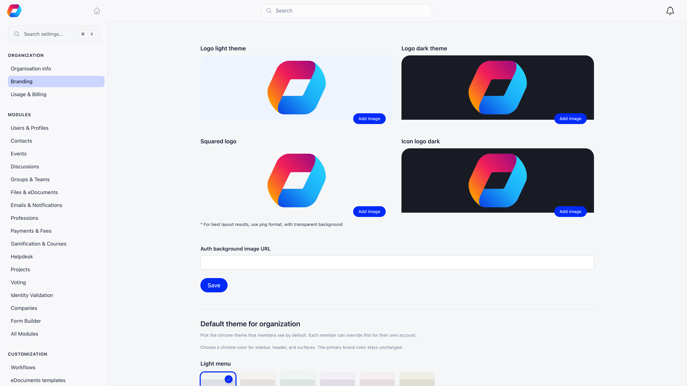
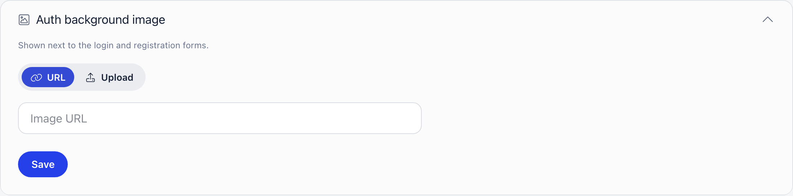
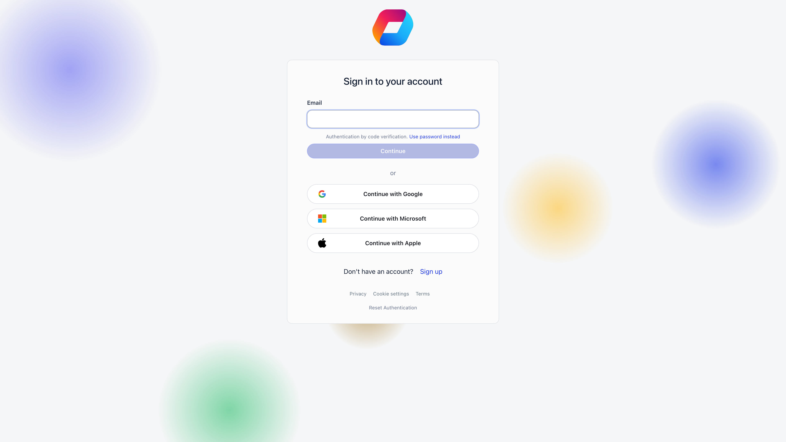
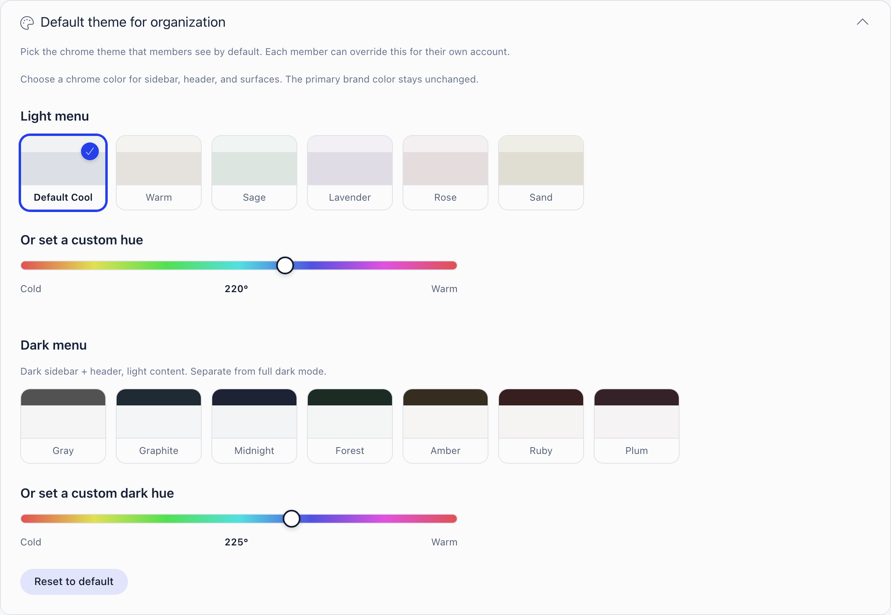

Branding controls how the platform looks to your members: the four logo variants Orgo swaps between depending on where and on what background a logo is shown, the image beside your sign-in and registration screens, the default interface theme, your own brand colours, and the colour of the checkout buttons.

**Built for** organizations whose members should recognise the platform as theirs, including federations, professional associations, and youth organizations that put their mark on every member touchpoint.

**Replaces** the assumption that a members' area has to look like the vendor's product.

**Settings → Organization → Branding**

<Note>
  Requires the **Orgo administrator** flag on your account. The page is unreachable and its contents are hidden for everyone else.
</Note>

The page is five collapsible sections: **Logos**, **Auth background image**, **Default theme for organization**, **Custom theme** and **Checkout color**. It reopens on the section you looked at last (in your browser), and on **Logos** the first time.

---

## Logos

Uploads accept **PNG and JPEG** and are saved the moment you upload them: there is no Save button. The section's own hint is: for best layout results, use PNG with a transparent background. The two wide logos sit in one column and the two square icons in the other.

| Slot | Where it appears |
|---|---|
| **Logo light theme** | App header and sidebar, the sign-in screen, registration screens, invoice emails, and the invoice PDF |
| **Logo dark theme** | Substituted for the light logo whenever the surface behind it is dark |
| **Icon logo** | Browser favicon, the favicon on public share pages, your organization's avatar in lists, the OAuth consent screen, and the centre of an event app QR ticket |
| **Icon logo dark** | The favicon when the member is in dark mode, whether from their own theme choice or their operating system |

Two behaviours are worth knowing:

**The dark logo is not only for dark mode.** In the app header it is used whenever the chrome is dark, which includes a dark menu theme on an otherwise light interface. If you skip this slot, a dark-on-dark logo becomes invisible for those members.

**The first upload fills the empty slots.** Upload the light logo while the other three are still empty and the same image is copied into all four. That is a starting point, not a finished setup: replace the dark and icon variants so contrast and cropping are right.

If a slot is empty and nothing was copied into it, that slot alone falls back to Orgo's own mark; the other three keep their own image. **Logo dark theme** falls back to the light logo first, both in its box here and in the app, so an empty dark slot shows your light logo rather than Orgo's.

<Tip>
  Give **Icon logo** and **Icon logo dark** a genuinely square image. They are used as a favicon and as an avatar, so a wide logo ends up either letterboxed or cropped.
</Tip>

---

## Auth background image

The image shown next to the sign-in and registration forms. Choose how to supply it:

- **URL** takes a publicly reachable address that starts with `https://` or `/`. Anything else is refused with "Enter a link starting with https:// or /". Click **Save** to apply it.
- **Upload** takes a file from your computer. The drop area is cropped to 4:3, the shape the sign-in screen uses, so what you frame there is what members see. Like the logos it saves on upload, and **Remove image** clears it.

Where it appears depends on the screen. On desktop it fills the background of the sign-in screen and sits beside the registration forms, including the per-user-type and child registration forms. On a phone the registration screens show it as a banner above the form, and the sign-in screen shows no image. Embedded registration forms (in an iframe) never show it, and neither do the password reset or password setup screens. Leave it empty and members see Orgo's default animated background instead.

---

## Default theme for organization

**Default theme for organization** sets the chrome: the sidebar, header, and surface colours. The primary brand colour is not part of it; that is set under **Custom theme** below.

| Group | Presets |
|---|---|
| **Light menu** | Default Cool, Warm, Sage, Lavender, Rose, Sand |
| **Dark menu** | Gray, Graphite, Midnight, Forest, Amber, Ruby, Plum |

A dark menu preset gives you a dark sidebar and header with light content. That is not the same as full dark mode, which inverts the whole interface.

Clicking a swatch saves immediately: there is no separate Save button for the theme. **Reset to default** puts the organization back on Default Cool. Once you have saved a custom theme, a swatch carrying its name appears first in both rows, so you can switch between your own colours and Orgo's presets.

<Warning>
  The **Or set a custom hue** sliders are a live preview on your own device only. A custom hue is never stored as the organization default. Only the named presets (and your own saved custom theme) become what other members see.
</Warning>

The theme a member actually sees is resolved in this order: the member's own choice, then your organization default, then Orgo's built-in default. Members pick their own from the theme sidebar, and their choice is stored separately for desktop and mobile. Setting an organization default therefore changes what new members and members who never chose will see, not what everyone sees.

If you are currently viewing Orgo in dark mode, the Light menu block is hidden and only the dark presets are offered.

---

## Custom theme

**Custom theme** is where you set your own colours instead of choosing a preset. Four colours, each with a hex field and a lightness ruler:

| Colour | What it paints |
|---|---|
| **Brand primary** | Buttons, links, active states and focus rings, and the buttons in Orgo's emails to your members |
| **Light menu** | The sidebar and header on the light tone |
| **Dark menu** | The sidebar and header on the dark tone |
| **Event cover block** | The panel beside an event photo, in light mode only. It follows the dark menu colour until you set it separately |

Give the preset a **Preset name**: it is what members see on the swatch in their theme picker. Choose the **Default menu for members** (light or dark); members can still switch to any Orgo theme for their own account.

Every colour is checked as you type, with a verdict of **Accepted** or **Out of band**. The menu colours have an allowed lightness range so text stays readable on them, and the brand primary must carry a white button label at the accessibility contrast ratio. An out-of-range colour offers a nearby value you can accept with **Use**, and the preset cannot be saved until all four pass. A live preview shows a mock sidebar, an event and a form in the colours you picked, on either menu tone.

**Save brand colours** applies the preset and makes it the organization default. **Remove brand colours** takes it away: members go back to the Orgo themes, and anyone who had chosen your preset moves to the Orgo default.

---

## Checkout color

**Checkout color** on the Branding page sets the color of the ticket picker's **Continue** button, of the **Pay** and **Done** buttons at checkout, and of the highlight on the ticket a person has picked. Choose a swatch or enter your own; **Use the Orgo green** goes back to the default. A color set on an individual event wins over this one, and an event with none uses this. The editor warns when the text on the button would be hard to read, so try a darker or lighter color.

---

## What is not customisable

- **Fonts and layout** of the members' area.
- **The mobile app icon.** The shared Orgo app ships Orgo's own icons; the Icon logo slot does not change them. Branded per-tenant apps are a separate arrangement, covered in [Mobile Apps](/platform/mobile-apps).
- **Most email headers.** The light logo is used on invoice emails and the invoice PDF. Other system emails use a shared layout with no logo, though their buttons take your brand primary colour.

The look of your public website (colours, fonts, header and footer) is set in the website builder, not here. See [Website Builder](/platform/organisation/website-builder).

---

## Troubleshooting

<AccordionGroup>
  <Accordion title="The logo is cropped or stretched">
    Check which slot the file is in. The two **Logo** slots expect a wide image; **Icon logo** and **Icon logo dark** expect a square one. A wide file in a square slot is what produces cropping in the favicon and avatar.
  </Accordion>
  <Accordion title="The background image is not showing on the sign-in screen">
    Open the URL in a private window with no session. If it does not load there, the host requires authentication or is not public. If it does load, check you are not on a phone (the sign-in screen shows no image there) and not in an embedded form.
  </Accordion>
  <Accordion title="Save says to enter a link starting with https://">
    The URL field only accepts an address beginning with `https://` or `/`. Paste the full address of the image, or switch to **Upload**.
  </Accordion>
  <Accordion title="The logo disappears when members switch theme">
    The dark variant is missing or is the same file as the light one. Upload a light-coloured version to **Logo dark theme** and **Icon logo dark**. This also applies to a dark menu theme in an otherwise light interface.
  </Accordion>
  <Accordion title="The logo has a white box around it">
    The file is a JPEG, which has no transparency, or a PNG exported on a white background. Re-export as PNG with transparency.
  </Accordion>
  <Accordion title="I picked a hue I liked and it vanished for everyone else">
    Custom hues from the sliders are not saved to the organization. Either pick the closest named preset, or set the exact colours under **Custom theme** and save them.
  </Accordion>
  <Accordion title="Save brand colours is greyed out">
    At least one of the four colours is out of its allowed range or is not a valid colour. The verdict beside each colour says which, and offers a value you can accept.
  </Accordion>
</AccordionGroup>

<Note>
  The admin **Getting Started** checklist has a **Customization & Branding** step whose first task, **Add organisation's logo**, links straight to this page.
</Note>

---

## Related

- [Organization Info](/platform/organisation/organisation-info) - Name, contact email, and financial details
- [Custom Domain](/platform/custom-domain) - Serve the community from your own address
- [Website Builder](/platform/organisation/website-builder) - The look of your public website
- [Modules](/platform/organisation/modules) - Turn platform features on and off
- [Labels and Terminology](/platform/customization/labels) - Rename product vocabulary
- [Mobile Apps](/platform/mobile-apps) - Shared app and branded apps
