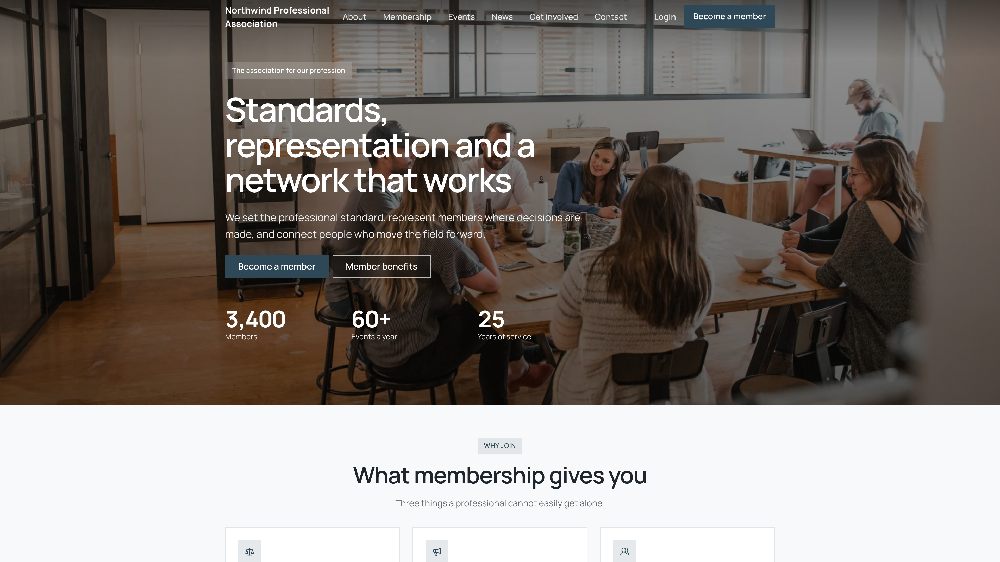

Some of your organization's pages are open to anyone, with no sign-in: the pages you write in the [website builder](/platform/organisation/website-builder), plus a few built-in pages that show live data, such as your chapter directory and your public events. One setting decides whether a first-time visitor who types your address lands on one of these pages or on the sign-in screen.

<Note>
  Orgo used to ship a small fixed public site (a `/homepage` page with a hero, a map and a donation block, written in Orgo's own words). It no longer exists. Your public front page is now an ordinary page you write in the website builder. If you pointed **Anonymous Homepage URL** at `/homepage`, change it to the address of your builder page (see below).
</Note>

**Built for** organizations whose address is handed out to people who are not members yet, including federations recruiting chapters, associations with an open events programme, and anyone whose "join us" link currently opens a login box.

**Replaces** a separate brochure site you would otherwise host and keep in sync.

**Settings → Modules → Users & Profiles → Configuration → Advanced Settings**

<Note>
  Requires the **Orgo administrator** flag on your account. The setting is saved on your organization record, and the server checks that you are an Orgo administrator of that same organization.
</Note>

---

## What visitors can open

These addresses work without a session, on your members' address (for example `yourorg.orgo.space`). They are drawn in the design of your website, with its header and footer.

| Address | What it shows |
|---|---|
| `/p/<page address>` | A page you wrote in the website builder. The address is the one in the **Address** column of the builder's Pages tab. |
| `/chapters` | Every active local center as a card with its town and a link through to its own page. A search box appears once you have more than 10 chapters. |
| `/chapter/<id>` | One local center: description, languages, active days, contact details and a link to join. |
| `/community-events` | Your public events, in **Upcoming** and **Past** tabs, as a card grid or an agenda. Choose which in the visual editor. Each event opens an editorial page, from which visitors go on to register. |
| `/news` and `/news/<article>` | Your news archive and one article. Available once you switch on **Enable articles** in the builder. |

The chapter and event pages show data from your Orgo records, not text you type. A chapter appears only when it is active. An event appears only when it is public (see [Sharing Events](/platform/events/sharing)). To change how these pages are introduced, link to them from a page or a menu in the builder.

Visitors only see any of this while your website is **live**: the **My website is live** switch under the builder's Settings → Domain. While it is off, visitors get "no website is published here". Organization admins with the builder switched on can still preview everything from the application address.

---

## Making your address open the website

<Steps>
  <Step title="Write and publish the page">
    In the website builder, create the page you want visitors to land on and publish it. A draft is not visible to visitors.
  </Step>
  <Step title="Make the website live">
    Turn on **My website is live** under the builder's Settings. Without it the page is not public.
  </Step>
  <Step title="Open the Users & Profiles module settings">
    **Settings → Modules → Users & Profiles**, stay on **Configuration**, and scroll to the **Advanced Settings** card.
  </Step>
  <Step title="Type the page's path into Anonymous Homepage URL">
    Enter `/p/` followed by your page's address, for example `/p/home`. It must begin with a forward slash. The field saves itself about a second after you stop typing, and a **Settings saved automatically** toast confirms it.
  </Step>
  <Step title="Check it in a private window">
    Open your community address in a private window or a browser you are not signed into. You should land on your page instead of the sign-in screen. Signing out and reloading is not the same test: what changes is where a visitor with no session is sent.
  </Step>
</Steps>

| Setting | What it does |
|---|---|
| **Anonymous Homepage URL** | Where a visitor with no session is sent when they open your bare address. Must be a **path**, starting with `/`. Empty by default, which sends them to the sign-in screen |
| **Custom Homepage Route** | Where a **signed-in member** lands instead of the dashboard. Accepts a path or a Vue route name such as `EventList`. It has no effect on visitors who are not signed in |

<Warning>
  The two homepage fields sit next to each other and do **not** accept the same thing. **Anonymous Homepage URL** takes a path only. **Custom Homepage Route** also takes a route name. Typing a value with no leading slash into Anonymous Homepage URL does nothing visible in the settings screen and quietly sends every anonymous visitor to the sign-in page, because the value is discarded and the sign-in screen is the fallback.
</Warning>

The redirect only fires on your bare address. A visitor who follows a deep link into the members' area, say to a member profile, still meets the sign-in screen, which is the point. If your website runs on its own domain (see [Custom Domain](/platform/custom-domain) and the builder's Domain settings), the bare address of that domain opens your website's homepage without this setting.

---

## Search engines and your address

While your community runs on an `orgo.space` address, every page is served with a `noindex, nofollow` instruction, so search engines are told to skip the pages above along with everything else. That is deliberate: it keeps members' area URLs out of search results.

The instruction is tied to the address, not to the pages. Your website has its own address, and can have a domain you own, set up in the builder. That, and not the members' address, is the one to promote. See [Website Builder](/platform/organisation/website-builder#your-address).

---

## Troubleshooting

<AccordionGroup>
  <Accordion title="I filled in the field and visitors still land on the sign-in screen">
    Almost always a missing leading slash. `/p/home` works, `p/home` does not, and neither reports an error. Check also that the website is live and that the page is published, and test the bare address in a private window: the redirect only applies to the bare address, and only to a visitor with no session.
  </Accordion>
  <Accordion title="Visitors get a Page not found screen">
    The path matches no published page. If it still reads `/homepage`, that fixed page no longer exists: point the setting at your builder page, for example `/p/home`. Otherwise check the spelling against the **Address** column in the builder's Pages tab, and that the page is published.
  </Accordion>
  <Accordion title="The chapter directory is empty, or a chapter is missing">
    Only active local centers are listed. A chapter that is inactive does not appear. Check its status under [Local Centers](/platform/groups/local-groups).
  </Accordion>
  <Accordion title="The events page is empty though we have events coming up">
    The listing only shows events that are public. An event that is not marked public is invisible here, even to members who are signed in elsewhere. See [Sharing Events](/platform/events/sharing). Past events are on the **Past** tab.
  </Accordion>
  <Accordion title="There is no news page">
    News is off until you switch on **Enable articles** on the builder's Pages tab. Turning it off again hides the section but deletes nothing.
  </Accordion>
  <Accordion title="Members say they get the public site instead of their dashboard">
    Signing in takes them to the dashboard as usual. What keeps bringing a member back to the public pages is a bookmark saved on one of them, since they stay open to everyone. Ask them to open the bare address rather than the bookmark. If signed-in members are landing somewhere other than the dashboard, that is **Custom Homepage Route**, in the same settings card, not this feature.
  </Accordion>
  <Accordion title="The public pages are not showing up in Google">
    Expected while you are on an `orgo.space` address: those pages are served with a `noindex` instruction. Promote your website's own address instead, and put it on a domain you own for the best result.
  </Accordion>
</AccordionGroup>

---

## Related

- [Website Builder](/platform/organisation/website-builder) - Write the pages visitors see, set the domain and publish
- [Custom Domain](/platform/custom-domain) - The address your members sign in at
- [Branding](/platform/organisation/branding) - The logos and colours of the members' area
- [Local Centers](/platform/groups/local-groups) - The chapters behind the directory
- [Sharing Events](/platform/events/sharing) - What makes an event public enough to appear here
- [Donation Pages & Widgets](/platform/fees/donation-pages) - The donation product the builder's donate section needs
- [Newsletter signup widgets](/platform/newsletter-widgets) - Where the newsletter form's subscribers land
- [Permissions](/platform/permissions) - What the Orgo administrator flag unlocks
