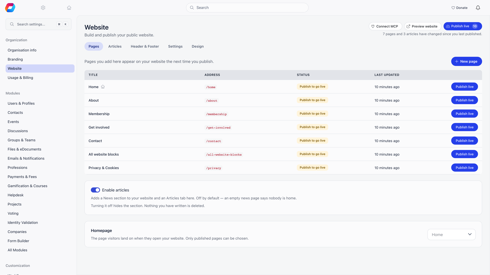
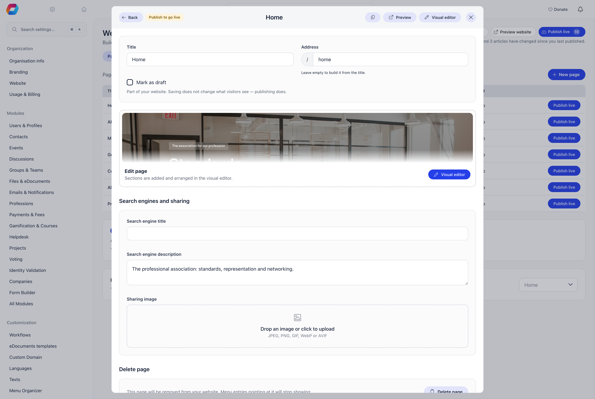
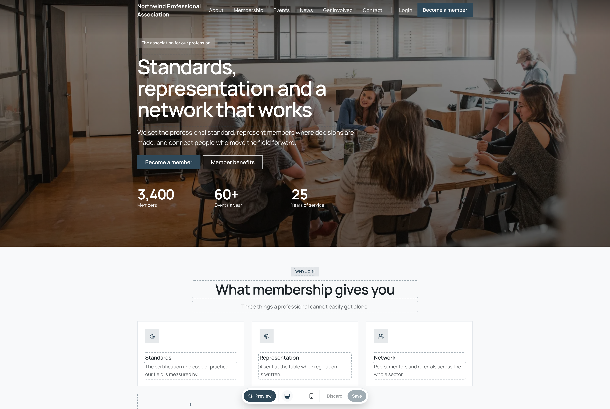
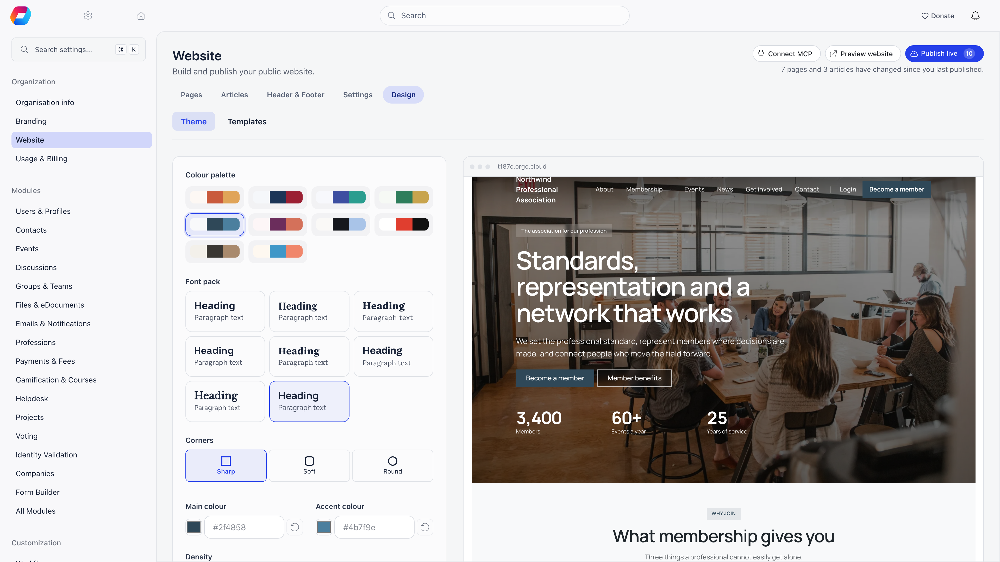
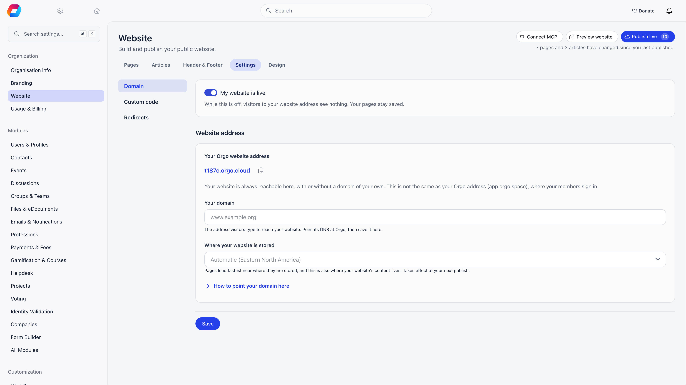
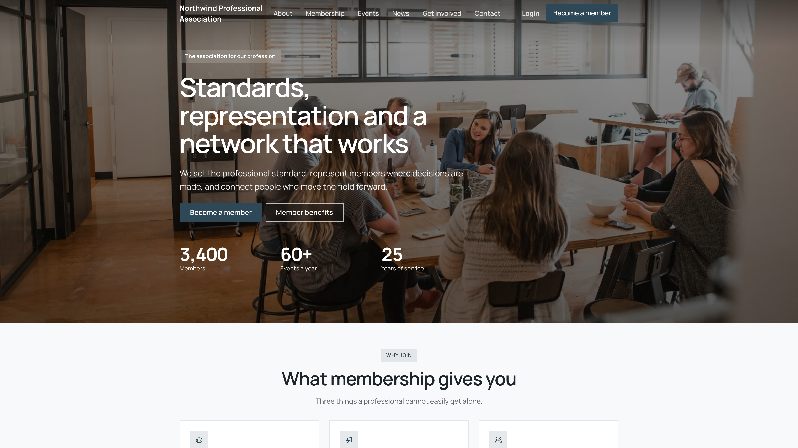

The website builder is where your organization's own website is written: pages and news articles made of ready-made sections, a header and footer menu, your colours, your domain. It is a site you author, with as many pages as you want to write.

What it replaces is a separate website you would otherwise host somewhere else, keep in sync by hand, and re-key every event, chapter and document into. Here the events section pulls your real events, the chapters section your real chapters, and the downloads section the files you have already shared from Drive.

**Settings → Organization → Website**

<Note>
  Requires the website module to be on. Without the module the menu entry is not there and every call behind it is refused, so an address typed by hand gets you nowhere either. Organization admins and organization-wide communication managers can use the builder, but the **Website** link in the Settings sidebar is shown to admins only, so a communication manager reaches it by address or from a link an admin gives them. Connecting an assistant and moving an existing site in need an admin.
</Note>

---

## The builder at a glance

Across the top of the builder, four buttons:

| Button | What it does |
|---|---|
| **Connect MCP** | Gives you the address and the steps for connecting an AI assistant. See [Building your website by asking](#building-your-website-by-asking). |
| **Preview website** | Opens the site as the application serves it right now: drafts included, and whatever you saved a second ago. |
| **Live website** | Opens the site the internet has. It appears only once something has been published. |
| **Publish live** | Publishes everything that has changed. A number on the button counts the changes waiting. |

Below them are five areas:

| Area | What you do there |
|---|---|
| **Pages** | Write and order the pages of the site, choose the homepage, duplicate a page, and switch news on with **Enable articles**. |
| **Articles** | Write news articles. The tab appears once news is on. |
| **Header & Footer** | The two menus, plus the footer's tagline and social links. |
| **Settings** | Whether the site is live, your domain, custom code and redirects. |
| **Design** | Colours, fonts and the starter templates. |

Opening a page gives you that page's own settings: its **Title**, the **Address** visitors type, a **Mark as draft** box, the **Search engine title**, **Search engine description** and **Sharing image**, and **Delete page**. Sections are not written here. The card in the middle shows what the page currently opens with, and the way in: **Visual editor**, beside **Preview** and **Duplicate** in the header.

---

## Pages are made of sections

A page is an ordered list of sections, each one a shape that already knows how to behave on a phone. You choose the shape and fill it in; you do not lay anything out.

Sections are added, arranged and written in the visual editor, which opens the page itself in a new tab with its blocks live on it, so nothing typed in the settings form is lost. A bar floats below the page: it switches between **Edit page** and **Preview**, offers a desktop, a tablet and a mobile size, and carries **Discard** and **Save**. **Publish** joins them once the page has been saved, and publishes that one page: everything else on your website stays as it is. The header and footer layout, the logo size and the menu hover style are set here too, no longer in Design.

| Section | For |
|---|---|
| `hero` | The opening statement: a headline, a line under it, up to three buttons, optionally a background image or a short silent video |
| `text` | A run of prose, such as an about page, a policy or a long explanation |
| `imageText` | One image beside one block of text; repeat with alternating sides for a sequence |
| `image` | A picture that *is* the content, not an illustration of nearby text |
| `cards` | A row of linked cards with pictures: programmes, news teasers, "explore these" |
| `features` | Icon cards: a glyph, a short title, two lines. For "what we do" where there are no photographs |
| `stats` | A band of numbers with labels, for when the figures are the argument |
| `cta` | One loud panel asking for a single action. Once per page: a page that asks three times asks for nothing |
| `banner` | A full-bleed photograph with a heading and a button, mid-page |
| `gallery` | A grid of photographs, optionally opening into a lightbox |
| `video` | One embedded video or podcast episode |
| `quote` / `testimonials` | One pulled quote, or several short endorsements with faces |
| `people` | A roster: photograph, name, role, a line of biography |
| `logos` | A wall of partner, funder or member logos |
| `faq` | Questions with expandable answers |
| `columns` | Two or three columns of parallel text |
| `divider` | A rule or a gap between two sections |
| `contactForm` | Your contact form (name, email, message), filled in and sent without leaving the page |
| `form` | One of your own forms, filled in and sent without leaving the page |
| `contactForm` | Your contact form (name, email, message). Messages land in the Messages inbox and the sender is filed in Contacts |
| `files` | Documents to download, taken from Drive or uploaded to the website |
| `events` | Your upcoming public events, pulled live |
| `articles` | Your published news, newest first, optionally one category |
| `chapters` | The map and list of your local chapters |
| `companyList` | Your member organisations as a searchable directory |
| `donate` | The donation panel, wired to your payment setup |
| `newsletter` | The sign-up form for your own newsletter list |

The last seven are live: you write the heading, the platform supplies the content, and it stays correct without anyone revisiting the page.

Two older sections, a contact block and a company map, are retired. They still draw and can still be edited on pages that already carry them, but you cannot add them to a new page. Use the footer or a `contactForm` for contact details, and `companyList` for member organisations.

### Sections that need something to exist first

<AccordionGroup>
  <Accordion title="contactForm: pick a contact form, or create one on the spot">
    This is the section for "get in touch". It asks for a name, an email address and a message, optionally a phone number and a subject, and sends without the visitor leaving the page. The message arrives in **Contact messages**, the sender is saved in [Contacts](/platform/contacts/sources), and whoever the form notifies is emailed.

    Its settings offer the contact forms you already have, and a **Create a contact form** button for when you have none, which is the usual case the first time you add this section. If your organisation has never switched the contact form module on, creating one switches it on too, and **Contact messages** appears in your menu.

    The fields, the consent wording and the notification address belong to the form, not to the page: they are edited under **Settings → Modules → Communication → Contact forms**, and a change there corrects every page carrying that form without republishing any of them.

    Use `form` instead when the form asks anything beyond those fields: a membership application, a survey, a volunteer sign-up with its own questions. A contact form switched off, or the module switched off, hides the section from visitors rather than showing a panel nobody can send.
  </Accordion>

  <Accordion title="form: the form has to be published and open to non-members">
    The section stores the form's identifier and fetches its questions when the page renders, so adding a question updates every page carrying it and closing the form closes it everywhere at once. Never re-type a form's questions into another section.

    Two conditions, both refused on save with a message naming the block: the form must be **published or closed** (a draft is not embeddable), and it must be answerable by somebody with no Orgo account. A members-only form on a public page would render questions a visitor can fill in and cannot send, so it is refused rather than embedded.
  </Accordion>

  <Accordion title="contactForm: the contact form has to be on">
    The section hides itself from visitors while the contact form module or that particular form is switched off, rather than showing a panel that cannot send. If you have no contact form yet, the builder can create one for you and switch the module on.
  </Accordion>

  <Accordion title="files: upload the document, or share it from Drive">
    Each row of the section is one document, from one of two places:

    - **Uploaded to the website.** Press **Upload** next to the file search and choose a PDF, Word, Excel, PowerPoint, OpenDocument, RTF, EPUB, text or CSV file, up to 25 MB. It is checked, stored on the website and listed in the search from then on. It stays public until it is deleted: there is no share to revoke. A document still listed on a page cannot be deleted until it is taken off that page.
    - **Shared from [Drive](/platform/files).** Search for a file you have already shared publicly. The permissions and the revocation stay in Drive: revoking the share later takes the download off the site. Prefer this for documents the organisation keeps and updates in Drive.

    Archives, web pages, images and programs are refused on upload.

    Every entry is listed as a file, never as a picture: a photograph a visitor is meant to *look* at belongs in `gallery` or `image`.
  </Accordion>

  <Accordion title="donate: online payments have to be configured">
    Without a donation product the section hides itself from visitors rather than showing an empty panel. See [Donation Pages & Widgets](/platform/fees/donation-pages).
  </Accordion>

  <Accordion title="events and chapters: the modules have to be on">
    Both pull from the platform. The events section needs the events module; the chapters section shows your active local centers, so it is empty until you have some.
  </Accordion>

  <Accordion title="companyList: the company directory has to be public">
    The section needs the companies module and its **Public company directory** switch (Settings → Modules → Companies). Without both it hides itself. It shows each company's name, place and public profile fields, never its members or contact details.
  </Accordion>
</AccordionGroup>

---

## Starting from a template

Six starter templates under **Design → Templates**, each a complete small site (pages, sections, menus and a matching palette) that you then edit. **View demo website** shows a template as a browsable site before you apply it, and **Make it yours** lets you choose its palette, font pairing and corners first.

| Template | For |
|---|---|
| Civic | Parties, movements and campaign groups |
| Cultural | A theatre, festival, choir or heritage organisation |
| Educational | Youth programmes, training and scouting |
| Environmental | Conservation, climate and local green action |
| Professional | Professional bodies and chambers |
| Social | Community support and direct services |

A template is a starting point, not an import. If your website is not empty, applying a template warns you before it replaces what is there. If you already have a website somewhere else, do not rebuild it by hand from a template: [move it across](#moving-an-existing-website-in) instead.

---

## Design

**Design → Theme** sets how the whole site looks, so it stays coherent without anyone picking a colour per page:

- **Style**: a palette, a font pairing and the corner style, the same three choices the template picker offers.
- **Main colour** and **Accent colour**, each with **Use theme colour** to go back to the palette's own.
- **Density**: how tightly the text and spacing are set.
- **Advanced: individual fonts and colours**: the headings and body fonts, and the colours for the accent, page background, alternate surface, body text, header background and footer background. If news is on, also the **Article header** layout.

The design panel warns you when a colour choice will be hard to read, but never blocks it. The header and footer layout, the logo size and the menu hover are edited on the site itself in the visual editor.

---

## Your address

Every organization's site starts on an Orgo address of the form `your-org.orgo.cloud`, shown under **Settings → Domain** as **Your Orgo website address**. It answers once the site is published and live, with or without a domain of your own. It is not the address your members sign in at.

Two switches, both needed. Publishing sends the pages out. **My website is live** (Settings → Domain) decides whether the address answers at all: while it is off, visitors see nothing, though your pages stay saved.

To use a domain you own, enter it under **Settings → Domain → Your domain**, for example `www.example.org`. Orgo shows you the DNS record to add under **How to point your domain here** (for a bare domain such as `example.org`, use an ALIAS or ANAME record, or point the bare domain at `www`) and then reports what it sees:

| Status | What it means |
|---|---|
| Live | Visitors reach the site here over a secure connection |
| Setting up the certificate | The DNS record is in place; this usually takes a few minutes |
| Not reaching Orgo yet | Check the record with whoever manages the domain name |
| Could not be set up | Orgo retries on its own; contact support if it stays this way |

DNS changes can take a few hours to travel, and your site answers on the new address from your next publish onwards. **Where your website is stored** chooses the region the site's files live in; it defaults to automatic and takes effect at your next publish.

<Note>
  The domain your website uses is separate from the address your members sign in at. See [Custom Domain](/platform/custom-domain).
</Note>

### Custom code

**Settings → Custom code** adds markup inside `<head>` and before `</body>`: an analytics tag, a verification meta tag, a chat widget. Up to 8,000 characters each.

<Warning>
  Custom code runs on the **published site only**, never in the builder and never in the preview. That is a safety boundary, not an omission: code you paste cannot reach the screen where you are signed in as an administrator.
</Warning>

### Cookie consent

Analytics and marketing tags you set up under the organization's integrations (Google Analytics, Google Tag Manager, Meta pixel) follow a region-aware rule on the pages the application draws. Where the law requires consent, judged from the visitor's device time zone (Europe, the wider EU and EEA territories, and Quebec), a cookie banner appears and the tags load only after the visitor accepts. Elsewhere the tags load without a banner, unless the visitor declined earlier or their browser sends a Global Privacy Control signal. A **Cookie settings** link in the footer lets a visitor change or withdraw consent, and appears only when such tags are running. The default privacy notice Orgo drafts for your website says the same.

Markup you paste into **Custom code** is added exactly as you write it. Orgo does not hold it behind that banner, and the published, static pages of the site load no optional script of their own, so if a tag you paste sets cookies, check the consent rules that apply to your visitors yourself.

### Redirects

**Settings → Redirects** maps an old address to a new one. They matter most when you move a site in: without them, every link anyone ever shared to the old site, and every search ranking those addresses earned, stops working on the day you go live. Redirects save themselves rule by rule.

---

## Publishing

Nothing you write is visible to anybody until you publish. Two separate things have to be true:

<Steps>
  <Step title="The page is published">
    Pages are drafts until you say otherwise. Press **Publish live** on a page row to publish that page alone (the button reads **Take offline** for a page that is live), or **Publish live** at the top of the builder to publish everything that has changed.
  </Step>
  <Step title="The site is live">
    **My website is live** under Settings → Domain decides whether visitors reach the site at all. Until it is on, a published page is still only visible to you.
  </Step>
</Steps>

Publishing queues a build: the site is rendered to static files and served from a CDN, which is why a published page loads faster than the builder that made it. Changes you save afterwards do not reach visitors until you publish again: the builder tells you which areas have unpublished changes.

Orgo keeps a snapshot of the whole site at every publish, and before every whole-site import by an assistant, so a change you regret can be put back by asking the assistant to restore it.

---

## Building your website by asking

You can connect an AI assistant to your organization and describe what you want instead of clicking it together:

> *"Add a Volunteering page with a hero, three ways to help and a contact form, and put it in the header menu."*

The **Connect MCP** button at the top of the builder gives you the address and the steps for Claude, Claude Code, ChatGPT and other assistants. The assistant works with your permissions and never publishes anything by itself. See [Orgo MCP](/platform/mcp).

### Moving an existing website in

Ask the assistant to move your current site across: WordPress, Squarespace, Wix, WildApricot, Hivebrite and NationBuilder are all covered. It reads the old site, decides what each part of it *is*, and expresses that in the sections above. It is a mapping rather than a copy: a clone would inherit the old site's layout accidents and its bad behaviour on phones, which is usually why you are moving in the first place.

It stops and asks you twice: once before anything is written, with a preview of what would land, and once before anything becomes public. Pictures and downloadable documents (statutes, reports, forms as PDF or Office files) come across with the pages, and a downloads page becomes a `files` section. Your old newsletter provider and any shop do not come across; the assistant tells you what it found rather than quietly flattening it.

---

## Troubleshooting

<AccordionGroup>
  <Accordion title="I published, but visitors still see nothing">
    Publishing a page and putting the site live are two separate steps. Check **My website is live** under Settings → Domain, then check that the page itself is published rather than a draft.
  </Accordion>

  <Accordion title="My changes are not on the live site">
    Saving is not publishing. The builder marks the areas holding unpublished changes; press **Publish live** to send them.
  </Accordion>

  <Accordion title="A document is missing from my downloads section">
    A Drive document can only be listed while it is publicly shared in Drive. Share it there, then add it here. If a download has stopped working, check whether the share was revoked. A document you uploaded to the website stays until you delete it.
  </Accordion>

  <Accordion title="My contact form section is empty for visitors">
    Either no contact form is chosen yet, or the one it names is switched off, or the contact form module is off for the whole organisation. The builder says which; visitors are shown nothing at all rather than a form they cannot send. Check **Settings → Modules → Communication → Contact forms**.
  </Accordion>

  <Accordion title="My contact form section is empty for visitors">
    Either no contact form is chosen yet, or the one it names is switched off, or the contact form module is off for the whole organisation. The builder tells you which; visitors are shown nothing at all rather than a form they cannot send. Check **Settings → Modules → Communication → Contact forms**.
  </Accordion>

  <Accordion title="My form will not save on a page">
    A draft form cannot be embedded, and neither can a members-only one: on a public page it would show questions a visitor can fill in and cannot send. Publish the form and set it to accept answers from people without an Orgo account.
  </Accordion>

  <Accordion title="The website menu is not in my settings">
    It needs the website module, and the sidebar link is shown to admins only. Both are checked on the server, so the missing menu entry is the symptom rather than the cause. A communication manager can still open the builder by its address.
  </Accordion>
</AccordionGroup>

---

## Related

- [Custom Domain](/platform/custom-domain) - the address your members sign in at
- [Branding](/platform/organisation/branding) - the logos and colours of the members' area
- [Orgo MCP](/platform/mcp) - connect an assistant and build the site by asking
- [Files](/platform/files) - Drive, and the shares the downloads section reads
- [Forms](/platform/forms) - the forms a page can embed
- [Where contacts come from](/platform/contacts/sources) - what the contact form section writes, and where it lands
- [Donation Pages & Widgets](/platform/fees/donation-pages) - what the donate section needs
- [Permissions](/platform/permissions) - what the Orgo administrator flag unlocks
