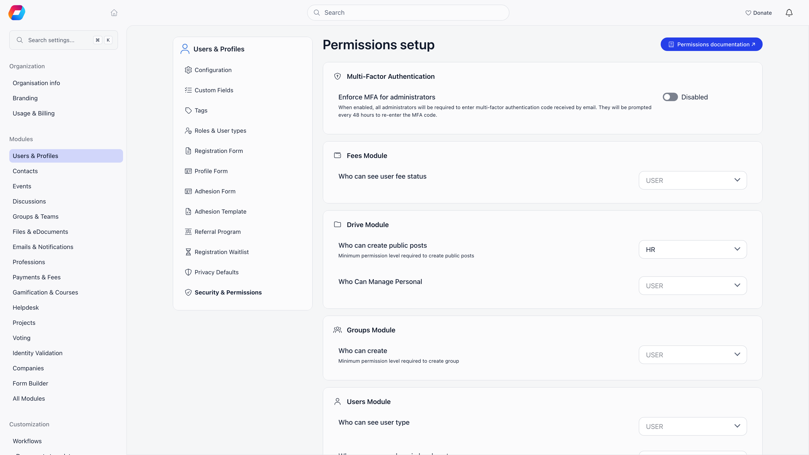

A permission grants access to a part of Orgo. Every permission is a pair: a **domain** (what area of the platform) and a **scope** (whose data). `HR_LOCAL` means member management, limited to one chapter. `FINANCIAL_TENANT` means money, across the whole organization.

**Built for** organizations that delegate admin work across chapters, regions, or committees: professional associations, alumni networks, trade unions, and faith communities where different people manage different areas at different levels.

**Replaces** shared admin logins and informal trust-based access.

Permissions are not the same as [roles and user types](/platform/users/user-types). A role like "President" is an organizational position; it grants access only if you attach permissions to it.

---

## Two separate things grant access

Orgo has one account-level flag and one permission set, and they are not interchangeable.

| | What it is | Where it is set |
|---|---|---|
| **Orgo administrator** | An account flag on a member. Every screen that configures the organization itself checks for this flag, not for a permission. The full list is [below](#what-the-orgo-administrator-flag-gates). | The **Orgo administrator** switch at the top of a member's **Permissions** tab, and the same switch on the form that creates a member. Only a member who already holds it can see the switch. |
| **Permissions** | The domain and scope grants described on this page. They govern everyday administrative work: members, fees, events, campaigns. | The permission checkboxes on the same tab, or attached to a role. |

<Warning>
Granting the `ADMIN_TENANT` permission is not the same as making someone an Orgo administrator. `ADMIN_TENANT` passes every permission check in the product, but the configuration screens still require the Orgo administrator flag. If an admin reports that Settings is missing, this is almost always why.
</Warning>

### What the Orgo administrator flag gates

Everything under **Settings**, including every module's configuration pages. Some of those are easy to miss, because they do not feel like settings:

- Organization info, branding, languages, custom domain, single sign-on
- Terminology and text replacements
- The registration, profile and adhesion form builders, and user type forms
- Custom fields
- Roles, tags, regions, unit types, contact statuses, professional industries, discussion categories and namespaces
- Event templates, eDocument templates
- Referral, waitlist, privacy defaults, Security & Permissions
- Online payment setup, product setup, membership fee setup, the invoice product
- Chapter and region configuration, help desk configuration, gamification settings, official gazette configuration
- Integrations, webhooks, workflows
- Import, demo import and provisioning
- The organization-wide change log

Two screens outside Settings need it as well: the **Menu Organizer** and the **dashboard builder** under Dashboard.

Four of these are easy to assume are only an Admin matter, because they are about developers and money rather than about members: **API Tokens**, **OAuth Apps**, **Usage & Billing**, and **invoice templates**. So are **event types and statuses**. An organization admin without the flag cannot open any of them.

Email campaign templates are **not** on this list. They need the Communication Manager permission at organization scope, or `ADMIN_TENANT`. Neither are reports, which need `ADMIN_TENANT`.

---

## The six domains

| Domain | UI label | What it unlocks |
|---|---|---|
| **ADMIN** | Admin | Everything in the other five domains at the same or lower scope. On top of that it unlocks chapter settings, waitlist management, badges and badge types, the roles list and invoices |
| **HR** | HR | Member profiles and their **Permissions** and **Roles** tabs, adhesions, resignation requests, chapter transfer requests, member exports and bulk actions, merging duplicates, e-documents, creating and editing gazette entries, the form builder |
| **HR_ASSISTANT** | HR Assistant | Awarding badges and recording progress on a badge's checklist, viewing admin-only custom fields, reviewing identity documents on a member profile, and (at organization scope) seeing members who hide themselves from the directory and map |
| **FINANCIAL** | Financial | Products and product payments, subscribers, membership fee records and fee statistics, chapter fee settings, chapter online payment settings, your organization's own Orgo billing page |
| **EVENT** | Event Manager | Creating events beyond the level set in **Settings → Events**, plus the organizer-only options on the event form: ticketing and payment fields, gamification tiers, restricting an event to one user type, and propagating an event to chapters |
| **COMMUNICATION** | Communication Manager | Email campaigns, campaign templates, lists and segments, newsletter signup widgets, the discussion moderation queue, and (at organization scope) the email log |

Sidebar menu entries are only entry points: individual actions inside a screen can require more, and a few require the Orgo administrator flag instead.

### Automatic inclusions

Holding one permission can imply another. This is the complete list; nothing else is implied.

| Holding this | Also grants |
|---|---|
| `ADMIN_TENANT` | Every permission check in the product |
| `HR_TENANT` | `HR_ASSISTANT_TENANT` |
| `FINANCIAL_TENANT` | `HR_ASSISTANT_TENANT` |
| `HR_PARENT_LOCAL` | `HR_LOCAL`, `HR_ASSISTANT_LOCAL` |
| `HR_LOCAL` | `HR_ASSISTANT_LOCAL` |
| `FINANCIAL_PARENT_LOCAL` | `FINANCIAL_LOCAL`, `HR_ASSISTANT_LOCAL`, `HR_ASSISTANT_PARENT_LOCAL` |
| `FINANCIAL_LOCAL` | `HR_ASSISTANT_LOCAL` |
| `EVENT_PARENT_LOCAL` | `EVENT_LOCAL` |
| `COMMUNICATION_PARENT_LOCAL` | `COMMUNICATION_LOCAL` |
| `ADMIN_PARENT_LOCAL` | Every local and regional permission within the same branch of the chapter tree |
| `ADMIN_LOCAL` | Every local permission within the same chapter, but nothing at regional scope |

<Note>
`HR_TENANT` does **not** imply `HR_LOCAL` as a separate grant. It does not need to: an organization-scope permission satisfies any check in the same domain at regional or local scope. Regional and local grants are the ones that need the chapter to match.
</Note>

<Note>
Admin is the only domain that carries the others. At chapter scope it satisfies any chapter-level check in that same chapter, so a chapter Admin can do HR, financial, event and campaign work there without those boxes ticked. What it does **not** reach is regional scope: a chapter Admin never satisfies a parent-chapter check, however the chapters nest.
</Note>

---

## The three scopes

| Scope | Suffix | Whose data |
|---|---|---|
| Organization | `_TENANT` | Everything in the organization |
| Regional | `_PARENT_LOCAL` | One anchor chapter and every chapter below it, at any depth |
| Local | `_LOCAL` | The member's own chapter, plus their anchor chapter (see below), plus any chapter granted separately through Multi local center access |

An organization-scope permission always satisfies a check for the same domain at regional or local scope. The reverse is never true.

Regional and local scopes exist only when the **Local Centers** module is on, and regional scope also needs **Enable Parent Centers**. Without them, the only checkboxes shown are the organization-scope ones.

### What "regional" means when chapters nest

Chapters chain to any depth, so regional scope is defined by an anchor chapter rather than by a fixed layer. The anchor comes from the holder's own primary chapter and cannot be pointed elsewhere:

| The holder's own chapter | The anchor |
|---|---|
| Flagged **It's a parent chapter** | That chapter itself |
| Has no parent at all | That chapter itself |
| An ordinary chapter with a parent | The chapter directly above it |

The grant then covers the anchor and every chapter beneath the anchor, however many layers down. It never reaches the chapter above the anchor and never crosses into another branch. A district officer whose district is flagged as a parent chapter therefore administers the district and its branches, and not the region above it.

The full worked example is on [Local Groups](/platform/groups/local-groups#what-a-parent-scope-permission-reaches).

<Note>
  Nesting widens administrative reach only. What an ordinary member without a regional permission can see did not change: their own chapter, the chapter directly above it, and the chapters sharing that same direct parent. It does not follow the chain further up. Reading another member's User and Admin custom field values still requires being in the same chapter exactly, with no walk up the tree.
</Note>

---

## Complete permission reference

Twenty permissions exist. The UI shows them as six labels repeated under three headings: **Organization: (your organization)**, **Chapter: (chapter name)** and **Parent chapter: (region name)**.

| Permission | Shown as | Shown when |
|---|---|---|
| `ADMIN_TENANT` | Admin (Organization) | Always |
| `HR_TENANT` | HR (Organization) | Always |
| `HR_ASSISTANT_TENANT` | HR Assistant (Organization) | Always |
| `COMMUNICATION_TENANT` | Communication Manager (Organization) | Always |
| `FINANCIAL_TENANT` | Financial (Organization) | Fees module on |
| `EVENT_TENANT` | Event Manager (Organization) | Events module on |
| `ADMIN_PARENT_LOCAL` | Admin (Parent chapter) | Parent centers on |
| `HR_PARENT_LOCAL` | HR (Parent chapter) | Parent centers on |
| `HR_ASSISTANT_PARENT_LOCAL` | HR Assistant (Parent chapter) | Parent centers on |
| `FINANCIAL_PARENT_LOCAL` | Financial (Parent chapter) | Parent centers on |
| `EVENT_PARENT_LOCAL` | Event Manager (Parent chapter) | Parent centers on |
| `COMMUNICATION_PARENT_LOCAL` | Communication Manager (Parent chapter) | Parent centers on |
| `ADMIN_LOCAL` | Admin (Chapter) | Local centers on |
| `HR_LOCAL` | HR (Chapter) | Local centers on |
| `HR_ASSISTANT_LOCAL` | HR Assistant (Chapter) | Local centers on |
| `FINANCIAL_LOCAL` | Financial (Chapter) | Local centers on |
| `EVENT_LOCAL` | Event Manager (Chapter) | Local centers on |
| `COMMUNICATION_LOCAL` | Communication Manager (Chapter) | Local centers on |
| `USER` | Regular user | Not assignable; used by minimum access level settings |
| `USER_LOCAL` | Regular user | Not assignable; used by minimum access level settings |

`USER` and `USER_LOCAL` mean "any signed-in member". They never appear as checkboxes on a profile, only as the lowest option in the minimum access level dropdowns below.

---

## How a check is decided

Orgo works through these steps in order.

<Steps>
  <Step title="Organization boundary">
    If the record belongs to a different organization than you, access is denied. No permission overrides this.
  </Step>
  <Step title="Configuration check">
    If the action is one of the configuration screens listed above, only the Orgo administrator flag answers it. The `ADMIN_TENANT` permission is deliberately not consulted here, which is why a permission-only admin is refused.
  </Step>
  <Step title="Organization administrator shortcut">
    For everything else, if you are an Orgo administrator or hold `ADMIN_TENANT`, access is granted. This shortcut is skipped for the restricted sessions listed further down.
  </Step>
  <Step title="Domain and scope match">
    Your permissions are expanded using the automatic inclusions above, then matched against what the action requires.
  </Step>
  <Step title="Chapter match, for regional and local permissions">
    For a local permission the record's chapter must be your own chapter, your anchor chapter, or a chapter you were separately granted through **Multi local center access**. For a regional permission it must sit inside your anchor's branch, at any depth.
  </Step>
  <Step title="Event user type restriction">
    If **Restrict events by user type** is on and the event names an allowed user type, a regional or local manager whose user type does not match is denied, even with the right permission.
  </Step>
</Steps>

Lists apply the same rules when they load, so a chapter HR manager opening the member directory sees their chapter's members, not an error.

---

## Minimum access levels

Some behaviour is not a permission you hold but a bar your organization sets, at **Settings → Users & Profiles → Security & Permissions**. The screen is headed **Permissions setup**, and it builds itself: one card per switched-on module, listing that module's own access settings. Switch a module off and its card disappears.

| Setting | Default | Controls |
|---|---|---|
| **Minimum access level** (Analytics) | User | Opening the analytics area at all |
| **Membership** (Analytics) | HR Tenant | The membership section of analytics |
| **Geography** (Analytics) | User | The geography section |
| **Leaderboards** (Analytics) | User | The leaderboards section |
| **Platform** (Analytics) | Admin Tenant | The platform usage section |
| **Finance** (Analytics) | Financial Tenant | The finance section |
| **Communication** (Analytics) | Admin Tenant | The communication section |
| **Who can create public posts** (Discussions) | User | Starting a discussion in the whole community rather than a group |
| **Who can create public posts** (Drive) | HR Tenant | Uploading to the community drive rather than a group's |
| **Who can manage personal** (Drive) | User | Keeping personal files in the drive |
| **Who can create public posts** (Events) | HR Tenant | Publishing an event to the whole community |
| **Who can see user fee status** (Fees) | User | Seeing whether another member's fee is paid |
| **Who can create** (Groups) | User | Creating a group |
| **Who can send user invitations** (Users) | User | Inviting someone to join |
| **Who can see members in general unit group** (Users) | User | Browsing the full member directory |
| **Who can see members in local center** (Users) | User | Browsing a chapter's members |
| **Who can see user type** (Users) | User | Seeing another member's user type |
| **Who can filter users by type** (Users) | User | Filtering the member directory by user type |

Each dropdown offers the six organization-scope levels plus **User**, which means any signed-in member. When the Local Centers module is on, the six chapter-scope levels are offered too. Changes save as you make them; there is no Save button.

The same screen carries **Enforce MFA for administrators**. With it on, administrators must enter a code sent by email and are asked again every 48 hours.

---

## Sessions that carry fewer permissions

Four situations narrow a session below what the member actually holds. In all four the organization administrator shortcut is switched off.

- **Permission impersonation.** An administrator previews the product as a lower permission set. See [Assigning Permissions](/platform/permissions-assigning).
- **Event app sign-in.** A ticket holder or host signing in with a one-time email code gets member-level access plus the Event Manager family only. Organization-wide administration is never reachable that way, even for an administrator.
- **Scoped API tokens.** A token is limited to the categories chosen when it was created, and cannot inherit the organization administrator shortcut. See [API](/platform/api).
- **Connected apps.** An app acting with its own credentials is capped at plain member access.

---

## Related

- [Assigning Permissions](/platform/permissions-assigning) - who may grant what, and how to test it
- [User Types & Roles](/platform/users/user-types) - positions you can attach permissions to
- [Role Groups](/platform/groups/role-groups) - groups that fill themselves from roles
- [Modules](/platform/organisation/modules) - the switches that make permissions visible
- [Local Groups](/platform/groups/local-groups) - chapters, parents, and what local scope means
