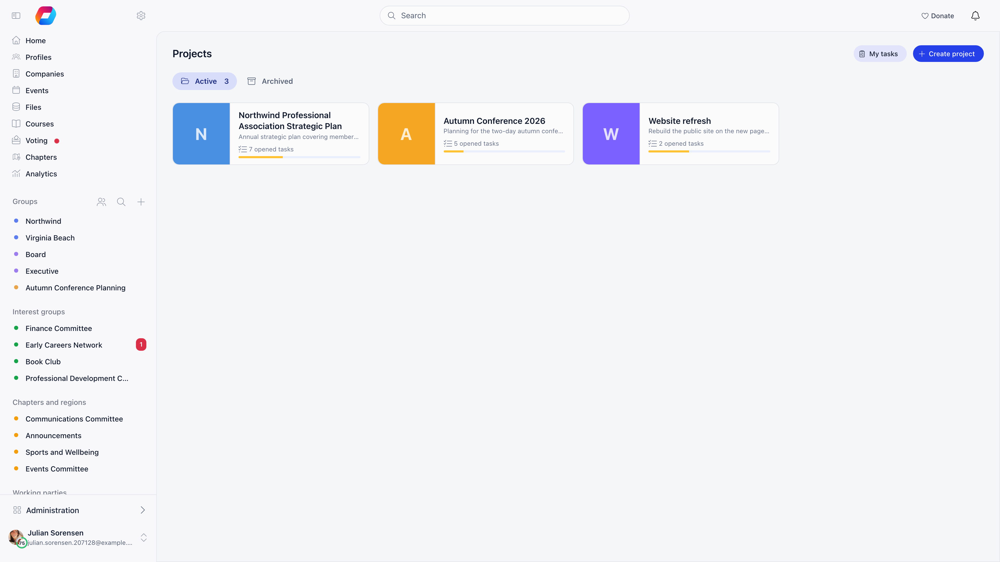
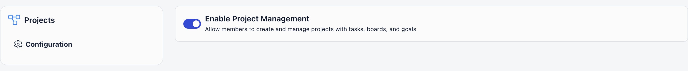
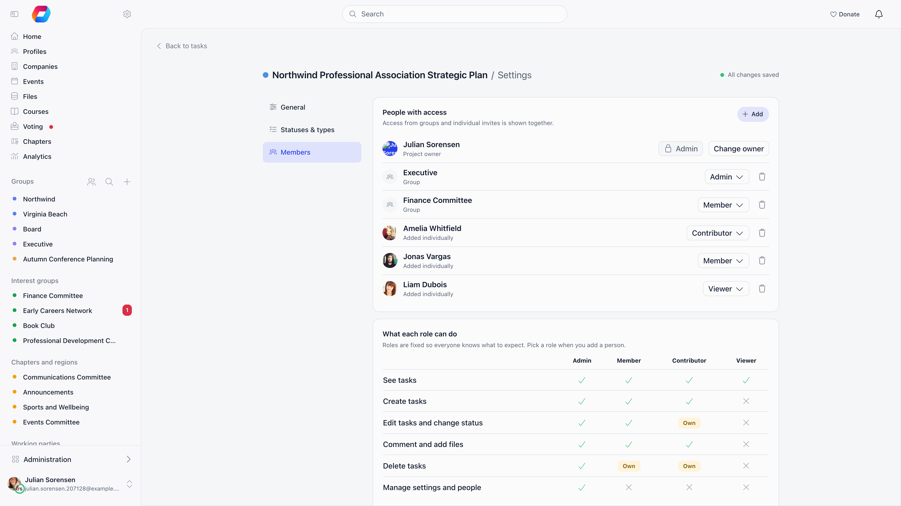
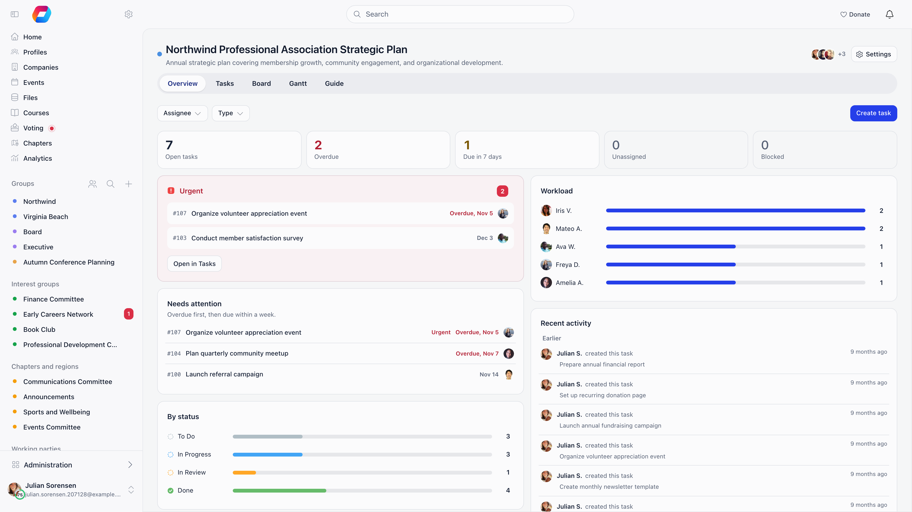
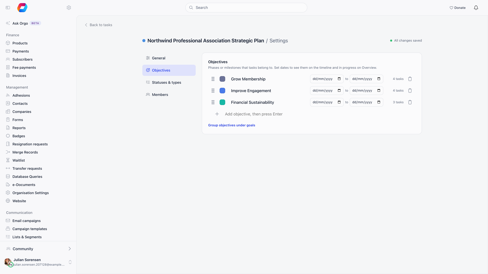

A project is a workspace for a piece of work your organisation is delivering. It holds tasks, its own set of task statuses and task types, optional objectives and goals, and its own people and roles. Every project has up to five views: Overview, Tasks, Board, Gantt (when the project uses due dates) and, once it has a description, About. Each person on a project holds one of four roles that decide what they can change.

**Built for** committees, working groups and staff teams that plan work in Orgo rather than in a separate tool, so the people, groups and permissions are already there.

**Replaces** a spreadsheet of action items or a standalone task tracker for internal work. It is not a client-facing or billable project tool: there is no time tracking, no budget and no external sharing.

---

## Turning it on

Projects is a module, **off** by default: **Settings** → **Modules** → **Projects** → **Enable Project Management** (`ADMIN_TENANT`). The same switch also enables project groups, described at the end of this page.

A **Projects** section then appears in the sidebar listing the projects you can open, with a search box past two. Its label can be renamed in the menu organiser.

---

## Who can do what

| Action | Who |
|--------|-----|
| Create a project | Any signed-in member, from the plus button on the sidebar **Projects** section. The Projects page **Create project** button shows only to `HR_TENANT` and above. Guests cannot create projects when a guest user type is configured. |
| Open a project | The owner, individual members, members of a group it grants access to, `ADMIN_TENANT` and `HR_TENANT`. Everyone else gets a not-found and never sees it in the sidebar. |
| Rename, restyle, archive, delete, manage people, statuses, types and objectives | The **Admin** role: the owner, `ADMIN_TENANT`, `HR_TENANT` and anyone given Admin on the project. |
| Work with tasks | Depends on the role, see [Roles](#roles). |

---

## Creating a project

**Projects** → **Create project**. Everything on the form can be changed later in project settings.

| Field | What it does |
|-------|-------------|
| **Project name** | Required. Shown in the sidebar, on the card and in the header. |
| **Emoji** / **Color** | Pick one or the other. It identifies the project everywhere it is listed. |
| **Description** | Free text. Filling it in adds the **About** tab. |
| **Project owner** | Defaults to you; search any member to hand it over. The owner always has full rights. |
| **Group access** | One or more groups whose members can all open the project. |
| **Task key** | Prefix of the task IDs, such as `ORG-145`. Filled in from the name; see [Project settings](#project-settings). |
| **Task options** | Which fields and filters appear on tasks here: **Priority**, **Due date**, **Task types** (on) and **Objectives** (off by default). |

Saving creates five task statuses: **Backlog**, **To do**, **In Progress**, **Review** and **Done**, with **Done** marked as closed.

### Giving people access

Owner, individual members and group access stack. Add people and groups under **Settings** → **Members**, using the search box: pick a person or a group, then a role. Only active accounts qualify, and nobody twice. Changing a role, or removing someone, takes effect straight away. `ADMIN_TENANT` and `HR_TENANT` see every project as Admin regardless.

The project header shows a stack of the people with access; click it for the full list, with each person's role and the groups. Members of a group are not listed one by one.

The owner is always an Admin and cannot be removed. To hand the project over, make the new person an Admin first, then use **Change owner**; the previous owner stays an Admin.

### Roles

Roles are fixed, so everyone knows what to expect. A person who reaches the project in several ways (owner, individually, through two groups) gets the highest role among them. A group with no role set is treated as Contributor, and so is anyone who was a project member before roles existed, so nobody lost or gained access when roles arrived.

| Capability | Admin | Member | Contributor | Viewer |
|------------|:-----:|:------:|:-----------:|:------:|
| See tasks | Yes | Yes | Yes | Yes |
| Create tasks | Yes | Yes | Yes | No |
| Edit tasks and change status | Yes | Yes | Own | No |
| Comment and add files | Yes | Yes | Yes | No |
| Delete tasks | Yes | Own | Own | No |
| Manage settings and people | Yes | No | No | No |

**Own** means tasks the person created or is assigned to, and files they uploaded. Deleting is the narrower case: only tasks the person created.

Two options sit under the table:

- **Contributors see** — **All tasks**, or **Only assigned** for volunteers or clients who should not see the whole backlog. With Only assigned, a Contributor sees just the tasks they created or are assigned to, in the lists, the board, the timeline and when opening a task by link.
- **Viewers can comment** — off by default. When on, a Viewer can reply on tasks but not change them.

The interface hides what a role cannot do (a Viewer sees no **Add task** button), and the server refuses it anyway.

---

## The project views

| Tab | What it shows |
|-----|--------------|
| **Overview** | Counters for open, overdue, due in 7 days, unassigned and blocked tasks; a **By status** breakdown; **Needs attention**; **Urgent and high priority**; **Workload** by assignee; and progress per objective. Clicking a counter or a slice opens the Tasks tab with that filter applied. |
| **Tasks** | The full task list with filters, grouping, ordering and keyboard shortcuts. See [Tasks](/platform/tasks). |
| **Board** | Kanban: one column per status, with optional **Swimlanes** by assignee, priority or type. Drag a card between columns to change its status, or within a column to reorder it. A closed column shows the last 7 days, with **Show all** for the rest. |
| **Gantt** | Tasks on a timeline with dependency arrows and **Go to today**. Drag a bar to move it, or its edges to change the dates. Tasks with no dates wait in **Without dates**: drag one onto the timeline to schedule it. **Done tasks** and **Dependencies** can be switched off. On a phone it becomes a plain agenda grouped Overdue, This week, Next week, Later and No date. Shown when the project uses due dates. |
| **About** | The project description, edited in place by anyone who can edit the project. Appears once a description exists. |

The **assignee**, **type** and **objective** filters are shared across Overview, Tasks, Board and Gantt, and live in the address bar (`?assignee=`, `?type=`, `?objective=`), so a filtered view can be linked. Each member lands on the tab they used last in a project; the first visit opens the Overview.

Dropping files anywhere on a project opens the new task form with those files attached.

---

## Objectives and goals

Switch on **Objectives** in the project's task options, then open **Settings** → **Objectives** (the old **Objectives & Goals** page now lives there, and its address redirects).

An **objective** is a phase or milestone that tasks belong to: a name, a colour and optional start and end dates. Tasks then carry an **Objective** field, the task list filters by it, Overview tracks progress against it and dated objectives get their own bars on the Gantt.

A **goal** sits a level above, for projects with several strands of work; turn on **Group objectives under goals** and drag objectives into them. With it off you get one flat list. Both reorder by dragging (or Alt with the arrow keys), and deleting a goal keeps its objectives.

<Note>
The interface and the API swap the two words. What this page calls an *objective* is the `Goal` resource in the [API](/api-reference/introduction), and a *goal* is the `Objective` resource.
</Note>

---

## Project settings

The **Settings** button in the project header opens four tabs, for Admins:

| Tab | What it holds |
|-----|---------------|
| **General** | Name, emoji or colour, description, **Task key**, the task options (**Priority**, **Due date**, **Task types**, **Objectives**; hidden fields keep their data), and the danger zone. |
| **Objectives** | Objectives and goals, described above. |
| **Workflow** | **Task statuses** and **Task types**: add, rename, recolour and drag into order. |
| **Members** | People, groups and roles, described above. |

Changes save as you make them, and the tab shows **All changes saved** when they have.

**Task key** is the prefix of every task ID in the project (`ORG-145`): 2 to 6 letters or digits, starting with a letter, unique across your organisation. New projects get one from their name. Changing it updates the ID shown on every task, and links that used the old key keep working.

Each **status** has a name, a colour, a **Closed** switch and a circle that shows progress (from empty to full, or dashed for none). Closed statuses are hidden from **Open tasks**, and a project must keep at least one open and one closed status. A new project starts with **Backlog**, **To do**, **In Progress**, **Review** and **Done**, with **Done** closed. A **type** is a name and a colour. Deleting a status or type that tasks still use asks where to move those tasks first.

**Archive project** moves it to the **Archived** tab, still readable and restorable from there. Its tasks stop sending assignment, status, comment and reminder emails and drop off the dashboard **My Tasks** card, but still appear in the daily task digest. **Delete project** is permanent, asks you to type the project name, and takes the tasks, objectives, goals, statuses and types with it.

---

## Projects and project groups

The same module switch also turns on an older feature that uses the word project. A **project group** is an ordinary group with issue tracking switched on, created from **Issues** → **New**: it gains an **Issues** tab with its own issue statuses and types, lives with the group rather than on the Projects page, and issue tracking can only be set at group creation. See [Issues](/platform/issues).

A project in the sense of this page is a separate record with its own members, tasks, board, Gantt and goals, listed under **Projects** in the sidebar. It can grant access to groups, but it is not one. Starting fresh, use Projects; project groups remain for organisations already tracking issues inside their groups.

---

## Related

- [Tasks](/platform/tasks) - everything a task holds and how the reminders work
- [Issues](/platform/issues) - the group issue tracker and project groups
- [Groups](/platform/groups) - the groups a project can grant access to
- [Permissions](/platform/permissions) - what `ADMIN_TENANT` and `HR_TENANT` unlock
- [Notifications](/platform/notifications) - the member-side notification switches
