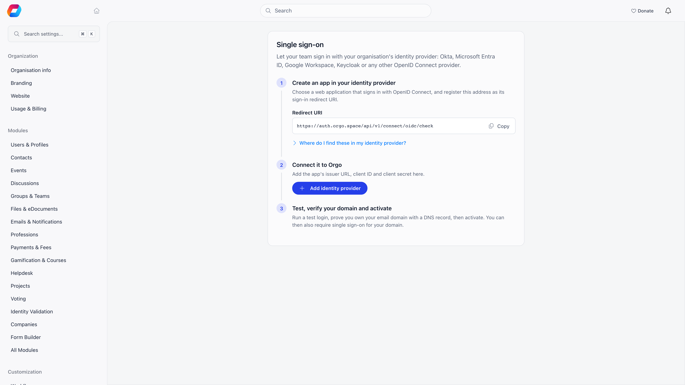
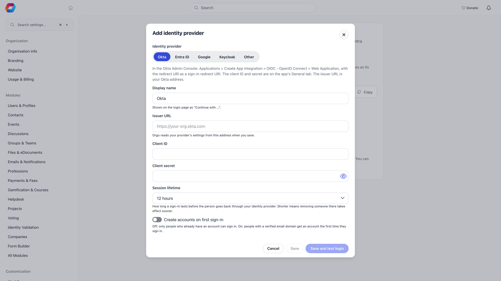

Connect your organization's identity provider and your team signs in to Orgo with their work account. Okta, Microsoft Entra ID, Google Workspace, Keycloak and any other OpenID Connect provider work.

**Built for** organizations whose staff already sign in to everything else through a company directory, and who need joining and leaving to be handled in one place.

**Replaces** separate Orgo passwords for staff, and the manual work of remembering to close an Orgo account when someone leaves.

<Note>
This is the opposite direction from [OAuth Server](/platform/oauth), which lets people sign in to **your** apps with their Orgo account. This page is about signing in to Orgo with an account from **your** provider.

It is also not the same as the Google, Microsoft and Apple buttons described under [Integrations](/platform/integrations#single-sign-on). Those are Orgo's own social sign-in, they need no setup, and they cannot be required.
</Note>

---

## Before you start

The feature is switched on per organization by Orgo. Until it is, the screen says "Sign-in with your own identity provider is not enabled for your organisation yet. Contact Orgo support to turn it on."

Once Orgo has enabled it, turn it on yourself at **Integrations → Single Sign-On**. Then the setup screen lives at **Settings → Single sign-on**. Both need the Orgo administrator flag, not just an admin permission: see [Permissions](/platform/permissions).

You will also need access to your identity provider's admin console, and the ability to publish a DNS record for your email domain.

---

## Setting it up

<Steps>
  <Step title="Create an app in your identity provider">
    Create a web application that signs in with OpenID Connect, using the authorization code flow, and register Orgo's **Redirect URI** as its sign-in redirect URI. The screen shows the exact address with a copy button.

    Pick your provider on the setup screen and it tells you where each value lives in that provider's console:

    | Provider | Where the app goes |
    |---|---|
    | **Okta** | Applications, Create App Integration, OIDC, Web Application. Client ID and secret are on the app's General tab. |
    | **Microsoft Entra ID** | App registrations, New registration, platform Web. The client ID is the Application (client) ID, and secrets live under Certificates & secrets. |
    | **Google Workspace** | Google Cloud console, APIs & Services, Credentials, OAuth client ID, type Web application. Only accounts on your verified Workspace domains are linked. |
    | **Keycloak** | Clients, Create client, with Client authentication and the Standard flow on. The secret is on the Credentials tab. |
    | **Other** | Any OpenID Connect provider. Create a confidential web client with the authorization code flow. |
  </Step>
  <Step title="Connect it to Orgo">
    Choose **Add identity provider** and fill in:

    | Field | What to enter |
    |---|---|
    | **Display name** | Shown on the login page as "Continue with ...". |
    | **Issuer URL** | The address in front of `/.well-known/openid-configuration`. Orgo reads your provider's settings from it when you save. For Google Workspace it is always `https://accounts.google.com`. |
    | **Client ID** | From the app you just created. |
    | **Client secret** | From the same app. When editing later, leave it empty to keep the current one. |
    | **Session lifetime** | How long a sign-in lasts before the person goes back through your provider: 1 hour, 4 hours, 12 hours (the default), 24 hours or 7 days. |
    | **Create accounts on first sign-in** | Off by default. Off, only people who already have an Orgo account can sign in. On, anyone with a verified email domain gets an account the first time they sign in. |
  </Step>

  <Step title="Run a test login">
    **Test login** is required before you can activate, and it tells you exactly what would happen:

    - **Signs in as (member)**, when your account is already linked.
    - **Will be linked to (member) on the first real sign-in**, when it matches an existing Orgo account by email.
    - **The connection works, but this account would not be signed in**, with the reason. Usually this means the account does not exist in Orgo and account creation is off.
  </Step>
  <Step title="Verify your email domain">
    Add each email domain this provider signs people in for, then prove you own it by publishing the TXT record Orgo shows at your DNS provider. Use **Check now** after publishing. DNS changes can take a few minutes, and the domain sits at **Pending** until the record is found, then moves to **Verified**.
  </Step>
  <Step title="Activate">
    **Activate** makes the "Continue with ..." button appear on your login page. Members can now choose it, while every existing way of signing in still works.
  </Step>
</Steps>

The screen tracks where you are and names the next step, so you can leave a half-finished connection and come back to it.

---

## Requiring single sign-on

Activating a connection only offers it. **Require single sign-on**, set per verified domain, makes it the only way in for everyone with an email address on that domain.

Before you can switch it on, you must have signed in to Orgo through that provider yourself at least once. That is deliberate: it proves the connection works for a real person before it becomes mandatory.

<Warning>
Requiring single sign-on is the one setting on this page you cannot undo yourself. Once it is on for a domain, password, email code and social sign-in all stop working for every address on that domain, and sessions open at that moment end. **If your identity provider later stops working, only Orgo support can lift it.**

Verify the connection with a real sign-in first, and keep at least one administrator whose email is on a domain you have not enforced.
</Warning>

A member who hits a sign-in path that is no longer allowed is refused with a message telling them to use single sign-on, rather than being told their password is wrong. This covers every route in: password, email code, multi-factor prompts, password reset, the Google, Microsoft and Apple buttons, the mobile apps, and the event app.

---

## Day to day

| Action | What happens |
|---|---|
| **Edit** | Change the display name, issuer, client ID, secret, session lifetime or account creation. Leaving the secret empty keeps the current one. |
| **Disable** | Nobody can sign in through the connection until it is activated again, and single sign-on stops being required for its domains. Linked accounts are kept. |
| **Delete** | Removes the connection, its domains and its linked accounts. Members have to use another way to sign in. |
| **Remove a domain** | People with that email domain can no longer be linked through the provider. |
| **Switch the feature off** | At **Integrations → Single Sign-On**. The login buttons disappear and nothing is required any more, so members on your domains go back to code, password and social sign-in. Your connections are kept. |

Each connection shows its **Linked members** count and when it was **Last tested**.

Shortening the session lifetime is the fastest way to make removing someone in your identity provider take effect in Orgo, since the next session renewal sends them back through the provider.

---

## Troubleshooting

<AccordionGroup>
  <Accordion title="The screen says the feature is not enabled for us">
    Orgo switches this on per organization. Contact support. Once they have, you still need to turn it on yourself at **Integrations → Single Sign-On**.
  </Accordion>
  <Accordion title="Activate is greyed out">
    Run **Test login** first. A connection cannot be activated until a test has passed, so that a broken issuer or secret is caught before anyone relies on it.
  </Accordion>
  <Accordion title="Require single sign-on is greyed out">
    You have to sign in to Orgo through the provider yourself before you can require it. Sign out, choose the "Continue with ..." button, sign back in, and the option becomes available.
  </Accordion>
  <Accordion title="The domain stays Pending">
    The TXT record has not been found yet. Check it is published on the exact domain shown, then use **Check now**. DNS changes can take a few minutes to propagate.
  </Accordion>
  <Accordion title="A test login says the account would not be signed in">
    The email from your provider does not match an Orgo account and **Create accounts on first sign-in** is off. Either add the person to Orgo first, or turn account creation on, which requires a verified email domain.
  </Accordion>
  <Accordion title="Our provider broke and nobody can sign in">
    If you only activated the connection, members can still use password, email code or social sign-in, so disable the connection and carry on.

    If you required single sign-on for the domain, those routes are closed and only Orgo support can lift the requirement. Contact support.
  </Accordion>
  <Accordion title="A member signs in but lands in the wrong account">
    Linking matches on email address, and only on an exact match. If someone has two Orgo accounts, or their provider email differs from the address on their Orgo profile, correct the profile email first. See [Merging Duplicates](/platform/users/merging-duplicates).
  </Accordion>
</AccordionGroup>

---

## Related

- [Integrations](/platform/integrations) - the switch that turns this on, and Orgo's own Google, Microsoft and Apple sign-in
- [OAuth Server](/platform/oauth) - the other direction, signing in to your apps with an Orgo account
- [Permissions](/platform/permissions) - why this screen needs the Orgo administrator flag
- [Troubleshooting Access](/platform/users/troubleshooting-access) - when a member cannot sign in at all
- [Custom Domain](/platform/custom-domain) - the address members sign in at
