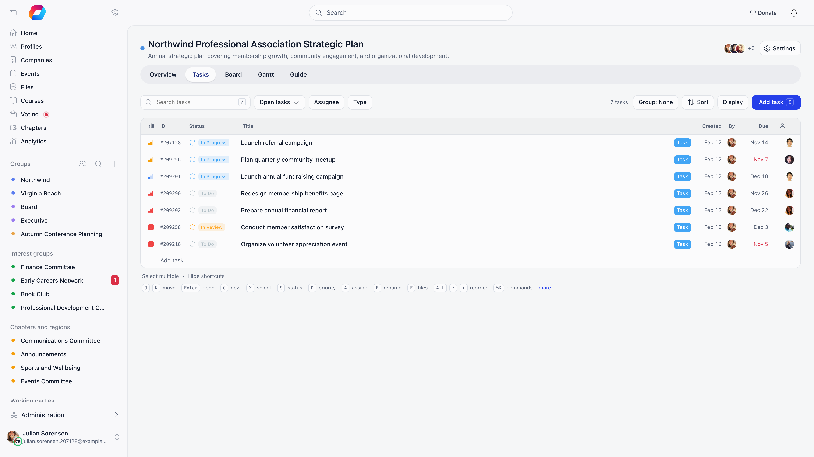
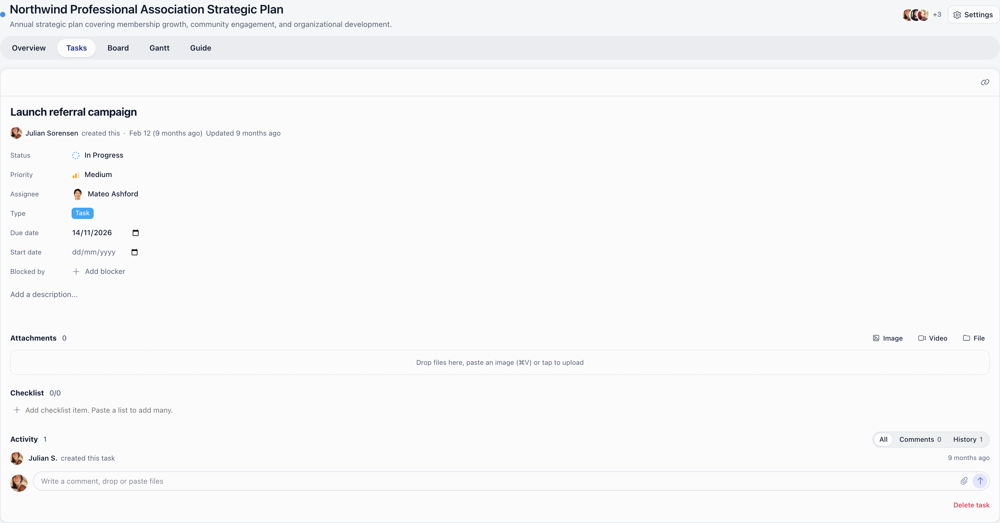
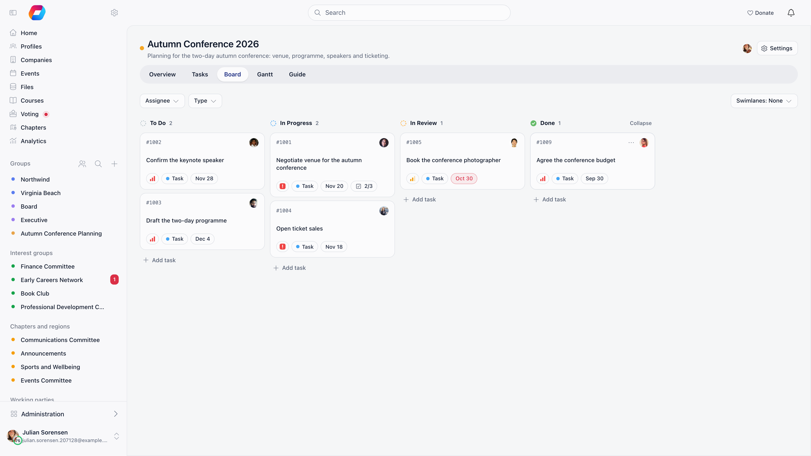

Tasks are the unit of work inside a project. A task carries a short ID such as `ORG-145`, a title, a rich description with attachments, a status, a type, a priority, one or more assignees, start and due dates, a checklist, dependencies on other tasks, comments and a change history.

**Built for** the day to day work of a committee or staff team: who is doing what, by when, and what is blocking it.

**Replaces** action-item spreadsheets and email chases. Tasks always belong to a project, so there is no standalone personal to-do list.

---

## Creating a task

Anyone with the **Admin**, **Member** or **Contributor** role on the project can create tasks; a Viewer cannot (see [Roles](/platform/projects#roles)). There are three ways in:

- **Quick add.** Press `C` on the Tasks tab, or use **Add task** at the head of a group, and type a title. The new task starts with the values of the group you added it in. Type `!high`, `@daniel`, `#bug` or `+review` anywhere in the title to set the priority (`!urgent`, `!high`, `!medium`, `!low`, `!none`, or `!1` to `!4`), the assignee, the type and the status; words that match nothing stay in the title. `Enter` adds the task, `⌘ Enter` adds it and opens it.
- **Add task** on the Board or Gantt tab, which adds a card in the column or opens the form.
- **Dropping files** onto a project opens the form with those files attached.

Every task gets its ID on creation, built from the project's task key and a number that counts up: `ORG-1`, `ORG-2`... Numbers are never reused, so a deleted task leaves a gap. The ID is searchable in the list.

| Field | What it does |
|-------|-------------|
| **Task title** | Required. |
| Description | Rich text with images, video and file attachments. Files can also be dropped or pasted (`⌘ V`) onto the task. |
| **Checklist** | A list of sub-items with tick boxes. Pasting a bulleted list creates several at once. Items are reordered by dragging. |
| **Objective** | Only when **Objectives** is on for the project. Puts the task under a phase or milestone. |
| **Type** | Only when the project has task types defined, for example Bug, Feature, Task. |
| **Assignees** | One or more members. Search is limited to people who can access the project. |
| **Priority** | **Urgent**, **High**, **Medium** or **Low**, or no priority. |
| **Status** | One of the project's statuses. Defaults to the first open one, normally **Backlog**. |
| **Start date** and **Due date** | Each optional. The pickers keep the start on or before the due date. |
| **Blocked by** | Other tasks in the same project that must be closed first. |

The list, board and Gantt only show the fields the project has switched on under **Task options**, so a project without priorities or due dates gets a simpler form.

<Note>
Tasks used to have a fifth priority, **Lowest**. It has been merged into **Low**: tasks that were Lowest now read as Low.
</Note>

## The task panel

Click a task in the list, board or Gantt to open it in a panel beside the list, so you keep your place. The panel holds the title, the ID, a **Copy link** button, every field above, the checklist, the files and the comment thread. `J` and `K` (or the previous and next arrows) move to the neighbouring task while the panel is open, and **Expand** opens the task on a page of its own. Changes save as you make them, and the panel shows who created the task and when.

---

## Statuses and types

Both are defined per project under **Settings** → **Workflow**, so two projects can run entirely different workflows.

A status has a name, a colour and a **Mark as closed** switch. Closed is what makes a task count as complete: it removes the task from open filters, from the daily digest and from reminder emails, and it satisfies any dependency on that task. A new project starts with **Backlog**, **To do**, **In Progress**, **Review** and **Done**, with **Done** marked as closed. Each status also draws a circle showing how far along it is, from dashed (no progress) to full.

A type has a name and a colour only. It is a label for grouping and filtering.

---

## Assignees and completion

A task can have several assignees, each with their own tick box, and the task shows a counter such as 2/3. Only that assignee can tick their own box; `ADMIN_TENANT` can tick anyone's. Completing every assignee's part does not close the task automatically: someone still has to move it to a closed status.

What a person may do to a task follows their role on the project. Admins and Members edit any task; a Contributor edits the tasks they created or are assigned to; a Viewer edits nothing. Admins delete any task, while Members and Contributors delete only tasks they created. On a project set to **Only assigned**, a Contributor cannot see other tasks at all. See [Roles](/platform/projects#roles).

---

## Dependencies

**Blocked by** lists tasks that must be finished first. Orgo enforces three rules when you add one:

- the blocking task must be in the same project,
- a task cannot block itself, and the chain cannot loop back on itself,
- a dependency chain deeper than 100 levels is rejected.

While a blocking task is still open, moving the dependent task to a closed status is refused and the response names the tasks still in the way.

---

## Comments and history

Comments sit at the bottom of the task. They take rich text, images and files, support threaded replies and emoji reactions. Viewers can read them, and can reply only when the project has **Viewers can comment** switched on.

Posting a comment notifies the task assignee and the task creator in the app, and emails everyone assigned plus the creator, skipping whoever wrote the comment. On an archived project the comment is saved but nothing is sent.

Every status change, assignee change, priority change and due date change is written to the task history with who made it and when.

---

## Finding and organising tasks

The **Tasks** tab is the full list. Tasks show in groups, each with a header you can collapse.

| Control | What it does |
|---------|-------------|
| **Search tasks** | Matches the title or the task ID (`ORG-145`). |
| Filters | Narrow by status (**Open tasks**, **Closed only**, or individual statuses), assignee (including **unassigned** and **Show my tasks**), type and objective. Assignee, type and objective are shared with the Overview, Board and Gantt tabs. |
| **Display** → grouping | Group by **status**, **assignee**, **type**, **priority**, or by deadline: **week**, **two weeks** or **month**. A second **Then by** level splits each group by assignee or type. |
| **Display** → ordering | **Manual rank**, **priority**, **due date** or **Newest first**. |
| **Display** → columns | Show or hide the task fields on each row. |
| Reset | Clears every filter at once. |

Deadline groupings also show the next few empty periods, so a task can be dropped into next week; **Add period** and **Remove period** adjust how many.

The Overview tab's counters are shortcuts into the same list: clicking **overdue**, **due in 3 days**, **unassigned** or **no dates** applies that filter.

### Changing many tasks at once

Press `X` on a row (or use **Select multiple**) to tick tasks, then change their status, priority, assignee or type together, or delete them. **Clear selection** drops the ticks.

### Manual order

Tasks have one order inside the project. Drag a row, or press `Alt` with `↑` or `↓`, to change its rank; a task keeps its place relative to its neighbours in every grouping. The same order is used by the board columns.

### Keyboard

| Keys | What they do |
|------|-------------|
| `J` `K` | Move between tasks; the task panel follows when it is open |
| `Enter` | Open or close the task |
| `C` | Add a task inline |
| `X` | Select the task for bulk actions |
| `S` `P` `A` `T` | Set status, priority, assignee, type |
| `E` | Rename inline (or double-click the title) |
| `→` `←` | Expand or collapse the checklist |
| `F` | Show or hide the files under a task |
| `Alt` `↑` `↓` | Change rank inside the group |
| `⌘ K` | Command palette: run a command or search a task |
| `/` | Search |
| `Esc` | Close, deselect, cancel |

`?` in the list shows the same table inside Orgo (**Keyboard shortcuts**).

The **Board** tab is a kanban view with one column per status; dragging a card changes its status, and **Swimlanes** split the board by assignee, priority or type. The **Gantt** tab plots tasks on a timeline, and dragging a bar or its edges changes the dates. Both are described under [Projects](/platform/projects#the-project-views).

---

## My tasks

The dashboard carries a **My Tasks** card listing your open tasks from active projects, soonest due date first and then by priority, with a link through to **Projects**. Archived projects and tasks in a closed status are left out.

---

## Emails about tasks

| Email | When it is sent | Who gets it |
|-------|----------------|-------------|
| Task assigned | A task is created with an assignee, or its assignee changes | Everyone assigned, except the person who made the change |
| Task status changed | The status changes | Everyone assigned plus the creator, except the person who made the change |
| Task comment added | A comment is posted | Everyone assigned plus the creator, except the commenter |
| Daily task digest | Every day at 06:00 UTC | Members with at least one overdue, due today, due this week or high priority open task |

The digest groups your work into overdue, due today, due this week and high priority, and adds up to five tasks with no due date. If none of the first four groups has anything in it, no digest goes out that day.

Archiving a project silences the first three emails for its tasks. The digest is the exception: it still lists tasks from archived projects.

<Note>
The daily digest is the one task email a member can switch off, using the **Task** toggle in their profile notification settings. The organisation default for new members is **Email Notifications: Tasks** under **Settings** → **Modules** → **Emails & Notifications** → **Notification Preferences**, and it ships set to Instant. The assigned, status changed and comment emails have no member-level switch and are not in the Email Templates catalogue, so they cannot be edited or turned off from Settings.
</Note>

<Warning>
Orgo also has due soon and overdue task emails, but the job that sends them is not on the automatic schedule, so members do not receive them today. Use the daily digest, which lists the same overdue and upcoming work.
</Warning>

---

## Related

- [Projects](/platform/projects) - projects, access, goals and the project views
- [Issues](/platform/issues) - the separate issue tracker inside groups
- [Notifications](/platform/notifications) - the notification switches and defaults
- [Emails](/platform/emails) - how system emails are built, sent and logged
- [Permissions](/platform/permissions) - what `ADMIN_TENANT` and `HR_TENANT` unlock
