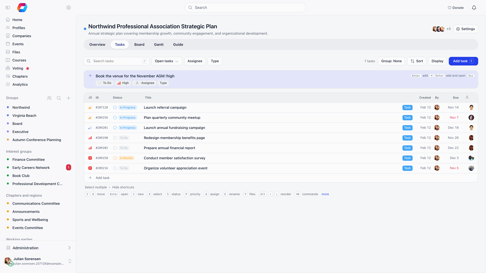

Tasks are the unit of work inside a project. A task carries a title, a rich description with attachments, a status, a type, a priority, one or more assignees, start and due dates, an objective, a checklist, dependencies on other tasks, comments and an activity log. Each task gets an ID made of the project's task key and a number, such as ORG-145.

**Built for** the day to day work of a committee or staff team: who is doing what, by when, and what is blocking it.

**Replaces** action-item spreadsheets and email chases. Tasks always belong to a project, so there is no standalone personal to-do list, but the **My tasks** page gathers everything assigned to you across projects.

---

## Creating a task

Use **Add task** (or press **C**) on the Tasks tab, a plus under a group on the list, or **Add task** at the bottom of a board column. A new row opens where you type the title. Admins, Members and Contributors of the project can create tasks; Viewers cannot. Dragging files onto a project opens a new task with those files attached.

You can set fields while typing the title:

| Type | Sets |
|------|------|
| `!high` | Priority: `!urgent`, `!high`, `!medium`, `!low` (or `!1` to `!4`) |
| `@daniel` | Assignee, matched on first name |
| `#bug` | Task type, matched on its name |
| `+review` | Status, matched on its name |

Words that match nothing stay in the title. Chips under the title show what the task will get and open a menu to change it. **Enter** adds the task; **Cmd** or **Ctrl** with **Enter** adds it and opens it. On the Tasks tab, a task added inside a group takes that group's value (the status, the assignee, and so on).

A new task takes the first open status (normally **Backlog**) and **Medium** priority, unless you say otherwise. Everything else is filled in afterwards in the task panel.

---

## The task panel

Clicking a task opens it in a side panel (**Expand** makes it a full page, **Copy link** shares it, and **Previous** and **Next** or **K** and **J** move between tasks). The panel holds:

| Field | What it does |
|-------|-------------|
| Title | Edited in place. |
| **Status** | One of the project's statuses. |
| **Priority** | **Urgent**, **High**, **Medium** or **Low**, when the project uses priority. |
| **Assignee** | One or more people. The picker offers the project's people: the owner, individually added people and members of an added group. |
| **Type** | Only when the project uses task types. |
| **Due date** and **Start date** | Each optional, when the project uses due dates. |
| **Goal** and **Objective** | Only when the project uses objectives. **Goal** appears once the project groups objectives under goals. |
| **Blocked by** | Other tasks in the same project that must be closed first. |
| Description | Rich text with images, video and file attachments. |
| **Checklist** | A list of sub-items with tick boxes. Pasting a bulleted list creates several at once. A checklist item can be turned into a task of its own. |
| **Activity** | Comments and history in one thread, filterable by **All**, **Comments** and **History**. |

People who cannot edit the task see these fields read only. **Delete task** is at the bottom of the panel for those allowed to delete.

---

## Statuses and types

Both are defined per project under **Settings** → **Statuses & types**, so two projects can run entirely different workflows.

A status has a name, a colour and an **Open** / **Closed** button. A small circle shows progress (0, 25, 50, 75 or 100 percent, or none), which closed statuses always show as full. Closed is what makes a task count as complete: it removes the task from open filters, from the daily digest and from reminder emails, and it satisfies any dependency on that task. A new project starts with **Backlog**, **To do**, **In Progress**, **Review** and **Done**, with **Done** closed. Drag to reorder; type a name and press Enter to add one. Deleting a status asks which status its tasks move to.

A type has a name and a colour only. It is a label for grouping and filtering. Deleting one asks whether its tasks move to another type or to **No type**.

---

## Assignees

A task can have several assignees. On the board a task with several assignees has a card in each assignee's swimlane when swimlanes are by assignee. Filters on assignee match a task if any of its assignees is picked, and the Overview workload counts the task for each of them.

Who can edit a task depends on the project role: Admins and Members can edit any task, Contributors only tasks they created or are assigned to, Viewers none. Deleting is limited to Admins and to the person who created the task (Members and Contributors, for their own tasks). See [Projects](/platform/projects).

---

## Dependencies

**Blocked by** lists tasks that must be finished first. Orgo enforces three rules when you add one:

- the blocking task must be in the same project,
- a task cannot block itself, and the chain cannot loop back on itself,
- a dependency chain deeper than 100 levels is rejected.

While a blocking task is still open, moving the dependent task to a closed status is refused and the response names the tasks still in the way. Blocked tasks show a **Blocked** tag in the list and on the board, and the Gantt can draw the dependencies as arrows.

---

## Comments and history

The **Activity** thread at the bottom of the task panel takes rich text, images and files, supports threaded replies (**Replying to**) and shows comments and history together. A comment counter on the task counts replies as well as top-level comments.

Posting a comment notifies the task assignees and the task creator in the app, and emails them (skipping whoever wrote the comment). On an archived project the comment is saved but nothing is sent.

Status, priority, type, objective, due date and assignee changes are written to the history with who made it and when. Several changes to the same field by the same person within two minutes become one entry. Title, description and checklist edits are not logged.

---

## Finding tasks

The **Tasks** tab is the full list. Rows are in manual order by default; drag a row, or press **Alt** with the up or down arrow, to re-rank it.

| Control | What it does |
|---------|-------------|
| **Search tasks** | Matches the title. Press `/` to jump to it. |
| **Status** | **Open tasks**, **All statuses**, **Closed only**, or pick individual statuses. |
| **Assignee** | **Anyone**, **Me**, **Unassigned**, or one or more people. |
| **Type** | Filter to one type, when the project uses types. |
| **Goal** / **Objective** | Filter to one objective, or one goal, when the project uses objectives. |
| **Group by** | **Status**, **Assignee**, **Type**, **Priority**, **Objective** (called **Goal** when goals are in use) or by deadline: **week**, **two weeks** or **month**. **Then by** adds a second level. Each group holds 100 tasks, then **Show more**. |
| **Sort** | **Manual rank**, **Priority**, **Due date**, **Latest** or **Oldest**. |
| **Display** | Show or hide the **ID**, **Status icon**, **Status name**, **Type**, **Due date**, **Created & Author**, **Assignee** and **Checklist progress** columns. |
| **Select multiple** | Tick several tasks to change **Status**, **Priority**, **Assignee** or **Type** together, or delete them. |

Your filters, grouping and display choices are remembered per project in your browser. **Shortcuts** at the bottom of the list shows the keyboard shortcuts, and **Cmd** or **Ctrl** with **K** opens a command palette.

The Overview's tiles are shortcuts into the same list: clicking **Overdue**, **Unassigned** or **Due in 7 days** applies that filter.

The **Board** tab shows one column per status and the **Gantt** tab plots dated tasks on a timeline. Both are described in [Projects](/platform/projects).

---

## My tasks

**My tasks** collects the tasks assigned to you across every active project, and is reached from the **My tasks** button on the Projects page or from **View all** on the dashboard card. Switch between **Open** and **Completed** (the last 90 days), group by **Project**, **Due date**, **Priority** or **Month**, filter by status, and mark a task done from its row. Archived projects and projects you have been removed from are left out.

The dashboard **My Tasks** card shows your five open tasks that are due soonest, then by priority.

---

## Emails about tasks

| Email | When it is sent | Who gets it |
|-------|----------------|-------------|
| Task assigned | A task is created with an assignee, or someone is added as an assignee | The people newly assigned, except the person who made the change |
| Task status changed | The status changes | Everyone assigned plus the creator, except the person who made the change |
| Task comment added | A comment is posted | Everyone assigned plus the creator, except the commenter (and their other account if they have a duplicate) |
| Daily task digest | Every day at 06:00 UTC | Members with at least one overdue, due today, due this week or high priority open task |

The digest groups your work into overdue, due today, due this week and high priority, and adds up to five tasks with no due date. If none of the first four groups has anything in it, no digest goes out that day.

Archiving a project silences the first three emails for its tasks, and so does taking someone off the project: they stop hearing about tasks that stay assigned to them. The digest is the exception: it still lists tasks from archived projects.

<Note>
Every task email can be switched off by the member with the **Task** toggle in their profile notification settings, and that switch stops all four emails above. The organisation default for new members is **Email Notifications: Tasks** under **Settings** → **Modules** → **Emails & Notifications** → **Notification Preferences**, and it ships set to Instant. The assigned, status changed and comment emails are not in the Email Templates catalogue, so their wording cannot be edited from Settings.
</Note>

<Warning>
Orgo also has due soon and overdue task emails, but the job that sends them is not on the automatic schedule, so members do not receive them today. Use the daily digest, which lists the same overdue and upcoming work.
</Warning>

---

## Related

- [Projects](/platform/projects) - projects, access, goals and the project views
- [Issues](/platform/issues) - the separate issue tracker inside groups
- [Notifications](/platform/notifications) - the notification switches and defaults
- [Emails](/platform/emails) - how system emails are built, sent and logged
- [Permissions](/platform/permissions) - what organization admins and HR managers unlock
