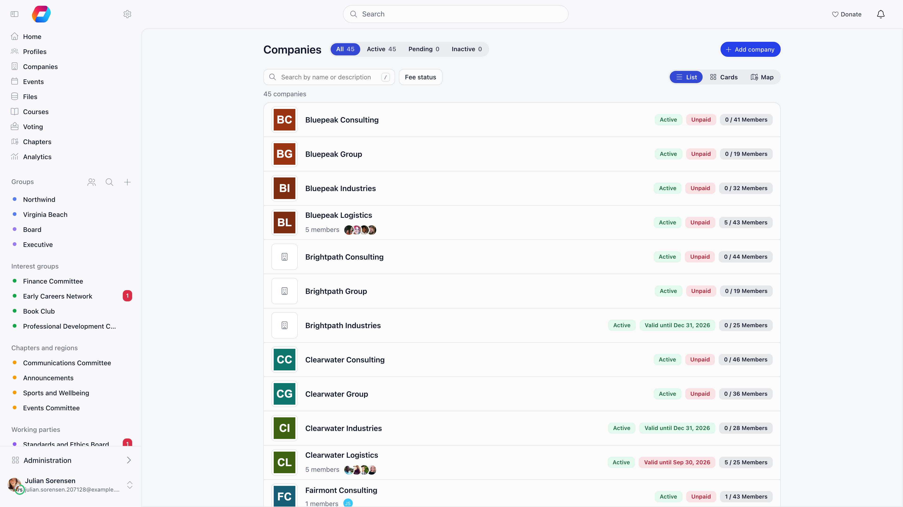
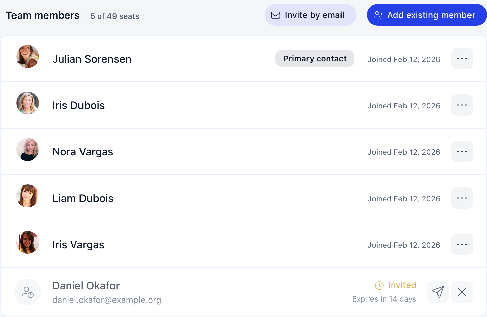
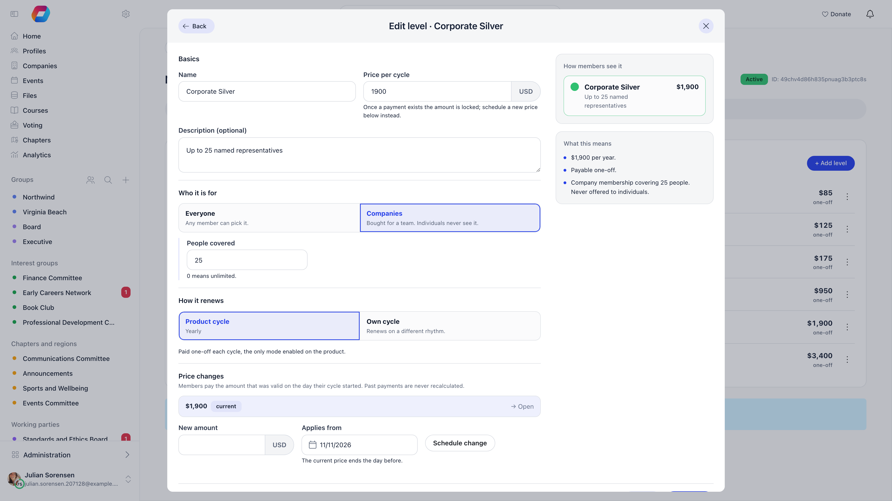
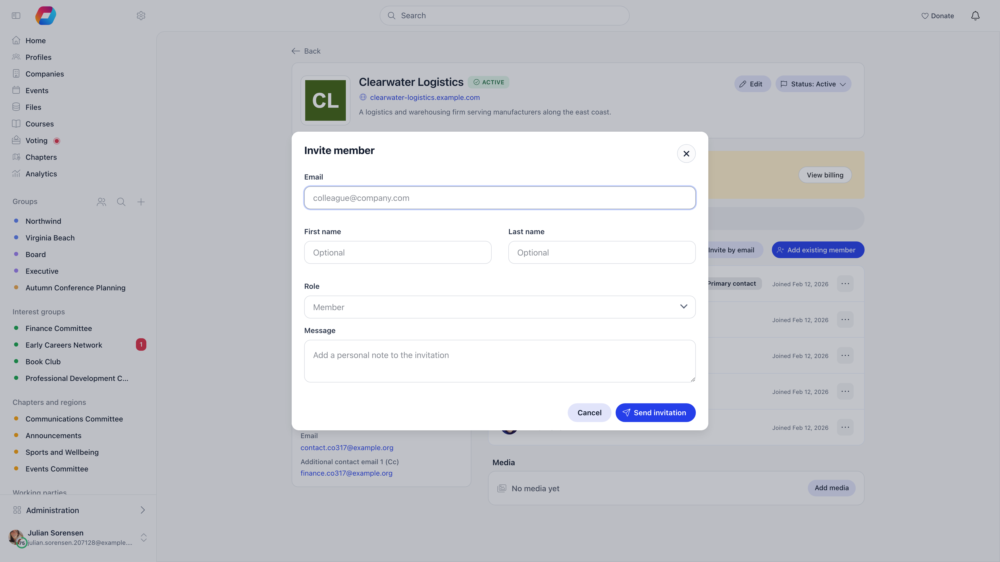
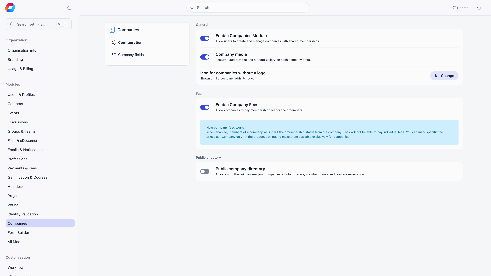
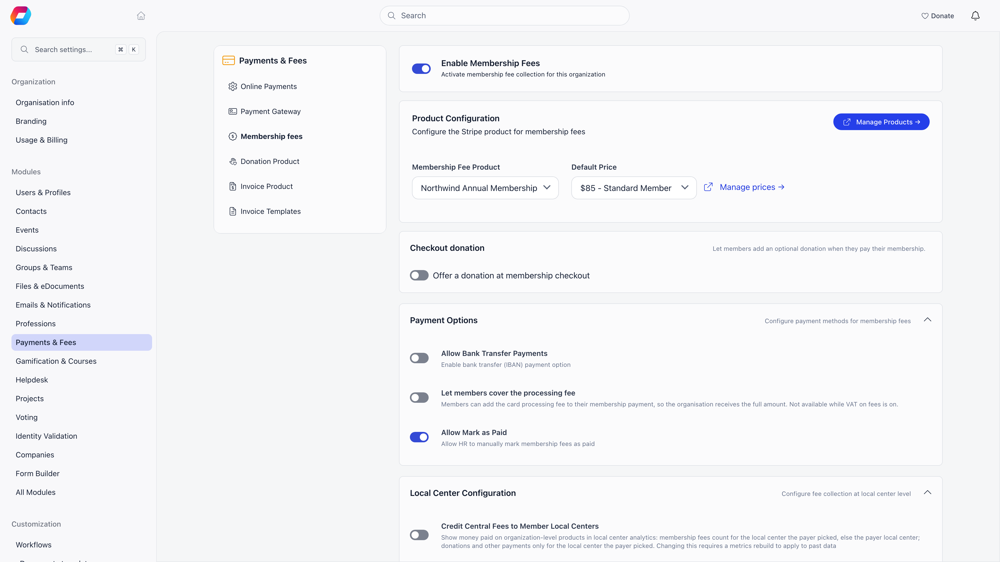
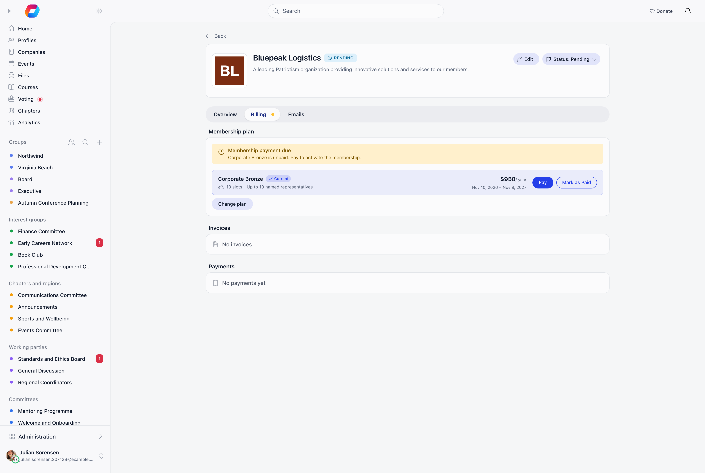

**Built for** associations whose members are organizations rather than individuals: trade associations, chambers of commerce, industry bodies, employer federations, and federations of member organizations.
**Replaces** the member-company spreadsheet, the separate invoicing tool, and the manual list of "who at each member company should get our emails".

In Orgo a member company is a **company** record. It holds one membership, it is billed as one customer, and the people who work there attach to it and inherit its membership validity. Everything on this page is built on that: the company record first, then billing and invoices, then a geographic tier only if your federation has one.

Your member roster lives under **Companies** in the sidebar, which is shown to organization-wide HR managers and Orgo administrators. Each row carries the status, the seats used against the allowance, and the valid-until date, so the health of your membership is one screen.

---

## Before you start

Five decisions carry the whole setup. Settle them on paper first: each one becomes a field, a switch or a price row later, and reversing some of them means re-billing your members.

- [ ] Legal entity details collected for every member company: legal name, registration number, VAT number, billing address, town and country
- [ ] Seat policy decided: how many named people each corporate tier includes, and which tier (if any) is unlimited
- [ ] Invoicing direction agreed: your organization bills each member company centrally, because company fees never route to a region
- [ ] Payment method chosen: card through Stripe, bank transfer against an invoice, or an administrator recording money received elsewhere
- [ ] Primary contact named per company, plus the financial contact email that will receive the renewal ladder

<Note>
The one that bites later is the seat policy. Seats are not typed in on a company: they arrive from the price the company buys. The tier list you design now is the seat list you live with, and changing a company's allowance means moving it to another tier and taking a payment.
</Note>

---

## Who this is for

Use this playbook when the entity that joins, pays and renews is an organization, and the people are attached to it:

- a trade or industry association billing member firms an annual corporate fee;
- a chamber of commerce with tiered corporate memberships and a seat allowance per tier;
- an employer federation or umbrella body whose members are other associations;
- any body that sells team or corporate memberships alongside, or instead of, individual ones.

If your members are individuals who happen to be grouped by geography, you do not need this page. Start at [Chapters](/platform/groups/local-groups) instead.

---

## Modelling your members as companies

### The company record

Organization-wide HR managers and Orgo administrators create companies: **Companies** in the sidebar, then **Add company**. The creator is not added to the company, because they are setting it up for someone else. The form has a **Profile** tab and a **Billing** tab. Only **Company Name** is required to save, but the billing block has to be complete before a payment can start.

| Tab | Fields |
|---|---|
| Profile | **Company Name**, **Description**, **Website**, **Company Logo**, **Show in public directory**, **Location on companies map**, your own questions under **About us**, and **Featured media** and **Gallery** when company media is on |
| Billing | **Legal Name**, **Registration Number**, **VAT Number**, **Billing Address**, **Postal code**, **Town**, **Country**, **Secondary address**, **Secondary postal code** |
| Billing, Financial Contact | **Financial contact full name**, **Financial contact email**, **Financial contact phone**, **Additional contact email 1 (Cc)**, **Additional contact email 2 (Cc)** |

A company starts at **Pending** and flips to **Active** on its first paid membership fee. Organization admins can also set the status by hand from the **Status** menu on the company page. **Delete company**, in the same menu, is a soft delete: the record moves to **Deleted** and disappears from every list.

Once saved, the company page becomes the single screen your staff and the member's own primary contact both work from: the company details, the **Team members** panel, and a **Billing** tab holding the **Membership plan** panel and the company's invoices and payments. See [Companies](/platform/users/companies) for the full record, including the public directory and company fields.

### One company, many people, one membership

A membership row inside a company points at either a **User** (someone with an account) or a **[Contact](/platform/contacts)** (a record in your database with no account). Both appear in the member list. Only user memberships inherit the company's validity date, because a contact has no fee date to write to.

A person can belong to several companies, in two ways. A **primary member** belongs to one company only, takes a seat, can hold roles, and inherits the company's validity. An **associate member** can belong to any number of companies, takes no seat, holds no roles, and keeps whatever their own primary company or own payments give them. Think of a consultant employed by one member firm who sits on the boards of two others: primary in the first, associate in the other two.

Roles are stored per primary membership, and one person can hold more than one. Associates cannot hold any.

| Role | What it grants |
|---|---|
| **Member** | The default. Sees the company page and inherits the membership validity |
| **Primary Contact** | Edits the company, manages members and invitations, and pays. At most one per company |
| **Voting Representative** | Casts the company's ballot in a **Company vote** (see [E-voting](/platform/e-voting)). At most one per company |
| **Financial Rep** | Legacy. Same rights as Primary Contact, but no longer assignable from the interface |

Assigning **Primary Contact** or **Voting Representative** takes it from whoever held it before, in the same action.

A person can be a primary member of only one company, and cannot be added as a primary member of a second one. They can still be added to others as an associate.

### Seats, and what happens when they run out

Seats are not typed in on the company. They come from the fee level the company bought: every company level carries a **People covered** number, and paying for that level writes the number onto the company. **0 means unlimited.**

The count is primary members plus pending invitations, so an outstanding invitation holds a place. Associates take no seat, and neither do memberships that have ended or whose user was deleted. When the allowance is full, **Invite by email** disappears from the company page and **Primary member** can no longer be chosen in **Add existing member**, though associates can still be added.

### How an employee joins

Three routes, and you will use all three: invitations for new names, **Add existing member** for people already in your database, and automatic domain matching for the ones who turn up at your events.

<Steps>
  <Step title="Invitation, the normal route">
    Open the company, then press **Invite by email** in the header of the **Team members** panel (company administrators and organization admins see it). Fill in the email, first name, last name and role, and add a message if you want one, then **Send invitation**. Both names are labelled optional in the dialog but the server rejects the invitation without them, so treat them as required.

    The email links to `/company-invitation/{hash}`. Accepting joins the person to the company and emails them a one-time login code, creating the account first if they have none. Invitations expire after **30 days** and can be resent (which resets the 30 days) or revoked.

    **Done when** the person appears in the **Team members** panel with an **Invited** badge, and the seat counter at the top of the company has gone up by one.

  </Step>
  <Step title="Add existing member, for people already in your database">
    Press **Add existing member** in the same panel header, choose **Primary member** or **Associate member**, optionally type a **Title**, and search. The search finds people already in your database and does not create anybody. The button is shown to organization admins, and **Primary member** is only available while seats are free.

    **Done when** the person is listed in **Team members** straight away, with no invitation email involved.
  </Step>
  <Step title="Email domain match, automatic">
    Nothing to press. With the Companies module on, somebody registering for an event whose email domain matches the **Website** of an **Active** company is added to that company automatically. Common free providers (gmail.com, outlook.com and similar) are excluded, subdomains are reduced to the base domain, and the company's validity date is copied onto them if it has one. The person joins as a primary member, so nothing happens if they already are a primary member of another company, and a company with no free seats is skipped. This runs on event registration only.

    **Done when** an event registrant from a member firm shows up in that company's member list without anyone inviting them.
  </Step>
</Steps>

An invitation is refused up front when there are no free seats, when one is already pending for that email, when the person is already in this company, or when they are already a primary member of another company. Invitations always make a primary member. The seat check runs again at acceptance, so an invitation sent before the company filled up can still fail.

---

## What to turn on

Every Settings screen below needs the **Orgo administrator** flag on your account, which is a separate switch from the Admin permission. See [Permissions](/platform/permissions).

### Companies, first

**Settings** → **Modules** → **Companies** → **Configuration**

| Setting | What it does |
|---|---|
| **Enable Companies Module** | Adds **Companies** to the sidebar for organization-wide HR managers, a **Companies** tab for every member, and a **Company** card on member profiles |
| **Company media**, **Icon for companies without a logo** | Featured audio, video and a gallery on each company page, and the icon shown until a company uploads a logo |
| **Public company directory** | Publishes your companies to anyone with the link. Optional. See [Companies](/platform/users/companies#public-directory) |
| **Enable Company Fees** | Lets companies pay membership fees on behalf of their people. Only appears while the Payments and Fees module is active |

### Payments and fees

**Settings** → **Modules** → **Payments & Fees**

| Setting | Tab | What it does |
|---|---|---|
| **Payment Gateway** | Payment Gateway | Connects your organization's Stripe account. See [Stripe Integration](/platform/fees/stripe-integration) |
| **Enable Membership Fees** | Membership fees | The master switch for dues |
| **Membership Fee Product** / **Default Price** | Membership fees | The product companies are billed against |
| **Enable VAT on Fees** | Membership fees | While off, no VAT is added, whatever a price row stores. See [VAT](/platform/fees/vat) |
| **Allow Bank Transfer Payments** | Membership fees | Shows your bank details as a payment option |
| **Enable Membership Payments via Bank Transfer** | Membership fees | Required, together with Invoices, for the **Get invoice for bank transfer** button on a company |
| **Allow Mark as Paid** | Membership fees | Lets an administrator record money received outside the platform |
| **Company Fee Payment Mandatory** | Membership fees | Locks company people out of the platform while the company's fee is unpaid |

### Invoices

Switch **Invoices** on in **Settings** → **Modules** → **All Modules**, then set **Manual Invoice Product** under **Settings** → **Modules** → **Payments & Fees** → **Invoice Product**. Without that product, invoice creation fails. The same tab holds **Send invoice emails automatically** (on by default) and **Invoice membership fee payments**.

### Chapters, only if you have a geographic tier

**Settings** → **Modules** → **Groups & Teams** → **Local Centers** → **Enable Local Centers Module**. Skip this unless the answer to "does a region of ours hold its own members, events and budget?" is yes. See [Adding a geographic tier](#adding-a-geographic-tier-if-you-need-one).

---

## Setup order

Work through these in order. Steps 1 to 4 build the money side, 5 turns the member companies on, and 6 to 9 get your real data in and the enforcement switched on last.

<Steps>
  <Step title="Connect Stripe">
    Go to **Settings** → **Modules** → **Payments & Fees** → **Payment Gateway** and connect your organization's Stripe account.

    Set a **country** under **Settings** → **Organisation info** first, because Stripe fixes the country when the account is created and it cannot be changed afterwards.

    **Done when** the Payment Gateway tab shows your account as connected rather than offering the connect button. See [Stripe Integration](/platform/fees/stripe-integration).
  </Step>
  <Step title="Create the membership fee product">
    Go to **Finance** → **Products** → **Create Product** and choose **Membership Fee**.

    Set **Cycle length** and **Cycle starts in** now: both are locked once saved. A federation billing an annual corporate fee usually wants **Yearly** and a fixed calendar month, so every member company renews together instead of on its own separate anniversary. Leave **Pricing model** on **Fixed levels**: corporate tiers are levels, and a **Flexible amount** product has a single level with no company seats. The first fixed-level membership product you create is picked up automatically as the organization's **Membership Fee Product**.

    **Done when** the product opens on its own page with a **Membership levels** tab, and the cycle you chose can no longer be edited.
  </Step>
  <Step title="Add one price per corporate tier">
    On the product's **Membership levels** tab, press **Add level** and create one level per tier. Under **Who it is for**, choose **Companies** and enter **People covered**, the number of seats that tier buys. `0` means unlimited. The **Companies** choice only appears once **Enable Company Fees** is on (step 5), so switch that on first if it is missing.

    Levels set to **Everyone** stay available to individual members, so a federation with individual members can run both from one product.

    **Done when** each corporate tier is listed on **Membership levels** tagged **Company** with its seat count, and opening one shows the number you typed.

  </Step>
  <Step title="Point the organization at the product">
    Go to **Settings** → **Modules** → **Payments & Fees** → **Membership fees**. Switch **Enable Membership Fees** on, then pick your **Membership Fee Product** and a **Default Price**.

    Nothing charges until the product is selected here, however complete the product itself looks.

    **Done when** the **Product Configuration** card names your product and a default price, and a company's **Membership plan** panel starts listing tiers instead of sitting empty.

    
  </Step>
  <Step title="Turn on Companies and company fees">
    Go to **Settings** → **Modules** → **Companies** → **Configuration**. Switch **Enable Companies Module** on, then switch **Enable Company Fees** on. Read [Permissions](#permissions) first: organization-wide HR managers can administer every company, and nothing narrows that to a chapter.

    **Done when** **Companies** appears in the sidebar and the **Enable Company Fees** switch shows its "How company fees work" note underneath.
  </Step>
  <Step title="Turn on invoicing">
    Switch **Invoices** on under **Settings** → **Modules** → **All Modules**, then set a **Manual Invoice Product** under **Payments & Fees** → **Invoice Product**.

    Do this before you import companies, so the first renewal round can attach invoices. Without that product, invoice creation fails outright.

    **Done when** the **Invoices** list is reachable and creating a manual invoice no longer errors. See [Invoices](/platform/fees/invoices).
  </Step>
  <Step title="Import your member companies">
    Go to **Settings** → **Customization** → **Import**. It offers **Companies** (with membership details) and **Company Members** (assigning users to companies with roles), each with an example CSV. Run **Companies** first, then **Company Members**, so every membership has a company to attach to.

    **Done when** the **Companies** list shows your real roster with the expected **All** count, and opening one shows its people in **Team members**. Every imported membership is a primary one: a row for someone who is already a primary member elsewhere is skipped, and you add them as an associate from the company page. See [Import](/platform/customization/import).
  </Step>
  <Step title="Name a Primary Contact in each company, then invite the rest">
    On each company, give one person the **Primary contact** role: that is who pays and who manages the seats. If a company has a voting representative for [Company votes](/platform/e-voting), tick **Voting representative** on the right person now. Fill in **Financial contact email** on the **Financial Contact** card too, because it is the address the renewal ladder writes to.

    **Done when** every company shows a **Primary contact** badge on exactly one member row, and no company is left with an empty **Financial Contact** card.
  </Step>
  <Step title="Decide on the lockout last">
    Leave **Company Fee Payment Mandatory** off until your companies are actually billed and paid. Switching it on with unpaid records blocks their people out on the next page load.

    **Done when** your first billing round has settled and you have deliberately chosen whether to enforce, rather than discovering the lockout through support tickets.
  </Step>
</Steps>

---

## Billing companies

The **Membership plan** panel, on the **Billing** tab of a company, lists every non-archived company level on your organization's fee product, with its seat count and amount. It is visible to the Primary contact (and any legacy Financial Rep) and to organization admins.

The tier the company is on is marked **Current** and carries the action buttons; the others offer **Select** to move the company across.

### Where the money goes

A company fee checkout always charges **your organization's Stripe account**. There is no chapter routing for company fees and no revenue split: the full amount lands in one account, and any onward distribution to regions or member bodies happens in your own accounting, not in Orgo. Orgo takes no commission of its own; the platform application fee is present in the code but forced to zero on every charge, so what you lose is Stripe's processing fee.

### The three ways a company pays

| Route | What happens | Needs |
|---|---|---|
| **Pay online** | Stripe checkout. Membership activates as soon as the payment lands | A connected Stripe account |
| **Get invoice for bank transfer** | Generates an unpaid invoice, emails it, and shows a reference to quote on the transfer | **Enable Membership Payments via Bank Transfer** and the Invoices module, both on |
| **Mark as Paid** | Records money received outside the platform. Asks for a period start, defaulting to the current expiry so it extends rather than overwrites, and voids any pending bank-transfer invoice | Organization admins only |

Before any of them, Orgo checks that **Legal Name**, **Billing Address**, **Financial contact full name** and **Financial contact email** are filled in, and sends you to the edit form if one is missing.

**Renewal opens 60 days before the current period ends.** Before that window a company with a valid membership has no Pay button, and the bank-transfer invoice endpoint refuses with "Membership can only be renewed closer to its expiry date."

On a calendar-anchored cycle a mid-cycle payment buys only the remainder and is prorated: the panel shows the list price struck through beside the real charge, plus `{months} of {total} months`. The amount is always recomputed on the server at checkout, so a stale quote can never undercharge.

VAT is added on top of the net price as its own line when **Enable VAT on Fees** is on and the price is not marked exempt.

### Invoices

A company only ever has one open renewal invoice. The renewal reminder flow and the **Get invoice for bank transfer** button share it: an unpaid membership invoice matching the current period and plan is reused, a stale one is voided and replaced, and a new one is created otherwise.

While the Invoices module is active, the renewal reminder emails carry that invoice as a PDF attachment. Marking a membership invoice paid is what extends the company's membership, which is why the **Membership** switch on a manual invoice matters: an invoice without it is just a document.

Every invoice carries a number (the highest used in your organization plus one, never reset) and a five-character series. Voided and refunded invoices keep their number. Full detail in [Invoices](/platform/fees/invoices) and [Cancelling invoices](/platform/fees/cancelling-invoices).

### What a company payment does to its people

When a payment lands, Orgo:

1. sets the company's valid-until date, never shortening one that is already further out;
2. sets the company **Active** if it was **Pending**;
3. writes the plan's seat count (**People covered**) onto the company;
4. copies the valid-until date onto every active primary member who has an account. Associates are untouched.

Somebody who joins an already-paid company inherits the date on joining. Somebody removed from a company has their fee date and fee price cleared. A refunded payment rolls the company back to the previous non-refunded period, or clears it entirely, and re-syncs everyone.

<Warning>
With **Enable Company Fees** on, anyone who is a primary member of a company loses their individual fee screen entirely. Associates keep theirs. Their profile **Fee** tab shows "Membership managed by company" with a link to the company, in place of both the organization fee card and the chapter fee card. This happens as soon as they are attached to a company, whether or not the company has paid anything yet.
</Warning>

### When a company fee lapses

Companies have their own reminder ladder, separate from the individual one: about a month before expiry, 7 days before, 1 day before, on the expiry day, then 7, 14 and 30 days after. Each goes **To** the **Financial contact email**, copying the active Primary Contacts and the two **Additional contact email** addresses. Without a financial contact email, the first Primary Contact is promoted to the To line, and a company with nobody reachable is skipped. Only **Active** and **Pending** companies are reminded, so setting one to Inactive stops both the reminder and the renewal invoice attached to it. The post-expiry rungs are exact day counts, so a company 3 days lapsed hears nothing that day.

With **Company Fee Payment Mandatory** on and the membership lapsed:

| Who | Where they land |
|---|---|
| Primary Contact or legacy Financial Rep | `/company-fee-payment`, a guided three-step page: Billing Information, Select a Plan, Complete Payment |
| Everyone else in the company | `/company-fee-required`, which names the company and points them at the financial contact |

The company pages themselves stay reachable, so a locked-out Primary Contact can still edit billing details and pay. The gate exempts holders of the organization-wide Admin permission and fee-exempt user types, and nothing else.

<Note>
The company gate is stricter than the individual one. The individual mandatory-fee gate lets organization-wide HR and Financial managers through; the company gate does not. A staff member of yours who happens to belong to a member company with a lapsed fee is locked out unless they hold the organization-wide Admin permission.
</Note>

---

## Adding a geographic tier, if you need one

Chapters (called **local centers** in the data model, the API and the permission names) are optional. Turn them on when a region genuinely holds its own members, events, files and budget, and skip them otherwise: they add a permission scope, a second fee, and a second set of admin screens to every screen you already run.

**Settings** → **Modules** → **Groups & Teams** → **Local Centers** → **Enable Local Centers Module**. What it changes:

| Area | With chapters on |
|---|---|
| Members | Every member has exactly one primary chapter. Moving someone is a [transfer request](/platform/groups/transfers), approved by the receiving chapter |
| Permissions | The `_LOCAL` family appears on the profile permission panel, scoped to the holder's chapter. **Enable Parent Centers** adds the `_PARENT_LOCAL` family on top |
| Structure above a chapter | **Enable Parent Centers** lets a chapter sit under another chapter, to any depth. A national body holding regions holding member bodies is three layers of one tree, not three products |
| Fees | **Local Center Fees Enabled** gives each chapter its own fee product, default price and validity date, independent of the organization fee. See [Chapter Fees](/platform/local-group-fees/create-local-fees) |
| Money | A chapter that connects its own Stripe account receives its own chapter fee payments. Without one, they fall back to the organization account |
| Structure below a chapter | **Enable Organizational Units** adds typed, nestable teams inside a chapter. See [Units](/platform/groups/units) |

<Warning>
Chapters and companies do not meet. A company record has no chapter field, a company fee is never routed to a chapter Stripe account, and chapter fee screens work on individual members, not on companies. If your regions need their own income from member companies, either bill it centrally and distribute it in your accounting, or give each region its own corporate tier and reconcile from the payment records.
</Warning>

If your federation has tiers (a national body, its regions, their member bodies), build them as chapters nested inside each other rather than as regions or groups. **Enable Parent Centers**, flag each chapter that holds others with **It's a parent chapter**, then set **Belongs to parent chapter** on the ones below it. A chapter can be both at once, which is what makes a middle tier possible. Moving a chapter later requires the organization-wide HR permission, because the link decides who administers the branch.

Two grouping tools that are not chapters and are worth knowing before you build a hierarchy you cannot undo:

- **Regions** (**Enable Regions**) are a flat label on a chapter, used for filtering and grouping. They grant nothing on their own, and they are not a layer of the chapter tree.
- **[Role groups](/platform/groups/role-groups)** are spaces whose membership is a query over roles, age, gender, region or fee tier, recalculated as your data changes. They are the right tool for "every Primary Contact" or "every company representative in the north", and the wrong tool for a permanent tier of your organization.

---

## Permissions

Company access is decided by a company-specific check, not by the chapter permission family.

| Action | Who |
|---|---|
| See a company | Any active primary member of that company |
| Edit the company record | Primary contact, legacy Financial Rep |
| Add, remove and re-role members | Primary contact, legacy Financial Rep. **Add existing member** in the interface is shown to organization admins only |
| Send, resend and revoke invitations | Primary contact, legacy Financial Rep |
| Select a plan, pay, request the bank-transfer invoice | Primary contact, legacy Financial Rep |
| **Mark as Paid**, change company status, delete a company | Organization admins |
| Everything above, on every company | Organization-wide HR managers, and Orgo administrators |
| Open **Settings** at all | The **Orgo administrator** flag, not a permission |

There is no setting that lets ordinary members or chapter admins create or administer companies. Creating a company, and administering one you do not belong to, belongs to organization-wide HR managers and Orgo administrators only. Because a company has no chapter, a chapter-scoped permission has nothing to narrow it down to, so chapter admins get no extra access to companies.

Two more things worth knowing before you delegate:

- A member's profile shows a **Company** card with their primary company and any **Associate member of** companies. Only the person themselves and organization admins can open the company page from it.
- Renewal correspondence follows the company record, not permissions. Whoever is in **Financial contact email** and **Additional contact email 1 and 2** receives the ladder, regardless of what they can do in the platform.

---

## Reporting

| Question | Where |
|---|---|
| How many member companies, by status | **Companies** list. The **All**, **Active**, **Pending** and **Inactive** filters carry live counts, and each row shows seats used against the allowance and the valid-until date |
| Which companies have lapsed | The same list: sort or scan the **Valid until** column, and filter on **Active** to separate paid from **Pending** |
| Who is in a company, and which of them are contacts | The company page member list. Contacts are tagged and link to the contact record |
| What a member is billed at | **Members** list, **fee** column. For anyone in a company it shows the *company's* tier rather than their own, even while the company is **Pending** or its fee is unpaid |
| Invoices and their state | **Invoices** list, searchable by customer name, invoice number, series and internal id, filterable by status |
| Anything else, in plain language | **Ask Orgo** (organization admins). Its catalogue includes companies and company membership, payments, invoices and subscription profiles, and results export to CSV. See [Insights](/platform/insights) |
| Who voted, by company | Vote exports carry a **Company** column while the Companies module is on. See [E-voting](/platform/e-voting) |

<Note>
The Analytics dashboards have no company dimension. Members, geography, leaderboards, platform and finance all count individuals and money, not member organizations. For "revenue by member company" or "companies renewed this quarter", use Ask Orgo or the invoice list.
</Note>

If you also run chapters, **Finance** → **Stats** (organization-wide finance managers) adds a fees-by-chapter table: chapter, status, active member count and fees paid for a chosen period, with chapters under **Minimum Members per Local Center** or **Minimum Active Members Percentage** highlighted for organization admins.

---

## Limits worth knowing before you start

- **A person is a primary member of at most one company.** They can be an associate of any number of others, but associates take no seat, hold no roles and are not covered by that company's fee.
- **Companies are organization-wide.** A company has no chapter field, so it cannot be owned by a region, filtered by one, or billed through one.
- **One company, one vote needs a Company vote.** Create the vote with the **Company vote** audience: each company's voting representative is eligible, counted once however many companies they represent. The roll freezes when voting starts, so fix representatives and fee records beforehand. An ordinary **Group vote** still counts every employee as an individual.
- **Contacts occupy seats but inherit nothing.** A contact has no fee date, so company membership sync skips them. Use contacts for people you communicate with, not for people who need to sign in.
- **Domain matching respects seats.** An event registrant whose email domain matches a full company is not added, and neither is someone who is already a primary member elsewhere.
- **Company fees replace individual fees entirely for those people.** There is no "company pays half" arrangement, and no way to leave an individual fee in place beside a company one.
- **One Stripe account for company money.** Company fees never route to a chapter account, and Orgo performs no split between tiers.
- **Renewal is windowed.** A company cannot pay several periods in advance: the Pay button and the bank-transfer invoice both wait for the 60 day window.
- **The company gate is all or nothing.** With **Company Fee Payment Mandatory** on, only holders of the organization-wide Admin permission and fee-exempt user types are spared.

---

## Setup checklist

Work down this list once and your federation is live. Each line is an outcome you can see on screen, in the same order as [Setup order](#setup-order) above.

- [ ] Organization country set under **Organisation info**, and Stripe connected on the **Payment Gateway** tab
- [ ] Membership fee product created with the right **Period** and **Cycle beginning** (both lock on save)
- [ ] Company fee prices created on that product: one **Companies** level per corporate tier, each carrying its own **People covered** allowance
- [ ] Organization pointed at the product: **Enable Membership Fees** on, with a **Membership Fee Product** and a **Default Membership Fee Price** selected
- [ ] Companies module on and **Enable Company Fees** on
- [ ] Invoices module on and a **Manual Invoice Product** set, so renewal reminders can carry a PDF
- [ ] Member companies imported, each with legal name, billing address and VAT number filled in
- [ ] One **Primary contact** named per company, and a **Voting representative** if you hold Company votes, and a **Financial contact email** on every **Financial Contact** card
- [ ] Employees invited or added, with each company's seat counter below its allowance
- [ ] First billing round settled, then **Company Fee Payment Mandatory** switched on or left off as a decision

---

## Troubleshooting

<AccordionGroup>
  <Accordion title="The company paid, but its people still show as unpaid">
    Three separate causes, in the order worth checking.

    The payment may not have been recorded as one: a **Get invoice for bank transfer** invoice sits unpaid until somebody marks it paid, and nothing propagates before that.

    The people may be contacts rather than users. Membership sync writes the company's valid-until date onto members who have an account, and skips contact rows, which have no fee date to write to. They still occupy seats and still show in the member list.

    Or they joined after the payment through a path that did not sync. Invitations, **Add existing member** and domain matching all copy the company's date on joining, so this should be rare; if you see it, re-record the payment with **Mark as Paid** starting at the current expiry, which re-syncs everybody.
  </Accordion>

  <Accordion title="There is no Pay button on a company">
    The most common reason is the renewal window. Renewal opens 60 days before the current period ends, so a company that paid two months ago has no Pay button and is not meant to.

    After that, check that a plan is selected: the panel needs a company level chosen before it can quote or charge. And check who is looking. The panel renders for the Primary contact, the legacy Financial Rep and organization admins; an ordinary employee never sees it.
  </Accordion>

  <Accordion title="Get invoice for bank transfer is missing or fails">
    It needs four things at once: **Enable Membership Payments via Bank Transfer** on, the Invoices module active, a plan selected on the company, and the renewal window open. Each missing one produces its own refusal message rather than a silent failure.

    If it works but the company says nothing arrived, check the addresses on the company record. The invoice email goes to the company contact address with the two **Additional contact email** addresses copied in, and if none is set, nothing is sent.
  </Accordion>

  <Accordion title="Invite by email has disappeared from a company, or Primary member cannot be chosen">
    The seat allowance is full. The count is primary members plus pending invitations, so outstanding invitations are the usual culprit: revoke the ones that will never be accepted and the buttons come back.

    Seats come from the plan, not from a field you can edit. To give a company more room, move it to a tier with a larger **People covered** value and take the payment; the new number is written on when the payment is recorded. A tier with `0` slots is unlimited.
  </Accordion>

  <Accordion title="Someone was added to a member company nobody invited them to">
    That is email domain matching. When somebody registers for an event and their email domain matches the **Website** of an **Active** company, Orgo attaches them to that company and copies its validity date onto them.

    It is deliberate, and for a federation it is usually what you want: an employee of a member firm registering for a conference is recognised as covered by that firm's membership. It has two edges. It skips a full company and anyone already a primary member elsewhere. And it depends entirely on the **Website** field being right, so a company whose website is recorded as a shared portal or a marketing domain can collect people who do not work there. Correct the **Website** on the company, then remove the wrong memberships.

    Free email providers are excluded, so nobody is ever matched by a gmail.com or outlook.com address.
  </Accordion>

  <Accordion title="Our own staff member is locked out by a company fee">
    The company lockout exempts holders of the organization-wide Admin permission and fee-exempt user types, and nobody else. The individual mandatory-fee gate is more forgiving (it lets organization-wide HR and Financial managers through), which is why this only bites on the company side.

    If the person genuinely belongs to a member company, the honest fix is to settle that company's fee. If they were attached to a company by mistake, or by domain matching, remove the membership: that clears their fee date and fee price, and the individual rules take over again.
  </Accordion>

  <Accordion title="A member of a company wants to pay their own fee">
    They cannot, and the platform is deliberate about it. With **Enable Company Fees** on, anyone attached to a company sees "Membership managed by company" in place of the whole fee area, including the chapter fee card when chapters are on.

    If a company covers only some of its people, do not attach the rest to the company record. Keep them as ordinary members on an individual price, and use a [private group](/platform/groups/private-groups) or a [role group](/platform/groups/role-groups) if you still want them grouped by employer for communication.
  </Accordion>

  <Accordion title="Can a region bill its own member companies?">
    Not as a company fee. Chapter fees are individual: they resolve from a member's own chapter and their chapter fee tier, and a company has no chapter at all. A chapter's own Stripe account receives chapter fee payments from members, never company fees.

    Two workable shapes. Bill everything centrally and distribute in your accounting, which is what most federations end up doing. Or create a corporate tier per region on the organization fee product, so the payment record itself names the region and you can report on it, while the money still settles in the organization account.
  </Accordion>

  <Accordion title="Can we give each member company one vote?">
    Yes, with a **Company vote**. Name the **Voting representative** on each company, then create the vote with the **Company vote** audience (offered to organization admins while the Companies module is on). Only the voting representative of each active, paid-up company is eligible, once, even if they represent several companies. The roll is fixed when the vote starts, so correct representatives and company fees before the start time. Vote exports carry a **Company** column. See [E-voting](/platform/e-voting).
  </Accordion>

  <Accordion title="We deleted a company and its people still look like members">
    Deleting is a soft delete: the record moves to **Deleted** and drops out of every list, but the memberships attached to it are not unwound, so the people keep the validity date they inherited until it expires on its own.

    Remove the members first, which clears each person's fee date and fee price, then delete the company. If it is already done, correct the affected people from their own fee tab or with a recorded payment.
  </Accordion>
</AccordionGroup>

---

## Related

- [Companies](/platform/users/companies): the full company record, roles, seats and invitations
- [Membership Fees](/platform/fees/fees): cycles, proration, validity and the mandatory-fee settings
- [Products](/platform/fees/products): fee products and company levels with **People covered**
- [Invoices](/platform/fees/invoices): numbering, templates, and getting the document to the payer
- [Stripe Integration](/platform/fees/stripe-integration): which account receives what, and what breaks without it
- [Chapters](/platform/groups/local-groups): the optional geographic tier and its permission scopes
