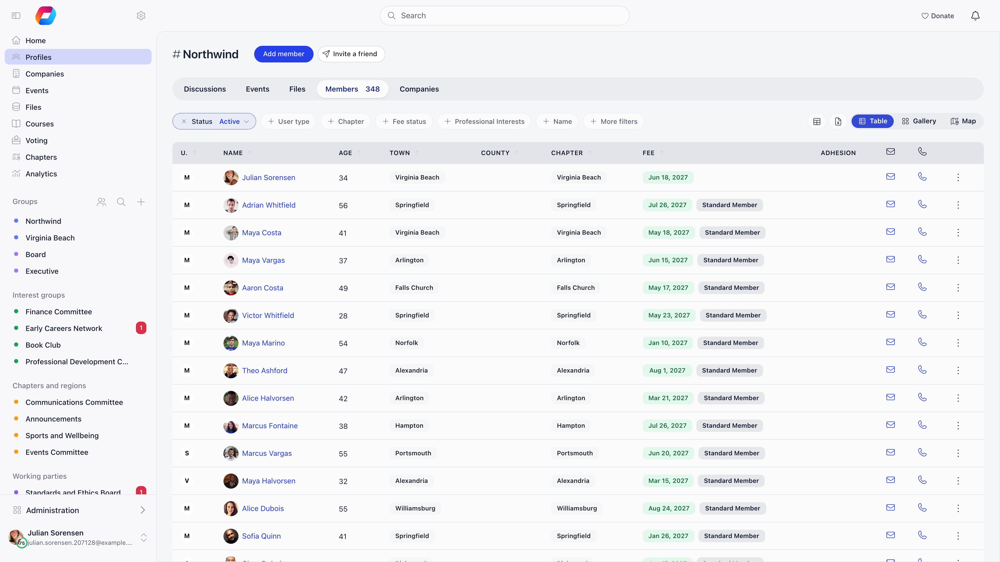
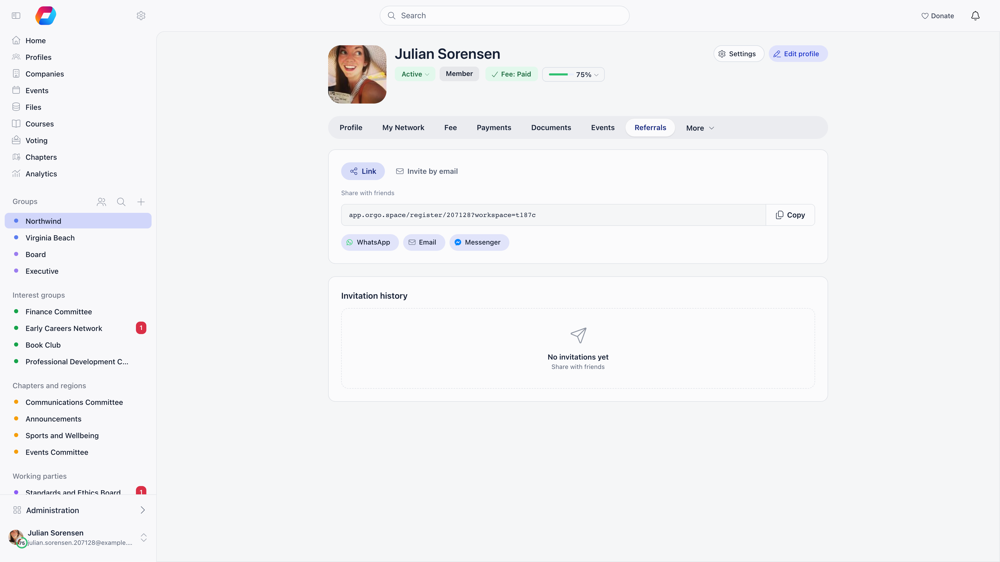

There are four ways a person ends up with an account in your organisation. If you
have one person's details in front of you and want them in the platform now, that
is **Add member** in the member directory, the first route below.

---

## Which route to use

| If you want to | Use | Where it starts |
|---|---|---|
| Create the account yourself, for one person whose details you already have | **Add member** | **Members** in the sidebar → **Add member** |
| Send someone a link and let them fill in their own details, with credit to whoever brought them | **Invite** | **Members** → **Invite a friend**, or the **Referrals** tab on your own profile |
| Let anyone sign themselves up, from your website or a public link | **Self-registration** | The registration form at `/register` |
| Load a spreadsheet of people you already have | **Import** | **Settings** → **Customization** → **Import** |

Adding a person to a member company is a separate job with its own section
[further down](#adding-a-person-to-a-member-company). It attaches someone to a
company that already holds the membership, and it is not a general way of adding
members.

---

## 1. Add member, from the member directory

**Members** in the sidebar, then **Add member**, the first button on the title
line above the filters. On a phone it is the person-plus icon in the header
instead of a labelled button.

**Who can.** Organization HR permission on the organisation-wide list. Chapter HR permission only on their
own chapter's list (or, on a parent chapter such as a region, the parent-level
equivalent), so a chapter secretary has to open their chapter's list before the
button appears. An administrator without
Organization HR permission and without a chapter on their own account is refused on save with
"You cannot create user without a local center".

**What you fill in.** Email and chapter always, and user type when user types
are on. The personal fields (first and last name, phone, birthday, gender, town
of residence and town born, address and postal code) appear only if they are on
your [profile form](/platform/users/profile-fields), and any you marked
**Required** there are required here too. Below them are two collapsible blocks:
**Permissions** (chapter HR permission and above, and you can only grant what you hold
yourself) and **Roles**. If the Companies module is on and you may assign a
company, a company and company role appear too.

**What the person receives.** The email address is labelled optional and it is
what decides whether this is an account or only a record. With one, Orgo sends
the **Account created by admin** message naming you and linking to the login
page, and they sign in with an email one-time code and set their own password on
the way through. Without one, nothing is sent and nobody can sign in as them.

**What state the account lands in.** The status comes from **Settings** →
**Modules** →
**Users & Profiles** → **Configuration** → **Default Status for Admin-Created
Users**: Active by default, or Inactive, Unapproved, Waiting List, Suspended or
Excluded. That setting always wins, whatever any screen appeared to ask for.

**If the person is already a contact.** When the account starts Active and a
[contact](/platform/contacts) with the same email exists, the contact is merged
into the new member and the separate contact record goes away, so you do not end
up with both.

<Note>
Fields you marked **Required** on the [registration form](/platform/users/registration-form)
are not asked for here, because nothing created this way passes through that form.
If a field must be present on every profile, mark it required on the
[profile form](/platform/users/profile-fields) instead: it is asked for here, and
the member is made to fill it in on their next visit.
</Note>

**The same route from a contact.** **Create user account** on a
[contact](/platform/contacts) record creates a member from that contact's email
through exactly this mechanism, welcome message included. It carries the email
and the joined date across but not the name, so open the new profile afterwards
and fill in the first and last name.

---

## 2. Invite

**Invite a friend**, next to Add member above the directory, opens a window with
the invitation tools. The same tools are on the **Referrals** tab of your own
profile. The button needs **Enable User Invitations** on and you to meet **Who
Can Send Invitations**, and it is desktop only, on the organisation-wide list: on
a phone, open the Referrals tab from your profile.

Two mechanisms sit there:

- **Invite by email.** Orgo emails each address a registration link tied to that
  invitation, valid for 30 days. The box accepts 20 addresses, sends the first 10
  of them, and refuses after 50 invitations from one member in an hour, so work in
  batches of ten.
- **Your personal link**, `https://<your app host>/register/<member id>`. Orgo
  sends nothing; you share it yourself, and whoever registers through it is
  recorded as referred by you.

**What the person receives.** The registration form with their email already
filled in and locked to the invited address.

**What state the account lands in.** An emailed invitation skips email
confirmation entirely: the account is created **Active** with the address already
confirmed, and the person is signed in and taken to the dashboard. If a chapter
administrator sent it from their chapter context, the invitation carries that
Chapter and accepting places them in it.

Invitation links keep working while **Enable Registration Form** is off, which is
how you close the door to the public and still admit the people you name. Full
detail, including the tracking counters: [Member Invitations](/platform/users/invitations).

---

## 3. Self-registration

The public form at `/register`, plus one form per [user type](/platform/users/user-types)
at `/join/<slug>`, both embeddable in your own site as an iframe. It is live
while **Enable Registration Form** is on, and you decide what it asks in
**Settings** → **Modules** → **Users & Profiles** → **Registration Form**.

**What the person receives.** No password is asked for. Orgo generates one, emails
a six digit code valid for five minutes, and requires them to set their own
password at first login.

**What state the account lands in.** Unconfirmed email until they enter the code.
On verification the status resolves in this order: eligible for the
[waitlist](/platform/users/waitlist) becomes **Waiting list**; a
[referral program](/platform/users/referral) requiring referrals becomes
**Awaiting referral**; **Manual Approval** on becomes **Unapproved**; otherwise
**Active**, and the welcome message goes out if **Send Welcome Message** is on.

Full detail: [Registration Form](/platform/users/registration-form).

---

## 4. Import

**Settings** → **Customization** → **Import**, the **Users** step. Requires
Organization admin permission. Upload a CSV of up to 50 MB, tell Orgo which column goes where,
press **Start import**, watch the progress, read the per-row messages in the
history, and undo the whole thing once with **Rollback**. Nothing is written until
you start. A column you do not map is dropped, so map any extra column onto a
profile custom field (the wizard can create one for it). The create step skips
people who already exist, so use **Modify Users** to change them instead.

**What the person receives.** Nothing. Import sends no email at all, so tell
people yourself that their account exists.

**What state the account lands in.** Active, unless your file carries a `status`
column. The password the import writes is a placeholder nobody knows, so an
imported member signs in with the email one-time code from the login page, or
with a password reset. Two kinds of row cannot sign in at all: rows whose email
already belongs to somebody else, and rows with no email, both of which get a
generated placeholder address that cannot receive mail.

Full detail, including the other import types and the ordering between
them: [Data Import](/platform/customization/import).

---

## Joining can be gated

Three modules change what happens to a person arriving through the invite or
self-registration routes. None of them is a way of adding somebody, and none of
them appears in the table above for that reason.

| Module | What it changes |
|---|---|
| **Manual Approval** | New registrations land as Unapproved and wait for an admin. See [User Statuses](/platform/users/statuses) |
| [Waitlist](/platform/users/waitlist) | Registrations naming a chapter are queued with a position instead of admitted |
| [Adhesion](/platform/users/adhesion) | A formal application, with an ID check and a signature, after the account exists |

Add member and Import set the status directly and never enter the waitlist
queue or the Manual Approval review. **Mandatory Adhesion** is the exception: it
opens an application on every new account however it was created.

---

## Adding a person to a member company

This is a different job. It attaches an individual to a
[company](/platform/users/companies) that already holds the membership, so it
only applies to organisations that sell corporate or team memberships and only
once the company record exists. If the person is not joining through a member
company, use **Add member** above.

On the company page, the **Team Members** panel offers two buttons:

- **Invite** emails a company invitation naming the company and the role offered.
  It expires after 30 days, and accepting creates the person's account if they do
  not have one and emails them a one-time login code.
- **Add Member** (organization admin permission) attaches somebody who is already in your
  database, whether a member or a contact.

Both consume one of the company's seats, and a person can belong to only one
company. Members added this way inherit the company's membership validity instead
of paying an individual fee. Everything else about companies, including seats,
fees and renewal reminders: [Companies](/platform/users/companies).

---

## At a glance

| Route | Who can use it | What the person receives | Status it starts in |
|---|---|---|---|
| **Add member** | Organization HR permission, or chapter HR permission on their own chapter | Account created by admin email with a login link, if you gave an email address | **Default Status for Admin-Created Users** |
| **Invite** | Whoever **Who Can Send Invitations** names | An invitation email with a registration link, or a link you share yourself | Active, email already confirmed |
| **Self-registration** | Anybody, while the form is on | A six digit confirmation code | Unconfirmed email, then whatever your gates resolve to |
| **Import** | Organization admin permission | Nothing | Active, unless the file says otherwise |

---

## Troubleshooting

<AccordionGroup>
  <Accordion title="I cannot see the Add member button">
    Two gates. On the organisation-wide list it needs organization HR permission. On a chapter's
    list it needs organization HR permission, or chapter HR permission on that exact chapter (on a parent
    Chapter, the parent-level permission), which means a chapter secretary has to
    open their own chapter's list first: they never see the button on the
    organisation-wide list. Chapter admin permission on its own is not enough.
  </Accordion>

  <Accordion title="I created the member but they never received anything">
    Check the email address first. It is optional on the create form, and without
    one nothing is sent and there is nothing for the person to sign in with. Then
    check that **User Created by Admin** is still switched on under **Settings** →
    **Modules** →
    **Emails & Notifications** → **Emails**, and look the address up in the
    email log. The member's own profile has **Email Logs** in its **More** menu, which
    shows exactly what was sent to them.
  </Accordion>

  <Accordion title="They have a welcome email but cannot sign in">
    Their status is not Active. Everyone you create by hand or by import gets the
    status you configured, not the one the screen implied, so check **Default
    Status for Admin-Created Users**: Inactive, Unapproved, Waiting List,
    Suspended and Excluded all block sign-in. Setting that default to Waiting List
    is the least obvious trap, because it blocks the account without creating any
    waitlist entry for staff to approve. The full elimination sequence is in
    [Troubleshooting member access](/platform/users/troubleshooting-access).
  </Accordion>

  <Accordion title="Which routes can I use if I turned the registration form off?">
    Add member, Import, and invitations. A valid invitation link opens the
    form even while **Enable Registration Form** is off, which is the supported way
    to run an invitation-only organisation. Only public self-registration is
    refused, and it is refused on submit rather than on load, so `/join/<slug>`
    pages keep rendering. See
    [Registration Form](/platform/users/registration-form).
  </Accordion>

  <Accordion title="Fields I marked required came through empty">
    Only self-registration and invitation links go through the registration form,
    so only those collect its required fields. Add member, Import and a parent
    registering a child all bypass it. Put anything genuinely mandatory on the
    [profile form](/platform/users/profile-fields) instead.
  </Accordion>

  <Accordion title="I want to add several people at once but not from a spreadsheet">
    Invite by email is the only bulk route that does not involve a CSV, and it
    sends ten addresses per batch. For anything larger, build the CSV and use
    [Import](/platform/customization/import): it validates the headers before
    writing anything and it can be rolled back once.
  </Accordion>
</AccordionGroup>

---

## Related

- [Users & Profiles](/platform/users) - the member directory these routes feed
- [Member Invitations](/platform/users/invitations) - the invite route in full
- [Registration Form](/platform/users/registration-form) - what self-registration asks
- [Data Import](/platform/customization/import) - the CSV route in full
- [Companies](/platform/users/companies) - adding a person to a member company
- [Family Members](/platform/users/family-members) - a parent registering a child
- [User Statuses](/platform/users/statuses) - what each starting status blocks
- [Permissions](/platform/permissions) - organization HR permission, chapter HR permission and the rest
