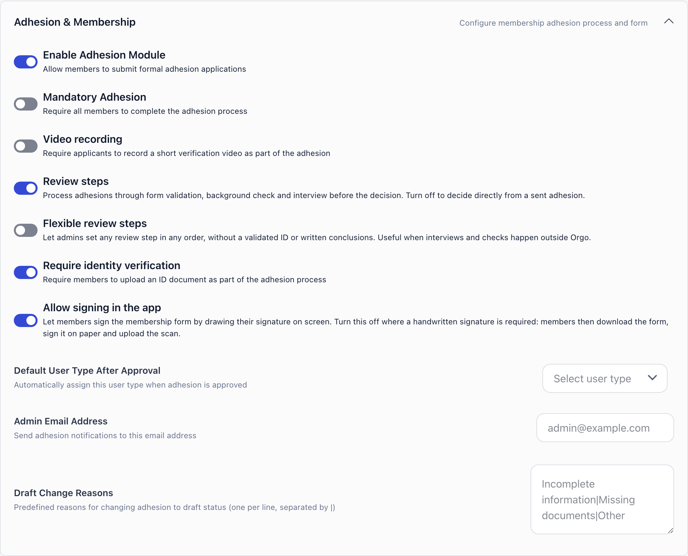
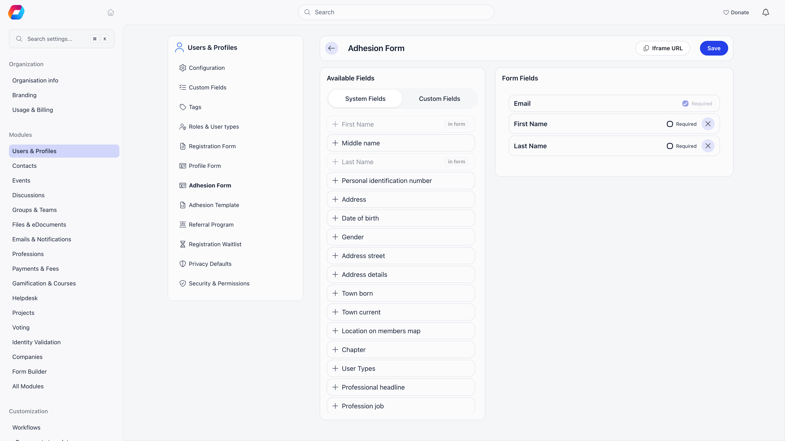
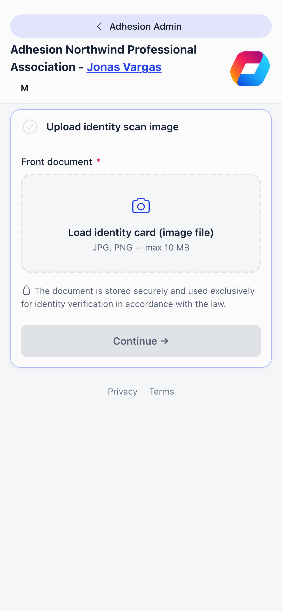
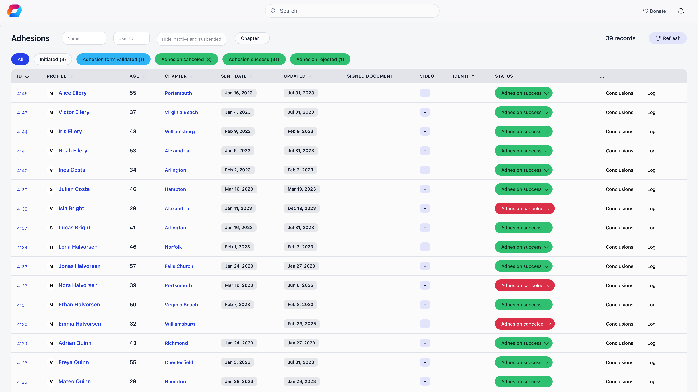
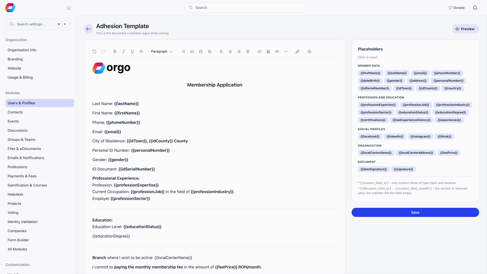

Adhesion is Orgo's membership application module. An applicant fills a form you define, optionally uploads an identity document and records a short video, signs the application in the browser, and sends it to your team. Staff then move it through a review chain and either approve or reject it.

**Built for:** organisations that vet people before admitting them, such as professional associations, political parties, trade unions and cooperatives, and anyone who needs a signed, auditable record of who was admitted and by whom.

**Replaces:** a PDF application form plus email review, plus a separate place to store the signed copy.

**When you do not need it:** if you only want a light approval gate, set new registrations to a pending [status](/platform/users/statuses) instead. Adhesion is heavier: it adds an ID check, a signature and a multi-step review.

---

## Turning it on

**Settings** → **Modules** → **Users & Profiles** → **Configuration** → **Adhesion & Membership**. Only Orgo administrators can change it.

| Setting | What it does | Default |
|---|---|---|
| **Enable Adhesion Module** | Turns the module on. Until it is on, the Adhesions menu item and the member's own application page are hidden. | Off |
| **Mandatory Adhesion** | Every new account gets an application in Initiated status the moment it is created, and the member is redirected to it on every page until the application succeeds. | Off |
| **Video recording** | Adds a video step after sending, where the applicant answers questions on camera. | Off |
| **Review steps** | Runs applications through form validation, background check and interview before the decision. Turn it off to decide straight from a sent application. | On |
| **Flexible review steps** | Only matters with Review steps on. Lets admins set any review step in any order, without a validated ID or written conclusions. Useful when interviews and checks happen outside Orgo. | Off |
| **Require identity verification** | Requires an ID document upload, and blocks the "form validated" step until that document is validated. | On |
| **Allow signing in the app** | Lets the applicant draw their signature on screen. Turn it off where a handwritten signature is required: the applicant then downloads the form, signs it on paper and uploads the scan. | On |
| **Default User Type After Approval** | The [user type](/platform/users/user-types) assigned when an application is approved. | None |
| **Admin Email Address** | Extra address notified when an applicant sends an application. The local HR team is always notified as well. | None |
| **Draft Change Reasons** | The pick list an admin chooses from when sending an application back. Entries are separated by a pipe character, not by commas. | None |

<Warning>
  With **Mandatory Adhesion** on, members are redirected to their application on every route until it reaches Adhesion success. Chapter admins and above, and members who already hold the configured success user type, are exempt. Keep your review turnaround short.

If a member also owes a mandatory membership fee, the adhesion comes first: they are sent to the application, and payment is enforced once it succeeds.
</Warning>

---

## Building the form

**Settings** → **Modules** → **Users & Profiles** → **Adhesion Form** (Orgo administrators). The page has two panels. **Available Fields** on the left has a **System Fields** tab and a **Custom Fields** tab: click a field, or drag it across, to add it to the form. Fields already added carry an **in form** tag. **Form Fields** on the right lists what the applicant will see, in the fixed order the application page draws them, each with a **Required** checkbox. **Save** stores the form. Email is always included, always required, and cannot be removed.

The system fields you can add are: first name, middle name, last name, personal identification number, address, date of birth, gender, address street, address details, town born, town current, location on members map, chapter, user types, profession headline, profession job, profession expertise, profession sector, profession industry, phone number, ID serial and number, Facebook, Twitter, LinkedIn, Instagram, Telegram and TikTok profiles, personal number, education status, certifications, experience history, and fee level. Every [custom field](/platform/users/custom-fields) you have defined is listed on the **Custom Fields** tab and can be added the same way; **Create Custom Field** there makes a new one without leaving the page.

Personal number, ID serial and number, and date of birth are only shown to people allowed to see private data. **Fee level** lets the applicant choose which [membership fee price](/platform/fees/fees) applies to them; that choice is written to their profile and printed on the generated document.

The **Iframe URL** button copies an embeddable link to the application page for your tenant. The applicant still has to be signed in, so this is a convenience for your own site, not an anonymous public form.

---

## What the applicant does

The member opens **My Adhesion** from their profile menu (`/adhesion`), or lands on it automatically when adhesion is mandatory. Chapter HR managers can fill it in on their behalf from the member's profile, which opens the same page for that member. `/adeziune` still resolves to it as well.

<Steps>
  <Step title="Start adherence">
    Creates the application in **Initiated** status. Everything after this point is editable only while it stays in Initiated.
  </Step>
  <Step title="Upload identity scan image">
    Shown only when **Require identity verification** is on. The front of the document is required; a back side can be added with the "Document has information on the backside" switch. Orgo runs OCR on the upload to pre-fill identity fields; if OCR fails the upload still succeeds and the applicant types the details manually.
  </Step>
  <Step title="Complete the adhesion profile form">
    The fields you selected in the form builder. Required custom fields must all have a value before the next step unlocks.
  </Step>
  <Step title="Adhesion signature">
    The applicant can download the unsigned document first, then signs on a canvas. Signing generates the PDF from your template with the signature embedded and stores it as the application's signed document. Staff filling the form on someone else's behalf get no canvas, and neither does anyone when **Allow signing in the app** is off: they upload the signed file instead, up to 5 files.
  </Step>
  <Step title="Send adhesion">
    Moves the application to **pending**. Blocked until a signed document exists and, when identity verification is on, until an ID document has been uploaded. When the member sends it themselves, Orgo emails the configured admin address plus every HR member of their chapter.
  </Step>
  <Step title="Video recording">
    Only when **Video recording** is on. The recorder walks the applicant through a set of questions with a 5 minute total limit, and can be re-recorded while the application is Initiated or pending.
  </Step>
</Steps>

---

## Reviewing applications

**Management** → **Adhesions** in the sidebar, or `/adhesions`. Requires chapter HR manager rights or above.

Status chips with live counts sit above a table of the applicant, age, chapter, sent and updated dates, the signed document and video downloads, the identity state, and a status dropdown. Filter by name, by user ID, by **Member status**, and, for parent-chapter HR managers and above, by chapter. Organization-wide HR managers see the whole organization; everyone else is restricted to the chapters they manage. Applications marked Duplicated, and applications belonging to deleted members, never appear.

**Member status** is the account status, not the application status. It starts on **Hide inactive and suspended**, so applications of members who are Inactive or Suspended (or deleted) are hidden while every other status, including awaiting approval and waiting list, stays visible, and the status chip counts follow the same filter. Choose **All members**, or one specific status, to see the rest. A row whose member is not Active carries a red `member:` tag with that status.

| Status shown | Meaning |
|---|---|
| **Initiated** | Draft. The applicant can still edit everything. |
| **pending** | Sent for review. |
| **Adhesion form validated** | An admin checked the submitted form. |
| **Background checked** | Background check recorded. |
| **Interviewed** | Interview recorded. |
| **Adhesion success** | Approved. |
| **Adhesion rejected** | Refused. |
| **Adhesion canceled** | Withdrawn or dropped, with a reason. |
| **Duplicated** | Marked as a duplicate and removed from the queue. |

With **Review steps** on, the queue offers the full chain: pending, validated, background checked, interviewed, then the decision. With it off, the review statuses are hidden and an admin goes straight from a sent application to success, rejected or canceled. With **Flexible review steps** on as well, every review status is open from any active status, in any order, so stages that happened outside Orgo can be recorded as they are.

Gates on each move (the first two do not apply under Flexible review steps):

- **Adhesion form validated** requires a validated identity document, unless identity verification is off for the tenant.
- **Adhesion success** and **Adhesion rejected** require both the Interview conclusion and the Background conclusion, whenever Review steps is on.
- **Adhesion canceled** requires a cancel reason.
- Moving back to **Initiated** opens the Draft Change Reasons picker, deletes the signed document so it has to be signed again, and emails the applicant with the reasons you selected.

Every status change asks for confirmation and is written to the application log.

Approving flags the member as a full member, assigns the **Default User Type After Approval** (creating the underlying role assignment if the member did not have it), and stamps the date they became a full member. If their user type actually changed as a result, they get the approval email.

<Note>
  Approval does not change the member's account status. A member whose account is Inactive or Unapproved stays that way after approval; change the [status](/platform/users/statuses) separately.
</Note>

### Conclusions and the audit log

The **Conclusions** and **Log** buttons on each row open the same screen, also at `/adhesion/{id}/log` for chapter HR managers.

**Conclusions** holds three free-text notes: Interview conclusion, Background conclusion, and Adhesion cancel reason. They can be saved while the application sits at validated, background checked, interviewed or canceled. They are read-only once it reaches Adhesion success or Adhesion rejected, and cannot be saved at all while it is still Initiated, pending, Duplicated or a decision has been made.

**Log** shows who sent, validated, interviewed, decided on and last updated the application, each with a timestamp and a link to the person, followed by the system log entries with the raw field-level changes.

---

## The generated document

**Settings** → **Modules** → **Users & Profiles** → **Adhesion Template** (Orgo administrators). This is the document a member signs when joining. You write it in a rich text editor, with a **Placeholders** panel beside it: click a placeholder to insert it where your cursor is. **Preview** shows the document with each placeholder highlighted, and **Save** stores it.

These placeholders are replaced when the PDF is generated:

| Group | Placeholders |
|---|---|
| Identity | `{{firstName}}`, `{{lastName}}`, `{{personalNumber}}`, `{{dateBirth}}`, `{{gender}}`, `{{idSerialNumber}}`, `{{address}}`, `{{idTown}}`, `{{idCounty}}`, `{{country}}` |
| Contact | `{{email}}`, `{{phoneNumber}}`, `{{facebook}}`, `{{linkedin}}`, `{{instagram}}`, `{{tiktok}}` |
| Organisation | `{{localCenterName}}`, `{{localCenterAddress}}`, `{{feePrice}}` |
| Professional | `{{professionIndustry}}`, `{{professionJob}}`, `{{professionExpertise}}`, `{{professionSector}}`, `{{hasExperienceHistory}}`, `{{experiences}}` |
| Education | `{{educationStatus}}`, `{{educationDegree}}`, `{{certifications}}` |
| Signature block | `{{signature}}`, `{{dateSignature}}` |

For a custom field, use `{custom_field_<id>}` with the field's numeric id (single braces); only custom fields of type input and textarea are offered this way. To drop a section when the member left a field empty, wrap it as `{if|custom_field_<id>}` ... `{custom_field_<id>|endif}`. `{{educationDegree}}`, `{{certifications}}` and `{{experiences}}` expand to tables, so put them on their own line rather than inside a sentence.

---

## Emails

Five emails belong to this flow. They are listed under **Adhesion** at **Settings** → **Modules** → **Emails & Notifications** → **Emails**, each with its own switch and **Turn all off** for the five together, and each can be reworded with **Edit text** (see [Email templates](/platform/emails/email-templates)). Your wording reaches every applicant as written, whatever language they read the platform in.

| Email | Sent to | Trigger |
|---|---|---|
| `adhesion_pending_admin` | Admin Email Address plus the chapter's HR team | Applicant sends their application |
| `adhesion_draft` | Applicant | Application sent back to Initiated, with the selected reasons |
| `adhesion_validated_member` | Applicant | Application moved to Adhesion form validated |
| `adhesion_rejected` | Applicant | Application rejected |
| `adhesion_success` | Applicant | Application approved and their user type changed |

---

## Troubleshooting

<AccordionGroup>
  <Accordion title="The applicant cannot press Send">
    Sending needs a signed document and, when identity verification is on, an uploaded ID. If the form was filled by staff, the signed file has to be uploaded manually.
  </Accordion>

  <Accordion title="I cannot move an application to Adhesion form validated">
    The identity document has to be validated first, with the **Validate** button in the Identity column of the queue. If you do not run identity checks, turn **Require identity verification** off and both the precondition and the upload step disappear.
  </Accordion>

  <Accordion title="The queue refuses my decision and asks for conclusions">
    With **Review steps** on, open **Conclusions** on that row, save both the Interview and Background conclusions, then set the status.
  </Accordion>

  <Accordion title="The applicant says they never got the approval email">
    It only goes out when approval actually changes their user type, so nothing is sent if they already held the type set in **Default User Type After Approval**. Also check that the email is switched on under **Adhesion** on the **Emails** page.
  </Accordion>

  <Accordion title="An application needs to be redone from scratch">
    Set its status back to **Initiated**: this deletes the signed document and reopens every step. Applications that were rejected or marked Duplicated also show a **Reopen** button on the applicant's own page for chapter HR managers.
  </Accordion>

  <Accordion title="A member resigned but still shows an application">
    Approving a [resignation](/platform/users/resignation) detaches the application from the member when a guest user type is configured, so their profile no longer points at it. The application row itself is kept as a record.
  </Accordion>
</AccordionGroup>

---

## Related

- [Identity Validation](/platform/identity-validation) - the ID document check the validation step depends on
- [User Types](/platform/users/user-types) - what gets assigned on approval
- [Custom Fields](/platform/users/custom-fields) - adding your own questions to the form
- [Registration Form](/platform/users/registration-form) - what people fill in before the application
- [User Statuses](/platform/users/statuses) - the account status, which approval does not change
