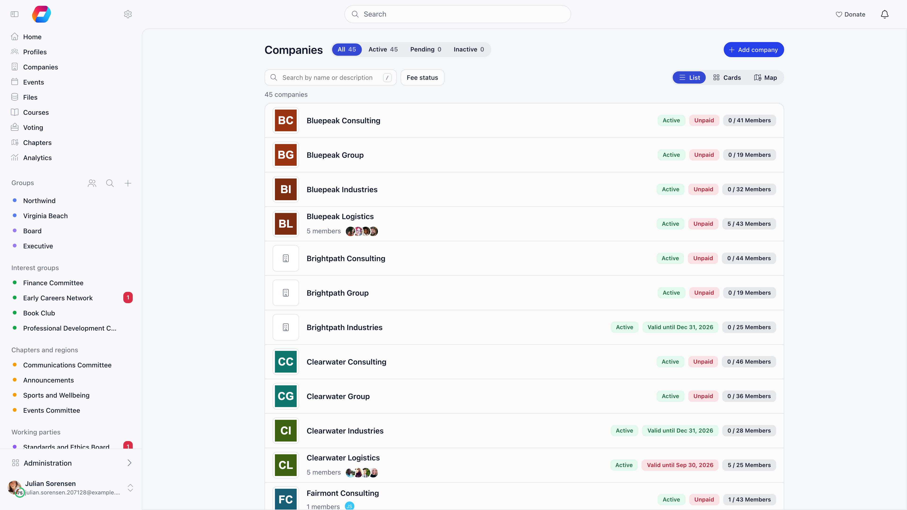
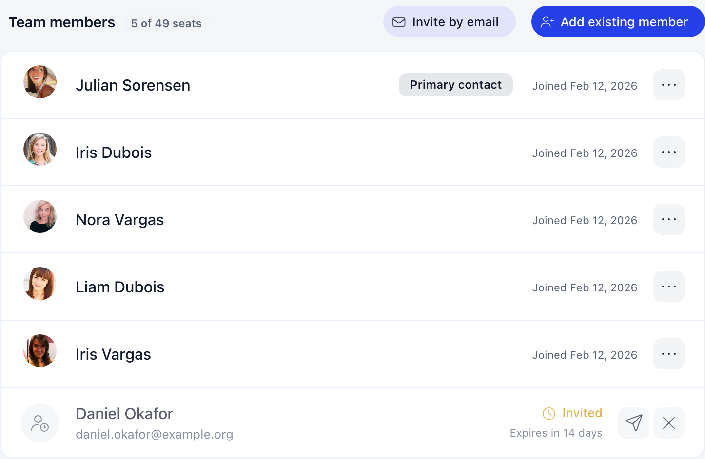
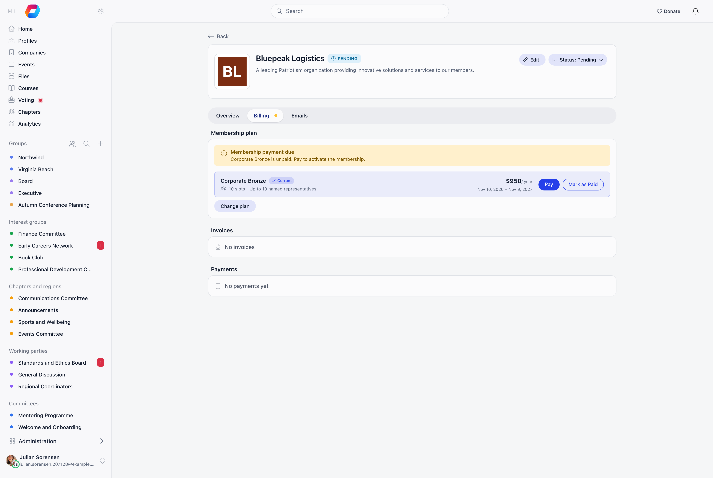

A company is an organization that holds a membership on behalf of its people. It has its own record, its own billing details, a seat allowance, and one membership fee. Its primary members inherit the company's membership validity instead of paying individually.

**Built for** organizations whose members are businesses rather than individuals, including business networks, chambers of commerce, trade and industry associations, and any body that sells corporate or team memberships. **Replaces** spreadsheets of member companies plus manual invoicing and per-employee fee tracking.

<Note>
This page is about **member companies**, not about adding people to your
organization in general. Everything below applies once a company record exists
and holds the membership. To create an account for an ordinary member, use
**Add member** in the member directory: see
[Adding Members](/platform/users/adding-members).
</Note>

---

## How to enable

**Settings** → **Modules** → **Companies**. Only Orgo administrators see this page. It has two tabs: **Configuration**, and **Company fields** for the extra questions you ask every company (see [Company profile](#company-profile)).

| Setting | What it does |
|---------|-------------|
| **Enable Companies Module** | Turns the feature on. Adds **Companies** to the sidebar and a **Company** card to member profiles. The **Members** menu entry is then called **Profiles** |
| **Company media** | Featured audio, featured video and a photo gallery on each company page. On by default. See [Company media](#company-media) |
| **Icon for companies without a logo** | Shown on company cards, on the map, on the company page and on the sidebar entry until a company adds its logo |
| **Enable Company Fees** | Lets companies pay membership fees for their members. Only appears when the Payments and Fees module is active |
| **Public company directory** | Publishes your companies for anyone with the link. Off by default. See [Public directory](#public-directory) |

The **Company fields** tab beside **Configuration** holds the questions every company answers. See [Company fields](#company-fields).

With **Enable Company Fees** on, set a fee level's **Who it is for** to **Companies** in the fee product settings and give it a **People covered** number: company members then inherit membership status from the company and cannot buy an individual fee. A separate switch, **Settings** → **Modules** → **Payments & Fees** → **Company Fee Payment Mandatory**, locks company members out of the platform until the company fee is paid.

---

## Creating a company

Creating a company requires `HR_TENANT`. **Create** on the Companies list opens one form. Only **Company Name** is required, though payment needs the billing block completed.

| Group | Fields |
|---|---|
| Identity | Company Name, Description, Website, Company Logo, Location on companies map |
| Public directory | **Show in public directory**, when the directory is published and companies opt in |
| About us | The answers to your [company fields](#company-fields) |
| Media | Featured audio link, Featured video link, Gallery. Photos can be added once the company is saved |
| Billing Details | Legal Name, Registration Number, VAT Number, Billing Address, Postal code, Town, Country, Secondary address, Secondary postal code |
| Financial Contact | Financial contact full name, Financial contact email, Financial contact phone, Additional contact email 1 (Cc), Additional contact email 2 (Cc) |

Companies start **Pending** and flip to **Active** on the first paid membership fee. `ADMIN_TENANT` can also set status by hand from the company page. **Delete Company** is a soft delete: the record moves to status Deleted and disappears from every list.

<Note>
Members cannot create companies themselves. Whoever creates a company does so on behalf of others and is not enrolled in it, so add a **Primary Contact** afterwards from the company page.
</Note>

The form has a **Profile** tab and a **Billing** tab. Only **Company Name** is required, though payment needs the billing block completed.

| Tab | Fields |
|---|---|
| Profile | Company Name, Description, Website, Company Logo, **Show in public directory**, **Location on companies map**, your company questions under **About us**, and **Featured media** and **Gallery** when company media is on |
| Billing | Legal Name, Registration Number, VAT Number, Billing Address, Postal code, Town, Country, Secondary address, Secondary postal code |
| Billing, Financial Contact | Financial contact full name, Financial contact email, Financial contact phone, Additional contact email 1 (Cc), Additional contact email 2 (Cc) |

Companies start **Pending** and flip to **Active** on the first paid membership fee. Organization admins can also set the status by hand from the **Status** menu on the company page. **Delete company**, in the same menu, is a soft delete: the record moves to status Deleted and disappears from every list.

### Billing address and secondary address

**Billing Address** and **Postal code** are the address invoices go to. **Secondary address** and **Secondary postal code** are optional: use them when invoices need a second address line block, for example a registered office next to a postal address. Both addresses are private to the company's administrators and your HR team, except that the town and country can show in the public directory.

On an invoice issued to the company, the Bill-to block prints "address, postal code" and, when you filled it in, a second line "Secondary address: ..., postal code". Each invoice keeps its own copy of the address at the moment it is issued, so editing the company later does not change invoices already sent. The company address, town and country are also available as columns in the [report builder](/platform/reports).

---

## Members: primary and associate

A person can belong to more than one company, but in two different ways:

| | Primary member | Associate member |
|---|---|---|
| How many companies | One | Any number |
| Takes a seat | Yes | No |
| Roles (Primary Contact, Voting Representative) | Yes | No |
| Covered by the company's fee | Yes: inherits its validity date | No: keeps whatever their own primary company or own payments give them |
| Shown on their profile as | **Primary company** | **Associate member of** |

An associate is listed in the company without belonging to it for fee purposes: think of a consultant who sits on the boards of three member companies but is employed by one. A person who is already a primary member elsewhere can still be added to another company as an associate, but not as a primary member.

A membership points at either a **User** (has an account) or a **Contact** (in your database, no account). Both appear in the member list, and contacts are tagged **Contact**. Only user memberships inherit the company's validity date: a contact has no fee date, so membership sync skips it.

On the company page, the **Team members** panel has two ways in:

- **Invite by email** (company administrators): the person gets a link and joins as a primary member. See [Inviting employees](#inviting-employees).
- **Add existing member** (organization admins): searches users and contacts. Choose **Primary member** or **Associate member** first, and optionally type a **Title**. The search finds people already in your database, it does not create anybody. To create a member who is not joining through a company, use [Adding Members](/platform/users/adding-members).

Each member has a menu with **Edit title** or **Add title** (a free-text job title shown next to their name), **Make associate member** or **Make primary member**, and **Remove**. Company administrators and organization admins can also click a join date to correct it.

- **Make associate member** removes their roles and takes away the membership validity the company gave them. The Primary Contact cannot be made an associate: hand the role to someone else first.
- **Make primary member** needs a free seat, and fails if the person is already a primary member of another company.
- Removing a member, or a member leaving from their profile card, ends their membership and, if it was their primary one, clears the fee date and fee price the company gave them. When the last primary member leaves, they are asked whether to delete the company; associates alone do not keep a company alive.

<Info>
If you import company members from a CSV, every imported membership is primary. A row for someone who is already a primary member of another company is skipped with the message to add them as an associate from the company page.
</Info>

---

## The company directory

**Companies** in the sidebar opens the directory at `/organizations`, for every member of an organization running the module. It shows the active companies with search, a map, and a filter for each [company field](#company-fields) marked **Use as a filter**. Members can filter only on Public fields.

Staff with `HR_TENANT` also get **Manage companies**, which opens the full list at `/companies` with status counts and billing data. When the [public directory](#public-directory) is published, **Public page** opens it.

---

## Company fields

**Settings** → **Modules** → **Companies** → **Company fields**. Managing them requires `ADMIN_TENANT`.

Company fields are questions every company answers on its page, such as a genre or a sector. They work like [custom fields](/platform/users/custom-fields) on member profiles, with these differences:

- **File Upload** is not offered, and company fields cannot be encrypted.
- **Show on list rows and cards** puts the answer under the company name in the company lists and directory cards.
- **Use as a filter** adds the field as a filter on the company lists and the public directory. It is offered only on Dropdown, Checkboxes, Radio choice and Switcher fields. Options ticked within one field widen the results, and each further field narrows them.

Visibility has its own meaning here:

| Level | Who can read the answer | Who can fill it in |
|---|---|---|
| **Public** | Everyone who can see the company, including visitors of the public directory | Whoever can edit the company |
| **Company members and admins** | The company's own members and `HR_TENANT` | Whoever can edit the company |
| **Admins only** | `HR_TENANT`. The company itself does not see it | `HR_TENANT` |

---

## Company media

With **Company media** on, a company page can show:

- **Featured audio** and **Featured video**: links only, with no upload. Spotify, SoundCloud, YouTube and Vimeo play inside the page, and any other `https://` link becomes a button that opens it.
- **Gallery**: up to 12 JPEG, PNG, GIF or WebP images of 5 MB each. The first image is the cover, images can be reordered, and each can carry a description for screen readers.

Whoever can edit the company manages its media. Switching **Company media** off hides all of it, including on the public directory.

---

## Public directory

Publishing the directory puts your companies on a page anyone can open, without signing in. Switch **Public company directory** on under **Settings** → **Modules** → **Companies** → **Configuration**, then choose how it behaves:

| Setting | What it does |
|---|---|
| **Only companies that opt in** | On by default: each company decides through **Show in public directory** on its page, and new companies appear unless they switch it off. Off: every company meeting the membership status appears, whatever it chose |
| **Views offered** | **List**, **Cards** and **Map**. At least one of List and Map stays on, and Cards needs List |
| **Default view** | The view the page opens on, when more than one is offered |
| **Membership status required** | **Active and fee paid** (default) or **All active**. Only shown while company fees are on. Without them, every active company qualifies |
| **Share** | **Open public page**, and an embed code for any website. You can also add the **Company map** section in the [Website Builder](/platform/organisation/website-builder). Both show the views you offered |

A company must always be **Active** to appear. The public page is at `/company-map/<your-organization-slug>`.

| Visitors see | Visitors never see |
|---|---|
| Name, logo, description, website, town and country | Contact details, billing data, postal address, VAT or registration number |
| Answers to **Public** company fields, with filters on the ones marked **Use as a filter** | Answers to the other company fields |
| Featured audio and video, and the gallery | Fees and member counts |
| The Primary Contact and Voting Representative, subject to each person's [privacy settings](/platform/users/privacy-settings) | Any other member |

The list shows at most the first 500 companies, and says so when there are more.

---

## The Company card on a member's profile

The module adds a **Company** card to the main tab of a [member's profile](/platform/users/member-profile). It replaces the Company tab older versions had.

| Situation | What the card shows |
|---|---|
| The member belongs to a company | The company logo and name, and a role chip. The name opens the company page for the member themselves and for `ADMIN_TENANT`; for anyone else it is plain text. The role chip is shown only to the member and to staff with `HR_LOCAL` or `FINANCIAL_LOCAL` over them |
| It is your own profile and you belong to a company | The same, plus **Manage** (opens your company page) and **Leave** |
| The member belongs to no company | No card |

**Leave** asks "Are you sure you want to leave this company?". Leaving ends the membership and clears the fee date and fee price the company had given you, so you are treated as an individual member again. If you are the only person left, leaving also deletes the company (status Deleted), exactly as **Delete Company** does.

The card does not show the company's member count, valid-until date or status. Those are on the company page itself, one click away from the company name.

---

## Roles inside a company

Roles are stored per primary membership; a person may hold several. Associates cannot hold any.

| Role | What it grants |
|---|---|
| **Member** | The default. Sees the company page, inherits the membership validity |
| **Primary Contact** | Edits the company, manages members and invitations, pays. At most one per company |
| **Voting Representative** | Casts the company's vote in a [company vote](/platform/e-voting#company-votes). At most one per company |
| **Financial Rep** | Legacy. Same rights as Primary Contact, but it can no longer be assigned from the interface |

Roles are ticked or unticked from a member's menu. Assigning Primary contact or Voting representative takes it from whoever held it before, in the same action. A company always keeps at least one Primary contact.

`HR_TENANT` creates companies and can view, edit, and manage members and payments on any company in the organization without belonging to it. `ADMIN_TENANT` includes it.

Chapter permissions such as `ADMIN_LOCAL` and `HR_LOCAL` give no access to companies, because a company is not attached to a chapter anywhere in its record. Holders of those permissions see the same directory as any other member.

---

## Company profile

Beyond billing, a company has a public-facing profile, edited from **Edit** on the company page:

- **About us**: the questions you define under **Company fields** in the module settings. Each field is either public, for company members only, or for administrators only, and the form shows a **Company members only** or **Admins only** badge on the private ones. Visitors to the public directory see only what is public.
- **Featured media**: links to one audio and one video (Spotify, SoundCloud, YouTube and Vimeo play inside the page, any other link becomes a button), plus a **Gallery** of photos you can reorder. The first photo is the cover. Gallery photos can be added once the company is saved.
- **Location on companies map**: places the pin on the directory map. Leave it empty and the company sits on the centre of its town.
- **Show in public directory**: the company's own opt-in, offered when the organization publishes a directory and asks companies to opt in.

Members see the company directory from the **Companies** tab of the general group: a searchable list with filters, cards and a map, and each company's members. Organization-wide HR managers get a **Manage companies** button there that opens the admin list, where they also see pending and inactive companies, the fee status and the seat usage.

### Public directory

**Public company directory** in the module settings publishes your companies on a page anyone with the link can open, and in the website builder. Contact details, member counts and fees are never shown. Once it is on you choose:

- **Only companies that opt in**: companies decide on their own page whether to appear.
- **Views offered**: List, Cards, Map, with a **Default view**.
- **Membership status required**: **Active and fee paid** or **All active**. The choice only matters when company fees are on, and with **Active and fee paid** a company appears once it is active and its fee is paid.
- **Share**: an embed code and **Open public page**.

The map shows active companies only.

---

## Inviting employees

The **Team members** panel puts a person into *this company*, taking one of its seats and passing the company's membership validity to them. That is a narrower job than adding a member to your organization, which starts from the member directory instead: [Adding Members](/platform/users/adding-members).

<Steps>
  <Step title="Send the invitation">
    **Invite by email** on the company page. Enter the email, first name and last name, pick a role (Member, Primary contact or Voting representative), and add an optional personal message. **Send invitation** sends it.
  </Step>
  <Step title="The recipient opens the link">
    The email carries a link to `/company-invitation/{hash}`, which shows the company name and logo, who invited them, the message, and the role they were offered.
  </Step>
  <Step title="They accept or decline">
    **Accept Invitation** joins them to the company and emails a one-time login code, creating their account first if they do not have one. **Decline** closes it.
  </Step>
</Steps>

Invitations expire **30 days** after they are sent. Pending ones show in the member list with an **Invited** badge and a countdown; administrators can resend (resetting the 30 days) or revoke them.

An invitation is rejected up front when there are no free seats, when one is already pending for that email, when the person is already in this company, or when they are already a primary member of another company. The seat check runs again at acceptance, so one sent before the company filled up can still fail. Invitations always make a primary member: to add someone as an associate, use **Add existing member**.

<Warning>
First name and last name are labelled Optional in the invite dialog, but the server rejects the invitation without them. Fill both in.
</Warning>

---

## Seats

Seats come from the fee level the company bought: a level whose **Who it is for** is **Companies** carries a **People covered** value, and paying for it writes that number onto the company. **0 means unlimited.**

The count is primary members plus pending invitations, so an outstanding invitation holds a place. Associates take no seat, and neither do memberships that ended or whose user was deleted. The panel shows it as "used of max seats". When the allowance is full, **Invite by email** disappears and **Primary member** cannot be chosen in **Add existing member**, though associates can still be added.

---

## Paying the company fee

When company fees are on, the company page has a **Billing** tab. Its **Membership plan** panel is visible to the Primary contact (and any legacy Financial Rep) and to organization admins. It lists every non-archived company level on the tenant fee product, with the number of people it covers and its price. Invoices and payments for the company are listed under the same tab for the teams allowed to see them.

Select a plan, then **Pay** (or **Renew** once the company has been paid before). Orgo checks that Legal Name, Billing Address, Financial contact full name and Financial contact email are filled in, sending you to the edit form if any are missing, then offers:

- **Pay online**: a Stripe checkout. VAT is added on top of the configured net price as a separate line when your tenant charges VAT on fees and the price is not exempt.
- **Get invoice for bank transfer**: generates an unpaid invoice addressed to the company's billing name, address and secondary address, emails it, and shows a reference to quote on the transfer. Only offered when both bank-transfer membership payments and invoicing are enabled.
- **Mark as Paid** (organization admins only): records money received outside the platform. It asks for a period start, defaulting to the current expiry so it extends rather than overwrites, records a payment, updates the seats, and voids any pending bank-transfer invoice.

On a calendar-anchored fee cycle, a mid-cycle payment buys only the remainder and is prorated: the panel shows the list price struck through next to what you will actually be charged, plus `{months} of {total} months` and the exact period. The charge is always recomputed server-side at checkout, so the quote can never undercharge.

Renewal opens **60 days** before the current period ends. Before that window, a company with a valid membership sees no Pay button. A company whose chosen plan is unpaid or expired also shows a **Membership payment due** notice on its Overview tab.

---

## What members get from a company fee

When a payment lands, Orgo copies the company's valid-until date onto every active **primary** member who has an account, sets the company to Active, and applies the plan's seat count. Joining an existing paid company as a primary member inherits its date immediately; leaving or being removed clears the person's fee date and fee price. Associates are untouched: they never receive the company's date and never lose their own when an associate membership ends. On their own fee screen, company-covered members see "Membership managed by company" with a link to the company, instead of the individual payment options.

If **Company Fee Payment Mandatory** is on and the membership has lapsed, primary members are blocked out: Primary Contacts land on `/company-fee-payment`, a guided three-step page (Billing Information, Select a Plan, Complete Payment), everyone else on `/company-fee-required`, which names the company and points them at the financial contact.

---

## Renewal reminders

Companies get their own reminder ladder, separate from individual member reminders: about a month before expiry, 7 days before, 1 day before, on the expiry date, then 7, 14 and 30 days after.

Each goes **To** the financial contact email, copying the active Primary Contacts and the two additional Cc addresses. Without a financial contact email, the first Primary Contact is promoted to the To line. A company with nobody reachable is skipped.

Only **Active** and **Pending** companies with a plan and a renewal date are reminded. Setting a company to Inactive, or deleting it, stops both the reminder and the renewal invoice that goes with it.

---

## Importing companies

**Settings** → **Customization** → **Import** offers **Companies** (with membership details) and **Company Members** (assigning users to companies with roles), both gated on the module being active. Example CSV files are linked next to each.

---

## Common questions

<AccordionGroup>
  <Accordion title="Where did the Company tab on the member profile go?">
    It is now the **Company** card on the profile's main tab. The membership figures the tab used to carry (members used and allowed, valid until, status) live on the company page, which you reach from the company name or **Manage**.
  </Accordion>

  <Accordion title="How does a member leave a company?">
    On their own profile, **Leave** on the Company card. Staff cannot use that button on someone else's profile; an administrator removes a person from the member list on the company page instead.
  </Accordion>

  <Accordion title="Can members create their own company?">
    No. Companies are created from the Companies list by staff with `HR_TENANT`, who then add a **Primary Contact** to run the company.
  </Accordion>

  <Accordion title="Why is a company missing from the public directory?">
    Check, in order, that it is **Active**, that **Show in public directory** is on for it (while **Only companies that opt in** is on), and that its fee is paid (while **Membership status required** is **Active and fee paid**). The public list can take a minute to update.
  </Accordion>

  <Accordion title="What happens to the company if its last member leaves?">
    The company is deleted (soft delete, status Deleted) as part of leaving, with no second confirmation. Deleted companies disappear from every list.
  </Accordion>
</AccordionGroup>

---

## Related

- [Member Profile](/platform/users/member-profile) - the Company card and the other cards on the profile

- [Adding Members](/platform/users/adding-members) - the four ways people get into your organization, and where this one fits
- [Family Members](/platform/users/family-members) - the household equivalent, without shared fees
- [Membership Fees](/platform/fees/fees) - fee products, prices and cycles
- [Record a Payment](/platform/fees/record-payment) - payments taken outside the platform
- [VAT](/platform/fees/vat) - how VAT is added to a fee price
- [Contacts](/platform/contacts) - non-member records that can hold a company seat
- [E-voting](/platform/e-voting) - company votes and the voting representative
- [Permissions](/platform/permissions) - what organization-wide HR managers and organization admins can do
