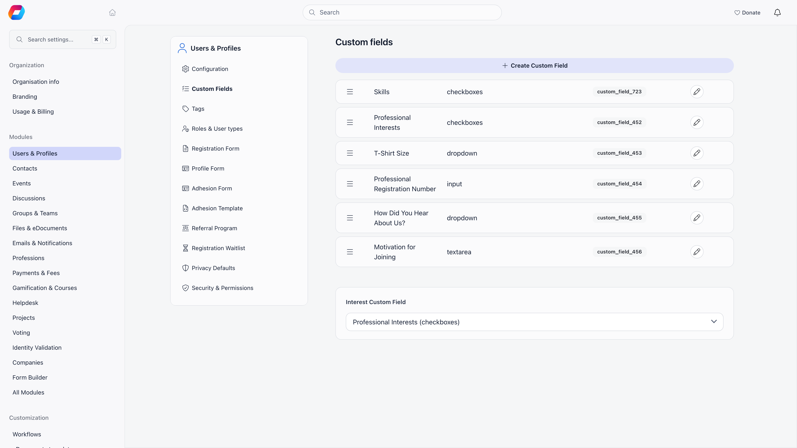
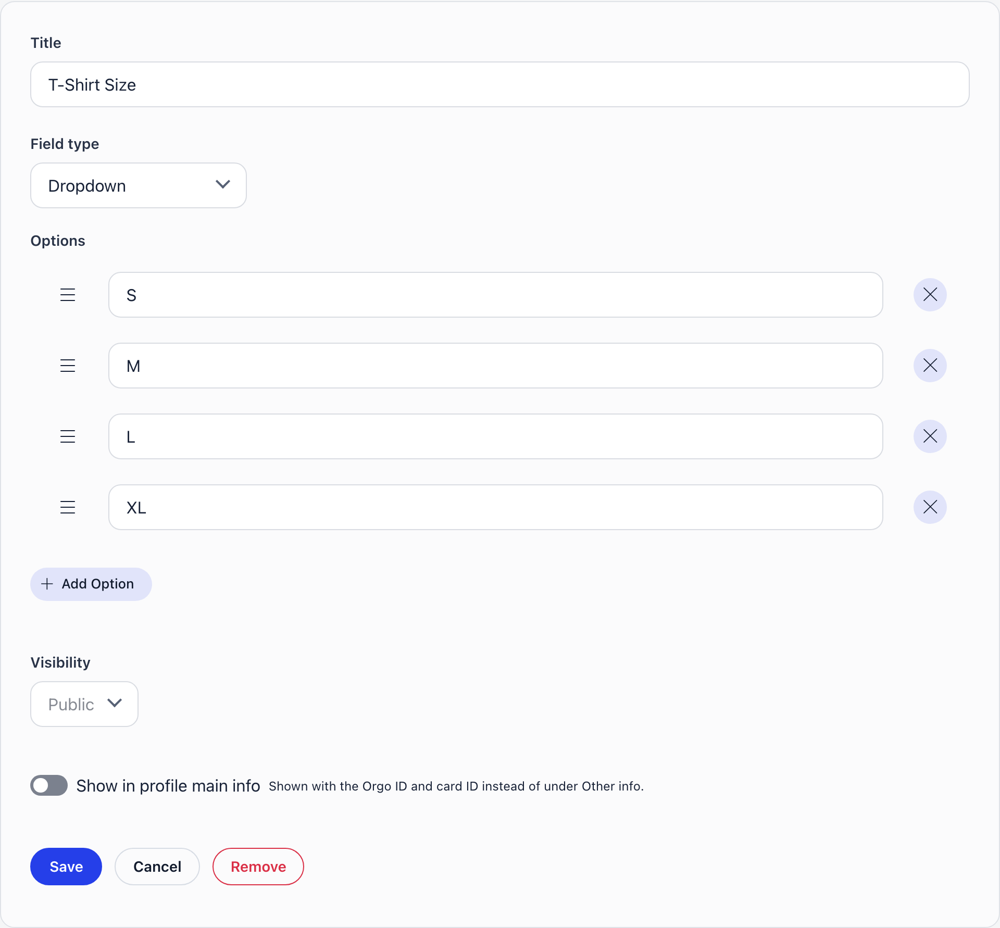
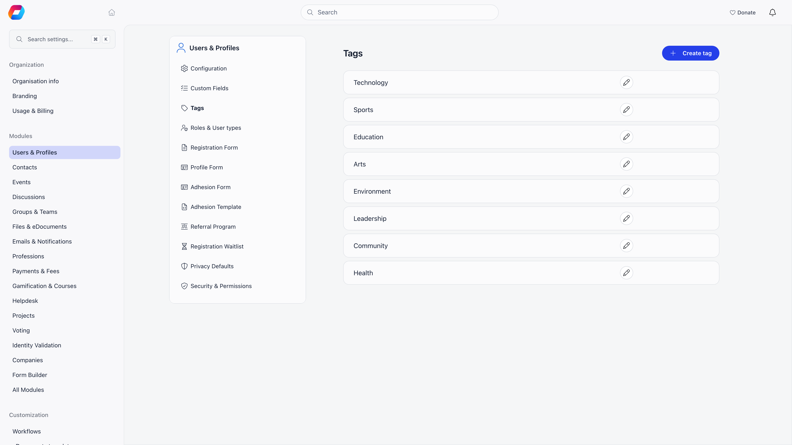

Custom fields capture information Orgo does not ship a column for: emergency contact, T-shirt size, licence number, dietary restrictions, whatever your organisation actually tracks. A field is defined once and reused across the profile form, the registration form, the adhesion form, contact records, Forms and your emails.

 reference tags, plus the Interest Custom Field selector" style={{ width: "100%", borderRadius: "8px", border: "1px solid var(--border-color)", marginBottom: "1rem" }} />

---

## Creating a field

**Settings** → **Modules** → **Users & Profiles** → **Custom Fields**. Creating, editing, reordering and deleting profile fields, registration fields included, needs the **Orgo administrator** flag on your account, not the organization admin permission. Custom fields of other kinds are gated by what they belong to: an event field by organization admin or organization event manager permission, a form field by organization admin or organization HR permission, and a company field by organization admin permission. Changing a field from one kind to another asks for both tiers.

<Steps>
  <Step title="Click Create Custom Field">
    The form opens inline at the top of the list.
  </Step>
  <Step title="Enter a title and choose a field type">
    Both are required before Save is enabled.
  </Step>
  <Step title="Add options or allowed file types">
    Dropdown, Checkboxes and Radio choice fields start with two placeholder options (Option 1 and Option 2): rename them, add more and remove the ones you do not want. See the note under Field types before you reorder or remove options on a field people have already answered. File Upload fields need at least one allowed file type before saving.
  </Step>
  <Step title="Set visibility">
    **Public**, **User** or **Admin**, described below.
  </Step>
  <Step title="Save, then put it on a form">
    A new field exists but is not shown anywhere yet. Add it to the [profile form](/platform/users/profile-fields), the [registration form](/platform/users/registration-form) or the [adhesion form](/platform/users/adhesion).

    You can also skip this page: the profile form builder, the registration form builders and the adhesion form builder each have a **Create Custom Field** button on their **Custom Fields** tab that opens this same editor in a window and adds the new field to the form when you save. The pencil next to a field there edits it. Two things differ on a registration form: File Upload is not offered, and the **Visibility** choice (only **Public** and **User**) appears only for a field that is also on the profile form; a field created there starts as **User**.
  </Step>
</Steps>

Drag rows in the list to reorder them. Order matters where a form does not define its own arrangement.

---

## Field types

| Type | Stores | Good for |
|---|---|---|
| **Input text** | One line of text | Membership number, emergency contact |
| **Input numeric** | A number | Years of experience |
| **Textarea** | Multi-line text | Notes, medical information |
| **Dropdown** | One option from a list | Region, skill level |
| **Checkboxes** | Several options from a list | Interests, languages, committees |
| **Radio choice** | One option from a list, all shown at once | Short either-or questions |
| **Switcher(True/False)** | On or off | Consent, opt-in |
| **Date** | A calendar date | Certification expiry |
| **File Upload** | An uploaded file | Certificates, ID scans, signed forms |

There is no dedicated URL or email type. Use **Input text** for those.

<Note>
Choice fields store each option's number, not its text and not its place in the list. A new option gets the highest number so far plus one. Renaming an option therefore updates it everywhere, including in answers members already gave. Deleting an option does not delete the answers that pointed at it, but those answers no longer resolve to a label and display as a bare number. Do not delete an option and add a different one in its place: if the deleted option held the highest number, the new one takes that number and inherits the old answers. Options are listed in the order of their numbers, and dragging one onto another swaps their wording, so only reorder a field before anyone has answered it. Prefer renaming over delete-and-recreate.
</Note>

**File Upload fields:** pick at least one allowed type per field from **PDF**, **Images (PNG, JPG)** and **Videos (MP4, WebM)**. Maximum file size is per field, 1 MB to 50 MB, default 50 MB. An optional **Example File** gives members a template to download.

---

## Visibility

Every field carries one of three levels, enforced on the server for both reading and writing.

| Level | Who can read the value | Who can write it |
|---|---|---|
| **Public** | The member and your staff. Other signed-in members see it only if the field is on your [profile form](/platform/users/profile-fields) (or is the designated skills or interests field) | The member and your staff |
| **User** | The member and your staff. Other members do not see it at all. | The member and your staff |
| **Admin** | Your staff only. The member cannot see it on their own profile. | Your staff only |

"Your staff" means organization HR assistant permission (implied by organization HR permission and organization financial permission) organisation-wide, or chapter HR assistant permission (implied by chapter HR permission, parent-chapter HR permission, chapter financial permission and chapter admin permission) over a member in their own local center. Guest accounts see no custom field values at all.

The adhesion form and the per-type `/join/<slug>` forms label User and Admin fields "(user only)" and "(admin only)"; the profile form and `/register` do not. Admin fields are excluded from the profile completion screen's required-field check, so a member is never blocked by a field they cannot see.

Visibility is organisation-wide, not per user type; to vary the questions by type, use per-type [registration forms](/platform/users/registration-form).

### Where a value actually saves

Visibility gates writing as strictly as it gates reading. On the public
registration pages nobody is signed in yet, but the account that was just created
counts as the member, so **Public** and **User** answers are saved. **Admin**
answers are not, because only your staff may write them. They are dropped without
an error: the applicant sees a normal success screen and the answer is simply not
there.

| Where the value is entered | Public | User | Admin |
|---|---|---|---|
| A member editing their own profile | Saved | Saved | The field is not shown to them |
| A parent editing a child's profile in their Family | Saved | Saved | The field is not shown to them |
| Your staff editing a member's profile | Saved | Saved | Saved |
| A member's [adhesion](/platform/users/adhesion) form | Saved | Saved | Rejected unless staff are filling it in |
| The public registration form at `/register` | Saved | Saved | Not saved |
| A per-user-type form at `/join/<slug>` | Saved | Saved | Field is stripped before the page loads |
| [Import](/platform/customization/import) from a spreadsheet | Saved | Saved | Saved |

An import cannot fill a field that is encrypted: the import wizard refuses a
column mapped to one, and a value sent that way by an older file is skipped.

"Your staff" is drawn slightly tighter on the profile edit form than elsewhere: the
form only offers Admin fields to chapter HR permission and above. Someone holding
Chapter financial permission or chapter HR assistant permission can read an Admin field's value on a
member's profile but will not find it among the fields they can edit. Give them
Chapter HR permission on that chapter if editing is part of their job.

The practical rule: **Admin fields do not belong on a registration form.** Public
and User both work there. What differs is who sees the answer afterwards: other
members see a Public answer only when the field is also on the
[profile form](/platform/users/profile-fields), so a question asked only at
sign-up stays with the member and your staff whatever its visibility. If you need
an answer from staff only, give the field **Admin** visibility and put it on the
profile form, where only your staff are offered it.

---

## Encryption at rest

Toggle **encryption** while creating or editing a field. Only organization admins see the toggle.

- Only **Input text**, **Input numeric**, **Textarea** and **Date** can be encrypted. Choice, switch and file fields cannot.
- **5 encrypted fields per organisation.** To go past the cap, decrypt or delete an existing one; for identity documents use [Identity Validation](/platform/identity-validation), which has its own encrypted storage.
- AES-256-GCM, bound to your organisation and to that specific field, so a value cannot be transplanted between fields or tenants.
- Turning it on re-encrypts stored values, turning it off decrypts them. Both run in the background after you save and are recorded in your organisation's activity log.
- Every decrypting read is logged: who read it, from which address, through which endpoint.

<Warning>
Switching encryption off asks you to type the field's name to confirm. It is not a display setting: it rewrites every stored value back to plain text.
</Warning>

Reading and editing an encrypted field is no different from any other; the encryption is invisible in the interface.

---

## Where custom fields are used

| Surface | How to enable it | Notes |
|---|---|---|
| [Profile form](/platform/users/profile-fields) | Add the field in the profile form builder, or press **Create Custom Field** there | Also offers **Required** and **Immutable** |
| [Registration form](/platform/users/registration-form) | Add the field in the form builder (general form or a per-type form), or press **Create Custom Field** there | Public and User fields only in practice; no file uploads |
| [Adhesion form](/platform/users/adhesion) | Tick the field on the adhesion form, or create it there | |
| Contact records | Contacts reuse the fields already on the profile form | |
| [Forms](/platform/forms) | In the form builder, turn on **Save the answer to the profile** for a question and pick the field under **Your database fields** | The answer is copied to the submitter's record once Orgo knows who they are. A choice question should offer the same options as the field, or Orgo warns you |
| Member directory | Turn the column on from **View columns** | Table view only. Organization HR permission anywhere, or chapter admin permission on that administrator's own chapter list |
| Imports | Map a column to the field in the import wizard | See [Custom fields in imports](/platform/customization/import/custom-fields). Encrypted fields cannot be imported into |
| Newsletters and emails | Pick the field from the merge-tag menu in the newsletter, workflow or system email editor | Admin-only, encrypted, file and chapter fields are never filled in |
| E-document templates | Use a `{custom_field_<id>}` placeholder | The id is the reference tag shown next to each field in the list |

To collect something from every existing member, add the field to the profile form and mark it **Required**: members are prompted the next time they open Orgo.

Event registration forms and the standalone form builder create their own fields, scoped to that event or that form. Those do not appear on this settings page and are managed where they were created. Companies keep a separate set of fields too, under the Companies module settings, **Company fields**.

---

## The Interest field

The selector at the bottom of the list designates one Dropdown, Checkboxes or Radio choice field as your interests field. That adds an interests filter to the member directory and an interests breakdown to organisation statistics, and gives the field its own section on member profiles instead of a plain form row. Create a Checkboxes field with your options, add it to the profile form, then select it here.

**Enable Skills Field** (**Settings** → **Modules** → **Users & Profiles** → **Configuration**) does the same for skills, except Orgo creates the field and seeds it with a catalogue. While the setting is on the field cannot be deleted, though its options stay editable. Turning it off preserves members' existing selections.

---

## Deleting a field

Deleting removes every answer members gave and strips the field from the profile, registration and adhesion form configurations, plus any per-user-type registration form. It is not reversible. To stop collecting a field without losing data, take it off the forms and leave the definition in place.

---

## Tags

Tags are a lighter alternative: a name administrators apply to member profiles for filtering and segmentation. Members never see or set their own tags, tags carry no value or type, and tag names are unique within your organisation regardless of capitalisation. Manage them at **Settings** → **Modules** → **Users & Profiles** → **Tags**.

Use a tag when staff need to label people ("VIP", "needs follow-up"). Use a custom field when you need a member to answer a question.

---

## Troubleshooting

<AccordionGroup>
  <Accordion title="Answers from the registration form are missing">
    Check the field's visibility. An **Admin** field is never saved on the public
    registration pages, because only your staff may write it. There is no error: the
    applicant fills the box, the account is created, and the answer never reaches the
    profile. Change the field to **Public** or **User**, or ask the question after joining
    on the [profile form](/platform/users/profile-fields). See the table under
    [Where a value actually saves](#where-a-value-actually-saves).

    The same field on a `/join/<slug>` form behaves slightly differently: Admin fields
    are stripped before the page is built, so the applicant never sees them.

    If the answer was saved but other members cannot see it, that is by design: they
    only see Public fields that are on the profile form.
  </Accordion>

  <Accordion title="A regional officer sees only Public fields on chapter members">
    Reading User and Admin values on someone else's profile requires the **Orgo
    administrator** flag or an organisation-wide staff permission (organization admin permission,
    Organization HR permission, organization financial permission or organization HR assistant permission), or a chapter staff
    permission **plus the reader and the member being in the same chapter**.
    The chapter comparison is a direct match, not
    a walk up the hierarchy, so someone holding parent-chapter HR permission over a region does
    not pick up User and Admin values on members of the chapters below them: on those
    profiles they see the Public fields only, like any other member.

    If a regional officer genuinely needs those values across the region, the only
    permission that delivers them today is an organisation-wide one such as
    Organization HR permission. Weigh that against the reach it grants, and prefer keeping the
    sensitive questions in an organisation-level workflow instead.
  </Accordion>

  <Accordion title="The custom field columns are not in the member directory">
    The column menu is the table icon above the list, and it only exists in the table
    view, so a person sitting in **Gallery** will not see it at all. Both the menu and
    the custom-field columns need organization HR permission, or chapter admin permission while looking at that
    administrator's own chapter list.

    A chapter administrator can therefore put a custom field on their own chapter's
    list, but not on the organisation-wide directory or on another chapter's. For
    those, use the profile, export the list, or ask an organisation administrator.
  </Accordion>

  <Accordion title="I cannot import values into an encrypted field">
    Import never writes into a field that is already encrypted. The import wizard
    refuses a column mapped to one, and an older-style file that names one has the
    value skipped, because writing it would have stored plain text in a field that is
    meant to be encrypted.

    To load sensitive answers, import them into a field that is not encrypted yet, then
    switch **encryption** on for that field and save. The background pass encrypts every
    value stored in plain text. Until it finishes, the values sit unencrypted, so do this
    straight after the import. For identity documents use
    [Identity Validation](/platform/identity-validation), which has its own encrypted
    storage.
  </Accordion>

  <Accordion title="I switched encryption on and off quickly and I am not sure what is stored">
    Each flip queues a background pass, and a pass that notices the flag has changed
    under it stops where it is rather than fighting the newer instruction. Flip twice
    in quick succession and the first pass can end part-way, leaving some values
    converted and some not.

    This is safe to read: every value carries its own marker, so Orgo decrypts the ones
    that need it and returns the rest untouched, whatever state the field is in. It is
    only untidy at rest. To settle it, leave the toggle alone for a few minutes, then
    check your organisation's [Logs](/platform/logs) for the encryption entries, and if
    you want certainty that every row matches the flag, flip it off and on once more
    and let that pass finish.
  </Accordion>

  <Accordion title="Who read an encrypted value, and when">
    Every request that decrypts at least one value files one entry in your
    organisation's [Logs](/platform/logs), recording who made the request, their IP
    address, the endpoint they hit and how many values were decrypted.

    Read it as one entry per request, not one per value. Opening a member's profile
    files a single entry covering every encrypted field on it, and a screen that lists
    many members at once files one entry with a large count. The entry is written just
    after the response is sent, so allow a moment before it appears. Turning encryption
    on or off is logged separately, with the field name and the direction of the change.
  </Accordion>
</AccordionGroup>

---

## Related

- [Profile Fields](/platform/users/profile-fields) for putting fields on member profiles
- [Registration Form](/platform/users/registration-form) for collecting them at sign-up
- [Adhesion](/platform/users/adhesion) for membership applications
- [Privacy Settings](/platform/users/privacy-settings) for the built-in profile data members control themselves
- [Permissions](/platform/permissions) for the permission names used above
