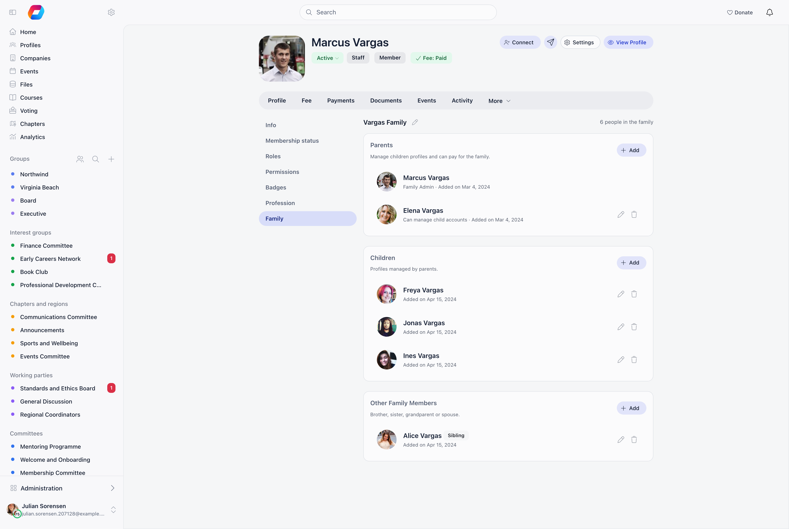

A family is a named record that groups people who belong together: parents and guardians, their children, and other relatives. Each person can be a full member with their own account, or a name-and-email profile held inside the family for people who never sign in.

**Built for** organizations whose membership is household-shaped rather than individual, including scouting and youth organizations, sports clubs, and faith communities that enrol whole families and need to know which adult is responsible for which child.

---

## How to enable

**Settings** → **Modules** → **Users & Profiles** → **Configuration** → **Family & Relationships**. Requires `ADMIN_TENANT`.

| Setting | What it does |
|---------|-------------|
| **Enable Family Members** | Turns on the Family tab and lets you link member accounts into a family |
| **Non-Member Family Profiles** | Allows profiles for relatives who are not members, stored inside the family as a name and an optional email |

Both toggles are switches on the Users & Profiles configuration page. Turning on **Non-Member Family Profiles** alone shows the Family card on the profile but leaves the Family tab empty: the family panel itself renders only when **Enable Family Members** is on.

---

## Where families live

A family appears in two places on a [member's profile](/platform/users/member-profile).

| Where | What you see | Who sees it |
|---|---|---|
| **Family** card on the profile's main tab | A read-only summary: linked members as small photos with their first names (clicking one opens that member's profile in a pop-up), and non-member relatives as a name with their email and phone when one is recorded. An empty family reads "No family members added yet." | The member, and anyone with `HR_LOCAL` for the member's local centre |
| **Family** tab of the profile editor | The full panel for creating the family and adding, editing and removing people | Whoever can edit that profile: the member, `HR_LOCAL` for their local centre, and a parent who can manage that child (see below). Only the member and `HR_LOCAL` administrators can change the family; other editors see it read-only |

The card has a pencil, labelled **Manage** when the family has people and **add** when it is empty. It opens the Family tab. You can also reach the tab from **Profile** → **Edit** → **Family**; old `/users/edit/{id}` links with `?tab=family` still land there.

The card shows linked members only while **Enable Family Members** is on, and non-member relatives only while **Non-Member Family Profiles** is on.

---

## Creating a family

One family per person. A member who is not in a family yet sees **No family yet** and a **Create Family** button, which names the record after them (for example "Maya Marino Family") and makes them the owner. Someone who may not create it sees "No family yet. Contact a national or local administrator to set up your family."

When an administrator creates a family from someone else's profile, Orgo asks what that person's place in it should be: **Parent/Owner** or **Child**. Picking Child creates the family without an owner and adds the person as a child, which is what you want when the responsible adult is not in the system yet.

The family owner or an `HR_LOCAL` administrator can rename the family with the pencil next to its name.

<Note>
Ordinary members can create their own family and can add non-member relatives to it. Adding an existing organization member to a family requires `HR_LOCAL`. Members without that permission see: "For privacy reasons, only chapter or association administrators can add organisation members to a family."
</Note>

---

## Reading the family panel

The panel header shows the family name and a count such as "3 people in the family". Below it are three sections, each with its own **Add** button: **Parents & guardians** ("Manage children profiles and can pay for the family."), **Children** ("Profiles managed by parents.") and **Other Family Members** ("Brother, sister, grandparent or spouse."). A section with no people is still shown, with its **Add** button, to anyone who can manage the family.

Each row shows the person's name, any tags, and a grey line under it.

| On the row | Meaning |
|---|---|
| **You** tag | This row is the person looking at the panel |
| **External** tag | A non-member profile: a name and optional email, no account |
| Relationship tag (**Guardian**, **Grandparent**, **Sibling**, **Spouse**) | Shown only when the row carries one of these more specific relationships. Plain parents, children and "other" rows have no tag |
| **In waitlist** / **In waitlist, underage** tags | The child is on the [Waitlist](/platform/users/waitlist); underage means younger than the Minimum Registration Age |
| **Family Admin** or **Can manage child accounts** | First item of the grey line: the family owner, or a person who may manage the children |
| Email | For non-member profiles, when one was entered |
| `{n} years old` | Calculated from the birthday of a member account |
| **Added on** and a date | When the person joined the family |

A member account's name links to that member's profile. Anyone who can manage the family sees a pencil and a bin on each row, except on their own row and on the owner's row.

---

## Adding people

Each section's **Add** button opens the **Add Family Member** dialog with that section's relationship already chosen.

<Steps>
  <Step title="Pick the relationship">
    Under **Who are they to the family?** choose **Parent** (can manage child accounts), **Child** (account managed by parent) or **Other member** (brother, sister, grandparent or spouse).
  </Step>
  <Step title="Answer 'Is member of {your organization}?'">
    **Yes** opens **Find the member**, a search by name or email over existing member accounts, children included. **No** takes a first name, last name and an optional email, and stores the person as a non-member profile under **Their details**.
  </Step>
  <Step title="Optionally grant child management">
    A **Can manage child accounts** switch appears for member accounts that are not children. Parents receive it automatically.
  </Step>
</Steps>

The button reads **Add Member**. Members without `HR_LOCAL` see the dialog start on **No**, because they can only add non-member profiles; choosing **Yes** shows the privacy message instead of a search. Choosing someone who is already in the family stops with "This user is already a member of the family".

Linking an existing member takes effect immediately. There is no request for the other person to accept.

A person can hold only one non-parent membership across all families. If you add someone who is already a child or sibling elsewhere, Orgo asks: "{name} is already a member of "{family}". Move them to this family?" Moving requires permission on the other family too, and a family owner cannot be moved out of the family they own. Parents and guardians are exempt: a parent of several children legitimately appears in each child's family.

Only an `HR_LOCAL` administrator can link an existing account as a child: parents who want to bring their own child into the family register the child instead (see below).

### Changing a person

The pencil on a row opens **Edit Family Member**. You can change the relationship, turn **Can manage child accounts** on or off, and, for a non-member profile, use **Link to existing account** to attach a real member account to it once that person has joined. Linking an account needs `HR_LOCAL`. Save with **Save Changes**.

---

## Registering a child who has no account

The Family panel adds people who already exist. To create a new child account, a signed-in parent uses the **Add Child to Your Family** page (`/register-child`). It is reached from the chapter map: on a chapter, a signed-in member sees a **Register child** button.

The page asks for the child's first name, last name and an optional email, then the child's details (gender, birthday, chapter, phone, address, and a user type when the waitlist is active), and a confirmation: "I confirm I am the legal guardian or have parental consent". Orgo then:

- Creates an active user account with `accountType` set to `child`
- Records parental consent (date and method) on both the account and the family membership
- Creates the parent's family if they do not have one, adds the parent as owner, and adds the child
- Marks the email as confirmed, since the parent supplied it

<Warning>
The email is optional, but a child registered without one gets a generated placeholder address that cannot receive mail and cannot be used to sign in. Leave it blank only when you want a record, not a login.
</Warning>

If the [Waitlist](/platform/users/waitlist) is active and the child's local centre qualifies, the child goes onto the waitlist instead of straight into the organization. When **Minimum Registration Age** is configured and the child is younger than it, the waitlist entry is flagged **underage** and the child's row in the Family panel shows an "In waitlist, underage" tag next to their name.

---

## What a parent can do for a child

A family owner, or any adult whose row has **Can manage child accounts** switched on, can act for the members who are in that family at **Child** level. For those children they can:

- open the child's profile and edit its details, including the child's email address and custom field answers
- open the child's **Payments** tab, when online payments are enabled
- see the child's waitlist entry

The permission covers only members at Child level in the same family, not other relatives and not other families. It does not give the parent any right over the organization's other members. Parents and guardians without the switch can see the family but cannot edit the children.

---

## Removing people and deleting a family

Anyone who can manage the family can remove others with the bin on a row; you cannot remove yourself, and the owner cannot be removed. Removing someone deletes the family link, not their account.

**Delete Family** is a link at the top right of the panel, offered to the family owner and to `HR_LOCAL` administrators. It appears only once every member except the owner has been removed, and asks for confirmation: "Are you sure you want to delete this family? This action cannot be undone and will remove all family members." If anyone else is still in the family the server refuses with "Cannot delete family with other members. Please remove all members first."

---

## Families and fees

Family membership does not change what anyone pays. Fees are resolved per member. Linking a child to a parent does not transfer, discount, or cover the child's fee, and there is no family price tier. A parent who manages a child can open the child's Payments tab and pay there, but the fee is still the child's. If you need one payer to cover several people, use [Companies](/platform/users/companies) or a fee bundle instead.

---

## Age settings

Two age values exist on the tenant, **Children Auth Restriction Age** and **Minimum Registration Age**, but only the second one has any effect today, and neither is editable from the settings screen: both fields are hidden pending backend enforcement.

- **Minimum Registration Age** is read when a parent registers a child. Below it, the child's waitlist entry is marked underage.
- **Children Auth Restriction Age** does not restrict authentication. It only drives a notification when a young member reaches that age.

<Warning>
Do not rely on these settings for legal age gating. There is no age check on public self-registration: anyone can register regardless of the birthday they enter. If your jurisdiction requires parental consent below a given age (GDPR, COPPA), enforce it in your registration flow and terms.
</Warning>

---

## Common questions

<AccordionGroup>
  <Accordion title="A parent wants to register their 10-year-old">
    The parent signs in and uses the **Register child** button on their chapter in the chapter map, which opens the **Add Child to Your Family** page. The family is created if the parent does not have one, and the child is linked automatically. To link a child who already has an account, an administrator with `HR_LOCAL` adds them from the Family tab.
  </Accordion>

  <Accordion title="Where do I manage my family?">
    Open your profile. The **Family** card shows a summary; its pencil (**Manage**, or **add** when empty) opens the full Family tab, where you create the family and add, edit and remove people.
  </Accordion>

  <Accordion title="Can both parents be linked to the same child?">
    Yes. Add both at parent level in the same family. Parents are not restricted to one family, so a parent already in another family record can be added without being moved out of it.
  </Accordion>

  <Accordion title="Can a member add another member to their family themselves?">
    No. Adding an existing account requires `HR_LOCAL`. Members can add non-member relatives (name and optional email) on their own.
  </Accordion>

  <Accordion title="What can a parent do with a linked child's account?">
    If the parent is the family owner or has **Can manage child accounts** on, they can open the child's profile, edit it (including the email address and custom field answers), open the child's Payments tab and see the child's waitlist entry. The permission is limited to members at Child level in that family. See [What a parent can do for a child](#what-a-parent-can-do-for-a-child).
  </Accordion>

  <Accordion title="Why can I not see the Delete Family link?">
    The link is offered only to the family owner and `HR_LOCAL` administrators, and only once nobody except the owner is left in the family. Remove the other people first with the bin on each row.
  </Accordion>

  <Accordion title="Why is there no pencil or bin on a row?">
    Rows have them only for people who can manage the family, and never on your own row or on the owner's row. Someone without management rights sees the family read-only.
  </Accordion>
</AccordionGroup>

---

## Related

- [Member Profile](/platform/users/member-profile) - the Family card and the other cards on the profile
- [Companies](/platform/users/companies) - one organization paying for many members
- [Waitlist](/platform/users/waitlist) - where underage children are held
- [Registration Form](/platform/users/registration-form) - the birthday field
- [Profile Fields](/platform/users/profile-fields) - what a child profile can store
- [Privacy Settings](/platform/users/privacy-settings) - who can see whom
