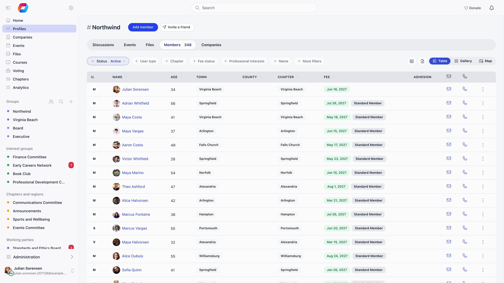
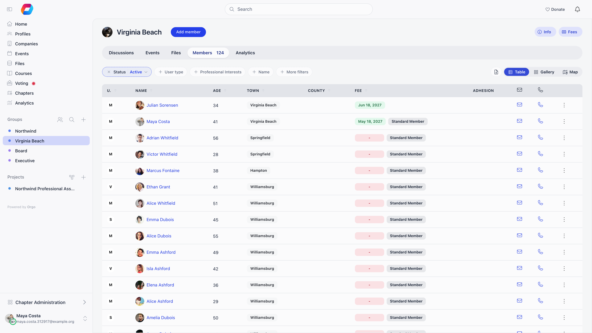
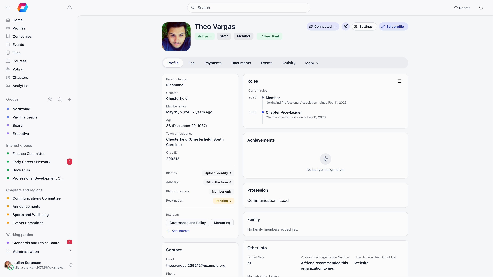
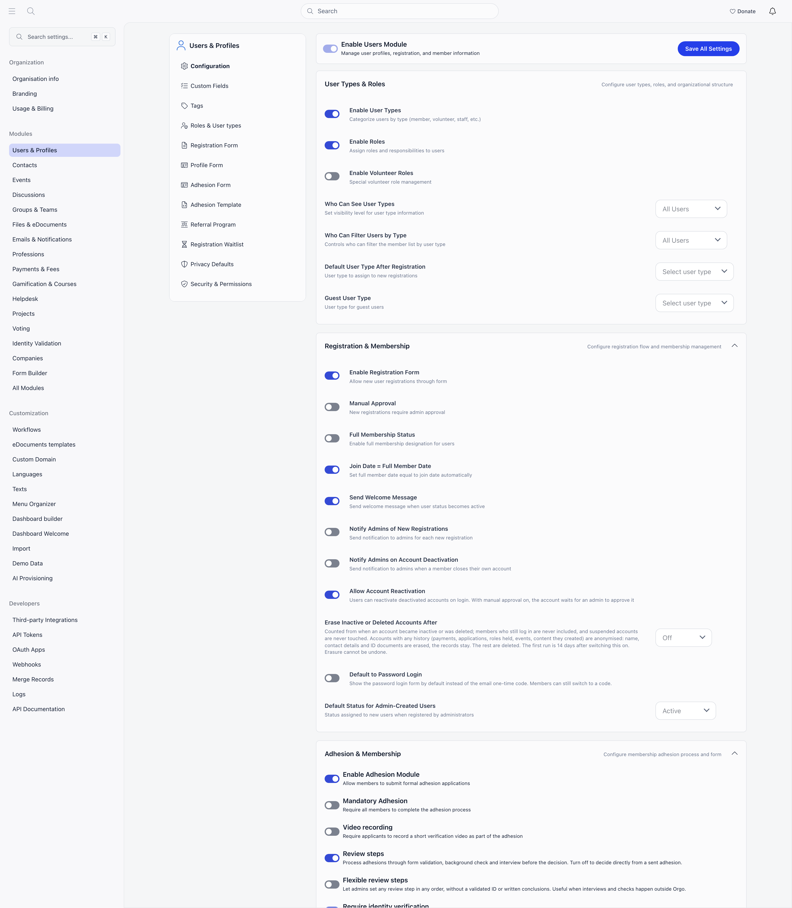

Everything about the people in your organisation lives here: how they join, what
you store about them, how you find them again, and what happens when they leave.

Looking for how to add someone? There are four routes and
[Adding Members](/platform/users/adding-members) compares them: register a member
yourself, invite them, let them sign themselves up, or import a spreadsheet.

---

## The member directory

**Members** in the sidebar lists everyone in your organisation.
**Settings** → **Modules** → **Users & Profiles** → **Who Can See Members in General Groups**
decides who sees it at all: All Users, HR Local, HR Tenant, Admin Local or Admin
Tenant. At an admin level, ordinary members never see the directory.

<Note>
Always reach the directory from the sidebar rather than by typing a URL. The
organisation-wide list lives at `/users?generalUnit=true`; a bare `/users` has no
scope to show and renders an empty page. The same screen shows a single group's
members at `/users?unit={id}`.
</Note>

Three views share the same filters: **Table**, **Gallery** (photo cards) and
**Map**, which plots members who have a town on their profile. The switch sits at
the right end of the filter row. The first time someone opens the
organisation-wide directory on a computer it opens on the map; chapter and group
lists open on the table. On a phone the first view is the table for
administrators and Gallery for everyone else. After that the browser remembers
the last view you picked. In Gallery and Map, **Fullscreen** gives the cards the
whole window.

### Filters

The filter row shows a handful of filters and keeps the rest under **More
filters**; a filter you pick from there stays on the row for the session. Which
ones exist depends on your permissions and on what is switched on. The list opens
filtered to **Active** members, so people with another status stay out of sight
until you change **Status**. **Clear filters** puts everything back.

| Filter | What it matches | Shown when |
|---|---|---|
| **Status** | One member status (see [User Statuses](/platform/users/statuses)) | You manage members of that chapter, or the whole organisation |
| **User type** | One user type | **Who Can Filter Users by Type** (All Users or Admin Tenant) allows you |
| **Country** / **County** / **State** | Country for international organisations, county or state otherwise. County waits until a state is picked where states exist | Organisation-wide and role-group lists; Country only when you have members abroad |
| **Chapter** | Local center | The organisation has local centers |
| **Fee status** | Fee paid, Fee not paid, or Grace period | Fees module on and you manage members organisation-wide |
| Your interests field | The options of the field designated in [Custom Fields](/platform/users/custom-fields#the-interest-field) | That field is set |
| **Name** | Full name, profession headline, company, or role at that company | Always |
| **Age** (under the **More filters** menu) | **Under 18** or **Adults** | **Show Age in Lists** is on and you may see ages |
| **Town** (called **Location** on a phone) | Town of residence | Organisation-wide and role-group lists |
| **Card ID** | Partial match on the member card number | **Enable Card/Member IDs** is on |
| **Profession** | Profession industry | Professions module with industries on |
| Skills, **Availability** | Values from those profile fields | The matching field is enabled |
| **Permissions** | Members holding one or more permissions, grouped Organization, Chapter and Regional | You are an Orgo administrator |
| **Fee type** | A specific membership fee price | Fees module on and you manage members or finances organisation-wide |
| **Full member** | All members, Only full members, or Only not full members | **Full Membership Status** is on |
| **Date joined** | A **From** and **Until** range | You manage members of that chapter, or the whole organisation |

<Note>
**Grace period** only appears when the fee is mandatory, auto deactivation on
expiry is on, and the deactivation delay is more than zero days. It finds members
whose fee has expired but who are still inside that delay.
</Note>

The permission and user-type filters are enforced server side: asking without the
required permission returns access denied, not an unfiltered list.

### Columns, sorting and row actions

Sortable headers: name, age, card ID, town, country or county, chapter, fee date,
status and date joined. Sorting applies to the whole result set, not just the
current page.

Columns are permission-gated rather than chosen:

| Column | Requires |
|---|---|
| Email and phone (copy-to-clipboard icons) | Chapter HR assistant permission |
| Age | Chapter HR assistant permission, and **Show Age in Lists** is on |
| Fee | Chapter HR permission or chapter financial permission, fees module on |
| Adhesion | Chapter HR permission, adhesion on |
| Status | Chapter HR permission, and no status filter active (clear the default **Active** filter first) |
| **Groups**, from the column menu | Chapter HR permission on a chapter list, organization HR permission on the organisation-wide list |
| One column per [custom field](/platform/users/custom-fields), from the column menu | Organization HR permission, or chapter admin permission on the administrator's own chapter list |

The column menu itself (**View columns**, the table icon at the right of the filter
row) needs organization HR permission, or chapter admin permission on your own chapter's list, and it only appears
in the table view, never in Gallery or Map.

Each row's menu holds **View Profile**, **Modify Profile** and **Modify Roles**
(ADMIN_LOCAL and above), plus making or removing a unit admin inside a unit.
**Modify Profile** opens the member's Edit view on the **Info** pane and **Modify
Roles** opens it on the **Roles** pane (see [Member profile](/platform/users/member-profile)).
Members pending approval (**New request**) or waitlisted get **Approve** and **Add
to waiting list** shortcuts next to the name, and a **New requests (N)** button
jumps to that queue. There is no multi-select: actions apply one member at a
time.

### Export and adding members

The Excel icon (**Export CSV**) exports the current filtered, sorted list as CSV. Exports are
paged at 500 profiles: below that you confirm and download, above it you pick
which page, so a large organisation needs several exports. Export needs
Organization HR permission, or chapter HR permission with a chapter selected, and each export is written to the
audit log with the exact query used.

A **Members** report in [Reports](/platform/reports) has no such paging: the
download holds every matching member in one file, however many there are. It
needs organization admin permission and it is built from its own column and filter picker rather
than from the list you are looking at, so the directory export stays the quicker
route for a chapter admin or for the list already on screen.

**Add member** creates an account directly; it needs organization HR permission, or chapter HR permission
for your own local center (and the parent-level permission on a parent chapter's list). The status comes from **Default Status for
Admin-Created Users**, and with an email address supplied the member gets a
welcome message with a login link. For many people at once, use
[Import](/platform/customization/import). **Invite a friend**, next to it, opens the invitation tools: a registration link to share or addresses to email. All four routes side by side:
[Adding Members](/platform/users/adding-members).

---

## Worked example: what a chapter treasurer sees

Permission names on their own do not tell you what lands on screen, because the
directory gates the filters, the columns and the export separately. Here is the
same person, a chapter treasurer holding only chapter financial permission on their own
Chapter, walking through the list.

| What they want | Do they get it | Why |
|---|---|---|
| The **Fee** column | Yes | The fee column asks for chapter financial permission or chapter HR permission |
| Email and phone columns, and age when **Show Age in Lists** is on | Yes | Chapter financial permission implies chapter HR assistant permission, which is what those columns ask for |
| The **Fee status** filter (Paid / Not paid / Grace period) | No | That filter asks for organization HR permission, an organisation-wide permission |
| The **Fee type** filter | No | That filter asks for organization HR permission or organization financial permission |
| The CSV export | No | Export asks for organization HR permission organisation-wide, or chapter HR permission on the chapter being listed |
| The column menu, to add a custom field column | No | The column menu asks for organization HR permission, or chapter admin permission on your own chapter's list |

So a treasurer who needs to work through unpaid members chapter by chapter needs
Chapter financial permission **and** Chapter HR permission on that chapter: Chapter financial permission for the
money, chapter HR permission for the export and the status column. The fee filters are a
bigger step: Organization financial permission unlocks **Fee type** but not **Fee status**, which
only organization HR permission opens, and both reach every chapter in the organisation. Before
widening someone's scope that far, check whether the chapter-scoped screens in
[Local group fees](/platform/local-group-fees/member-fees) already answer the
question they are asking.

Two implications worth remembering for any permission you hand out:

- Chapter financial permission, chapter HR permission and parent-chapter HR permission all imply
  Chapter HR assistant permission, so any of them unlocks contact details. Chapter event manager permission and
  Chapter communication manager permission do not.
- Filters and columns are not the same gate. Seeing a value in a column does not
  mean you can filter or sort a list by it, and being able to read the list does
  not mean you can export it.

---

## The member profile

Clicking a name opens the profile in a modal you can expand to a full page
(`/user/{id}`). The profile is made of cards you read, an **Edit** view where
details, status, roles and permissions are changed, and a **Settings** view for
the member's own account. Everything is documented on one page:
[Member profile](/platform/users/member-profile).

Clicking a name opens the profile in a window you can expand to a full page
(`/user/{id}`).

### The header

Under the photo and name, a row of chips shows where the member stands:

- **Status.** Whoever may manage the member's access can click it to open the **Permissions** pane of the editor. Members waiting for a decision also get **Approve** and, for new requests, **Add to waiting list** buttons next to it.
- **User type**, when user types are on.
- **Fee: Paid** or **Fee: Unpaid**, which jumps to the **Fee** tab.
- A completion percentage, on your own profile only, while **Profile Completion Enabled** is on and you are below 100%. Open it to see which fields are missing and click one to go to it.
- **Supporter**, for members on your supporter plan.

On the right, **Edit profile** (it turns into **View Profile** while you edit) and **Settings** open the two panes described below, **Send an email** writes to the member, and on someone else's profile with connections on, **Connect** sends a connection request.

### The Profile tab

The Profile tab is a set of cards. The pencil on a card opens the editor at the matching section.

| Card | What is there | Who sees it |
|---|---|---|
| The top card, which has no title | Chapter and parent chapters, **Member since** (the full-member date) or, for organisation-wide HR, **Registered on**, age, **Town of residence**, **Hometown**, card ID, the main-info [custom fields](/platform/users/custom-fields), then status rows for **Promise**, **Trainer**, **Identity**, **Fee**, **Adhesion**, **Platform access** (permission levels) and **Resignation**, then **Interests** | Everyone who can see the profile; the status rows follow the permissions of the module behind each |
| **Contact** | Email, phone, website and social links, **Bio**, **Address**, **Postal code**, **Billing Details** | Address and postal code: the member and HR over their chapter |
| **Company** | The company the member belongs to | Companies module on and the member belongs to one |
| **About** | **Skills**, **Availability** | When those fields are enabled |
| **Tags** | The tags on the member | Organisation-wide HR |
| **Roles** | Current roles with a **Timeline per role** | The member, or whoever **Who Can See User Types** allows; **Manage roles** for HR |
| **Membership level** | Points-based tier | When gamification tiers are on |
| **Achievements** | Badges earned, progress and activity | When gamification is on |
| **Profession** | Headline, industry, expertise, job, sector, organisation and role | When the Professions module is on |
| **Courses & trainings** | Trainings attended and courses taken | The organisation runs trainings, and the member has some to show |
| **Family** | Family members | Family members on, and you are the member or chapter HR permission over them |
| **Other info** | Every other [custom field](/platform/users/custom-fields) the member filled in, plus required ones left empty (shown as a dash) | Subject to each field's visibility |

### Tabs

Which tabs appear depends on modules, permissions and whose profile it is.

Which tabs appear depends on modules, permissions and whether the profile is
your own:

| Tab | What is there | Who sees it |
|---|---|---|
| **Profile** | Cards: membership, contact, company, about, tags, roles, achievements, profession, courses & trainings, family, other info | Everyone who can see the profile |
| **My Network** | Connection requests and accepted connections | Own profile, connections enabled |
| **Fee** | Fee level, periods and history | Self, HR_LOCAL, FINANCIAL_LOCAL, or a parent managing the profile |
| **Payments** | Every payment: fees, tickets, donations | Same as Fee, online payments enabled |
| **Documents** (**Files** when e-Documents are off) | Contracts and documents that need a signature, above the member's personal files | Self, HR_LOCAL, or a managing parent; personal files also for HR_TENANT and ADMIN_TENANT |
| **Events** | Events attended or registered for | Self, HR_LOCAL or EVENT_LOCAL |
| **Referrals** | People they referred or invited | Referral or invitations enabled. On someone else's profile it is under **More**. |
| **[Activity](/platform/users/profile-activity)** | Staff notes, donations, form submissions and tag changes on one feed | HR_LOCAL or FINANCIAL_LOCAL over that member, with **Enable Profile Notes & Activity** on |
| **More** | **Forms** (HR_LOCAL or FINANCIAL_LOCAL), and **Email Logs** and **Audit Logs** (ADMIN_TENANT) | Staff |

There is no separate edit page and no separate **Company** or **e-Documents**
tab any more: the company is a card on the Profile tab, and the documents live in
the **Documents** tab. A link to the old `/users/edit/{id}` address redirects to
the matching pane of Edit or Settings.

## Setting up

<Steps>
  <Step title="Design your registration form">
    Start minimal: you can collect more later.
    [Registration form](/platform/users/registration-form)
  </Step>
  <Step title="Create user types, if you need them">
    Use these when members fall into categories that behave differently, such as
    Scout and Leader. Each type can have its own registration form.
    [User types](/platform/users/user-types)
  </Step>
  <Step title="Decide whether signups need approval">
    Turn on **Manual Approval** to review each one from the directory.
    [Statuses](/platform/users/statuses)
  </Step>
  <Step title="Configure profile and custom fields">
    [Profile fields](/platform/users/profile-fields) ·
    [Custom fields](/platform/users/custom-fields)
  </Step>
  <Step title="Set privacy defaults">
    Members can restrict themselves further, never less.
    [Privacy settings](/platform/users/privacy-settings)
  </Step>
  <Step title="Assign permissions before you open registration">
    [Permissions](/platform/permissions)
  </Step>
</Steps>

All of this lives under **Settings** → **Modules** → **Users & Profiles** and needs
Organization admin permission to edit. The left sub-navigation also holds Custom Fields, Tags,
Roles & User types, the Registration and Profile forms, the Referral Program,
Privacy Defaults and Security & Permissions. Entries appear only for what is
switched on, so the Adhesion form, the Adhesion template and the Registration
Waitlist are absent until those modules are active.

---

## Choosing what to turn on

| If you want to | Turn on |
|---|---|
| Review every application before admitting people | [Adhesion](/platform/users/adhesion) |
| Queue people when membership is full or closed | [Waitlist](/platform/users/waitlist) |
| Let members bring in others | [Invitations](/platform/users/invitations) and [Referral](/platform/users/referral) |
| Verify who someone is | [Identity Validation](/platform/identity-validation) |
| Support families with children | [Family Members](/platform/users/family-members) |
| Track why people leave | [Resignation](/platform/users/resignation) |
| Support the GDPR right to erasure | [Account Deletion](/platform/users/deletion-of-account) |
| Clean up duplicate records | [Merging duplicates](/platform/users/merging-duplicates) |

---

## Troubleshooting

<AccordionGroup>
  <Accordion title="A member cannot log in">
    Start with their status: Inactive, Suspended, New request (still awaiting
    approval) and Unconfirmed email all block access. Full elimination sequence in
    [Troubleshooting member access](/platform/users/troubleshooting-access).
  </Accordion>

  <Accordion title="I need new information from existing members">
    Add the field in [Profile Fields](/platform/users/profile-fields) and mark it
    required. On their next visit, members with missing required fields are
    redirected to an onboarding screen that lists exactly what is missing.

    That redirect only knows about a fixed set of fields: first name, middle name,
    last name, date of birth, gender, phone, address, town born, town current, and the
    Facebook, Twitter, LinkedIn, Instagram, Telegram and TikTok links, plus any
    custom field. Marking anything else required, in particular **Bio**,
    **Personal identification number**, **Postal code**, **Website**, **Location on members map**, the three
    **Profession** fields or any of the company fields, still marks it required
    on the profile form, so a member who opens that form cannot save without it.
    What it does not do is trigger the prompt, so nobody is ever sent there and
    the field quietly stays empty for everyone who does not edit their profile.
    If one of those is what you actually need, collect it with a
    [custom field](/platform/users/custom-fields) instead, which the prompt does
    check.
  </Accordion>

  <Accordion title="Members see photo cards or a map instead of the table">
    Nothing is missing. The view switch at the right end of the filter row moves
    between **Table**, **Gallery** and **Map**, and the browser remembers the
    last one you picked. On a computer the organisation-wide directory opens on
    the map the first time, and chapter or group lists open on the table. On a
    phone the first view is Gallery for everyone except Orgo administrators. If a
    colleague says a column is missing, first check that they are looking at the
    table, since **View columns** is only offered there.
  </Accordion>

  <Accordion title="A colleague sees fewer columns than I do">
    Columns are not a shared setting. Each one is gated on the permission in the
    table above, evaluated per person and, for chapter permissions, per chapter.
    Turning a column on from the column menu changes what you see, not what your
    colleagues see.

    The two that surprise people most: email, phone and age need
    Chapter HR assistant permission, which chapter HR permission, parent-chapter HR permission and
    Chapter financial permission all imply but chapter event manager permission and chapter communication manager permission do
    not; and the custom-field columns need organization HR permission, or chapter admin permission while
    looking at their own chapter's list, so a chapter secretary holding only
    Chapter HR permission does not get them.
  </Accordion>

  <Accordion title="The Excel export button is missing">
    Export is gated separately from reading the list. On the organisation-wide
    list it needs organization HR permission. On a chapter's list it needs chapter HR permission on that
    Chapter. Chapter financial permission, chapter admin permission and chapter HR assistant permission are not
    enough, even though all of them can read the list and some of them see more
    columns than the export contains.

    A chapter secretary who has chapter HR permission but still sees no button is usually
    on the organisation-wide list rather than their chapter's. Pick the chapter
    in the **Chapter** filter first.
  </Accordion>

  <Accordion title="The New requests button never appears">
    Five conditions have to hold at once: **Manual Approval** is on, you hold
    Chapter admin permission, you are looking at either your own chapter's list or the
    organisation-wide list with organization HR permission, at least one request is waiting, and
    you are not already filtering by the Unapproved status. The last one catches
    people out: the button hides once you are in the queue it would take you to.

    Chapter HR permission alone does not show the button. The **Approve** and **Add to
    waiting list** shortcuts on the row are a separate gate and do appear for
    Chapter HR permission, because approving somebody is an ordinary status change and asks
    for chapter HR permission over that member's chapter. So a chapter secretary can approve
    people one at a time from the list; what they do not get is the button that
    jumps them to the queue.
  </Accordion>

  <Accordion title="Someone can see the Members link but the page is empty or refuses them">
    Sidebar entries and page permissions are configured in two different places
    and can disagree. Each entry in the sidebar carries its own permission, set
    in **Settings** → **Customization** →
    [Menu Organizer](/platform/customization/menu-organizer), while what the
    Members page shows is decided by **Settings** → **Modules** → **Users & Profiles** →
    **Configuration** → **Who Can See Members in General Groups**. Set the menu
    entry more generously than that setting and people see a link that leads to
    an empty page.

    Fix it at whichever end reflects your intent: raise the menu entry's
    permission to match the visibility setting, or lower the visibility setting
    if the members really should see the directory. Do not assume a hidden link
    means a protected page, or that a visible link means an accessible one.
  </Accordion>

  <Accordion title="Where did the Edit member page go?">
    Editing happens on the profile itself. Open the member, press **Edit profile**
    (or the pencil on any card) and pick a pane: **Info**, **Membership status**,
    **Roles**, **Permissions**, **Badges**, **Profession** or **Family**. The
    member's own account (password, email, privacy, closing the account) is the
    **Settings** view. Old `/users/edit/{id}` links still work and redirect.
    Details and the old-tab-to-new-pane table are in
    [Member profile](/platform/users/member-profile).
  </Accordion>

  <Accordion title="Where do I end a role or change a member's status?">
    Both are in the Edit view: **Edit profile** → **Roles** → **End role**, and
    **Edit profile** → **Membership status** → **Status**. See
    [Member profile](/platform/users/member-profile#roles-and-the-role-timeline).
  </Accordion>
</AccordionGroup>

---

## Related

- [Member profile](/platform/users/member-profile) - the header, cards, Edit view, Settings view and role timeline
- [Adding Members](/platform/users/adding-members) - the four ways people get an account
- [Lists & Segments](/platform/users/lists) - reusable audiences built from member criteria
- [User Statuses](/platform/users/statuses) - what each status blocks
- [Permissions](/platform/permissions) - who can do what
- [Custom Fields](/platform/users/custom-fields) - data Orgo does not ship with
- [Contacts](/platform/contacts) - people who are not members
